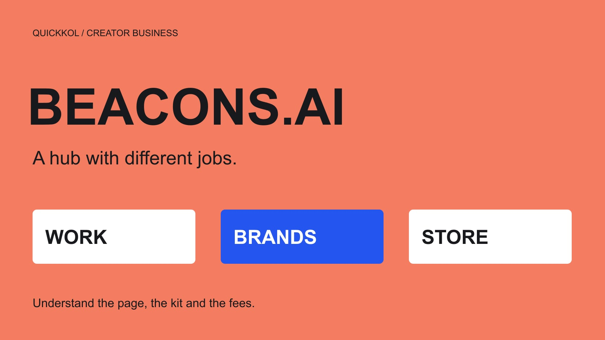
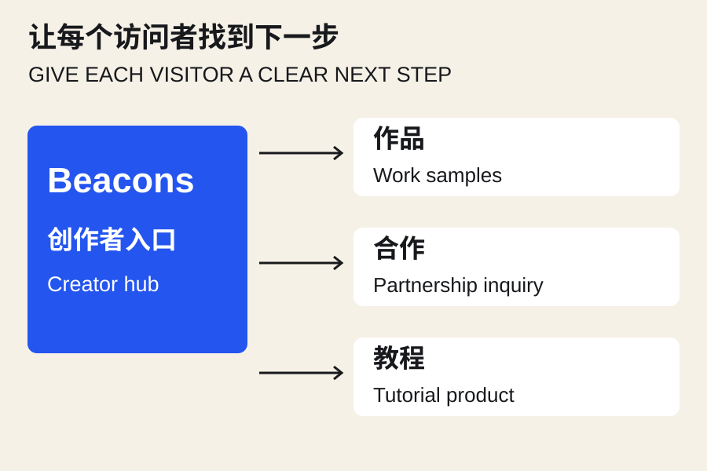

# What Is Beacons.ai? A Creator Partnership Guide

Understand Beacons’ link page, store, email and media-kit tools, and where they fit in a creator partnership.

> Draft date: November 23, 2026; independent local preview only.

Beacons.ai is a creator-business tool platform connecting functions such as link-in-bio pages, a store, email and a media kit. Creators can use it to receive audience visits and partnership inquiries; brands can use a shared page to understand work and potential collaboration terms. It serves a different role from discovering new creators for a brand. An automatically updating media kit also does not make every displayed figure independently audited.

## What part of creator work it supports

[Beacons’ official product explanation](https://help.beacons.ai/en/articles/4806401) describes link pages, email, a store and data functions. This article focuses on organizing visits and partnership interest after a creator already has work and an audience. The provider’s description is not presented as a performance result from our own product test.

A creator may want viewers to watch demonstrations, explore a course and find a business contact. Repeatedly replacing one biography link can send different visitors to the wrong destination. A clearly organized hub can serve those intentions, although more links do not automatically make the experience better.

List the two or three tasks that currently matter, distinguishing audience purchases, reading or viewing work, and brand inquiries. Then choose the necessary modules. A feature’s availability is not a reason to publish an empty store or a service the creator cannot deliver. The useful starting point is the visitor’s task, not a catalogue of every tool in the subscription.

## A media kit organizes information, with source limits

[Beacons’ media-kit explanation](https://beacons.ai/i/app-pages/media-kit) says supported social connections can populate and refresh statistics, with available metrics and refresh timing depending on the platform and connection. Manually entered rates and campaign descriptions remain as the user sets them. Not every sentence on the page is therefore a synchronized data point.

A brand reviewing a kit should distinguish account identity, date and metric definition, work samples and creator-entered conditions. Ask about the denominator if an engagement rate is unexplained. If a case description lacks a publication link, do not infer either authenticity or campaign effectiveness from the description alone.

The kit can begin a substantive discussion without replacing the rest of the research. The [creator reporting and evidence memo guide](/blog/influencer-reporting-decision-memo-and-evidence/#answer) helps separate observed material from open questions. This is not a finding that Beacons statistics are unreliable. It identifies the difference between automated updating and independent verification, while preserving the practical value of an organized introduction.

## Read the current pricing basis

[Beacons’ current pricing page](https://beacons.ai/i/pricing), reviewed on November 23, 2026, lists monthly Free, Creator, Creator Plus and Creator Max plans at US$0, US$10, US$30 and US$100. It lists a 9% seller fee for Free and Creator and 0% for Plus and Max, while noting that payment-processing fees may still apply.

These are provider-disclosed figures at the review date, not permanent pricing or the final tax-inclusive bill in every region. Do not reuse a conflicting plan amount from an older help article, or interpret a 0% platform seller fee as a promise that transactions have no other costs.

Compare the functions actually required, expected transactions, domain and email needs before estimating total cost. If the task is sharing work and partnership information, an upgrade needs a practical reason. A more expensive plan does not establish professional suitability. Check checkout and applicable terms before purchasing, including whether the displayed billing period matches the comparison.

## Example: organize three destinations for a home creator

Imagine a home-content creator preparing for brand partnerships. The first layer could offer three destinations: work samples, partnership information and an original tutorial product. This is an editorial example, not a default Beacons interface or an actual creator account. Each destination should lead to available material rather than reopening the same homepage.

Work samples show the ability to explain. Partnership information identifies subjects, language, suitable assignments and a business contact. The tutorial destination explains the actual product. A brand visitor should not have to enter a purchase flow to find a contact, and an audience member should not mistake a business quotation for a consumer product.

Open the public link on a signed-out phone before sharing it. Check wording, destinations, readability and the contact route. Do not label an entry complete data when it merely requests access to material not yet prepared. Public wording should describe something the visitor can actually obtain.

A hypothetical information structure, not a screenshot of the Beacons interface.

## Give a partnership inquiry a clear next step

A business page can ask a brand to describe category, market, intended deliverable, timing and contact information. The creator can then judge whether a conversation is worthwhile. Do not require a complete customer list or sensitive budget detail on first contact, and do not add fields merely because a form allows them.

The [brand-partnership content-governance guide](/blog/brand-partnerships-joint-content-governance/#answer) supports the next discussion about scripts, factual review, revisions and use rights. An example rate in a media kit starts a conversation; different quantities, deadlines and permissions can produce different final terms.

If email tools are used, confirm applicable requirements and choices for collecting and using addresses. A visit does not automatically express subscription intent. Sharing a kit with a brand should not be treated as permission for unlimited promotional messages either. Completing the intended contact task is more useful than maximizing a list without understanding what those people agreed to receive.

## A narrowly scoped fee illustration

Suppose a creator compares the US$10 and US$30 monthly plans and considers only the listed 9% versus 0% seller fee. The subscription difference is US$20. In a purely mathematical example where all other conditions are identical and every included transaction attracts that fee, 20 divided by 9% is approximately US$222.22. This compares one fee component; it is not an upgrade recommendation.

Payment processing, refunds, taxes, functions and settlement conditions still affect a real choice. Do not turn the example into a net-income forecast. Even above that transaction amount, check which sales or commissions actually fall within the fee’s scope rather than assuming all income has identical treatment. A creator using only a media kit may have no relevant store transactions at all. In that case the example does not determine a suitable plan, and the decision returns to the functions the creator needs.

## When it fits, and when another tool is needed

Beacons is worth researching when the task is organizing a creator’s destinations, presenting partnership information or receiving interest in an owned product. If a brand needs to find creators it does not yet know, discovery and candidate research remain separate work. The tools can be used in sequence without claiming one replaces the other.

[QuickKOL’s product explanation](https://www.quickkol.com/) provides discovery and research from a stated need. After identifying a candidate, a brand can read a voluntarily shared Beacons page, inspect actual publications and ask about terms. This is not a promise of importing private Beacons information automatically into QuickKOL.

For the creator, make the existing page complete one clear task before expanding it. Three destinations that audiences and brands understand can support a partnership more effectively than a dozen unexplained buttons. A useful hub is judged by whether the intended visitor reaches the right information, not by how many modules appear on screen.

## Monthly plan snapshot

Reviewed November 23, 2026. Payment-processing fees may apply separately; confirm current entitlements and final checkout cost.

| Plan | USD/month | Listed seller fee |
| --- | --- | --- |
| Free | 0 | 9% |
| Creator | 10 | 9% |
| Creator Plus | 30 | 0% |
| Creator Max | 100 | 0% |

## Next step

Find suitable people, then review the work and business information they share.

[Research creators with QuickKOL](https://www.quickkol.com/)

## Sources and scope

Sources reviewed November 23, 2026 using accessible public material. No user account was signed into or changed. Editorial examples are not client outcomes; confirm features in the intended account.

- [Beacons’ official product explanation](https://help.beacons.ai/en/articles/4806401)
- [Beacons’ media-kit explanation](https://beacons.ai/i/app-pages/media-kit)
- [Beacons’ current pricing page](https://beacons.ai/i/pricing)
- [QuickKOL’s product explanation](https://www.quickkol.com/)
