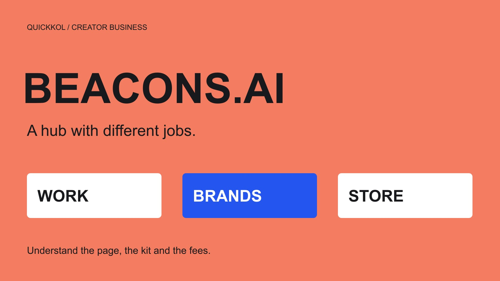
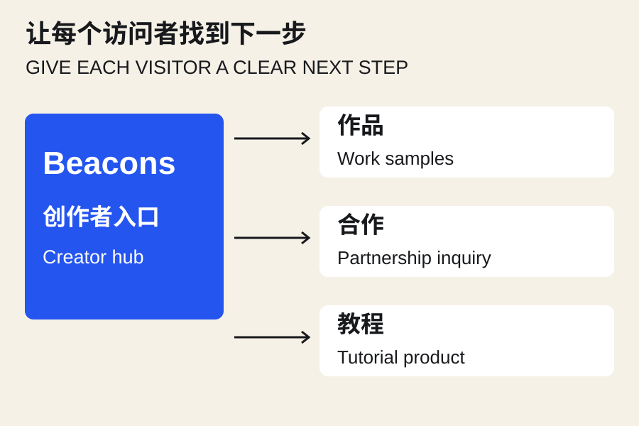

# Beacons.ai 是什么，怎样用于达人合作

了解 Beacons 的链接页、商店、邮件与媒体资料功能，判断它怎样承接达人合作。

> 草稿日期：2026年11月23日；仅独立本地预览。

Beacons.ai 是面向创作者的业务工具平台，可把链接入口、商店、邮件与媒体资料等放在相关工作流中。达人可以用它承接观众和合作询问；品牌可以把分享的页面作为了解作品与合作条件的入口。它与替品牌发现新达人的研究工具不同，也不能因为一份媒体资料自动更新，就把所有数字视为独立审核通过。

## 它解决创作者哪一段工作

[Beacons 官方产品解释](https://help.beacons.ai/en/articles/4806401)介绍了链接页、邮件、商店与数据等能力。本篇关注的是创作者已有观众和作品之后，怎样把访问与合作意向带到合适位置，不把产品自述写成我们亲自测试的效果。

一位创作者可能同时希望观众查看演示作品、了解自己的课程，并让品牌找到业务联系。如果只在简介里反复更换唯一链接，读者容易进入错误页面。一个组织清楚的入口可以承接这些不同意图，但链接越多不一定越好。

先列出当前最重要的两三种任务，区分观众购买、作品阅读与品牌联系。再决定页面需要哪些模块。不要因为工具有某项能力，就在没有真实交付内容时把它全部打开。

## 媒体资料能集中信息，但仍需读懂来源

[Beacons 媒体资料功能说明](https://beacons.ai/i/app-pages/media-kit)介绍，支持的社交连接可以自动填入和更新部分数据，具体指标与刷新时间取决于平台和连接；手动填写的报价与合作描述仍由用户设定。由此可见，不能把页面所有文字都当成同步数据。

品牌查看资料时，分别记录账号身份、数据时间与口径、作品示例和创作者自己填写的条件。若某个互动率没有说明分母，就向对方询问；若某项案例没有作品链接，就不要自行推断其真实性或效果。

媒体资料应帮助双方开始有内容的讨论，而不是替代全部研究。[达人报告与证据备忘指南](/zh/blog/influencer-reporting-decision-memo-and-evidence/#answer)可以帮助品牌把观测资料和待确认事项分开。这里没有认定 Beacons 数据不可靠，而是说明自动更新与独立验证并非同一件事。

## 按当次价格页理解费用

[Beacons 当前价格页](https://beacons.ai/i/pricing)在2026年11月23日显示，按月计费的 Free、Creator、Creator Plus、Creator Max 分别为0、10、30、100美元。页面对 Free 与 Creator 列出9%卖家费，对 Plus 与 Max 列出0%，并说明支付处理费用仍可能适用。

这些是提供方当次页面信息，不是永久价格或所有地区最终含税账单。不要沿用旧帮助文章中与当前价格页不一致的套餐数字，也不要把0%平台卖家费理解成交易完全没有其他成本。

比较套餐时，先确认需要的具体功能、预计交易、域名与邮件需求，再看总费用。若只是分享作品和合作资料，升级理由应来自真实需求，不应为了看起来更专业而买用不到的模块。购买前仍需查看结账页与适用条款。

## 示例：为家居创作者整理三个入口

假设一位家居创作者准备接受品牌合作，可以把页面第一层组织为“看作品”“合作资料”“购买自有教程”。这是本文编辑示例，不是 Beacons 默认界面或真实创作者账号。每个入口都应到达已经可用的内容，而不是重复打开同一首页。

作品入口放能显示讲解能力的内容；合作资料说明常做的题材、语言、适合的任务与业务联系；自有教程入口清楚写产品包含什么。品牌访问者不用穿过购买流程才找到联系方式，普通观众也不会误把业务报价当成消费产品。

发布前用未登录的手机打开公开链接，检查文字、点击目标、页面可读性和联系路径。不要在链接标签写“完整数据”，实际却要求访客另行申请一份未准备好的资料。对外承诺应与页面里真实存在的内容一致。

假设页面组织方案，不是 Beacons 真实界面截图。

## 合作询问需要明确下一步

业务页面可以先让品牌说明品类、市场、预期作品、发布时间与联系信息，再由创作者判断是否值得继续。不要要求对方在第一次联系就上传完整客户名单或敏感预算明细，也不必为了增加表单字段而增加阅读负担。

[品牌合作内容治理指南](/zh/blog/brand-partnerships-joint-content-governance/#answer)有助于继续约定脚本、事实审核、修改与使用范围。媒体资料中的示例报价只是讨论起点，具体作品数量、期限和授权不同，最终条件也可能不同。

如需邮件功能，先确认收集与使用地址的适用要求和用户选择。页面访问不自动代表订阅意愿，给品牌分享媒体资料也不应被解释成同意接收无限推广邮件。把联系任务做清楚，比单纯追求更多地址更有价值。

## 一个只考虑已列费用的算例

假设创作者比较每月10美元与30美元两档，只看页面列出的9%与0%卖家费，差额订阅费为20美元。在其他条件完全相同、交易均适用该费用的纯数学示例中，20÷9%约为222.22美元。这只是比较某一费用项的计算，不是升级建议。

实际选择还受支付处理、退款、税费、功能与结算条件影响；不能把这个示例写成净收入预测。即使某月超过这个交易额，也需检查具体收费范围，不能假定全部收入都适用同一费率。

## 何时使用，何时另找工具

当主要任务是整理自己的入口、向品牌展示资料或承接自有产品时，Beacons 值得按具体需求研究。若需要的是替品牌寻找尚未认识的达人，就要另外完成发现与候选研究。两者可以先后使用，不必把其中一个描述成另一个的替代。

[QuickKOL 官网能力说明](https://www.quickkol.com/)提供按需求寻找与研究达人的入口。品牌找到候选后，可以读取对方自愿分享的 Beacons 页面，再查看实际作品和询问合作条件；这不是把 Beacons 私有资料自动导入 QuickKOL 的承诺。

对创作者而言，先让现有页面完成一个明确任务，再逐步扩展。能被观众和品牌理解的三个入口，比十几个不知道通向哪里的按钮更能支持合作。

## 当次按月套餐概览

核验日2026年11月23日。支付处理费用可能另计，权益与最终费用以当前购买页为准。

| 套餐 | 美元/月 | 页面卖家费 |
| --- | --- | --- |
| Free 套餐 | 0 | 9% |
| Creator 套餐 | 10 | 9% |
| Creator Plus 套餐 | 30 | 0% |
| Creator Max 套餐 | 100 | 0% |

## 下一步

找到适合合作的人，再阅读对方分享的作品与商业资料。

[在 QuickKOL 研究达人](https://www.quickkol.com/)

## 来源与范围

资料核验于2026年11月23日，基于可读取的公开来源。未登录或修改用户账号；编辑示例不代表真实客户结果，平台功能以实际账号为准。

- [Beacons 官方产品解释](https://help.beacons.ai/en/articles/4806401)
- [Beacons 媒体资料功能说明](https://beacons.ai/i/app-pages/media-kit)
- [Beacons 当前价格页](https://beacons.ai/i/pricing)
- [QuickKOL 官网能力说明](https://www.quickkol.com/)
