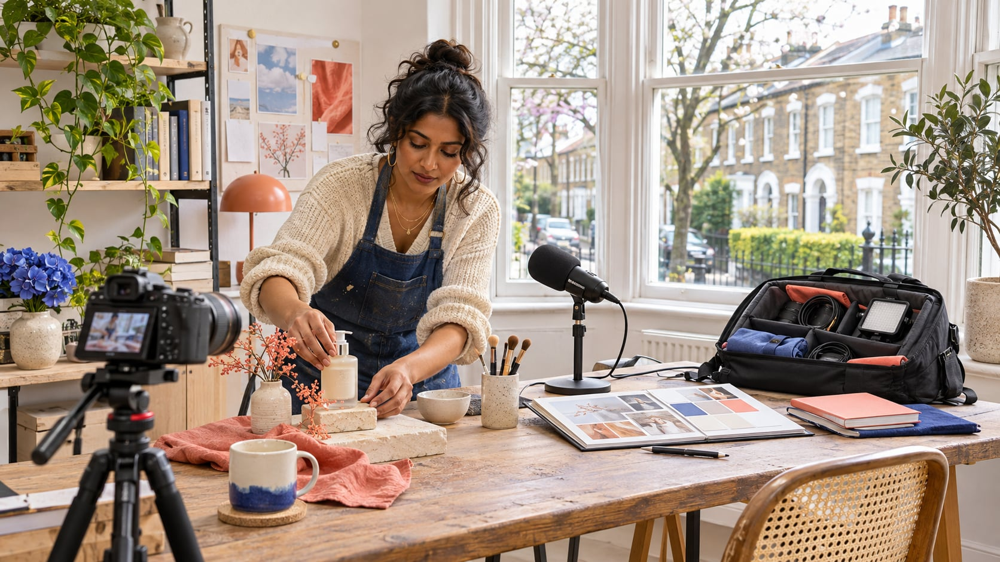
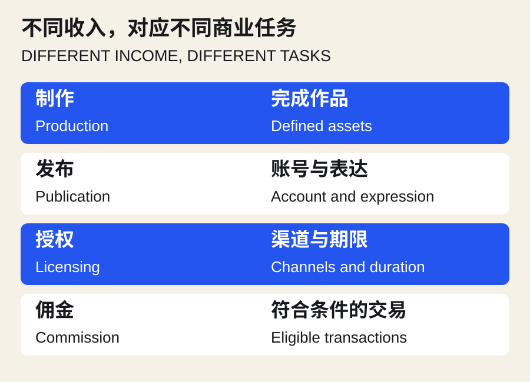

# Diversified Creator Income in London: Brand Work

For London creators and commissioning brands, separate production, publication, licensing and affiliate income into workable partnership terms.

> Draft date: November 23, 2026; independent local preview only.

Diversified creator income in London can involve different commercial tasks: producing content, publishing to an owned audience, licensing work to a brand, earning affiliate commissions, and selling an original product or service. These are not five income streams every creator necessarily has, and one influencer rate cannot describe them all. A commissioning brand should identify the work, rights and timing it wants before discussing price, rather than estimating someone’s income from their follower count.

## Begin with the kind of work in London

[UAL’s London creator-hiring guide](https://www.arts.ac.uk/students/student-careers/stories/how-to-hire-a-content-creator-in-london) distinguishes content roles and working arrangements. Its useful contribution here is not a public rate band treated as a universal standard, but the distinction between production, employment, freelance work and publication to an audience. Published on October 29, 2026, it does not establish an individual London influencer’s take-home income.

A London commission may also involve studio access, travel, location conditions, weather and filming time. Somebody based in London does not necessarily reach a mainly London audience, and local filming capability does not make their audience suitable for every local brand. Keep work location, content language, setting and authorized audience information as separate research fields.

For a demonstration film on the brand’s own channels, investigate production and explanation skills first. If publication on the creator’s account is also required, examine audience and expressive fit. Both tasks may involve filming, but that does not make their prices, responsibilities or deliverable conditions interchangeable.

## Production fees pay for defined creative work

Production income pays for planning, filming, explanation, editing and other actual creative work. Specify the number of assets, formats, settings, revision rounds and acceptance method. Two vertical demonstrations with one principal setting each are different from two filming days intended to capture every potentially usable asset.

Creators need to allow for preparation, communication, filming, post-production and delivery. Brands should provide accurate material and workable feedback deadlines. Extra settings, reshoots or additional language versions require a scope discussion; a content package should not imply unlimited creative time.

A useful quotation separates production from additional expenses and explains how props, talent, locations and travel are handled. This is a way to make the purchase intelligible, not a recommended universal tariff. Assess whether the agreed work was delivered before treating organic viewing as the acceptance condition. A completed production task can be evaluated separately from a later publication’s uncertain distribution.

## Publication and licensing purchase different things

Publication on a creator’s account involves their expression, audience relationship, schedule and commercial-content arrangements. Licensing the work to a brand concerns purpose, channels, duration, territory and editing permissions. One publication does not automatically grant permanent ownership, and receiving a video file does not automatically include paid-advertising rights.

A brand could request one creator-account publication and three months of organic reposting on specified brand social accounts, then discuss advertising, website use, offline display or further editing separately. That is a hypothetical way of expressing scope, not a default contract clause or a right automatically supplied by a platform.

The [brand-partnership content-governance guide](/blog/brand-partnerships-joint-content-governance/#answer) helps allocate factual review and revision responsibilities. Keeping the rights and expiry visible gives creators a clear basis for a later renewal conversation. It also prevents brand colleagues from assuming that possession of a file permits unlimited reuse. Publication and licensing may be bundled commercially, but the agreement should still explain the separate permissions. Neither should disappear inside an undefined line called content usage.

## Affiliate income depends on transaction terms

Affiliate compensation is connected to transactions or actions defined by the particular program. Commission rate, eligible orders, attribution window, returns, payment conditions and currency all affect the eventual amount. A public link or discount code does not establish that the creator has earned income.

Suppose a hypothetical program pays 8% on qualifying sales that remain valid, and £600 qualifies within a stated window. The illustrative commission is £48. Returns or excluded transactions can change it. Neither the percentage nor the sales figure is a London market benchmark, a platform rate or an earnings promise.

A commission can sit alongside a production fee, provided both sets of conditions are explicit. The fee compensates defined work; the affiliate component retains transaction uncertainty. Do not describe an uncertain commission as guaranteed production income, or ask the creator to take all sales risk before the program rules are available. The parties also need to know when a provisional transaction becomes payable and who supplies the supporting record.

These are commercial arrangements, not personal income forecasts. The 8% rate and £600 sales example are hypothetical.

## Owned products and services need delivery capacity

[Mastercard’s 2026 creator research](https://www.mastercard.com/content/dam/mccom/shared/news-and-trends/stories/2026/creator-economy-research/Dreamonomics_Content-powered%20businesses_November%202026.pdf) distinguishes content as the business product from content supporting another core business, and discusses several revenue channels. This guide uses those categories qualitatively. It does not turn a global study into average London creator earnings or a local allocation of income by channel.

Creators may consider courses, templates, memberships, events or specialist services, but every model requires delivery. A successful sponsorship does not establish willingness to pay repeatedly, and follower totals are not purchase demand. Define what can actually be provided before choosing a store, customer-support process or after-sales arrangement.

A brand commissioning such a creator should examine compatibility with that existing business. Someone who teaches may be better suited to a public demonstration or joint workshop than an agreement excluding an entire category for a long period. Partnership design should acknowledge the person’s business structure, instead of treating the account as advertising space alone. Revenue variety is useful only when the underlying commitments remain deliverable.

## Check a hypothetical mix against available time

Imagine a London lifestyle creator planning two brand-production projects, one account publication, a small workshop and maintenance of affiliate content within a month. No earnings figure is invented for that person. Put preparation, filming, revision and delivery time for every task on the calendar before deciding whether diversification is operationally realistic.

If two brands require script approval on the same day, or a commission needs a reshoot during the workshop, the plan must change. Reduce deliverables, move a new project or agree workable approval deadlines. Do not assume preparation time can compress indefinitely. More revenue categories do not automatically spread the workload.

Keep contracted amounts, invoiced amounts and received payments separate. Pending affiliate transactions should not occupy the same available-income field as a paid production fee. This is a project-management example, not personal tax or investment advice. It does not suggest that a hypothetical mix covers London living costs or guarantees a sustainable business. Those questions require the person’s actual circumstances and records.

## Make the commercial relationship understandable

[ASA’s 2026 influencer-advertising guide overview](https://www.asa.org.uk/resource/influencers-guide.html) covers disclosure questions involving UK creators, brands, agencies and affiliate relationships. For a London commission, make the benefit, the commercial arrangement and the audience’s ability to recognize advertising clear. A general statement in a profile should not conceal the nature of each publication.

This article does not decide the legal status of an individual contract. Consult guidance applicable to the market and arrangement, with the responsible reviewer checking the details where necessary. Products, payment, commissions and other commercial connections should prompt an appropriate disclosure assessment rather than being ignored because the compensation takes another form.

The [creator affiliate-invitation guide](/blog/whats-affiliate-outreach-partner-invitation/#answer) helps explain work and compensation during initial contact. A clear invitation lets the creator judge interest and gives the brand more comparable responses. It also avoids discovering late in production that each party understood partnership to mean something different. Explicit commercial language supports both informed agreement and a publication the audience can understand.

## Turn an invitation into a quotable assignment

Imagine an invitation that says only monthly London creator partnership. Make it concrete: one product demonstration filmed in London, one creator-account publication, and three months of organic brand reposting, with advertising to be discussed separately. Add product delivery, factual material, filming window, one feedback round and payment stages. This hypothetical invitation does not set a price, but it lets the creator assess time and capability.

The reply can confirm production, publication and licensing individually and identify missing information. The brand can then see whether a quotation omits a required component. A clear assignment advances a real partnership more effectively than guessing how many income streams a person has.

If the request is to use an existing work, describe licensing rather than a new production. Other people’s likenesses, background music and location conditions within the original can affect expanded use. Paying the principal creator does not automatically establish that every component is covered. Ask what permissions can actually be granted before putting the work into a new campaign.

A quotation, gross receipts and take-home income remain different measures. One contract amount cannot establish all three for the creator.

## Research a partner for the work you actually need

For London creator research, describe local filming capability, subject experience, language, publication needs and licensing scope in the brief. If the work is production only, follower count should not be the sole entry condition. If reaching an audience is also required, examine appropriate audience information separately.

[QuickKOL’s product explanation](https://www.quickkol.com/) offers an entry point for discovery and research from a stated need. Review the work, confirm the business contact and ask about terms after finding candidates. A public biography does not disclose the person’s income mix or quotation.

A workable agreement makes four things clear: what is being done, where the work may be used, when it is due and how payment works. Diversification can then come from different tasks being properly priced and delivered, rather than attaching several revenue labels to the same undefined obligation.

## Next step

Research people by filming setting, explanatory skill and publication needs.

[Start creator research](https://www.quickkol.com/)

## Sources and scope

Sources reviewed November 23, 2026 using accessible public material. No user account was signed into or changed. Editorial examples are not client outcomes; confirm features in the intended account.

- [UAL’s London creator-hiring guide](https://www.arts.ac.uk/students/student-careers/stories/how-to-hire-a-content-creator-in-london)
- [Mastercard’s 2026 creator research](https://www.mastercard.com/content/dam/mccom/shared/news-and-trends/stories/2026/creator-economy-research/Dreamonomics_Content-powered%20businesses_November%202026.pdf)
- [ASA’s 2026 influencer-advertising guide overview](https://www.asa.org.uk/resource/influencers-guide.html)
- [QuickKOL’s product explanation](https://www.quickkol.com/)
