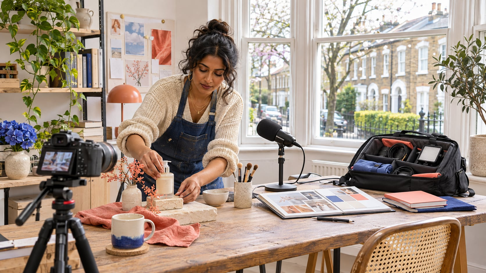
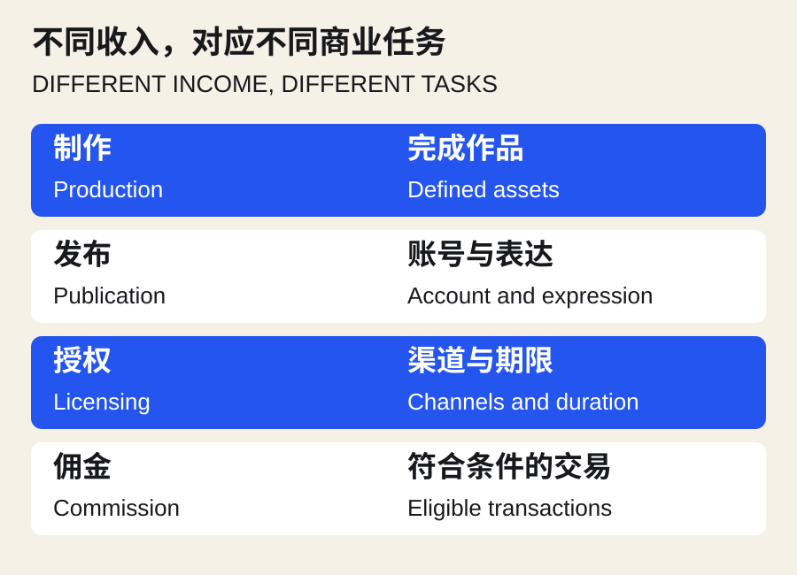

# 伦敦创作者收入多元化：品牌合作怎样安排

面向伦敦创作者与合作品牌，把制作、发布、授权和联盟收入拆开，形成更清楚的合作安排。

> 草稿日期：2026年11月23日；仅独立本地预览。

伦敦创作者的收入多元化，可以从不同商业任务入手：制作内容、在自己账号发布、许可品牌使用、联盟分成，以及提供自己的产品或服务。它们不是五种必然同时成立的收入，也不能用一个“达人报价”概括。对品牌而言，先明确要购买哪项工作、哪些权利和什么时间，再讨论价格，比只按粉丝数推算个人收入更有用。

## 伦敦语境先看工作类型

[UAL 伦敦创作者雇用指南](https://www.arts.ac.uk/students/student-careers/stories/how-to-hire-a-content-creator-in-london)区分了不同内容岗位与合作安排。对本篇有用的不是把某个公开价格区间当成行业统一标准，而是看清制作、受雇、自由职业和面向受众的发布并非同一种采购。该指南发表于2026年10月29日，不能据此推断某位伦敦达人的净收入。

伦敦合作还可能涉及工作室、交通、场地、天气和拍摄时间。位于伦敦的人不一定主要面向伦敦观众，能够在当地拍摄也不代表其受众适合每个本地品牌。研究时分别保留创作者工作地点、内容语言、作品场景和获准获得的受众资料。

品牌若要一条在自有渠道使用的演示片，首先寻找制作与讲解能力；若需要对方账号发布，还要研究受众与表达匹配。不要因为两种工作都包含拍视频，就把同一个价格和交付条件套给所有人。

## 制作费购买明确完成的作品

制作收入来自策划、拍摄、讲解、剪辑等实际工作。合同中应写作品数量、格式、所需场景、修改轮次与验收方式。例如两条竖版演示、每条一个主要场景，与“两天拍摄所有可用素材”是不同范围。

创作者需估算准备、沟通、拍摄、后期和交付时间，品牌则提供准确资料与合理的反馈期限。新增场景、重新拍摄或额外语言版本应讨论范围变化，不能把“内容套餐”理解成无限创作时间。

一个实用做法是在报价里分出制作与额外费用，注明道具、模特、场地或交通怎样处理。此处不是建议统一收费标准，而是让双方知道费用对应什么。交付成立与否，应先看作品是否符合已经确认的任务，而不是只看自然播放量是否达到品牌期待。

## 发布和授权各自购买不同价值

在达人自己的账号发布，涉及其表达、受众关系、排期和商业内容安排；许可品牌使用作品，则涉及用途、渠道、期限、地区与可编辑范围。发布一次不自动代表品牌永久拥有作品，交付视频文件也不自动包含付费广告使用权。

品牌可把需求写成“达人账号发布一条作品，品牌可在自有社交账号自然转发三个月”，再单独讨论是否需要广告、网站、线下展示或后续剪辑。这是假设的范围表达，不是默认合同条款或任何平台自动提供的权利。

[品牌合作内容治理指南](/zh/blog/brand-partnerships-joint-content-governance/#answer)可帮助约定事实审核与修改责任。对创作者而言，保留权利范围与到期时间，能让后续续用成为清楚的商业讨论；对品牌而言，也能避免团队成员误以为拿到文件就能在所有渠道持续使用。

## 联盟收入取决于已约定的交易条件

联盟合作通常把报酬与约定的交易或行为联系起来，需要看具体计划规则。佣金比例、有效订单、归因窗口、退款、付款条件与币种，都影响最后可确认的金额。一个公开链接或折扣码本身不能证明创作者已经赚到收入。

假设计划对符合条件且最终有效的销售支付8%佣金，某段窗口有£600符合条件销售，则假设佣金为£48。若之后有退货或排除交易，金额可能变化。这里的8%和£600只是算例，不是伦敦行情、某个平台费率或收入承诺。

品牌可以同时支付制作费与联盟佣金，但必须说明两部分各自条件。前者补偿已约定工作，后者仍有交易不确定性。不要把完全不确定的佣金描述成保证的制作收入，也不要要求创作者在不知规则的情况下替品牌承担全部销售风险。

收入类别是商业安排，不是个人收入预测；佣金算例中的8%与£600均为假设。

## 自有产品与服务需要真实承接能力

[Mastercard 2026 创作者研究](https://www.mastercard.com/content/dam/mccom/shared/news-and-trends/stories/2026/creator-economy-research/Dreamonomics_Content-powered%20businesses_November%202026.pdf)讨论了内容作为业务产品与内容支持既有业务的区别，也列出多种收入渠道。本篇只用这些类别帮助理解商业模型，不把全球研究改写为伦敦创作者平均收入或某种渠道的收入占比。

创作者可以考虑课程、模板、会员、活动或专业服务，但每种安排都有交付任务。一次品牌合作的成功，不代表观众一定愿意持续付费；已有关注人数也不等于购买需求。先确认自己能提供什么，再决定是否需要独立商店、客服和售后安排。

品牌与这种创作者合作时，检查推广是否与对方自有业务冲突。例如有教学业务的创作者，也许更适合做公开示范或联合课程，而不是接受限制全部品类的长期排他。关系设计应承认其业务结构，而不是只把账号当作广告位置。

## 用一个假设组合检查工作量

假设一位伦敦生活方式创作者在一个月计划两项品牌制作、一项账号发布、一场小型工作坊和联盟内容维护。这里没有为其编造收入数字。先把每项工作的准备、拍摄、修改和交付放进日历，才知道所谓多元化是不是实际超载。

如果两家品牌都要同一天确认脚本，或者一个合作要求在工作坊当天重拍，计划需要调整。可通过减少交付、延后新项目或明确审批期限解决，不能假设创作者可以无限压缩准备时间。工作量不随收入渠道数量自动分散。

再分开记录已签约金额、已开票金额和已收款金额。联盟待确认交易不要与已支付制作费放在同一“可用收入”栏。这个示例是项目管理方法，不提供个人税务或投资建议，也不推算伦敦生活费用能否由某个假设组合覆盖。

## 商业关系应在作品中清楚呈现

[ASA 2026 达人广告指南介绍](https://www.asa.org.uk/resource/influencers-guide.html)覆盖英国达人、品牌、代理与联盟关系的披露问题。对于伦敦合作，至少需要清楚谁提供了利益、作品与什么商业安排有关，以及观众如何识别广告。不要把所有商业关系都藏在资料页的一句笼统说明里。

本篇不替某个具体合同下法律结论。执行时应根据适用市场与安排查看相应指南，必要时请负责人核对。品牌给产品、付款、提供佣金或另有商业联系时，都不应只因形式不同就忽略披露判断。

[达人联盟邀请指南](/zh/blog/whats-affiliate-outreach-partner-invitation/#answer)可以帮助双方在联系阶段就说明工作与报酬方式。清楚的邀请让创作者判断自己是否愿意参与，也使品牌更容易得到可比较的回复，而不是在后期才发现“合作”一词被双方理解为完全不同的安排。

## 把一份邀请改成可报价的任务

假设品牌最初只写“伦敦创作者月度合作”。可以补成“在伦敦拍摄一条产品演示，另在创作者账号发布一条作品；品牌希望自然转发三个月，付费广告另谈”。再列出产品寄送、脚本资料、拍摄窗口、一次反馈与付款节点。这个假设邀请不规定价格，但已经能让对方判断是否有能力与时间。

创作者回复时可分别确认制作、发布和授权，指出任何缺失信息。品牌比较回复时，也就能看出某个报价是否少了发布或授权。相比直接猜测一个人有几种收入，这种清楚的任务说明更能推动真实合作。

若品牌只想购买现有作品的使用权，应明确是授权而非重新制作。原作品里其他人的形象、背景音乐和场地条件，也可能影响能否扩大使用，不能只向主创付款就假定所有部分都已覆盖。

报价、收入与净所得仍是不同口径，不能只看一项合同金额。

## 品牌寻找的是可完成任务的合作伙伴

寻找伦敦创作者时，把当地拍摄能力、内容经验、语言、发布需求与授权范围写进研究简报。若工作只需要制作，不要把粉丝量设为唯一入口；若需要受众触达，则进一步核对适合的受众资料。

[QuickKOL 官网能力说明](https://www.quickkol.com/)提供根据需求寻找与研究达人的入口。发现候选后仍要人工查看作品、确认商业联络与询问合作条件，不能从一个公开简介推断其收入组合或报价。

一份好的合作安排应该让双方清楚“做什么、在哪里用、什么时候交、怎样付款”。收入多元化随后来自不同任务被清楚定价与交付，而不是给同一项工作换几个名称。

## 下一步

从拍摄地点、表达能力和发布需求寻找适合的人。

[开始达人研究](https://www.quickkol.com/)

## 来源与范围

资料核验于2026年11月23日，基于可读取的公开来源。未登录或修改用户账号；编辑示例不代表真实客户结果，平台功能以实际账号为准。

- [UAL 伦敦创作者雇用指南](https://www.arts.ac.uk/students/student-careers/stories/how-to-hire-a-content-creator-in-london)
- [Mastercard 2026 创作者研究](https://www.mastercard.com/content/dam/mccom/shared/news-and-trends/stories/2026/creator-economy-research/Dreamonomics_Content-powered%20businesses_November%202026.pdf)
- [ASA 2026 达人广告指南介绍](https://www.asa.org.uk/resource/influencers-guide.html)
- [QuickKOL 官网能力说明](https://www.quickkol.com/)
