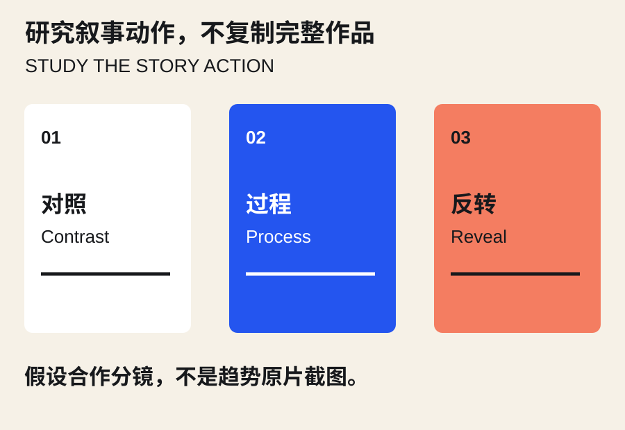

# Current TikTok Trends: Three November 2026 Formats

Study three dated short-video formats and decide how they could become creator work, rather than copying a popular sound.

> Draft date: November 23, 2026; independent local preview only.

As of November 23, 2026, this brief selects three formats from Later’s November 13 observations: contrasting two sides of a life, showing human connection or craft, and using everyday essentials for a humorous reveal. These are dated editorial observations, not a live global TikTok ranking or proof of popularity in every market. Creator partnerships can study the narrative structures, while separately checking current context, original execution and commercial-use rights.

## What this trend selection covers

[Later’s November trend observations](https://later.com/blog/tiktok-trends/) supply the leads for the three formats here. The source is editorial curation. Its examples are not presented as complete original videos we watched, a platform-certified chart or commercial authorization. Some original-video links were unreadable during this review, so this article does not clear particular recordings or creator assets for reuse.

The formats were selected because each has an understandable narrative action: contrast, demonstration or reversal. A brand can examine whether its product contributes meaningful information before deciding to follow a sound. The campaign concepts below are hypothetical editorial proposals, not advertisements reported by the source.

If you are working in another country or reading weeks later, inspect current results and the proposed creator’s recent work before proceeding. A trend brief stays useful through its dated examples and local context, not by keeping the word current permanently in its title.

## Format one: explain two sides of a life

The first source label is “btw it’s cool to do both”. The useful element is a contrast that explains a person, rather than a caption attached to any brand. In a creator partnership, ask whether both situations are genuine parts of the person’s work and whether the product has a real role in them.

Imagine a fashion creator who publishes office outfits and also enjoys weekend craft projects. A commission could demonstrate how one jacket is styled differently, explaining pockets, comfort or care requirements. Its value comes from an intelligible demonstration of two uses. Two unrelated attractive shots followed by a logo would contribute much less.

Ask the creator to write two sentences before filming: what each setting is, and what viewers will learn. If the second sentence merely says lifestyle, make it more specific. Leave room for truthful limitations, such as a fabric being unsuitable for a particular activity. The format should explain product conditions, rather than conceal them.

## Format two: make the human contribution visible

The second source format is “Building something AI can never replace”. A collaboration can explore the human connection or craft within that structure without turning it into an unsubstantiated claim about technological superiority. A warm scene also does not establish that a brand has fulfilled a wider social responsibility.

Imagine a baking-equipment brand working with a bread creator. The film could show how the creator responds to the actual dough and explains the judgment to a beginner. Viewers see skill and explanation, rather than a general assertion of authenticity. Obtain appropriate consent before including customers or other participants.

The branded equipment should help the action without obscuring the person’s contribution. A useful shot might show a touch test followed by an explanation of why the dough needs more rest. Allow enough time to record the complete demonstration and clear sound. That gives the audience more than another rehearsed sentence of praise.

## Format three: make the humorous reveal relevant

The third source label is “What do you bring to the table?” Its structure sets up an expectation, then reveals something through everyday objects or habits. A creator collaboration works when the audience learns something about the person or product after understanding the joke, instead of remembering only a fashionable phrase.

Imagine an urban-cycling creator collaborating with a bag brand. A light opening question leads to the repair tools, rain layer and water the creator actually carries. Each item has a relevant compartment, followed by a short demonstration of access when the bag is full. This does not require copying another video’s precise dialogue or choreography.

If the product cannot contribute to the reveal, leave the format aside. An unrelated item inserted at the end may weaken both the humor and the advertisement. Let the creator propose their objects and narrative while the brand checks product facts. The existence of a trend is not a reason to demand unpaid imitation of somebody else’s complete creative work.

Storyboards illustrate this article’s hypothetical commissions, rather than screenshots of original trend videos.

## Check music and commercial disclosure separately

[TikTok’s commercial-music explanation](https://support.tiktok.com/en/business-and-creator/creator-and-business-accounts/commercial-use-of-music-on-tiktok?lang=en) distinguishes music use in commercial content. A recording appearing in an ordinary video does not establish the same permission for a brand collaboration. An audio link in a public trend roundup is a research lead, not a sublicensable music package.

Develop the narrative and usable location sound first, then select music appropriate for the specific commercial use. Paid advertising, cross-platform reuse and subsequent edits each need their relevant rights confirmed. Availability somewhere on TikTok is not evidence of perpetual or cross-platform permission. A creator should be able to deliver the core explanation even if the originally considered sound cannot be used.

[TikTok’s commercial-content disclosure explanation](https://support.tiktok.com/en/business-and-creator/creator-and-business-accounts/promoting-a-brand-product-or-service?invalid_lang=en-GB) also requires the applicable disclosure setting when promoting a brand, product or service. Decide the correct relationship type and necessary identification before publication. A light trend format should not hide the commercial relationship. These editorial suggestions do not replace the advertising requirements applicable to the particular market.

## Move from a trend lead to a completed commission

After choosing a format, prepare one brief recording the source date, target market, audience question, the creator’s own concept, required setting, rights and publication deadline. If production will outlast the format’s useful context, adapt it into an evergreen narrative instead of racing after a sound whose meaning has passed.

Before filming, ask the creator to show that the contrast or reveal is understandable through a sketch or short rehearsal. At this stage the team is reviewing the content action, not judging the viewing performance of a rough preview. The [brand-partnership content-governance guide](/blog/brand-partnerships-joint-content-governance/#answer) helps assign factual approval, creative judgment and revision rounds.

After publication, review appropriate measures and audience responses within a consistent window. A trend’s use count, a reference video’s views and this campaign’s sales do not form one demonstrated causal chain. They concern different objects and cannot prove one another. Keep the actual question visible: did this creator’s interpretation communicate something useful to the intended audience?

## Find the relevant creative capability

Contrast needs clear situational explanation; a craft film needs a visible process; a humorous reveal needs timing and personal expression. Review whether candidates already show that ability in their work. This is more specific than asking whether they can follow trends quickly.

The [creator social-metrics decision guide](/blog/social-media-metrics-creator-decision-tree/#answer) can support the publication review. [QuickKOL’s product explanation](https://www.quickkol.com/) provides an entry point for discovering and researching creators from a need. Describe language, subject and expressive capability, then manually examine actual work and discuss collaboration terms. Discovery does not establish that a creator wants to use a particular format.

Keep a version that does not depend on one specific sound. A trend can suggest a way of communicating, while the completed commission should still carry its own useful information. Even a viewer unfamiliar with the original reference should understand the product’s use and why this creator chose to discuss it.

## Next step

Put the intended setting and storytelling skill into the creator research brief.

[Start creator research](https://www.quickkol.com/)

## Sources and scope

Sources reviewed November 23, 2026 using accessible public material. No user account was signed into or changed. Editorial examples are not client outcomes; confirm features in the intended account.

- [Later’s November trend observations](https://later.com/blog/tiktok-trends/)
- [TikTok’s commercial-music explanation](https://support.tiktok.com/en/business-and-creator/creator-and-business-accounts/commercial-use-of-music-on-tiktok?lang=en)
- [TikTok’s commercial-content disclosure explanation](https://support.tiktok.com/en/business-and-creator/creator-and-business-accounts/promoting-a-brand-product-or-service?invalid_lang=en-GB)
- [QuickKOL’s product explanation](https://www.quickkol.com/)
