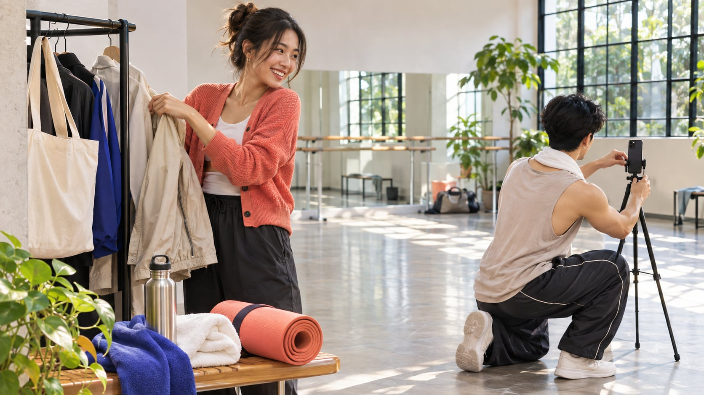
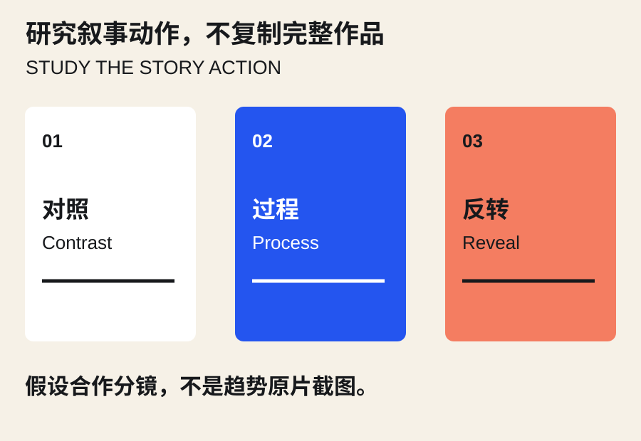

# 当前 TikTok 趋势：2026 年 11 月三种内容形式

研究三种有日期来源的短视频表达，判断怎样转成达人作品，而不是照抄热门声音。

> 草稿日期：2026年11月23日；仅独立本地预览。

截至2026年11月23日，本页从 Later 的11月13日趋势观察选出三种可研究的 TikTok 内容形式：用反差呈现生活的两面、展示人的连接与手艺，以及借日常物件完成幽默转折。这是有日期的编辑观察，不是 TikTok 全球实时榜单，也不代表每个市场都在流行。达人合作可以借用叙事结构，但仍要重新确认当日语境、作品原创性和商业使用权。

## 这份趋势观察涵盖什么

[Later 的 11 月趋势观察](https://later.com/blog/tiktok-trends/)提供了本篇三个形式的线索。这里只使用它作为编辑整理的来源，不把其示例视为我们观看过的完整原始视频、平台认证榜单或商业授权。本文核验时，部分原始视频入口无法读取；因此不为具体音频或达人作品作权利保证。

选择这三个形式的原因是，它们各自有可解释的叙事动作：对照、展示、反转。品牌无需只追随一个声音，也能先判断产品是否有足够的真实信息融入其中。下文合作提案均是假设示例，不是来源披露的真实广告案例。

若你在另一国家或几周后使用这篇文章，先看当前搜索结果与目标创作者近期作品，再决定是否继续。趋势文章的有效期来自具体形式和当地语境，不来自标题一直保留“当前”二字。

## 第一种：用两面性解释一种生活

第一种形式的来源名称是“btw it’s cool to do both”。这里关心的是前后对照如何解释人物，而不是把文案套在任何品牌上。对于达人合作，最重要的问题是两种场景能否真实共存，以及产品是否真的出现在其中。

假设一位服装创作者既发布正式办公穿搭，也喜欢周末做手工。合作可展示同一件外套怎样分别搭配，说明口袋、舒适度或保养要求。作品的价值来自达人清楚演示不同使用方式；不能只拍两个互不相关的漂亮镜头，再用产品标识强行连接。

请创作者先写两句话：每种生活场景是什么，观众能学会什么。若第二句话只有“展现生活方式”，继续细化。品牌还应允许对方说出实际限制，例如某种面料不适合特定活动，而不是用趋势格式掩盖产品条件。

## 第二种：让观众看见人的贡献

第二种来源形式为“Building something AI can never replace”。合作时可以研究其中人与人、人与手艺之间的关系，但不要把它写成未经证明的技术优劣主张。也不要把一个温暖场景当成品牌已经承担社会责任的证据。

假设一家烘焙器具品牌与面包创作者合作，可以拍摄对方面对实际面团状态如何调整手法，以及怎样向新手解释判断依据。观众看到的是手艺和讲解，不是泛泛赞美“真实”。如果拍摄涉及顾客或其他参与者，要事先取得适当同意。

品牌提供的器具是帮助完成动作的物件，不应遮住人的过程。一个有用镜头可能是手指触碰面团后，创作者解释为什么延长静置。与其让对方背诵赞美语，更值得给完整示范和清楚收音留出拍摄时间。

## 第三种：让幽默转折与产品有关

第三种来源名称为“What do you bring to the table?”。这类结构先形成一个期待，再用生活中的具体物件或习惯完成转折。达人合作是否成立，要看观众理解笑点之后，是否也更了解创作者或产品，而不是只记住一句流行话。

假设一位城市骑行创作者参与包袋合作，开头用一个轻松问题，随后展示自己出门总带的修补工具、雨衣和水。每件物品都对应一个实际隔层，最后用短镜头说明满载后的取用方式。这里不需要复制其他视频的具体台词或动作。

如果产品无法进入转折，不妨放弃这一形式。硬把不相关的商品塞进结尾，既可能破坏笑点，也使广告显得突兀。请创作者提出自己的物件与叙事，品牌核对产品事实；不要因为趋势已经存在，就要求创作者无偿模仿他人的完整创意。

分镜为本文假设合作方案，不是原始趋势视频截图。

## 音乐和商业披露单独确认

[TikTok 商用音乐说明](https://support.tiktok.com/en/business-and-creator/creator-and-business-accounts/commercial-use-of-music-on-tiktok?lang=en)指出，平台对商业内容的音乐使用有独立条件，不能因为一段音乐出现在普通视频中，就认为品牌合作也获得同等许可。公开趋势整理中的音频入口，是研究线索，不是可转授权的音乐包。

拍摄方案可以先用叙事和现场声完成，再选择适用于具体商业用途的音乐。需要付费广告、跨平台复用或后续剪辑时，分别确认相应权利范围。不要把“在 TikTok 能找到”当成跨平台或永久使用的证明。

[TikTok 商业内容披露说明](https://support.tiktok.com/en/business-and-creator/creator-and-business-accounts/promoting-a-brand-product-or-service?invalid_lang=en-GB)也要求推广品牌、产品或服务时使用相应披露设置。品牌与达人要在发布前决定正确的关系类型与必要标识，不能用趋势的轻松语气隐藏商业关系。图文中的编辑建议不替代具体市场适用的广告要求。

## 从趋势线索到一条完成的作品

选择形式后，制作一张简报，记录来源日期、目标市场、观众问题、达人自己的创意、所需场景、权利安排和发布期限。如果生产周期超过趋势预计适用期，把它改成常青表达，也比追赶一个已经失去语境的声音更合理。

在拍摄前，让创作者用草图或试录证明转折能被理解。草稿阶段看的是内容动作，而不是低清预览的播放表现。[品牌合作内容治理指南](/zh/blog/brand-partnerships-joint-content-governance/#answer)可以帮助约定谁批准事实、谁保留创作判断，以及修改轮次。

发布后使用一致窗口查看适用指标、观众反馈和作品是否回答问题。不要将趋势使用次数、某条参考视频的播放数和本次合作的销售额放在同一因果链上。它们来自不同对象，不能互相证明。

## 用内容能力而非追热门速度找人

对照形式需要善于解释场景，手艺形式需要能够展示过程，幽默转折则需要节奏与个人表达。研究候选达人时，查看过去作品是否已经体现这种能力，比只问“你能跟热点吗”更具体。

[达人社交媒体指标决策指南](/zh/blog/social-media-metrics-creator-decision-tree/#answer)可用于约定发布后的观察方式。[QuickKOL 官网能力说明](https://www.quickkol.com/)则提供按需求寻找和研究达人的入口；可以从语言、品类与表达能力描述任务，再人工核对实际作品和合作条件。

最后保留一个不依赖特定声音的版本。趋势帮助团队发现表达方式，完成的作品仍应拥有自己的信息价值。观众即使不知道原始梗，也应能看懂产品怎样使用，以及创作者为什么愿意讨论它。

## 下一步

把想解释的场景与表达方式写进达人研究需求。

[开始达人研究](https://www.quickkol.com/)

## 来源与范围

资料核验于2026年11月23日，基于可读取的公开来源。未登录或修改用户账号；编辑示例不代表真实客户结果，平台功能以实际账号为准。

- [Later 的 11 月趋势观察](https://later.com/blog/tiktok-trends/)
- [TikTok 商用音乐说明](https://support.tiktok.com/en/business-and-creator/creator-and-business-accounts/commercial-use-of-music-on-tiktok?lang=en)
- [TikTok 商业内容披露说明](https://support.tiktok.com/en/business-and-creator/creator-and-business-accounts/promoting-a-brand-product-or-service?invalid_lang=en-GB)
- [QuickKOL 官网能力说明](https://www.quickkol.com/)
