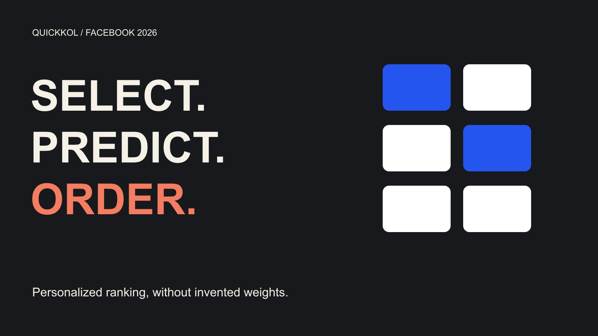
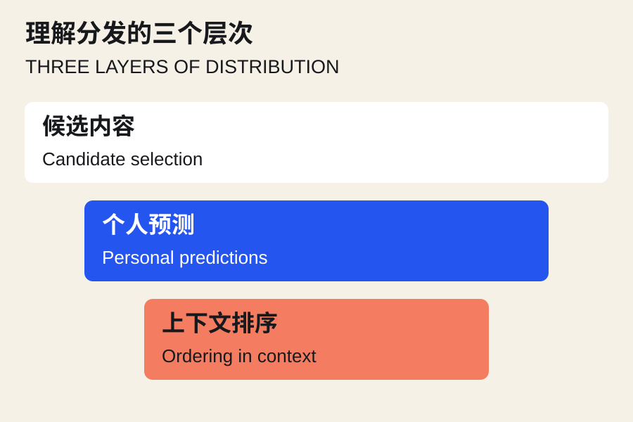

# How Facebook’s Algorithm Works in 2026 for Creators

Understand candidate selection, predictions and ordering, then turn that distinction into a practical creator brief and review.

> Draft date: November 23, 2026; independent local preview only.

Facebook does not have one identical algorithm formula for every person and placement. For creator work, distinguish candidate selection, predictions about a person’s likely interest, and ordering in context. Public engineering material published in 2026 adds detail about retrieval systems; it does not disclose a universal weighting table that brands can put into a campaign brief. Teams can control the work, its intended audience task and the publication plan. Distribution still depends on personalized selection and actual responses.

## Start with the distribution surface

When a creator says Facebook did not distribute a post, first identify the observation: followers’ Feed, Reels recommendations, another recommendation placement or paid advertising. One account-summary screenshot cannot explain all of these. Impressions bought through advertising also cannot be attributed directly to a change in organic ranking.

[Meta’s ranking explanation](https://about.fb.com/news/2023/06/how-ai-ranks-content-on-facebook-and-instagram/), published in 2023, describes systems for different surfaces and recommendations from accounts a person does not follow. It supplies historical conceptual context, rather than a specification of every 2026 menu or parameter. This article uses it for that purpose and adds newer engineering material where relevant.

A useful partnership brief might request an original video answering a particular beginner question, with organic recommendation outcomes reviewed afterwards. A promise to exploit this year’s algorithm for a fixed exposure total turns an undisclosed distribution process into an unreliable delivery condition. Ask the creator to deliver a piece of work whose purpose is understandable before any reach number appears.

## Candidate retrieval is different from final exposure

Think of the candidate set as content the system is prepared to consider further. Inclusion is not an impression, and it does not mean every follower will see the post. [Meta’s SilverTorch engineering explanation](https://engineering.fb.com/2026/05/26/ml-applications/silvertorch-index-as-model-new-retrieval-paradigm-recommendation-systems/) discusses retrieving a smaller set from a much larger collection and applying conditions such as language, country and policy eligibility. It establishes retrieval as a distinct step; it cannot predict the next video’s view count for an individual creator.

For example, an eligible home-decor video still competes within a particular reader’s available content. Its language, viewing context and that reader’s recent interests can produce different outcomes for different people. This is an editorial explanation of the mechanism, not an inspection of an account’s internal recommendation logs.

The engineering article’s throughput and computing-cost results concern its technical benchmark. They are not equivalent improvements in a creator’s reach. Keep infrastructure context, publication status and measured campaign impressions in separate report fields. Otherwise a platform engineering result can quietly become an unsupported marketing-performance claim.

A conceptual process diagram, not an internal Facebook interface or a disclosed weighting formula.

## Separate signals, predictions and measured outcomes

A signal is information a system can use; a prediction estimates a possible future response; an outcome is behavior observed after publication. They are related without being interchangeable. Previous viewing behavior may inform an interest estimate, for instance, while the eventual viewing and interaction totals still have to be measured for the actual post.

[Meta’s Feed engineering explanation](https://engineering.fb.com/2021/01/26/ml-applications/news-feed-ranking/) from 2021 describes combining multiple predictions and processing context. It helps explain why one engagement metric cannot represent the whole ranking process. It does not establish a fixed, publicly disclosed 2026 weight for a save, comment or viewing action.

In a creator brief, pair what the audience should understand with how the team will observe the response. A demonstration of folding equipment might be reviewed through relevant viewing information and comments about use. Turning the film into an unrelated question or asking everybody for an identical emoji can disconnect the work from the audience’s task. The brief should guide a useful response, rather than manufacture a convenient count.

## Originality changes how the work is commissioned

[Meta’s 2026 original-content explanation](https://about.fb.com/news/2026/03/rewarding-original-creators-on-facebook/) emphasizes original work and meaningful creative contribution. A brand can use that guidance to examine whether the commission gives a creator room to film, explain or develop a substantive new presentation, rather than asking several people to upload the identical brand video. Applicable policy and account status still determine specific eligibility.

Copyright permission and originality are different questions. Holding rights to a clip does not establish that a new border or an insubstantial reaction makes the upload meaningfully original for distribution purposes. The [Facebook creator original-contribution guide](/blog/facebook-creator-original-contribution-review/#answer) explores that distinction further.

This does not require an expensive long film for every partnership. One creator might demonstrate storage, another explain the circumstances for choosing the product, and another show maintenance after use. Those are distinct contributions around the same item. Budget for the actual creative tasks, rather than treating repeated distribution of one file as equivalent to several independently developed explanations.

## Turn the explanation into a filmable creator brief

Consider a hypothetical home-products collaboration. The intended viewer lives in a small space and wants to know where a folding table goes when it is put away. The deliverable is a creator-filmed demonstration of opening, using, folding and storing it, with relevant limitations. The brand supplies accurate dimensions and use conditions; the creator chooses a demonstration style suited to their work.

The brief does not claim that a particular opening guarantees entry into another distribution round. It can request an immediately understandable problem because that helps the viewer, rather than because the team knows a fixed algorithm threshold. Captions, framing and narration should communicate the use case instead of replacing information with vague superlatives.

Agree on an observation window before publication, such as seven complete calendar days. Record the time zone, organic and paid scope, publication time and edits. If advertising is added later, record its start separately. This creates a consistent review of the work, instead of comparing whichever screenshots happen to show the most favorable totals.

## Review the work without inventing a hidden penalty

A weaker post may reflect subject matter, timing, audience interest, content status and other factors. A view total below the previous post does not establish a hidden penalty or identify a changed algorithm parameter. The [creator social-metrics decision guide](/blog/social-media-metrics-creator-decision-tree/#answer) helps teams select measures connected to their actual objective first.

Retain the post URL, observation window, relevant viewing and interaction measures, and whether the publication was edited or supported with paid distribution. Examine several posts across comparable periods when a change appears substantial. Where the account shows a status or policy notice, record the notice itself instead of inventing an explanation that was never displayed.

For the next commission, change an element that can be described clearly. Two videos may address storage through a complete demonstration and a question-and-answer approach. Keep other conditions reasonably comparable while acknowledging that audiences and distribution will not be identical. The resulting learning can inform better creator work. It remains different from a controlled causal experiment proving an algorithm mechanism.

## Use a performance difference to test the interpretation

Imagine one creator publishing two home videos: one demonstrates the complete storage process and the other shows only a quick finished result. The first receives more viewing within a seven-day window. The team can document the difference without declaring that Facebook applies a fixed bonus to complete demonstrations. Topic, publication time, audience circumstances and advertising support may also differ.

First check that both windows are equally long and begin from actual publication. Confirm that cumulative totals have not been compared with single-day figures. Then inspect the URLs and content: do the supposedly similar topics actually answer comparable questions? Record an account notice if the creator sees one. If none is available, do not supply the system with an explanation it never provided.

A later commission could ask the same creator to demonstrate two related problems with the same observation method, retaining the differences between them. This still is not a controlled experiment, but it reduces reporting confusion. A defensible conclusion might say the complete process merits further investigation. It should not claim to have decoded the 2026 ranking formula.

If the brand needs a defined scale of distribution on a definite date, discuss measurable paid-media arrangements and budget separately. Do not insert an organic-reach guarantee into the creator’s production obligations. Completion, distribution and commercial outcomes have different evidence and should remain separate in the decision. Before assigning the next budget, ask which of those outcomes the team actually needs and which evidence is available to support it.

Different publications may also reach different viewing contexts. Record available information about followers, recommendations or other visible sources. If the account does not provide that breakdown, retain an unknown rather than reconstructing every placement from total views. This prevents a confident explanation from exceeding what the team actually observed in the report.

## Find creators who can deliver the actual explanation

When the next step is finding someone to make this work, describe the required content skill, language and setting before reviewing existing publications. [QuickKOL’s product explanation](https://www.quickkol.com/) offers a starting point for discovery and creator research from a brief. That is different from obtaining internal Facebook recommendation-system data.

A team might research Chinese-speaking creators who can demonstrate storage in small homes, then manually review whether their work answers practical questions, suits the intended reader and fits the proposed collaboration. Candidate discovery cannot guarantee distribution for a future commission. Confirm interest and availability directly rather than inferring them from a profile.

The useful output is a clear creative assignment, a defensible candidate shortlist and a consistent review method. These let a team distinguish a content problem, a partnership-fit problem and a situation where evidence is still insufficient. None requires a speculative algorithm story every time a post performs differently.

## Next step

Look for creators who can explain the specific problem, then discuss the original concept and partnership terms.

[Research creators with QuickKOL](https://www.quickkol.com/)

## Sources and scope

Sources reviewed November 23, 2026 using accessible public material. No user account was signed into or changed. Editorial examples are not client outcomes; confirm features in the intended account.

- [Meta’s ranking explanation](https://about.fb.com/news/2023/06/how-ai-ranks-content-on-facebook-and-instagram/)
- [Meta’s SilverTorch engineering explanation](https://engineering.fb.com/2026/05/26/ml-applications/silvertorch-index-as-model-new-retrieval-paradigm-recommendation-systems/)
- [Meta’s Feed engineering explanation](https://engineering.fb.com/2021/01/26/ml-applications/news-feed-ranking/)
- [Meta’s 2026 original-content explanation](https://about.fb.com/news/2026/03/rewarding-original-creators-on-facebook/)
- [QuickKOL’s product explanation](https://www.quickkol.com/)
