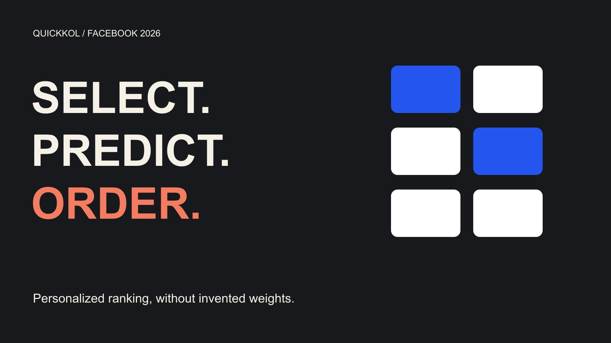
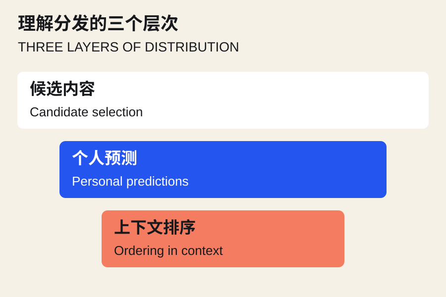

# 2026 年 Facebook 排序怎样影响达人内容

把候选内容、预测和排序拆开理解，再转成达人合作的选题与复盘动作。

> 草稿日期：2026年11月23日；仅独立本地预览。

Facebook 没有一个对所有用户、所有位置都相同的算法公式。理解达人内容分发，可以把过程分为候选内容进入范围、系统预测个人可能感兴趣的内容、再结合上下文排序。2026 年的公开工程资料增加了对检索系统的解释，但没有公布一个可直接填进合作简报的统一权重表。品牌能控制的是作品、受众任务和发布安排；触达仍取决于个性化分发和真实反应。

## 先说清你讨论哪一种分发

达人说“Facebook 没有推这条内容”时，先确认观察对象是主页关注者的信息流、Reels 推荐、其他推荐位置，还是付费广告。不同入口不能用一张总览截图解释。品牌投放获得的展示也不能直接归因于自然排序改变。

[Meta 内容排序解释](https://about.fb.com/news/2023/06/how-ai-ranks-content-on-facebook-and-instagram/)在2023年说明，不同位置使用相应系统，推荐还可能来自用户没有关注的账号。这是理解机制的历史材料，不是2026年每个按钮和参数的说明书。文章使用该材料解释基本概念，用2026年公开资料补充新的工程背景。

合作简报因此应写“用一条原创视频回答初学者的具体疑问，观察其自然推荐结果”，而不是“利用今年算法获得固定曝光”。前者给创作者可完成的工作，后者把未公开的分发机制变成了不可靠的履约条件。

## 候选内容与最终展示是两件事

可以把候选集合理解为系统准备进一步考虑的内容范围。进入这个集合，仍不等于已经展示，更不等于每位粉丝都会看到。[Meta SilverTorch 工程说明](https://engineering.fb.com/2026/05/26/ml-applications/silvertorch-index-as-model-new-retrieval-paradigm-recommendation-systems/)讨论了从很大的内容集合检索较小候选集合的技术，并涉及语言、国家和政策等条件。它说明检索是独立的一步，不能用来推算某位达人下一条视频的播放数。

例如，某条家居作品即使符合基本资格，也还要在具体读者的内容选择中竞争。作品语言、实际观看情境和读者近期兴趣，都可能让同一作品在不同人面前表现不同。这里是机制的编辑解释，并非我们读取了某个账号的内部推荐日志。

工程文章中的吞吐量和计算成本改善，描述的是相应技术基准。不要把它们写成“2026年达人触达提高同样倍数”。创作者合作表中应把技术背景、作品状态和真实展示指标放在不同字段，避免把平台基础设施改进当成品牌营销结果。

流程是理解机制的简图，不是 Facebook 内部界面或公开权重公式。

## 互动信号、预测与结果不要混写

信号是系统可以参考的信息，预测是系统对某种未来反应的估计，实际结果则是内容发布后观测到的行为。三者有关，但不是一件事。比如历史观看行为可以作为理解兴趣的输入，系统预测也可能涉及观看或互动，最后实际发生多少仍需看该条内容的数据。

[Meta Feed 工程解释](https://engineering.fb.com/2021/01/26/ml-applications/news-feed-ranking/)在2021年描述了多种预测组合与上下文处理。这可以帮助读者理解为什么没有一个单一互动指标能完整代表排序。它不能证明某个收藏、评论或观看行为在2026年有固定公开权重。

给达人简报时，最好把“希望观众理解什么”与“用什么观察结果”写在一起。若主题是示范一件可折叠设备怎样收纳，可以观察与使用问题有关的评论和适用的观看数据。不要为了追求互动，把作品改成无关提问或要求读者留下同一表情；这会让内容目标与读者任务分离。

## 原创要求影响作品安排

[Meta 2026 原创内容说明](https://about.fb.com/news/2026/03/rewarding-original-creators-on-facebook/)强调原创作品和有意义的创作贡献。品牌可以据此检查合作是否真正给达人空间拍摄、讲解或形成新的表达，而不是让多位达人重复上传同一条品牌视频。具体资格和执行仍以平台政策及账号状态为准。

版权许可与原创判断也不同。品牌拥有某素材的使用权，不代表换个边框、加一段无实质信息的反应就必然构成平台认可的原创贡献。[Facebook 达人原创贡献指南](/zh/blog/facebook-creator-original-contribution-review/#answer)对这个区别有进一步说明。

这不要求每次合作都制作昂贵长片。一位创作者实际演示收纳，一位解释场景选择，一位展示使用后的维护，可以围绕同一产品给出不同的有效信息。预算应支持这些真实任务，而不是只为同一文件的多次分发支付发布费。

## 把机制转成一份可拍摄的简报

以下是假设的家居合作示例：目标读者住在小空间，需要知道某件折叠桌收起后怎样放置。交付是一条达人亲自拍摄的视频，包含展开、实际使用、折叠和收纳，另说明适用条件。品牌提供真实尺寸和使用限制，创作者决定自己熟悉的演示方式。

这份简报不写“开头三秒保证进入下一轮流量池”。可以要求开头清楚展示问题，因为这有助于读者理解，而不是因为团队掌握了固定算法门槛。字幕、镜头和讲解都服务于任务，不用模糊夸张语言代替产品信息。

发布前约定观测窗口，例如七个完整日历日，并记录时区、自然与付费范围、发布时间和期间修改。如果之后加广告，单独记录开始时间和广告结果。这个安排让团队能讨论作品实际表现，而不是在不同时间截取最有利的数字。

## 复盘回答作品问题，不猜隐藏处罚

单条内容表现下降，可能与题材、时间、读者兴趣、内容状态和其他因素有关。仅凭播放量低于上次，不能判断账号受到隐藏处罚，更不能确定某个算法参数改变。[达人社交媒体指标决策指南](/zh/blog/social-media-metrics-creator-decision-tree/#answer)可以帮助团队先选择与目标有关的指标。

复盘至少保留作品链接、观察窗口、适用的观看与互动指标，以及发布后是否修改或加入付费分发。关注变化较大时，查看多个作品和相同口径的时间段，而不是把一条异常当成长期结论。账号状态或政策提示存在时，应记录实际提示内容，不自行补全未显示的原因。

下一轮只改变可以清楚说明的要素。例如两条都回答收纳问题，分别用完整演示和问答方式表达。保持其他条件尽量可比，承认观众与分发不会完全相同。这样的学习能指导创作者改进作品，但仍不是证明某个算法因果关系的实验。

## 用一次表现差异练习判断

假设同一达人先后发布两条家居视频，一条完整演示收纳，另一条只有快速成品镜头。前者在七天观察窗口里获得更多观看，团队可以记录差异，但不能马上宣布平台给完整演示固定加权。两条作品同时还可能在题材、发布时间、观众状态和广告支持上不同。

先检查两次窗口是否同样长，是否都从真实发布时间开始，以及有没有把累计数据与单日数据混用。再检查作品链接与实际内容，确认所谓“同题材”是否真在回答相同问题。创作者若看到账号提示，记录提示；没有提示时，不要替系统补一段原因。

下一轮可以请同一创作者为两个相近问题分别制作清楚的演示，约定同样的观察方式，并保留各自差异。这个设计仍不是严格实验，但能减少部分报告混乱。复盘结论可写“完整过程值得继续研究”，不宜写“已经破解2026年排序公式”。

如果品牌必须在确定日期获得确定规模的分发，应另行讨论可购买、可衡量的媒体安排与预算，而不是把自然触达保证塞进达人制作义务。作品完成、平台分发和商业结果各自有证据，判断时也应分别处理。

不同作品也可能面向不同阅读情境。复盘时补记是否为关注者访问、推荐或其他可见来源；账号没有提供来源拆分时就保留未知，不用总观看量反推每个入口。

## 从选题需求找到合适的创作者

如果下一步是为这种作品找人，先描述需要的内容能力、语言和场景，再查看创作者既有作品。[QuickKOL 官网能力说明](https://www.quickkol.com/)提供基于需求寻找和研究达人的入口；这与获得 Facebook 推荐系统内部数据是两回事。

例如可以从“能用中文演示小空间家居收纳的创作者”开始研究，再人工检查作品是否真实回应使用问题、表达是否适合目标读者，以及对方是否接受当前合作。发现工具给出候选对象，不能替品牌保证新作品的触达。

最终可交付的成果应是一份明确的创作任务、合理的候选名单和统一的复盘口径。把这些做好，团队才能区分是作品需要改进、合作匹配需要调整，还是暂时没有足够数据判断；不必给每次表现波动编一个算法故事。

## 下一步

先找能解释具体问题的人，再与对方讨论原创方案和合作条件。

[在 QuickKOL 研究达人](https://www.quickkol.com/)

## 来源与范围

资料核验于2026年11月23日，基于可读取的公开来源。未登录或修改用户账号；编辑示例不代表真实客户结果，平台功能以实际账号为准。

- [Meta 内容排序解释](https://about.fb.com/news/2023/06/how-ai-ranks-content-on-facebook-and-instagram/)
- [Meta SilverTorch 工程说明](https://engineering.fb.com/2026/05/26/ml-applications/silvertorch-index-as-model-new-retrieval-paradigm-recommendation-systems/)
- [Meta Feed 工程解释](https://engineering.fb.com/2021/01/26/ml-applications/news-feed-ranking/)
- [Meta 2026 原创内容说明](https://about.fb.com/news/2026/03/rewarding-original-creators-on-facebook/)
- [QuickKOL 官网能力说明](https://www.quickkol.com/)
