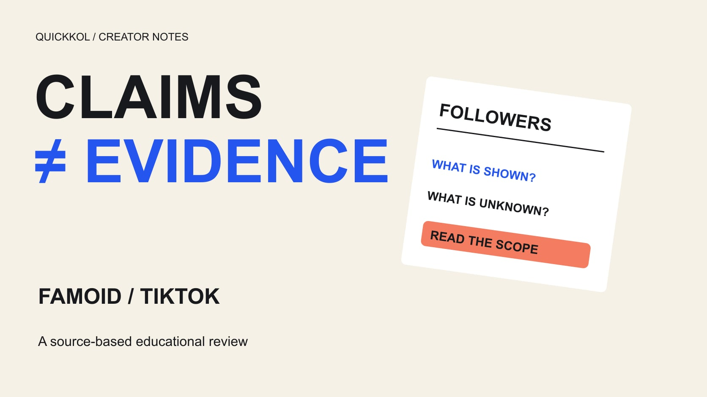
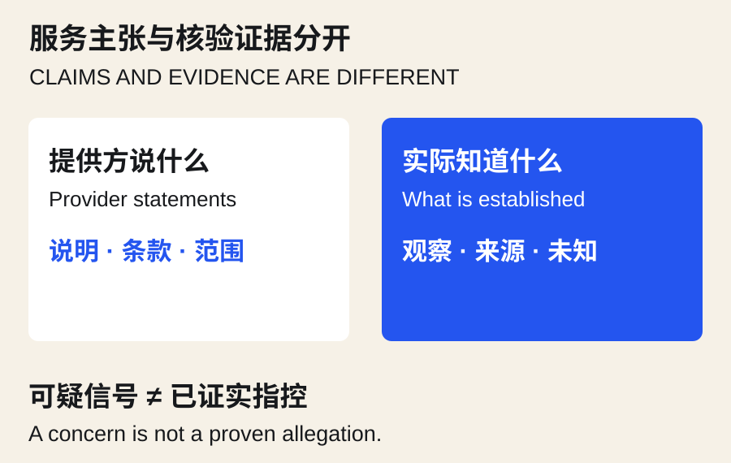

# Famoid TikTok Followers: Claims, Evidence and Risks

Use Famoid’s published claims to understand follower-service evidence, protect creator accounts and keep campaign reporting proportionate.

> Draft date: November 23, 2026; independent local preview only.

For a brand researching “tiktok followers famoid.com,” the service page is a provider statement, not a TikTok endorsement or independent authenticity audit. Identify the claimed activity, intended use and account information involved, then distinguish voluntary responses to advertising from manufactured indicators. A no-password claim does not establish audience quality, while rapid growth does not prove a creator purchased false followers. This educational guide explains how to assess evidence; it provides no purchasing, metric-inflation or detection-evasion instructions.

## Start with what the provider actually says

[Famoid’s TikTok service page](https://famoid.com/tiktok/) says it attracts voluntary actions through third-party advertising and does not require an account password for an order. Those are the provider’s descriptions. This article placed no order and did not inspect placement records, source accounts or delivered activity.

The first brand question is how that claim relates to the proposed creator assignment. If the need is a product demonstration, relevant understanding or an answerable enquiry, a larger account total does not complete the work. Do not let an easily visible number replace the content the team intended to commission.

Retain the review date, exact page and promise being discussed. Separate “the website states” from “the team checked” so another colleague does not turn a research extract into acceptance evidence. A public statement does not establish that it applies to this account, market or commercial use.

Also identify who introduced the service: the brand, an agency, the creator or an unverified correspondent. A familiar name does not prove that a sender represents the provider or account holder. The useful starting record identifies the question and source without converting one search into an investigation finding about a person.

## Read the use restrictions before discussing results

The reviewed page’s footer limits the services to personal use and prohibits commercial use and use on accounts the purchaser does not own. That published restriction needs checking against a brand’s actual assignment before any discussion of results.

If the footer, terms and a sales conversation leave an unresolved question, ask the provider and purchasing owner about that precise issue. Buying something or connecting a creator account is not necessary to test whether the proposed use is appropriate. This article does not determine a transaction’s legal effect or invent an authorization that was not supplied.

A brand can record that the intended use has not been confirmed and therefore exclude the proposal from the current campaign. That is a scope decision. It does not require an accompanying assertion that fraud has been proven. Declining an unsuitable arrangement and establishing unlawful conduct are different conclusions.

The same boundary matters for an agency handling a client account. A content-production assignment does not automatically authorize the agency to introduce an outside account service. Check the existing commission before expanding the discussion. Keep the decision tied to the work and the authority actually granted, rather than treating a functioning checkout as procurement approval.

## Separate promotion from manufactured indicators

[TikTok’s integrity and engagement rules](https://www.tiktok.com/community-guidelines/en/integrity-authenticity) prohibit platform manipulation and trade in services that artificially inflate engagement. That policy supplies a behavioral boundary; it does not by itself establish what a particular provider or creator did.

Advertising that introduces content to people who voluntarily choose to follow should not be conflated with automatically generated accounts or manufactured actions. Equally, “real people” answers only part of the question. It does not establish motivation, relevant market or product understanding. A brand needs an account of the activity, not simply a comparison of attractive sales phrases.

Ask the responsible campaign owner whether content or advertising records exist, which account and period they cover, and how they relate to the reported figures. Do not demand unrelated viewers’ private identities. A missing document is a limit on verification, not automatic proof of deliberate deception.

The [TikTok follower-service permissions guide](/blog/tiktok-free-follower-offer-permissions-review/#answer) helps organize access questions. The additional lesson here is that policy, provider description and campaign evidence perform different jobs. None substitutes for the others. An activity’s possible permissibility also does not establish its suitability for this particular creator collaboration or business objective.

## A no-password claim is not a complete access review

Keep passwords, verification codes and recovery information under the account holder’s control. If a message requests an unfamiliar login, installation or permission grant, a recognizable company name is not sufficient reason to proceed. [FTC’s phishing guidance](https://consumer.ftc.gov/articles/how-recognize-avoid-phishing-scams) recommends checking suspicious requests through a known genuine contact route and describes the protection offered by multifactor authentication.

This general advice is not a security finding about Famoid. An impersonator may request something different from the original service page. Conversely, an outside page that requests no password has not thereby verified its data sources, counting method or commercial suitability.

If information has already been exposed, an authorized person should handle official account-security and recovery routes first. Retain the necessary time, request and action records without copying complete sensitive material into a brand report. Give security handling and marketing analysis their respective owners.

A brand does not need to purchase a small batch of followers, submit personal identity documents or change account management to assess whether a sales claim supports a report. Use non-sensitive material where it can answer the work question. Where it cannot, preserve the unknown instead of expanding access merely to make a review look complete.

## Use a growth example to test the inference

Consider a teaching example, not a service test or client record. An account moves from 10,000 to 10,600 during an observation window. The recorded net change is 600, and the change divided by the starting value is 6%. Those calculations describe the relationship between the recorded counts.

They do not establish that 600 distinct, genuine, relevant people all came from one source. Nor do they show that a promotion, creator post or outside service caused the whole difference. New follows, departures, paid distribution and platform adjustments may coexist. Without supporting material, retain them as possible explanations rather than confirmed causes.

If a report calls the 600 “new target customers generated by the campaign,” correct that interpretation first. Preserve the original count and source, then mark campaign attribution as unverified. Do not invent a false-follower percentage to subtract. An unsupported adjustment can produce another misleadingly precise figure.

The [free-follower demonstration evidence guide](/blog/free-follower-demo-evidence-literacy/#answer) explains the distinction between a displayed difference and a commercial result. An anomaly can justify a specific question without supporting a personal accusation. A smooth-looking line is not proof of authenticity either. In both cases, the conclusion must remain within the available evidence.

A count difference in a teaching example does not automatically become attributed target customers.

## Ask a question the creator can actually answer

Instead of “your numbers look wrong,” use an answerable request: “We observed a follower-count change between these two recorded times. Was there a public activity, paid promotion or account-management event you can describe for that period? We will check the reporting definition before deciding how this window can be used.”

This is editorial sample wording. Limit the actual request to the collaboration and allow the creator to correct the time, field or source. Their explanation still needs to be related to available material. Courtesy does not abandon verification, and verification does not require a presumption of wrongdoing.

If the team can confirm only the count change, hand over that observation and limitation. If relevant promotion records arrive, state their coverage rather than extend one documented window to the account’s entire history. Assign an owner to missing information and explain whether it affects the present decision.

The team can continue reviewing work, audience questions and production capability while withholding an unsupported growth conclusion. A partnership need not be defined entirely by one unexplained number, and continuing the project does not require hiding a material reporting issue.

A concise written outcome could read: “The specified service page was reviewed. Suitability for this use and the source of activity remain unconfirmed. Two recorded counts describe a change and will not be used to establish campaign-generated customers. The account owner checks access; the report owner retains the original records and updates the interpretation.” This is sample wording to adapt to actual material. It assigns a next action without inventing a loss or misconduct. If new information arrives, revise the affected conclusion while retaining the earlier date and basis, rather than silently upgrading the entire account to verified.

## Return to the creator contribution the brand needs

Replace a guaranteed follower quantity with an identifiable creator contribution: a clear assembly demonstration, a sequence answering common questions or a discussion with a defined subject and time. Following remains an audience choice. Record content delivery separately from business outcomes.

[QuickKOL’s product explanation](https://www.quickkol.com/) provides routes for brief interpretation, creator discovery, research and personalized outreach. A brand can find relevant work, identify someone able to demonstrate the subject and then discuss the actual scope. QuickKOL should not be presented as a follower service or a tool that identifies every false account or proves an individual’s conduct.

Close with a limited, usable conclusion: which claims were read, which facts were checked, which proposed uses remain unsuitable or unresolved, and which report field needs a qualification. If declining, state that the present assignment will not use the proposal. Route account protection to its owner and analytical corrections through preserved records and versions.

That produces a more useful decision than a blanket label of completely safe or entirely fake. The purpose of an educational guide is to help readers understand what supports their decision while respecting the boundary of what has not been established.

## Where each conclusion should stop

Editorial review framework, not a fraud finding about a provider or individual.

| Material | Can establish | Cannot establish alone |
| --- | --- | --- |
| Provider page | Its published statements | Independent authenticity or campaign results |
| Two recorded counts | Net difference under that definition | Distinct people, source or causation |
| Promotion record | Activity within its documented scope | Authenticity of every added follower |

## Next step

Define what the audience needs to understand, then research creators able to demonstrate it.

[Explore QuickKOL](https://www.quickkol.com/)

## Sources and scope

Sources reviewed November 23, 2026 using accessible public material. No user account was signed into or changed. Editorial examples are not client outcomes; confirm features in the intended account.

- [Famoid’s TikTok service page](https://famoid.com/tiktok/)
- [TikTok’s integrity and engagement rules](https://www.tiktok.com/community-guidelines/en/integrity-authenticity)
- [FTC’s phishing guidance](https://consumer.ftc.gov/articles/how-recognize-avoid-phishing-scams)
- [QuickKOL’s product explanation](https://www.quickkol.com/)
