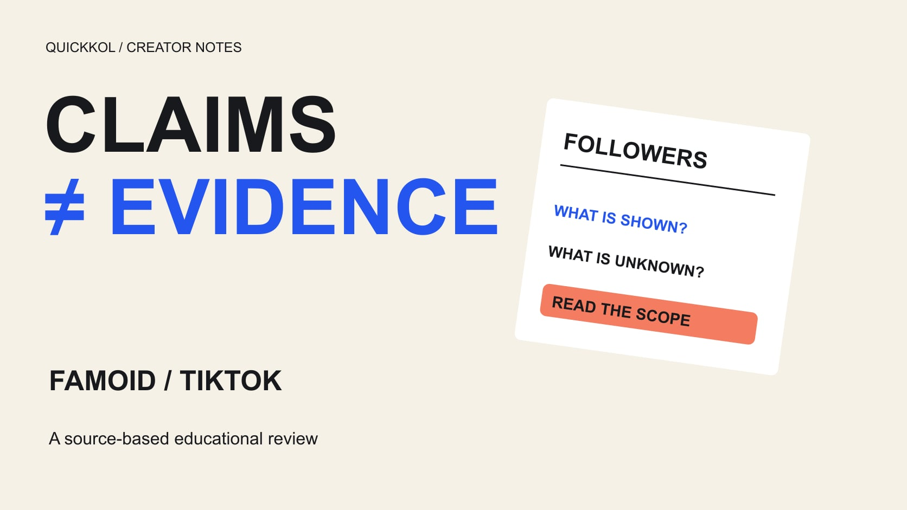
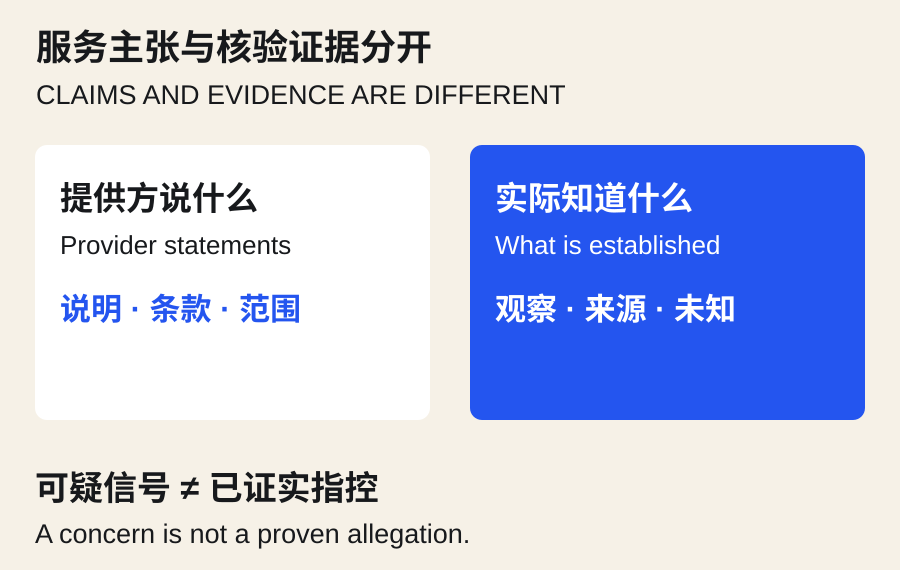

# Famoid TikTok 粉丝服务：主张、证据与风险

用 Famoid 的公开说法练习核对涨粉服务证据，帮助品牌保护账号与报告，避免把异常信号变成人身指控。

> 草稿日期：2026年11月23日；仅独立本地预览。

搜索“tiktok followers famoid.com”时，品牌应把服务页当作供应方陈述，而不是 TikTok 背书或独立验真报告。先明确服务实际声称做什么、适用用途与需要的账号信息，再区分合法广告带来的自愿关注和人为制造的指标。没有密码要求也不能证明受众质量；一次快速增长同样不能证明达人买了假粉。本篇是教育向的证据解读，不提供购买、刷量或规避检测方法。

## 先把供应方说法与已验证事实分开

[Famoid 的 TikTok 服务页](https://famoid.com/tiktok/)称，其服务通过第三方广告吸引用户自愿采取行动，并表示订单不需要密码。这里记录的是供应方自己的描述；本篇没有下单，也没有审核广告投放记录、来源账号或实际交付。

品牌首先要回答的不是“看起来是否可靠”，而是这条说法与自己要做的达人合作有什么关系。若真正需要的是一段产品演示、相关观众的理解或可解释的咨询，增加账号总数本身并不完成任务。不要让一个可见数字替代原本需要采购的内容。

记录资料的日期、具体页面和正在讨论的承诺。将“网页这样写”与“团队已经检查过”分列，避免下一位同事把研究摘录当作验收结论。某条说法在公开页面出现，不等于它对本次账号、市场和商业用途都成立。

还要确认是谁提出使用服务：品牌、代理、创作者，还是未经核实的来信。名字相同并不能证明发件人获得供应方或达人授权。一次搜索也不是对任何人的调查结论。

## 用途限制要早于效果讨论

所读服务页的页脚将服务限定为个人用途，并禁止商业用途及非本人账号使用。这段公开限制与品牌准备执行的实际任务需要先核对，不能仅因为页面能打开就视为符合采购要求。

如果条款、页脚和销售沟通之间存在需要解释的地方，应把具体问题交给供应方及负责采购的人核实。没有必要通过实际购买或让达人连接账号来“试试看”。本篇不判断某笔交易的法律效力，也不替供应方解释未提供的授权。

品牌可在记录中写清：当前用途尚未得到确认，因此不将它纳入此次活动。这个决定基于任务适用范围，不需要附带“已经证实诈骗”这样的结论。拒绝一个不符合要求的方案，与证明对方存在违法行为是不同事情。

对于代理机构，同一原则也适用于客户账号。受托制作内容，不自动包含为客户引入外部账号服务的权限。先确认原委托包含什么，再决定是否需要进一步讨论。

## 真实广告、自愿关注与人为指标不是一个概念

[TikTok 真实性与互动规则](https://www.tiktok.com/community-guidelines/en/integrity-authenticity)禁止操纵平台，以及交易人为增加互动的服务。规则说明平台如何界定不允许的行为，但不能单凭这一条就替某个供应方或某位创作者作事实认定。

广告让人看见内容、随后自愿关注，与自动生成账号或制造没有真实兴趣的动作，不应混为一谈。同样，“来自真人”只回答账号主体的一部分问题，还没有说明参与动机、相关市场或对产品的理解。品牌需要知道实际发生了什么，而不是只比较宣传词。

可以向负责此次活动的人询问：有没有真实的内容或广告记录？记录覆盖哪段时间和哪个账号？它与所报告的数字怎样对应？不要求获取不相关观众的私人身份，也不把供应方不愿提供某项材料自动解释成隐瞒欺诈。

已有的 [TikTok 涨粉服务权限核对指南](/zh/blog/tiktok-free-follower-offer-permissions-review/#answer)可帮助整理访问请求。本篇进一步强调，平台政策、供应方描述和活动证据有不同作用，不能互相替代。即使一种方式允许使用，也不意味着它适合这次达人合作的目标。

## 没有密码要求，仍要检查访问边界

把密码、验证码和账号恢复信息留在账号本人控制之下。若来信要求点击陌生入口、安装软件或授予权限，不要因为它使用熟悉品牌名称就继续。[FTC 反钓鱼指南](https://consumer.ftc.gov/articles/how-recognize-avoid-phishing-scams)建议通过自己已知真实的网站或联系方式另行核对可疑请求，并说明多因素认证的保护作用。

这项一般性建议不是对 Famoid 的安全指控。即使原服务页写着某种访问方式，冒名者也可能提出不同要求；反过来，外部页面没有索取密码，也不能证明数据来源、计数方式或商业用途已经得到核实。

若账号已经暴露信息，先由获准操作的人使用平台官方安全与恢复入口处理。保留解决问题所必需的时间、请求与操作记录，避免将完整敏感资料复制进品牌报告。安全处置与营销分析分别安排负责人。

品牌无需通过购买少量粉丝、提交个人证件或更换账号管理人来判断一个宣传说法能否支持报表。尽可能用非敏感资料回答任务问题，无法回答就保留未知状态，而不是扩大访问范围。

## 用一个增长算例看清推断的边界

以下是教学假设，不是服务实测或客户数据：某账号在一个观察窗口从 10,000 变为 10,600，净变化为 600，按起始值计算的变化比例为 6%。这些数字只能说明所记录计数之间的关系。

它们没有证明 600 个独立、真实且相关的人都来自同一来源，也没有证明某个推广、达人内容或外部服务造成全部变化。期间可能同时发生新关注、取消关注、付费分发或平台调整；缺少资料时，应列为可能解释而非已确认原因。

如果原报表把 600 写成“活动新增的目标客户”，先修正这个表述。可以保留原计数与来源，再将活动归因标为待核验，不必凭空扣除一个所谓假粉比例。没有依据的扣减同样会制造失真的精确数字。

读者可参考[免费涨粉演示的证据解读](/zh/blog/free-follower-demo-evidence-literacy/#answer)，区分展示差值与商业结果。一次异常足以提出明确问题，但不足以指控个人；一个平滑的曲线也不能证明所有活动都真实可靠。

教学示例中的计数差值不能自动变成已归因的目标客户。

## 把复核请求写成对方能回答的问题

不要只发一句“你的数据不正常，解释一下”。更有用的请求是：“我们在这两个有记录的时间点看到粉丝计数变化。同期是否有你愿意说明的公开活动、付费推广或账号管理事件？我们先核对报表口径，再决定这段数据能用于什么。”

这段话是编辑示例。实际沟通只包含与本次合作有关的范围，允许对方指出时间、字段或来源不准确。对方提供的说明仍需与可用材料对应；礼貌并不等于放弃核验，核验也不等于预设欺诈。

若团队只能确认计数变化，就交接这项观察及其限制。若取得了相关推广记录，则注明记录覆盖的范围，不把部分窗口扩写成全部账号历史。对暂时拿不到的信息，标记负责人和是否影响当前决定。

这样可以继续评估作品、受众问题和制作能力，同时暂缓使用不够可靠的增长结论。整项合作不必被一个尚未解释的数字完全定义，品牌也不必为了继续项目而隐藏数据问题。

一段可复用的书面结论可以是：“已读取指定服务页；尚未确认本次用途与活动来源；两次计数仅用于描述变化，不用于证明活动新增客户。账号负责人核对访问情况，报告负责人保留原记录并更新解释。”这只是填写示例，应按实际材料改写。它说明各方接下来做什么，而不是把尚未观察到的损失或不当行为写进结论。收到新资料后，也只更新受影响的一项判断，保留原来的日期与依据。

## 回到品牌真正要采购的达人贡献

把“保证增加多少粉丝”改写为可交付的内容任务，例如一段清楚演示装配步骤的视频、一组回应常见问题的内容，或一次具有明确主题和时间的交流。是否愿意关注，是受众的选择；内容交付和商业结果应分别记录。

[QuickKOL 官网能力说明](https://www.quickkol.com/)提供简报理解、达人发现、研究与个性化外联等入口。品牌可以从相关作品寻找能完成演示的人，再讨论实际范围。本篇不把 QuickKOL 写成涨粉服务，也不承诺它能够百分之百识别虚假账号或证明某位达人的行为。

最后形成一个有限而清楚的结论：已读到什么主张，实际核验了什么，哪些用途尚不适用，报表哪一项仍需保留限制。需要拒绝时，说明当前任务不采用；需要安全处置时，交给账号负责人；需要更新分析时，保留原始记录和版本。

这比贴上“完全安全”或“都是假粉”的标签更有用。教育向内容的价值，在于让读者知道自己能据什么作决定，并尊重尚未被证实的事实边界。

## 结论应该停在哪里

编辑核验框架，不对具体供应方或个人作欺诈认定。

| 材料 | 能说明 | 不能单独说明 |
| --- | --- | --- |
| 供应方页面 | 其公开陈述 | 独立验真与本次效果 |
| 两次计数 | 该口径下的净差值 | 独立人数、来源与因果 |
| 推广记录 | 记录范围内的活动 | 全部新增的真实性 |

## 下一步

先明确观众需要理解什么，再研究能够完成相关演示的创作者。

[了解 QuickKOL](https://www.quickkol.com/)

## 来源与范围

资料核验于2026年11月23日，基于可读取的公开来源。未登录或修改用户账号；编辑示例不代表真实客户结果，平台功能以实际账号为准。

- [Famoid 的 TikTok 服务页](https://famoid.com/tiktok/)
- [TikTok 真实性与互动规则](https://www.tiktok.com/community-guidelines/en/integrity-authenticity)
- [FTC 反钓鱼指南](https://consumer.ftc.gov/articles/how-recognize-avoid-phishing-scams)
- [QuickKOL 官网能力说明](https://www.quickkol.com/)
