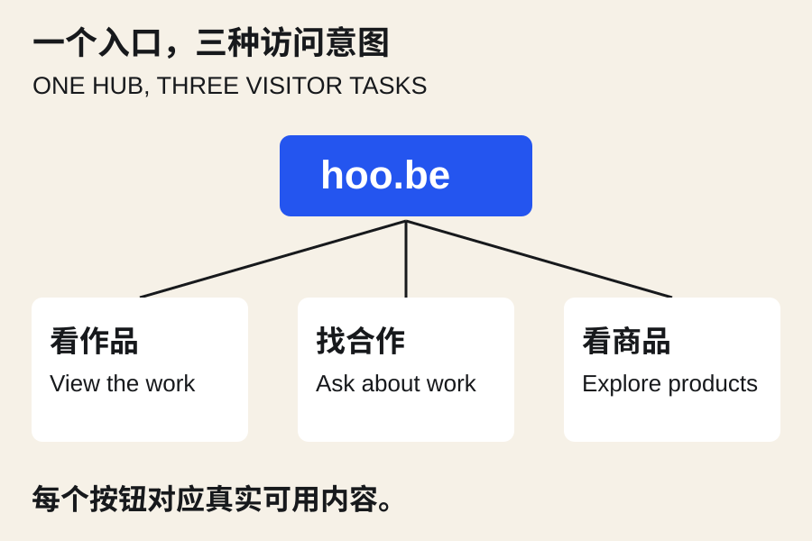

# Hoo.be for Creators: Build a Useful Campaign Link

Use hoo.be as a clear destination for creator content: organize links, check the plan and review one campaign journey before release.

> Draft date: November 23, 2026; independent local preview only.

“Hoo be” usually refers to hoo.be, a link-in-bio product that brings content, social profiles, products and other destinations together on one page. In creator partnerships it can give viewers a clear next step, such as watching a complete demonstration, learning about the featured item or finding a business contact. Define that task before checking the current plan and public link. The page is not proof of audience quality, automatic sales attribution or a replacement for researching suitable creators.

## Decide whether a hub helps this collaboration

[hoo.be’s creator overview](https://hoo.be/for-creators) presents video, music, portfolio and product destinations within a shared page. Its immediate job is navigation: helping someone arriving from social content understand where to go next. A longer link list is not evidence of better marketing.

A collaboration with one stable detail address may be served more simply by that direct link. A hub becomes more useful when a creator has a full video, event information and a business-enquiry route that answer different questions. Sketch the real journey instead of filling every available space with historical content.

Imagine a music creator working with an equipment brand. One viewer wants the complete performance, another wants information about the demonstrated device, and another wants the next public event. These questions should not all be labeled “learn more.” Name each destination as an action the viewer can recognize.

This guide uses that editorial scenario to explain page planning. It did not sign into or test the user’s account, and the vendor’s displayed creator examples are not treated as independently verified client outcomes. Establish one journey that the page should complete, then evaluate whether this product makes it clearer. Confirm these charges against current checkout conditions.

## Give the partnership an identifiable place

Collect three kinds of material first: creator-controlled official destinations, the approved campaign address and accurate business or event information. A same-name search result is not sufficient confirmation of an identity or link.

For the music-equipment example, use entries such as “Watch the complete demonstration,” “Read about the featured device” and “See public event details.” Replace these with the actual approved wording. During planning, do not manufacture apparently real destinations that do not exist. Older links may continue circulating after release, so stable, understandable labels matter.

Make the principal collaboration task easy to find without requiring the creator to erase their portfolio for one short campaign. A brand needs a suitable onward journey, not control of the person’s whole identity and catalogue.

A useful delivery record contains the label, actual URL, content owner and any review date. Check that these agree before debating decorative effects. Viewers cannot infer from a polished design which item belongs to the current partnership and which has ended.

The [brand-partnership content-governance guide](/blog/brand-partnerships-joint-content-governance/#answer) helps establish the collaboration’s purpose and use. The page organizes access; the agreement establishes responsibilities. Those jobs should correspond without being treated as interchangeable.

Editorial example: label entries around viewer questions, then supply the real destinations.

## Choose a plan around the actual page

At this review, [hoo.be’s current pricing page](https://hoo.be/pricing) lists Free, Pro and Premium at monthly advertised prices of US$0, US$9.99 and US$29.99, alongside differing platform seller fees. Confirm the checkout currency, price and available features before purchasing.

For this collaboration, establish whether the task requires a custom domain, additional pages, a particular level of analytics or page scheduling. A few accurate destinations do not make every advanced feature essential. Conversely, a contracted feature should be confirmed in the intended account’s plan before publication rather than repaired afterwards.

Separate subscription cost from selling-related fees. A monthly payment is not necessarily the complete cost of a transaction, and a platform-fee description does not replace payment-provider, refund or tax conditions. This article does not calculate a universal net payout.

Keep the commercial check specific: what this assignment needs, what the plan shows and what remains to be confirmed. An old screenshot is not a permanent price list. If the account setup differs from the public description, ask the provider about that difference and preserve the basis of the decision.

The plan table below helps locate those questions. It is not a purchase recommendation or evidence that a more expensive plan generates more sales.

## Obtain the public link through the official route

[hoo.be’s sharing instructions](https://hoo.be/support/sharing/add-to-bios) describe signing in, opening the share icon from Home, selecting Add to your socials in the Share my hoo.be panel and choosing the target platform. The panel also lets the user copy the link directly. Each platform’s profile-editing conditions still need their own check.

The expected output is the intended creator’s public address, not an editor URL. Open the copied address in a browser outside the editing session and inspect the identity, content and actual destinations. This proposed check is not a claim that this article operated the user’s account.

Place the checked address where the collaboration actually uses it, such as the creator’s profile link. If the brief says “see the link in my profile,” establish that a viewer can follow that instruction. Ordinary text should not be assumed to become a clickable destination automatically.

The authorized account operator should make the profile change. The brand can supply approved destination information and wording without obtaining the creator’s password. At handoff, separate the public address from responsibility for editing it.

Do not bundle unrelated business-contact changes into this replacement. Finish the current journey, decide whether older addresses remain necessary and scope any larger profile reorganization separately.

## Check the phone journey with three questions

First, can a viewer identify whose page they reached? Compare the creator name, image and subject with the originating video. If a brand has a separate page, distinguish the two rather than implying they are the same account.

Second, does each label accurately describe what opens? “Complete demonstration” should reach that work; “event details” should provide current information. A login request, different storefront region or unavailable product is a condition for the owner to assess, not something a responding URL automatically passes.

Third, can someone complete this one action on an ordinary phone? Inspect readability, spacing and loading, then follow the actual route to its final destination. A screenshot establishes a displayed state, not a completed journey.

Acceptance for the music-equipment example can be concrete: a tester follows the approved video’s instruction, finds the profile entry, opens the full demonstration and returns to identify the equipment-information link. If that journey is confusing, improve wording and order before adding more destinations.

Assign responsibility for later changes too. Who updates an ended event, moved product page or unavailable collaboration? A temporary promotion need not remain prominent forever, but its eventual destination should still make sense. This gives the creator and brand a manageable page instead of a collection of abandoned links.

Run one failure rehearsal as well. Imagine the event entry opens successfully but displays the previous event date. Record an information error rather than a passed link test. Have the responsible owner correct the destination, then inspect the public route again. If a stable information page must be used temporarily, update the publication instruction too. Distinguishing an unavailable page from an inaccurate page tells the creator whether the address needs replacement or the brand needs to correct content. This is a hypothetical acceptance exercise, not an observed hoo.be malfunction or a claim about its reliability.

## Interpret clicks separately from partnership outcomes

Page visits, link clicks, full-video viewing, enquiries and purchases are different observations. Use the fields actually available and explain what they count. A click does not become a new customer, and clicks across several destinations do not automatically represent distinct people.

Suppose the full-demonstration entry records 40 clicks and the equipment entry 25. These are teaching numbers, not product-test results. The total of 65 clicks establishes neither 65 different people nor that all visitors came from the same sponsored video. Without source records, preserve that attribution limit.

Page analytics can suggest a navigation change without establishing that it caused additional sales. Relating onward visits to a campaign requires the destination’s actual measurement arrangement, consistent naming and an appropriate window. The [social-media metrics decision guide](/blog/social-media-metrics-creator-decision-tree/#answer) helps establish the counted object first.

Evaluate “the route is clearer” separately from “business results improved.” The former can be examined through a navigation task; the latter needs suitable business evidence. Keeping those conclusions distinct lets a team improve the creator-content journey honestly even when purchase data is unavailable.

## Hand over a destination someone can maintain

Finish with the public address, principal entries, destination owners and conditions that require review. State who can edit, which changes need brand confirmation and what happens after the campaign. Passwords and unrelated audience information do not belong in this handoff.

For partner research, [QuickKOL’s product explanation](https://www.quickkol.com/) describes discovery and research using a brief, keywords or relevant work. Establish whether a candidate can explain the subject, then confirm the destination they actually use. A polished hoo.be page is not a complete creator assessment.

In the music-equipment example, the next step is agreement on three labels, three real addresses and one phone-navigation task. Complete that check before approving the publication instruction. The hub then serves the work and audience question, while product selection has a practical reason.

Completion does not require enabling every feature. It requires a destination a relevant viewer can find, understand and use. Retaining that standard makes subsequent link changes and partnership renewals easier to discuss without treating the website itself as proof of campaign success.

## A starting point for checking plans

Source: official pricing page read November23,2026. Confirm actual checkout and transaction conditions separately.

| Plan | Advertised monthly price | Platform seller fee |
| --- | --- | --- |
| Free | US$0 | 9% |
| Pro | US$9.99 | 5% |
| Premium | US$29.99 | 0% |

## Next step

Research partners through their work and the brief, then give viewers an accurate next step.

[Explore QuickKOL](https://www.quickkol.com/)

## Sources and scope

Sources reviewed November 23, 2026 using accessible public material. No user account was signed into or changed. Editorial examples are not client outcomes; confirm features in the intended account.

- [hoo.be’s creator overview](https://hoo.be/for-creators)
- [hoo.be’s current pricing page](https://hoo.be/pricing)
- [hoo.be’s sharing instructions](https://hoo.be/support/sharing/add-to-bios)
- [QuickKOL’s product explanation](https://www.quickkol.com/)
