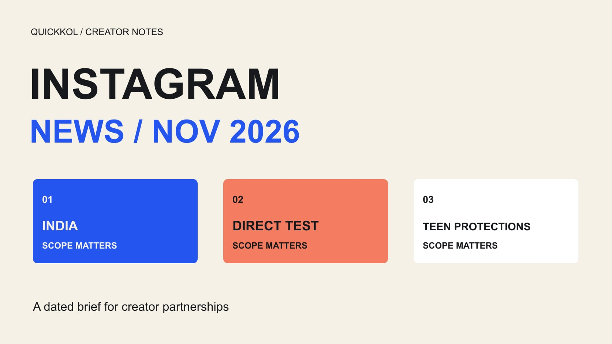
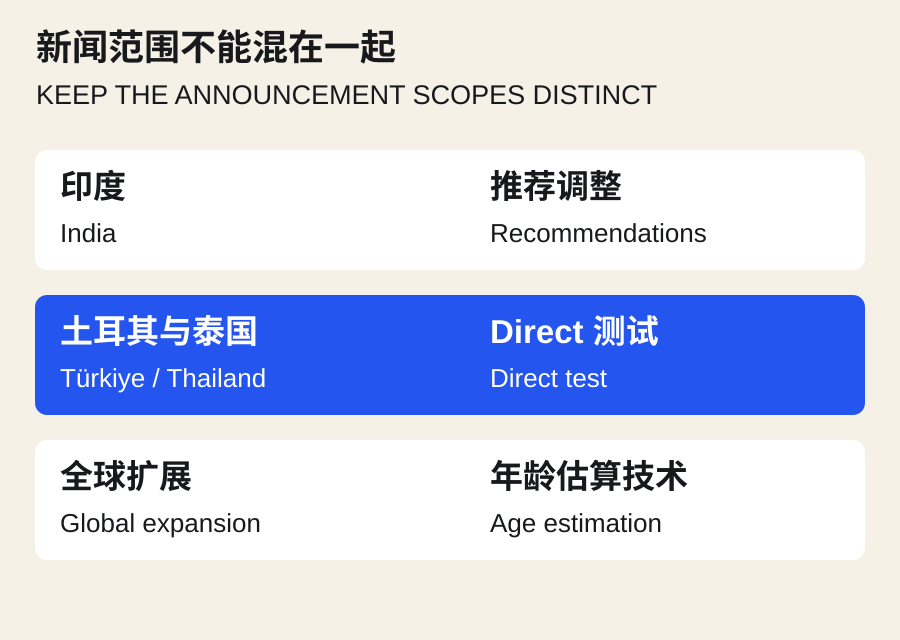

# Instagram Marketing News: A November 2026 Brief

Translate three official November announcements into decisions a brand and creator can act on, verify or leave unchanged.

> Draft date: November 23, 2026; independent local preview only.

This Instagram marketing news brief was reviewed on November 23, 2026. It selects three official developments with specific implications for creator partnerships: recommendation changes in India, a regional test of the standalone Direct messaging app, and expanded technology supporting Teen Account protections. These concern different things: a local content environment, a communication channel and age-appropriate experiences. They are not one global account upgrade and do not promise better reach, response rates or sales.

## November 16: recommendation changes in India

[Meta’s November India recommendation update](https://about.fb.com/news/2026/11/an-update-on-the-content-we-recommend-on-instagram-in-india/) describes stronger detection and handling of material local users do not want recommended. The announcement distinguishes recommendation eligibility from removing content that violates standards. A post not being recommended therefore should not automatically be described as unlawful or deleted.

For a brand commissioning creators in India, the relevant task is checking the work’s suitability for its intended distribution environment. Do not turn the company’s account of system improvements into guaranteed additional impressions for the brand, or assume the same change occurred in every country.

Editorial implication: ask the creator and responsible reviewer to inspect the actual work and any visible account status, recording the notice itself. If a scene could involve sensitive material, plan accurate and appropriate expression before filming. Guessing an algorithm penalty after weak viewing is not equivalent. This brief did not access the private status of any collaboration account.

## November 16 announcement, updated November 17: Direct test

[Meta’s Direct app announcement](https://about.fb.com/news/2026/11/introducing-direct-an-app-just-for-messaging/) introduces a standalone messaging app from Instagram, being tested in Türkiye and Thailand at the time. It describes close-contact communication, creative messaging and built-in protections, with different access paths for people with and without Instagram accounts.

This does not mean a brand can now send bulk messages to every Instagram creator. A regional test is not a global launch or evidence that a proposed partner uses the app. A team should not move an existing collaboration conversation solely because a product announcement appeared.

Editorial implication: continue using the business contact the creator publishes or the channel already agreed. If both parties are actually eligible for the test and want to use it, confirm identity and communication boundaries first. The [Instagram creator-inquiry triage guide](/blog/instagram-dm-creator-inquiry-triage/#answer) helps organize received partnership information; it does not turn a new messaging product into unlimited outreach permission.

## Early November: expanded teen protections

[Meta’s November teen-protection announcement](https://about.fb.com/news/2026/11/expanding-teen-account-protections-to-teens-around-the-world/) describes expanding age-estimation technology globally to place more suspected teen accounts into appropriate protections. It separately discusses parent notifications in the United States and an age-range signal in Australia. Those are different scopes, not one identical worldwide operating procedure.

The creator-marketing question is whether the content and partnership suit the actual audience and whether communication and data arrangements respect relevant protections. An adult creator does not establish an entirely adult audience. Nor can a person’s exact age be established from a public portrait, appearance or username.

Editorial implication: where age information is needed, use authorized and appropriate aggregate material with an understandable definition. Have the responsible reviewer check specific collaboration eligibility. Do not ask users to bypass protections to complete a marketing objective. A publication may address general viewers while still requiring the brand to examine product, language and purchase-path suitability in the intended market.

Source snapshot as of November 23, 2026. Global age-estimation expansion does not mean identical features in every location.

## Turn the news into three different decisions

An India project needs a review of local content and recommendation context. The Direct test first requires confirmation that both parties can and want to use it. Teen protections affect audience suitability and communication arrangements. Attaching an identical instruction to change every creator strategy immediately would obscure those differences.

Imagine a UK home-products brand working with an adult creator. These announcements do not automatically require a new contact channel. If the same team plans a new publication in India, review the expression and distribution plan for that market. If a product or communication may involve younger viewers, include age suitability in the actual approval task.

This example is editorial analysis, not an official Meta implementation plan. Separate the publisher’s disclosed fact, the team’s applicability judgment and the resulting action. A reviewer can then understand why one item warrants work and another belongs on an observation list. News becomes useful when the action follows the actual scope of the announcement.

## Review partnership information instead of chasing one score

News may change a question list, but it does not replace research into a candidate’s work. Continue checking language, subject, actual content and business contact, requesting updated authorized information where needed. An announcement date does not prove that account data has synchronized or that a feature is enabled.

The [creator reporting and evidence memo guide](/blog/influencer-reporting-decision-memo-and-evidence/#answer) helps record source date, scope and actual observations. Assign an owner and review date to each action. If a product remains in testing, retain a status such as not confirmed in the target account rather than describing it as an established team capability.

A later news brief should update facts, not merely change the month in its title. A change in Direct availability, recommendation policy or protection functionality needs a fresh source review and applicability decision. This article records a research snapshot. It is not a real-time account-status dashboard for every future partnership.

## Write a specific next research task

If an announcement genuinely changes the commission, express the new research task concretely. A team might seek creators able to demonstrate home products clearly for an India campaign, then check language, work samples and commercial terms. An instruction to adapt to the new algorithm should not ask a creator to guarantee an outcome.

[QuickKOL’s product explanation](https://www.quickkol.com/) offers discovery and research from a stated need. It can begin candidate research, but it is not evidence of private Instagram policy status, teen identity or eligibility for the Direct test.

The practical conclusion is to identify geography and product scope before deciding what to inspect. Preserve an agreed, working partnership route and change it when applicable facts support the decision. News can then serve creator marketing without repeatedly redesigning a team’s workflow around a feature that does not yet apply to it.

## Next step

Research candidates by market, language and content task, then confirm the terms.

[Start creator research](https://www.quickkol.com/)

## Sources and scope

Sources reviewed November 23, 2026 using accessible public material. No user account was signed into or changed. Editorial examples are not client outcomes; confirm features in the intended account.

- [Meta’s November India recommendation update](https://about.fb.com/news/2026/11/an-update-on-the-content-we-recommend-on-instagram-in-india/)
- [Meta’s Direct app announcement](https://about.fb.com/news/2026/11/introducing-direct-an-app-just-for-messaging/)
- [Meta’s November teen-protection announcement](https://about.fb.com/news/2026/11/expanding-teen-account-protections-to-teens-around-the-world/)
- [QuickKOL’s product explanation](https://www.quickkol.com/)
