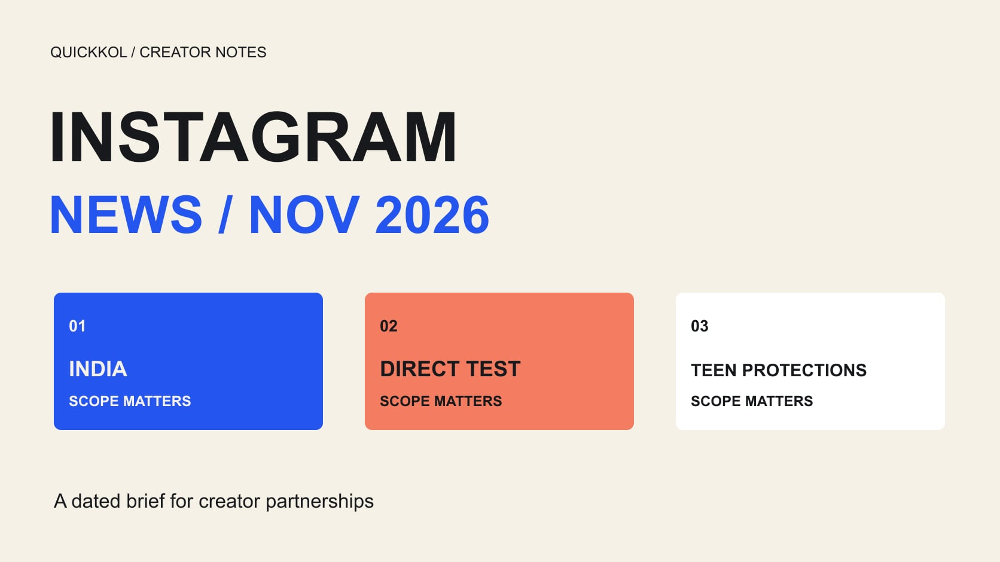
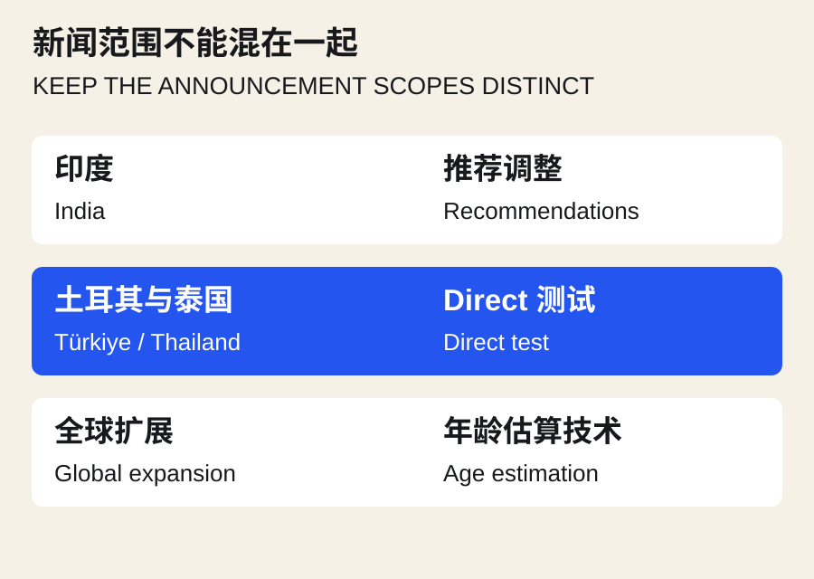

# Instagram 营销新闻：2026 年 11 月达人合作简报

从三项11月官方公告中，提炼品牌与达人需要调整、确认或暂不行动的内容。

> 草稿日期：2026年11月23日；仅独立本地预览。

这份 Instagram 营销新闻简报核验于2026年11月23日，选取三项对达人合作有具体意义的官方更新：印度推荐内容治理调整、Direct 独立消息应用的区域测试，以及青少年保护技术的扩展。它们分别涉及地区内容环境、沟通渠道和年龄适当的体验，不能合并成一次全球账号功能升级，也不能据此承诺触达、回复率或销售提高。

## 11月16日：印度推荐更新

[Meta 11 月印度推荐更新](https://about.fb.com/news/2026/11/an-update-on-the-content-we-recommend-on-instagram-in-india/)说明，该公司加强了推荐系统对当地用户不想看到内容的识别与处理。公告区分了推荐资格与违规内容删除，不能把“没有推荐”一概解释成内容已经被判违法或删除。

对在印度开展达人合作的品牌，直接相关的任务是核对作品是否适合推荐环境，以及原本依赖什么分发位置。不要把公告里的平台自述改善写成自己品牌必然增加的曝光，也不要把它外推为所有国家同样发生的改变。

编辑建议：让创作者和负责人检查实际作品与账号里可见的状态，记录具体提示。若作品涉及可能敏感的场景，先把准确、适当的表达写进简报，而不是在低播放后猜测“算法处罚”。本篇没有访问任何合作账号的私有状态。

## 11月16日公告、17日更新：Direct 区域测试

[Meta Direct 应用公告](https://about.fb.com/news/2026/11/introducing-direct-an-app-just-for-messaging/)介绍了由 Instagram 提供的独立消息应用，当次在土耳其与泰国测试。公告描述熟人沟通、创意消息与内置保护，并说明有 Instagram 账号与没有该账号的使用路径不同。

这不代表品牌现在可以向所有 Instagram 达人批量发消息。区域测试也不等于全球上线，更不等于对方已经启用。团队不应因为看见产品新闻，就把已有合作沟通强行迁到一个未确认可用的新入口。

编辑建议：继续使用创作者自己公开或约定的业务联系渠道。若双方实际处于测试范围且愿意使用，再确认账号身份与沟通边界。[Instagram 达人询问分流指南](/zh/blog/instagram-dm-creator-inquiry-triage/#answer)可帮助整理已经收到的合作信息，而不是把新消息工具当成无限触达许可。

## 11月上旬：青少年保护继续扩展

[Meta 11 月青少年保护公告](https://about.fb.com/news/2026/11/expanding-teen-account-protections-to-teens-around-the-world/)介绍，将识别可能为青少年的年龄估算技术扩展至全球，以便将更多账号纳入相应保护。公告还分别提到美国的家长通知与澳大利亚的年龄范围信号，三项范围不能混写成一个全球相同的操作步骤。

达人营销的相关问题是内容与合作是否适合实际受众，以及沟通与数据安排是否尊重相应保护。不能因为某位创作者是成年人，就推断其全部观众也是成年人；也不能从公开头像、外貌或昵称判断个人准确年龄。

编辑建议：需要年龄信息时，使用获准、适当且能解释口径的汇总资料；涉及具体合作资格则交由负责人核对。不要为了完成营销目标要求用户绕开保护。作品可以面向一般观众，品牌仍应检查产品、表达和购买路径是否适合预期市场。

截至2026年11月23日的来源快照；全球年龄估算扩展不表示各地所有功能相同。

## 把新闻变成三种不同决定

印度项目需要检查当地作品与推荐环境；Direct 测试首先需要确认双方是否实际可用与愿意使用；青少年保护则影响受众适当性与沟通安排。不要给三项新闻都附上同一句“立即调整所有达人策略”。

例如，假设一家在英国销售家居产品的品牌与成年创作者合作，公告不自动要求它更换联系渠道。若同一团队要在印度发布新的内容，则应重新确认该市场的表达与分发安排。若产品或沟通可能涉及年轻观众，则将年龄适当性放进实际审核。

这个例子是本篇编辑分析，不是 Meta 为品牌提供的官方操作方案。把来源披露事实、团队适用性判断和实际行动分别写清，能让负责人看懂为什么某条新闻值得执行，另一条只是继续观察。

## 核对合作资料，而不是追一个统一分数

新闻可能改变问题清单，但不能替代对候选达人的作品研究。保持对语言、题材、实际内容与合作入口的核对，必要时要求更新的授权资料。不能把公告发布时间当成账号数据已经同步更新的证明。

[达人报告与证据备忘指南](/zh/blog/influencer-reporting-decision-memo-and-evidence/#answer)可帮助记录来源日期、适用范围与实际观察。为每项行动标明负责人和复核日期，如果产品仍在测试，就保留“未在目标账号确认”状态，不把它写成团队已经掌握的新能力。

下一次新闻简报应更新事实，而不是只改标题月份。若 Direct 范围变化、推荐政策更新或保护功能新增，需要读取当次来源并重新评估。当前文章记录的是本次核验快照，不能充当未来所有合作的实时状态看板。

## 把下一步研究写成具体内容需求

如果新闻确实改变合作需求，就写成可以研究的问题。例如“寻找能为印度市场制作清楚家居演示的创作者”，并另外核对语言、实际作品与商业条件。不要用“适应新算法”这种宽泛描述要求达人保证结果。

[QuickKOL 官网能力说明](https://www.quickkol.com/)提供从需求出发发现与研究达人的入口。它可以成为候选研究的起点，但不是获取 Instagram 私有政策状态、青少年身份或 Direct 测试资格的证明。

这份简报的可执行结论是：先识别地区与产品范围，再决定要检查什么；保留现有可用的合作路径，只在事实支持时调整。这样新闻才能服务达人营销，而不是让团队不断为尚未适用的功能重做流程。

## 下一步

用市场、语言和作品任务研究候选达人，再核对具体合作条件。

[开始达人研究](https://www.quickkol.com/)

## 来源与范围

资料核验于2026年11月23日，基于可读取的公开来源。未登录或修改用户账号；编辑示例不代表真实客户结果，平台功能以实际账号为准。

- [Meta 11 月印度推荐更新](https://about.fb.com/news/2026/11/an-update-on-the-content-we-recommend-on-instagram-in-india/)
- [Meta Direct 应用公告](https://about.fb.com/news/2026/11/introducing-direct-an-app-just-for-messaging/)
- [Meta 11 月青少年保护公告](https://about.fb.com/news/2026/11/expanding-teen-account-protections-to-teens-around-the-world/)
- [QuickKOL 官网能力说明](https://www.quickkol.com/)
