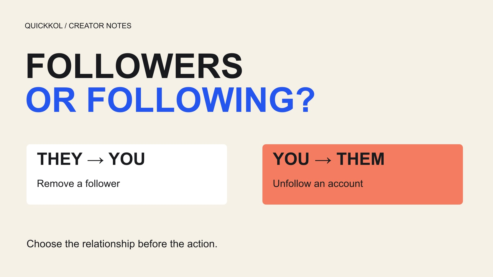
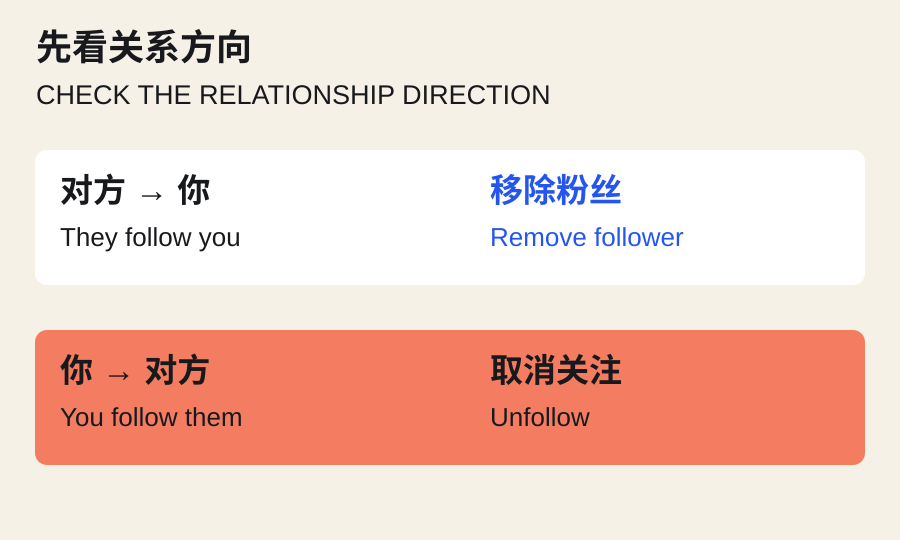

# How to Remove an Instagram Follower: Creator Guide

Handle one follower-removal task from the correct account, checking the person and result while separating removal from unfollowing and other controls.

> Draft date: November 23, 2026; independent local preview only.

To remove an Instagram follower, enter the correct account you are authorized to manage, open Followers, locate the exact username and use the removal action available for that entry. Read any confirmation, then check the list afterwards. Do not confuse Followers with Following and accidentally unfollow someone instead. The route below uses an accessible Instagram and Internet Matters guide; that material is older, so confirm current menus and account conditions in the actual interface. A brand partnership does not grant control over a creator’s private relationships.

## Identify the relationship you intend to change

Followers are accounts following you; Following contains accounts you follow. The same person can appear in both, but the direction of the action differs. Establish whether the task is to stop retaining someone as a follower or to stop following them. Do not act from a familiar button position alone.

Check the signed-in username as well. A creator, brand and agency may manage several accounts, and similar portraits are not sufficient identification. The [account-identity and collaboration guide](/blog/instagram-accounts-collaboration-identity-map/#answer) helps establish who may operate which entity.

This tutorial concerns one identified account-management task. It is not an audience-cleaning, false-follower detection or engagement-improvement method. Removal can reflect personal boundaries or community management; it does not establish that the removed account is false. Recheck the complete username and list after the action.

Confirm the relationship direction before acting so follower removal does not become an unintended unfollow.

## Use the follower-list route

The [Instagram and Internet Matters toolkit](https://www.internetmatters.org/wp-content/uploads/2020/02/Make-instagram-work-for-you.pdf) documents finding the relevant account in the follower list and using the action beside its handle to remove it. The document explains this in a private-account context; it is not evidence of identical button positions for every account in 2026.

Use five functional steps: open the intended profile, enter Followers, confirm the full username, select the entry’s removal action and read any prompt, then return to check the list. If display names match, inspect the actual handle before acting so the operation concerns the intended person.

Cancel if the confirmation identifies a different account or effect. Only an authorized operator should continue. Passwords and verification codes do not belong in a brand’s shared review sheet so that an ordinary content reviewer can act as the account holder.

The expected result is that the target entry no longer appears in its previous follower state in the inspected list. If the list is refreshing, wait and check again rather than repeatedly selecting different entries. These are instructions for checking the result, not a claim that this article removed anyone.

Practice with two fictional entries before taking a real action. Suppose both display the same photography-studio name but only one handle matches the account holder’s intended target. The operator should compare the full username and inspect the current relationship before proceeding. A familiar portrait or a position at the top of the list is not sufficient identification. The exercise ends with a clear decision: the intended entry was found, or there is insufficient information and no action will be taken. If a different entity appears during confirmation, cancel and inspect again. Do not treat an unintended operation as successful completion or try to repair the uncertainty by removing several accounts. This is a hypothetical check of the task, not an instruction to experiment on real followers.

## Removal, blocking and restricting have different purposes

Do not interpret a follower-list change as making every piece of content invisible to that person. Public visibility, current settings and the specific control affect the situation. If a stronger interaction boundary is required, read the relevant feature explanation in the account.

[Meta’s creator-safety explanation](https://about.fb.com/news/2024/06/protecting-athletes-and-fans-on-our-apps-during-major-sporting-events-this-summer/) describes different controls, including blocking, restricting and management of potentially unwanted followers. That is feature context, not proof of identical availability across accounts or an authenticity finding about every flagged person.

If the task concerns one person, do not extend it to a bulk operation. If the underlying problem is harassment or unwanted interaction, choose the appropriate official control for that problem. Check current help and confirmation wording for notification or future-following behavior. This guide did not sign into accounts to verify every version.

## If the control is missing or the result is unclear

First check that the list is Followers, not Following, then verify the account, application version and permissions actually granted. If the target is absent, do not automatically record a successful removal. The relationship may have changed before this operation.

Describe the specific interface problem and use in-account official help for applicable instructions. One individual action does not require buying a bulk-cleanup service or submitting account secrets to an unfamiliar page. [FTC’s phishing guidance](https://consumer.ftc.gov/articles/how-recognize-avoid-phishing-scams) recommends independently checking suspicious requests through a known genuine route.

This is not a safety verdict on every outside tool. It keeps the operation within its authorization. If no available route lets the operator confirm the target and effect, pause the action and resolve the account question first. A brand need not take possession of the entire creator account to do so.

## Share only the campaign context that matters

A brand may need to know that account management occurred during a reporting window without receiving the removed person’s private details. Retain the necessary time, action type and affected interpretation rather than circulate a personal list in an external report.

The [follower-removal and campaign-record guide](/blog/instagram-follower-removal-campaign-record-change/#answer) addresses denominator changes and history. This article focuses on the target and operation. One fewer follower does not establish weaker content, and one removal does not certify an entirely clean audience.

Close by confirming the correct account, intended person and either the result or a clear reason the task remains incomplete. The creator continues managing their community while the brand evaluates relevant work and task evidence. Both activities can retain their appropriate boundaries.

## Next step

Base partnership research on relevant work, audience questions and a defined content task.

[Explore QuickKOL](https://www.quickkol.com/)

## Sources and scope

Reviewed November23,2026. The current Instagram help page was inaccessible; this guide uses an accessible earlier Instagram/Internet Matters operating document and Meta safety material. No signed-in test was performed; identical current menus, notification behavior and public-account conditions are not promised.

- [Instagram and Internet Matters’ toolkit](https://www.internetmatters.org/wp-content/uploads/2020/02/Make-instagram-work-for-you.pdf)
- [Meta’s creator-safety explanation](https://about.fb.com/news/2024/06/protecting-athletes-and-fans-on-our-apps-during-major-sporting-events-this-summer/)
- [FTC’s phishing guidance](https://consumer.ftc.gov/articles/how-recognize-avoid-phishing-scams)
