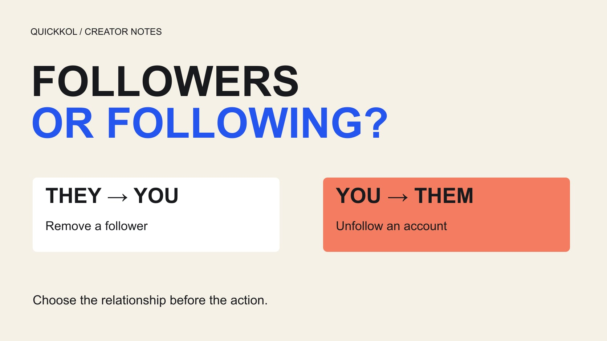
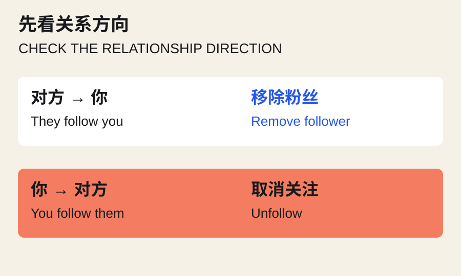

# 创作者怎样移除 Instagram 粉丝

从正确账号的粉丝列表完成单次移除，核对对象与结果，并清楚区分移除、取关和其他互动管理。

> 草稿日期：2026年11月23日；仅独立本地预览。

移除 Instagram 粉丝时，先进入你获准管理的正确账号，打开 Followers／粉丝列表，找到目标用户名，再使用该条目提供的移除操作并阅读确认提示，最后核对列表结果。不要误进 Following／关注列表而取消自己对别人的关注。下文依据可读取的 Instagram 与 Internet Matters 指南说明这条操作路径；资料较早，当前菜单和账号条件需在实际界面核对。品牌没有因合作就获得管理达人私人关注关系的权限。

## 先确认你要改变哪一段关系

Followers 是关注你的人，Following 是你关注的人。两张列表里的账号可以重叠，但处理的方向不同。操作前写清目标是“不再把此人保留为我的粉丝”，还是“不再关注此人”，不要凭按钮位置快速点击。

同时核对当前登录的用户名。创作者、品牌和代理可能管理多个账号，不能只看相似头像。[账号身份与协作关系指南](/zh/blog/instagram-accounts-collaboration-identity-map/#answer)可以帮助团队确认本次谁有权操作哪个主体。

这篇教程处理一次有明确对象的账号管理，不是清洗受众、识别假粉或提高互动率的方法。移除理由可能是个人边界或社群管理；被移除不代表该账号已被证明虚假。 操作后应再核对完整用户名与列表。

操作前先确认关系方向，避免把移除粉丝变成取消自己的关注。

## 从粉丝列表完成单次操作

[Instagram 与 Internet Matters 工具指南](https://www.internetmatters.org/wp-content/uploads/2020/02/Make-instagram-work-for-you.pdf)记录了从粉丝列表找到对应账号、再使用用户名旁操作移除的路径。该文件在私密账号的语境下说明此功能；本篇不把它写成2026年所有账号都完全一致的按钮位置。

操作可以分为五步：进入目标资料页；打开 Followers／粉丝；用完整用户名确认对象；选择条目中的移除操作并阅读出现的提示；返回列表核对。若有显示名称相同的账号，应先查看准确的用户名，避免作用到另一个人。

确认提示中的对象与预期不一致，就取消。只有获准管理账号的人应继续这项操作。不要在品牌共享表里放入密码或验证码，让普通内容审核者代替本人处理。

预期输出是目标条目不再按原状态出现在所检查的粉丝列表中。若列表正在刷新，先等待并重新查看，不要反复点击不同对象。这里说明检查方法，没有替用户实际移除任何人。

可以先做一个不执行真实操作的同名练习。假设两个账号都显示同一个摄影工作室名称，只有其中一个用户名是本人指定的对象。操作者应先对照准确用户名，查看当前关系，再决定是否继续。只凭头像眼熟，或因为某个账号排在最上面，都不是确认依据。练习的输出是一条清楚的决定：已找到正确对象，或信息不足、暂不执行。若操作过程中出现另一个主体名称，取消并重新检查，不把错误动作当成完成任务。

## 移除与屏蔽、限制不是同一个动作

不要把粉丝列表变化理解为所有内容都对这个人不可见。资料是否公开、当前可见性设置以及你选择的具体操作，会影响实际情况；若需要更强的互动边界，应阅读当前账号中相应功能的说明。

[Meta 创作者安全说明](https://about.fb.com/news/2024/06/protecting-athletes-and-fans-on-our-apps-during-major-sporting-events-this-summer/)介绍过屏蔽、限制及潜在垃圾粉丝管理等不同工具。这是功能背景，不意味着每项功能在所有账号里都有同样入口，也不是每个被标记账号的真实性鉴定。

这次任务只要求移除某个人，就不要顺带批量处理其他人。若问题实际是骚扰或不想收到互动，再按问题选择合适的官方控制。关于是否通知、能否再次关注等细节，以当前帮助和确认说明为准；本篇没有登录账号核验所有版本。

## 看不到相应入口时怎样处理

先确认打开的是粉丝列表而不是关注列表，再检查目标账号、实际应用版本和你获得的管理权限。若目标条目已不存在，不要把搜索不到自动记成刚才操作成功；它也可能在此前已经变化。

保留当前界面的具体问题，再从账号内官方帮助寻找适用说明。没有必要为一次单人操作购买批量清理服务或向陌生页面提交账号秘密。[FTC 反钓鱼指南](https://consumer.ftc.gov/articles/how-recognize-avoid-phishing-scams)建议，通过已知真实的渠道另行核对可疑请求，不使用来信中未经确认的入口。

这不是对所有第三方工具的安全判定，而是让操作保持在已授权范围。若没有能确认对象与效果的入口，就暂停这次动作，先解决账号功能问题。品牌无需因此要求创作者将整个账号转交。

## 达人合作中只交接必要的事件背景

品牌可能需要知道报告期间发生了账号管理事件，但通常不需要被移除者的私人资料。可以记录必要时间、操作类型和哪些统计解释可能受影响，避免把一份私人名单放进外部报告。

已有的[粉丝移除与合作记录指南](/zh/blog/instagram-follower-removal-campaign-record-change/#answer)讨论了分母变化和历史记录。本篇的重点是操作对象与结果；不要把“少了一个粉丝”写成内容变差，也不要把一次移除写成受众已经全部清洁。

结束前核对三件事：操作的是正确账号；对象与预期一致；结果或未完成原因清楚。创作者继续管理自己的社群，品牌按相关作品和任务证据评估合作，两者可以保持各自的边界。

## 下一步

研究合作仍应回到相关作品、观众问题与明确的内容任务。

[了解 QuickKOL](https://www.quickkol.com/)

## 来源与范围

核验于2026年11月23日。Instagram当前帮助页无法读取，采用可读取的较早 Instagram／Internet Matters 操作资料和 Meta 安全说明。未登录账号测试，不承诺所有当前菜单位置、通知行为或公开账号条件一致。

- [Instagram 与 Internet Matters 工具指南](https://www.internetmatters.org/wp-content/uploads/2020/02/Make-instagram-work-for-you.pdf)
- [Meta 创作者安全说明](https://about.fb.com/news/2024/06/protecting-athletes-and-fans-on-our-apps-during-major-sporting-events-this-summer/)
- [FTC 反钓鱼指南](https://consumer.ftc.gov/articles/how-recognize-avoid-phishing-scams)
