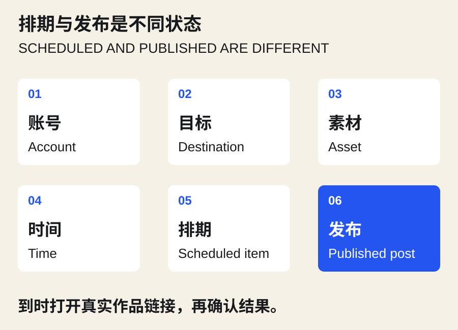

# Schedule Instagram Posts With Meta Business Suite

Follow a documented Business Suite route for creator collaboration content, checking the account, asset, time and scheduled result.

> Draft date: November 23, 2026; independent local preview only.

You can schedule an Instagram post through the Meta Business Suite functionality available to the intended account: select the correct business and account, create a post from Content or Planner, choose Instagram, add the asset and caption, review the preview, set the date and time, confirm, and check the scheduled item. The workflow below combines official capability information with an accessible illustrated guide. That guide shows an older interface, so confirm current labels and supported formats in the actual account. No user account was signed into or operated for this article.

## Confirm the account and scheduling route

[Meta’s Business Suite app listing](https://play.google.com/store/apps/details?id=com.facebook.pages.app&hl=en) describes managing and scheduling Facebook and Instagram content. [Meta Blueprint’s scheduling course overview](https://www.facebookblueprint.com/student/path/253041-meta-business-suite-customer-connection) also includes a scheduling lesson. These sources support the product route used here; they do not establish identical buttons or media options for every account at this moment.

Prepare the final image or video, caption, required commercial identification, intended account, publication date and time. Publishing permissions differ between a creator account and a brand account. Permission to use content in advertising does not automatically grant scheduling access to the creator’s profile.

Do not solve an access problem by requesting a personal password. The account owner should confirm the roles, connections and operating method currently offered by the product. The [account-identity and collaboration guide](/blog/instagram-accounts-collaboration-identity-map/#answer) helps establish who manages which entity before publication work begins. This matters especially when an agency operates several brands and a creator participates without joining the brand’s account administration.

## Step one: select the correct business and destination

Once in Business Suite, verify the business entity and connected account. Read the complete username rather than relying on an avatar, and compare it with the approved brief. If both the brand and the creator have Instagram accounts and this commission is for brand-account publication, do not select the creator’s profile by mistake.

[Landcare’s illustrated scheduling guide](https://www.environment.vic.gov.au/__data/assets/pdf_file/0044/689993/Landcare-Social-Media-Guide.pdf) shows an earlier interface using Content or Planner to create content and choose destinations. Look for the equivalent function in the current interface instead of repeatedly clicking unrelated menus to reproduce an old button position.

Where the composer offers Facebook and Instagram together, retain only authorized destinations. Convenient cross-platform selection does not establish permission to publish in both places. If Instagram is missing, ask the account owner to check the connection and access. An incomplete account connection is not a successfully scheduled publication, and the team should not mark it as one in the campaign calendar.

## Step two: add the final asset and inspect the preview

Upload the approved final file and enter its caption after opening the post composer. Check the version carefully, including similarly named exports, versions without subtitles and versions carrying the required commercial identification. Scheduling should not become the point where a brand unexpectedly replaces a creator-approved narrative.

For a hypothetical clothing commission, confirm the approved cover is first and later images preserve the styling sequence. For video, check whether subtitles obscure the action, the audio is correct and an expired price remains visible. Preview is a checking aid, not a substitute for examining the source file.

Supported functions can differ by format and account. If music, interactive elements, collaborative publication or another feature is absent from this route, do not assume it will appear automatically on publication. Keep the draft and confirm an authorized alternative. A responsible account owner can choose another available publishing method if the intended format cannot be represented accurately here.

## Step three: set the time and confirm scheduling

Check the time zone used by the interface before entering a scheduling date and time. Do not copy Friday at six from a campaign sheet without context: the creator, brand and target market may operate in different zones. Record a complete date and zone for the intended moment.

Before final confirmation, reread the destination, asset, caption and displayed time. A draft or an item still awaiting confirmation should not be reported to the team as scheduled. The illustrated guide documents a time-selection and confirmation route, but it does not establish a universal 2026 advance-scheduling horizon or daily allowance for every account.

If a hypothetical commission is due at 18:00 local time, record the place and date in the collaboration sheet and verify the corresponding time shown in Business Suite. The responsible person should check any daylight-saving or cross-zone conversion. Assuming the system will handle it is not a substitute for observing the actual scheduled result.

A functional checking route, not a replica of the current Business Suite interface.

## Step four: verify the scheduled item

After confirmation, return to Planner or the current content list and locate the item. Verify account, date, time, thumbnail and status. Retain only the internal record needed for the task; do not circulate entire dashboard screenshots containing private information.

If the item is missing, inspect filters, destination and date range before checking whether it remains a draft. Avoid immediately creating another copy, which can produce duplicate scheduled posts. Record an error message and the step where it appeared so an authorized operator can investigate the actual issue.

Review the final status again after changing an asset or caption. An earlier approval does not automatically cover a different version. The [brand-partnership content-governance guide](/blog/brand-partnerships-joint-content-governance/#answer) can help define which revisions need renewed approval and who performs the last publication check. A calendar entry in a separate document is useful coordination, but it is not evidence that the product accepted the schedule.

## Check actual publication after the scheduled time

A confirmed schedule and a published post are different states. After the intended time, open the actual publication and verify account, content, caption and commercial identification. If it fails, is delayed or requires intervention, retain the real status and agree the revised arrangement with the creator and brand.

Begin the reporting window from actual publication rather than including a period when the post did not exist. Record any later advertising start separately. A screenshot of a scheduling status does not establish reach, viewing or sales outcomes.

Keep the minimum useful record after the collaboration: final asset version, approved text, scheduled time, actual URL and responsible person. This makes later changes traceable without asking colleagues to infer the final version from a long message history. The purpose of scheduling is dependable publication, not simply filling a calendar with items that look complete.

## Check the full route with a clothing commission

The following is a hypothetical scheduling exercise, not an account test. A brand plans to publish three creator-made outfit photographs only to the brand’s Instagram. The operator first confirms that A-final is the cover and B-final and C-final are the subsequent images, then checks the approved caption’s product model and commercial relationship.

In the composer, select the correct Instagram destination before uploading all three assets. Inspect order and cropping, ensuring the first image does not lose the clothing detail the commission is meant to show. If this route does not support the required form, preserve the material and resolve the issue rather than silently changing the publication format.

Write a complete calendar date and the intended location’s time zone, then compare that plan with the scheduling interface. After confirmation, locate the item in the list and record its state. Success in this exercise means agreement between destination, assets, caption and time. It does not mean merely having clicked a button.

After the intended time, open the actual URL and enter the actual publication time in the report. If only two images appear, a published status in the list is not enough to declare completion. Compare the work with the agreement and discuss correction. If two duplicate publications appear, investigate before an authorized person decides what to do.

Also agree how urgent changes will be communicated. Unavailable stock, an asset error or a reasonable creator revision may require pausing the schedule. A named owner and approved version reduce mistakes caused by time-zone differences or delayed messages. Keep a clear distinction between changing a plan, changing a scheduled item and editing a published post. Each requires confirmation of the resulting state, and the team should know which one it is asking the operator to handle.

If phone and desktop views disagree, first check entity, date range and status, then have one responsible operator confirm the final result. Two colleagues should not each schedule another copy for reassurance; that can create duplicates. Give the last prepublication check an owner and time. If the interface cannot demonstrate a saved schedule, report the unresolved state plainly and agree the next authorized action rather than claiming the post is ready. A clear pending state is actionable; an unsupported completion message can cause the team to stop monitoring.

## Fit scheduling around the creator’s work

For a creator commission, understand production lead time and the person’s ordinary content rhythm before setting brand approval deadlines. Adding a setting or changing a core product claim at the last moment while insisting on the original publication time creates avoidable pressure.

[QuickKOL’s product explanation](https://www.quickkol.com/) offers discovery and creator research from a content need. Research expressive fit first; confirm scheduling, permissions and publishing functions directly in the actual account with the parties involved. This article is not a description of an automatic QuickKOL publishing feature.

The practical sequence is now clear: verify the entity, select the destination, inspect the asset, set the time, validate the scheduled item and check the actual publication. Each step has an observable result. That provides a more reliable collaboration record than a general message saying the post has been arranged.

## Next step

Define the content need, then agree workable production and publication dates.

[Research creators with QuickKOL](https://www.quickkol.com/)

## Sources and scope

Sources reviewed November 23, 2026 using accessible public material. No user account was signed into or changed. Editorial examples are not client outcomes; confirm features in the intended account.

- [Meta’s Business Suite app listing](https://play.google.com/store/apps/details?id=com.facebook.pages.app&hl=en)
- [Meta Blueprint’s scheduling course overview](https://www.facebookblueprint.com/student/path/253041-meta-business-suite-customer-connection)
- [Landcare’s illustrated scheduling guide](https://www.environment.vic.gov.au/__data/assets/pdf_file/0044/689993/Landcare-Social-Media-Guide.pdf)
- [QuickKOL’s product explanation](https://www.quickkol.com/)
