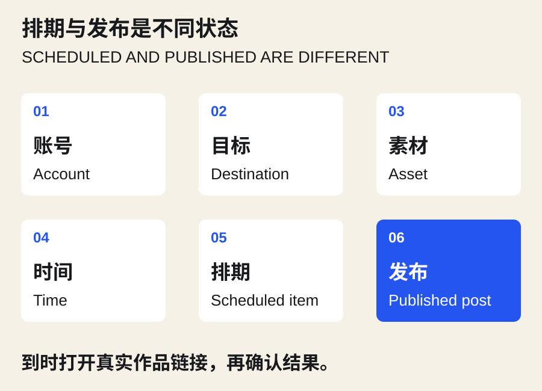

# Instagram 帖子排期：Meta Business Suite 操作指南

使用有来源的 Business Suite 路径安排达人合作作品，逐步确认账号、内容、时间和排期结果。

> 草稿日期：2026年11月23日；仅独立本地预览。

Instagram 帖子排期可以通过账号可用的 Meta Business Suite 功能完成：进入正确业务与账号，从内容或排期入口创建帖子，选择 Instagram，添加作品与说明，检查预览，设定日期时间并确认排期，最后回到列表核对。下文依据官方功能说明与可读取的图示教程整理；教程中的界面较早，按钮位置和可用格式需在实际账号确认。本篇没有登录或代操作用户账号。

## 先确认这项功能与账号是否匹配

[Meta Business Suite 官方应用说明](https://play.google.com/store/apps/details?id=com.facebook.pages.app&hl=en)列出管理与安排 Facebook 和 Instagram 内容的能力。[Meta Blueprint 排期课程目录](https://www.facebookblueprint.com/student/path/253041-meta-business-suite-customer-connection)也包含排期教学入口。两者支持本篇所用产品路线，但不能证明每个账号此刻都具备完全相同的按钮或媒体选项。

开始前准备最终图片或视频、说明文字、作品所需的商业标识、正确账号、计划日期及时间。创作者账号与品牌账号的发布权限不同；品牌获得广告使用权，不等于自动拥有达人账号的排期权限。

不要向协作方索取个人密码来解决权限问题。由账号负责人确认当前产品提供的角色、连接和操作方式。[账号身份与协作关系指南](/zh/blog/instagram-accounts-collaboration-identity-map/#answer)可帮助先明确谁管理哪个主体，再进入发布工作。

## 步骤一：进入正确业务与 Instagram 目标

进入 Business Suite 后，先核对业务主体与连接的账号。不要只看头像，阅读完整用户名，并与已经批准的发布简报核对。假设品牌与达人都各有一个 Instagram 账号，这次计划品牌账号发布，就不应误选达人自己的资料。

[Landcare 图示排期教程](https://www.environment.vic.gov.au/__data/assets/pdf_file/0044/689993/Landcare-Social-Media-Guide.pdf)在较早的界面中展示了 Content 或 Planner 进入创建内容、选择发布目标的路线。可以按功能名称寻找当前对应入口，但不要为了一模一样的旧按钮位置反复点击无关菜单。

当创建器同时提供 Facebook 和 Instagram 时，只保留本次获准的目标。跨平台选项方便，不代表同一作品已经获得在两个地方发布的许可。若 Instagram 未出现，先让账号负责人检查连接与权限；不应把未完成连接解释成作品已排期。

## 步骤二：上传最终文件并检查预览

选择创建帖子后，上传已经批准的最终素材，填写对应说明。确认文件版本，尤其注意同名导出、无字幕版本与带商业标识版本。品牌不应在排期最后一步才临时替换创作者已确认的叙事。

以假设服装合作为例，检查第一张图是否确实是批准封面，后续图片顺序是否保留搭配步骤。若是视频，核对字幕是否挡住动作、声音是否正确，以及画面是否含过期价格。预览只是检查入口，不能取代对源文件的核对。

不同格式在当前账号里的功能可能不同。音乐、互动元素、合作发布或其他选项若未出现在该排期路径，不要假定它们会在发布时自动补齐。保留草稿，确认可用替代方法，必要时由负责人选择其他获准的发布路径。

## 步骤三：设置时间并完成确认

在排期选项输入日期和时间前，先核对当前界面使用的时区。不要只把活动表上的“周五下午六点”复制过去：创作者、品牌与活动市场可能处于不同时区。用完整日期与时区记录同一个计划时点。

点击最终排期确认前，再读一遍目标账号、素材、说明和显示时间。若界面仍显示草稿或等待确认，就不能向团队报告已经排期。图示教程展示了选时间与确认的路线，但本篇不据此承诺2026年所有账号可提前多少天或每天可排多少条。

假设品牌约定当地18:00发布，在协作表中写清该地点与日期，并核对 Business Suite 显示的相应时间。涉及夏令时或跨区协作时，由负责人核对具体转换。不要让“系统会处理”成为没有检查结果的替代。

功能检查路线，不是当前 Business Suite 界面的仿制截图。

## 步骤四：回到列表核对排期结果

完成确认后回到 Planner 或当前内容列表，查找对应作品。核对账号、日期、时间、缩略图和状态。保留必要的内部记录即可，不要把含私人资料的整页后台截图到处共享。

如果作品未出现，先检查筛选条件、目标账号与列表日期范围，再确认是否仍是草稿。不要立即重新创建第二条，避免之后发现两条重复排期。遇到错误提示，记录原文与发生步骤，由有权限的人处理。

若排期后修改素材或文字，再检查一次最终状态。原始审批并不自动覆盖新版本。[品牌合作内容治理指南](/zh/blog/brand-partnerships-joint-content-governance/#answer)可以帮助团队约定什么改动需要再次确认，以及谁负责发布前最后一次核对。

## 到点后确认真实发布，而不是只看计划

排期成功和正式发布是两个状态。计划时间过后，打开实际作品链接，检查账号、内容、说明与商业标识。若发布失败、被延迟或需要处理，保留真实状态，并与创作者和品牌沟通新的安排。

报告从实际发布时间开始记录，不能因为原计划更早就把尚未存在的作品算入观察窗口。若品牌后来加广告，也单独记录其开始时间。不要把排期工具的状态截屏当成触达、观看或成交结果。

完成一条合作后，保留最少必要记录：最终文件版本、批准文本、计划时间、实际链接与负责人。下次需要调整时，团队可以直接找到正确版本，而不是从一长串即时消息里猜测哪条是最终稿。

## 用一个服装合作核对完整结果

以下是假设的排期练习，不是真实账号测试。一家品牌准备发布创作者制作的三张搭配照片，目标只有品牌 Instagram。负责人先在文件夹确认 A-final 为封面、B-final 与 C-final 为后续图片，再核对已批准说明中产品型号与商业关系。

进入创建器后，先选择正确 Instagram 目标，再上传三张素材。预览时检查顺序和裁切，确认第一张不把关键服装细节切掉。若当前路径不支持需要的形式，先保留资料并解决，不在不知情时改成另一种发布格式。

日期写成完整年月日，时间另注明目标地点时区，再与排期界面核对。确认后回到列表找到该条作品，记录其状态。这个练习的成功条件是目标、素材、说明和时间都一致，而不是按钮已经点过。

到计划时间后，负责人打开真实链接检查，并把实际发布时间写入报告。若只出现两张图，不能只凭列表显示已发布就宣布任务完成；应核对实际作品与约定，讨论修正方式。若出现两条重复作品，也先查清原因，再由有权限者决定处理。

发布前双方还应约定临时改动怎样沟通。产品缺货、素材错误或创作者提出合理修订，都可能需要暂停排期。保留明确负责人和已批准版本，可以减少团队因时区或即时消息延迟而误发。

如果手机和桌面显示不一致，先确认是否查看同一主体、日期范围和状态，再由同一负责人核对最终结果。不要让两个成员各自重新排一遍来“保险”，这可能制造重复作品。发布前最后一次检查应有清楚的归属与时间。

## 让排期服务于创作者的内容节奏

安排达人合作时，先了解对方制作周期与正常内容节奏，再确定品牌审批期限。不要在最后一刻增加场景或修改核心产品主张，同时要求保留原发布时间。

[QuickKOL 官网能力说明](https://www.quickkol.com/)提供按内容需求发现与研究达人的入口。找人时可以研究其表达方式和内容适配性，具体排期、权限与发布功能仍由双方在实际账号中确认；本页不是 QuickKOL 自动发布功能说明。

现在可以按顺序完成：确认主体、选择目标、核对素材、设定时间、验证排期、检查实际发布。每一步都有可以观察的结果，比一句“已安排”更可靠。

## 下一步

把作品需求说明白，再与对方约定可以执行的制作与发布时间。

[在 QuickKOL 研究达人](https://www.quickkol.com/)

## 来源与范围

资料核验于2026年11月23日，基于可读取的公开来源。未登录或修改用户账号；编辑示例不代表真实客户结果，平台功能以实际账号为准。

- [Meta Business Suite 官方应用说明](https://play.google.com/store/apps/details?id=com.facebook.pages.app&hl=en)
- [Meta Blueprint 排期课程目录](https://www.facebookblueprint.com/student/path/253041-meta-business-suite-customer-connection)
- [Landcare 图示排期教程](https://www.environment.vic.gov.au/__data/assets/pdf_file/0044/689993/Landcare-Social-Media-Guide.pdf)
- [QuickKOL 官网能力说明](https://www.quickkol.com/)
