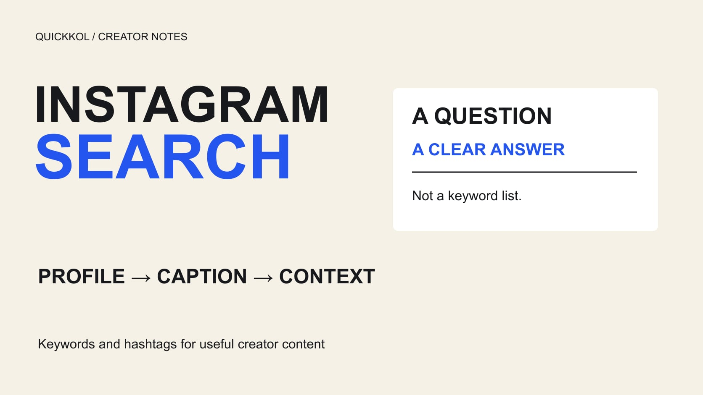
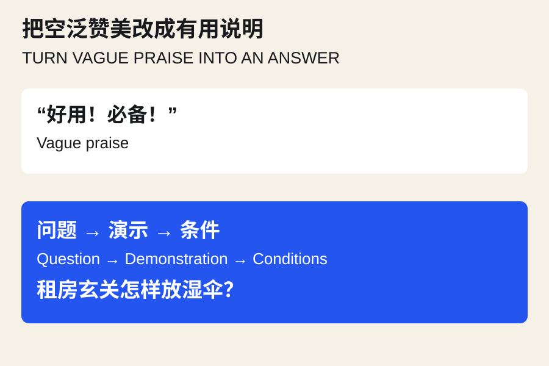

# Instagram SEO: Keywords and Hashtags for Creators

Put the audience’s actual search question into profiles and publications, with adaptable examples for a creator partnership.

> Draft date: November 23, 2026; independent local preview only.

Instagram SEO means making a creator’s profile and publications clearly answer a search need. Start with a question the intended audience actually asks, describe the relevant identity and subject naturally in the profile and caption, and use hashtags to clarify genuine topics. It is not keyword stuffing or a ranking guarantee. This guide brings SEO, Instagram keywords and hashtags together as one publishing task: making creator partnership content understandable and findable.

## Distinguish Instagram Search from web search

[The archived Instagram Search explanation](https://archive.ph/QjutM) preserves Adam Mosseri’s 2021 account of in-app search: entered text can be matched with relevant account and content information, while personal activity also affects results. This is historical first-party material available through an archive. It is not a complete 2026 algorithm formula or a current hashtag-count rule.

[Google’s SEO starter guide](https://developers.google.com/search/docs/fundamentals/seo-starter-guide) concerns how webpages are discovered, crawled, understood and displayed. That process differs from searching inside Instagram. Making an Instagram publication easier to understand does not guarantee Google indexing or establish that the creator controls every technical setting.

First ask where the intended audience is looking. If a brand wants people searching a styling question to find a creator’s answer, clarify the publication’s subject and description. If the objective is website search traffic, the brand also needs its own useful website content. A single SEO score should not combine two different tasks and imply that one improvement completes both.

## Choose one audience question for the commission

Start with the question the publication can answer, rather than the largest available keyword. In a hypothetical small-home storage commission, the audience might ask where to put wet umbrellas in a rented entrance. That is more actionable than lifestyle. A defined question lets the creator show the objects, actions and conditions needed for an answer.

Write the primary question, related wording and excluded scope. The main subject might be rainy-day entrance storage; related language could include a no-drill umbrella holder, rental entrance and wet-umbrella handling. A full home renovation could be outside scope. Related terms help check relevance; they are not a checklist that must all fit into the title.

Public comments and search results can inform audience wording, but personalized recommendations are not a market-wide demand estimate. Record the language and date and use actual questions to improve the brief. The [Instagram creator-search brief guide](/blog/instagram-search-creator-topic-brief/#answer) covers candidate research when you still need somebody to answer the question. This article addresses how the commissioned content is described for publication.

## Make the profile explain the creator’s work

A profile should quickly explain what the creator covers, the language or setting of the work, and the appropriate collaboration contact. Do not rewrite a long-standing identity as a list of product terms for one sponsorship. A city should not be presented as the main audience location without supporting information either.

For example, a hypothetical Chinese-language rental-home creator could describe the account as covering rental storage and reversible improvements, with small-space demonstrations and practical details. This is an editorial example, not a real person’s biography. Any business contact should be one the creator chooses to make public, rather than private information added for convenience.

Profile name, username and biography serve different purposes. An established username may already be recognized by viewers and should not change casually after one keyword exercise. Brands can specify a publication’s subject, while the creator retains control of long-term account identity. Both parties should check that descriptive titles are accurate instead of using inflated credentials to create apparent relevance.

## Write a useful caption instead of a term list

Suppose the draft caption reads: useful, essential, amazing storage. A stronger version could ask how to store wet umbrellas in a rented entrance, then explain that the creator uses a no-drill holder to separate umbrellas from shoes and demonstrates installation, water handling and access. It should also identify relevant surface conditions and where removal is explained, if removal is actually shown.

The description must match the video. If the film does not demonstrate removal, the caption should not imply that it does. Verify brand-supplied dimensions, materials and use conditions, while allowing the creator to describe their experience naturally. Search relevance comes from genuinely answering the question, rather than repeating entrance storage in every sentence.

Start by making the audience connection clear, then provide necessary steps or conditions and an appropriate next action. This is not a mandatory caption order: commercial identification must remain clear under applicable requirements. Do not bury a partnership disclosure or material limitation simply to fit more search terms into the visible opening.

An editorial rewrite for a hypothetical rental-storage collaboration, not an account or ranking test.

## Use hashtags to clarify an established subject

For the hypothetical post, consider topic, specific setting and genuinely relevant campaign identification separately. Rental storage and rainy-day entrances describe the content. Beauty, travel or celebrity tags would not become relevant merely because they are popular. Check the current account interface and official guidance for available counts; this guide does not assert an unverified universal limit.

The 2021 explanation gives specific advice about relevant keywords and hashtags in captions, while later functionality can change. [Instagram’s creator-education announcement](https://about.fb.com/news/2024/10/best-practices-education-hub-creators-instagram/) describes learning material and personalized tips in the professional dashboard. That is a useful place to continue checking account-relevant advice, rather than a public table of fixed ranking weights.

Ask two questions: would the publication remain understandable without this tag, and would retaining it give the viewer a false expectation? Remove terms whose only purpose is attracting unrelated traffic. A campaign hashtag may help organize collaboration material, but it does not guarantee that all viewers encounter the campaign or every relevant publication appears in search results.

## Make accessibility serve understanding

Captions help viewers understand speech, and alternative text should describe information actually shown in an image. Those tasks have reading value without requiring a claim about a hidden algorithm bonus. Do not turn alternative text into a concealed paragraph of repeated titles, brand names and keywords, or describe an effect the image does not show.

For an image of an umbrella holder beside an entrance, describe its position and how wet umbrellas are separated. A claim that it is the best rental-storage purchase destination would not describe the picture. When an image carries measurements, make the relevant conditions understandable in the surrounding text as well. Essential information should not exist only as small decorative lettering.

Review factual accuracy, readability and search wording together. Does mobile cropping preserve the action? Do subtitles cover the installation step? Can readers understand why the method fits this situation? These questions can improve a creator commission without pretending that a wording technique guarantees a search position.

## Review discoverability with a clear record

Before publication, save the final title, caption, tags and URL with the language and date. If you later check whether the post appears in search, record the query, account state, region and time. One result viewed from your account is not every user’s result.

Review available publication measures and audience questions alongside that record. If the account does not expose search-source traffic, mark it unavailable. Do not attribute all new viewing to the caption revision. The [creator social-metrics decision guide](/blog/social-media-metrics-creator-decision-tree/#answer) helps separate observed outcomes from editorial interpretation.

Change the next publication to address a specific information gap. Add surface compatibility if readers do not understand it, or demonstrate measurements if size remains unclear. More hashtags are not the automatic answer to every weak result. Turning feedback into a better explanation creates a useful publishing habit and a stronger basis for discussing future creator partnerships.

## Check the scope through a prepublication rewrite

Suppose the initial title is simply storage recommendations. Ask what the video actually answers and rewrite it around storing wet umbrellas in a rented entrance. Related wording can appear naturally once, alongside relevant surface, installation and removal conditions. Do not remove the rental context just to target a broader term when that context determines whether the method is appropriate.

For bilingual publications, use the expressions each intended audience actually recognizes. Chinese and English hashtags do not need a forced one-to-one correspondence. Preserve product facts and limitations, then have a competent reader check that each version sounds natural. This is not another keyword batch. It makes the same answer understandable in two languages, with a title, caption and illustration that describe the same task. Save both approved versions so a later edit does not accidentally leave one language promising more than the other.

Include a season, city or product name only when it changes the answer; avoid repeated lists intended solely to widen coverage.

## Let the content task guide the next partnership

After the rewrite, the team should be able to state the publication’s question in one sentence and identify the visible steps answering it. If a candidate does not work in that setting, do not solve the mismatch by asking them to recite keywords. Research somebody with more relevant content experience.

[QuickKOL’s product explanation](https://www.quickkol.com/) provides a starting point for discovery and research from a partnership need. A brief could specify Chinese-language rental storage, reversible installation demonstrations and attention to use details. Review actual publications and contact conditions afterwards. The connection with search is practical: a suitable creator is better placed to make an answer worth finding. It is not a guarantee of ranking.

Keep the creator’s own expression. Keywords clarify the topic but cannot replace observation, experience and useful information. The practical value of this publishing work is that a reader who discovers the content can actually resolve the question.

## Next step

Describe the setting and content capability needed for the commission.

[Research creators with QuickKOL](https://www.quickkol.com/)

## Sources and scope

Sources reviewed November 23, 2026 using accessible public material. No user account was signed into or changed. Editorial examples are not client outcomes; confirm features in the intended account.

- [the archived Instagram Search explanation](https://archive.ph/QjutM)
- [Google’s SEO starter guide](https://developers.google.com/search/docs/fundamentals/seo-starter-guide)
- [Instagram’s creator-education announcement](https://about.fb.com/news/2024/10/best-practices-education-hub-creators-instagram/)
- [QuickKOL’s product explanation](https://www.quickkol.com/)
