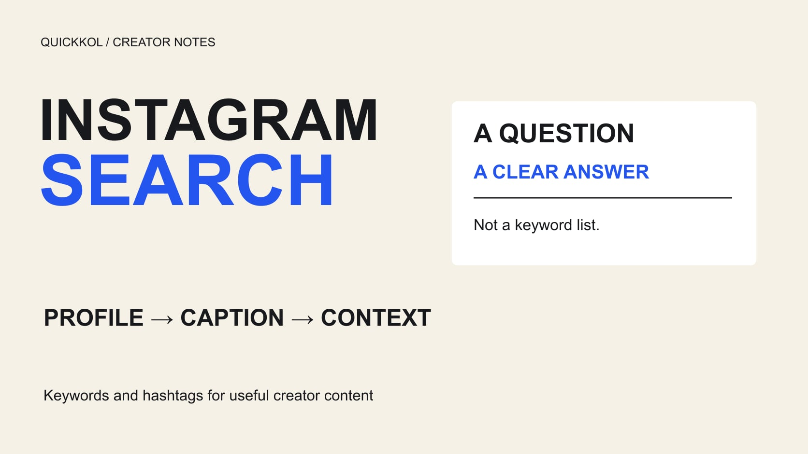
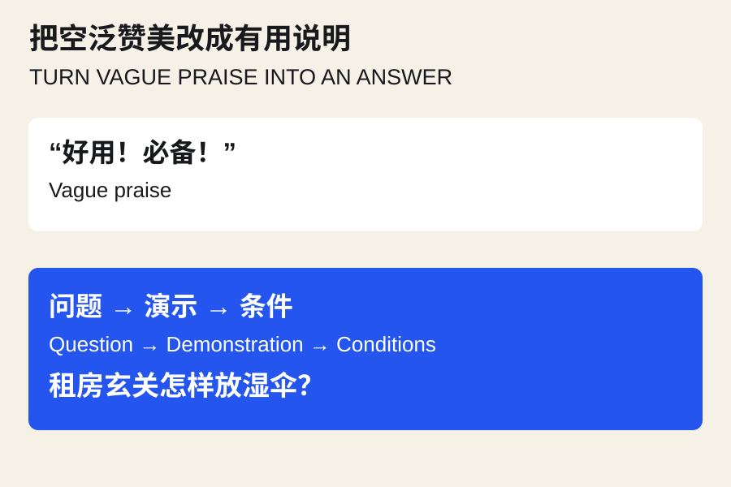

# Instagram SEO：达人内容的关键词与标签

把观众会搜索的问题写进资料与作品，附一组可以改写的合作标题、简介和标签示例。

> 草稿日期：2026年11月23日；仅独立本地预览。

Instagram SEO 是让创作者的资料与作品更清楚回应用户搜索需求的工作。先选观众确实会问的问题，再用自然语言写进合适的资料名称、简介和作品说明，标签只补充真实主题。它不等于堆词，也不保证排名。本篇把 seo instagram、hashtags for instagram 与 instagram keywords 合在同一发布任务中，重点是怎样写出可理解、可查找的达人合作内容。

## 先分清站内搜索与外部搜索

[Instagram 搜索机制原文存档](https://archive.ph/QjutM)保留了 Adam Mosseri 在2021年对站内搜索的解释：用户输入的文字会与相关账号及内容信息匹配，个人活动等信息也影响结果。这里引用的是历史的一方解释存档，不把它当成2026年完整算法公式或最新标签数量规则。

[Google 搜索入门指南](https://developers.google.com/search/docs/fundamentals/seo-starter-guide)讨论的是网页如何被发现、抓取、理解与展示。这套过程与 Instagram App 内搜索不同。让一条 Instagram 作品更容易理解，不代表 Google 一定收录，也不保证你控制所有技术设置。

因此先问目标观众在哪里找答案。若品牌希望有人搜索某种穿搭问题后找到达人作品，先优化作品本身的主题与说明。若目标是官网搜索流量，还需处理自己的网站页面。不要用一个“SEO 分数”把两个不同任务混在一起。

## 把合作主题缩成一个读者问题

从作品能回答的问题开始，而不是从最大搜索量词开始。假设达人拍摄小户型收纳，读者问题可以是“租房玄关怎样放雨伞”，而不是宽泛的“生活方式”。明确问题后，创作者才能展示能完成答案的动作、物件和条件。

写下主问题、相关说法和不回答的范围。示例主问题是雨天玄关收纳，相关词包括免打孔伞架、租房入口和湿伞处理；不回答的范围可能是整屋装修。相关词不是必须全部塞进标题的任务清单，而是检查作品有没有偏题的辅助。

品牌研究读者表达时，可以看公开评论与搜索结果，但不要把个性化推荐当成全市场需求统计。保存查询语言和日期，用真实提问改进简报。若下一步是找能回答问题的创作者，[Instagram 达人搜索需求指南](/zh/blog/instagram-search-creator-topic-brief/#answer)可以补充候选研究方法；本篇则处理已经准备发布的内容怎样表达。

## 资料要准确说明创作者做什么

资料页应让读者迅速知道这位创作者谈什么、以什么语言或场景展开，以及合作联络入口在哪里。不要为单次品牌合作把长期身份改成一串产品词，也不要把一个城市写成主要受众所在地，除非确有相应资料。

例如，假设一位创作者长期分享中文租房改造，简介可以自然写“租房收纳与可逆改造，分享小空间实测与使用细节”。这是编辑示例，不是真实账号的履历。若有合作邮箱，使用本人愿意公开的业务入口，不在简介中公开私人信息。

资料名称、用户名和简介承担不同功能。既有用户名可能已经被观众识别，不能因为一次关键词研究就随意改动。品牌可以提出作品的主题要求，但长期账号身份应由创作者决定。双方应检查展示名称是否真实，而不是用夸张职业头衔制造搜索相关性。

## 把关键词放进完整答案，而不是词串

假设原始说明是“好用！收纳神器！生活必备！”可以改为“租房玄关的湿伞怎样收纳？我用免打孔伞架把雨伞与鞋子分开，视频展示安装、滴水处理和取用。先检查表面是否适用，拆卸方法见最后一段。”后者说明了问题、动作和限制，读者即使不点品牌链接也能理解作品。

说明应忠实于视频。如果视频没有演示拆卸，就不能在文字里假装已经完成。品牌提供的尺寸、材质和使用条件要核实；创作者的实际体验可以用自己的语言表述。关键词相关性来自作品确实回答问题，而不是在每句话里重复“玄关收纳”。

开头优先解释内容与观众有什么关系，接着补充必要步骤或条件，再放合适的合作标识和下一步。示例不是固定文案顺序，披露等信息应按适用要求清楚呈现。不要为了容纳更多词，把关键商业关系或使用限制藏到读者难以看到的位置。

改写示例用于假设的租房收纳合作，不代表实际账号或排名测试。

## 标签只补充作品已经成立的主题

给这条假设作品选标签时，可以分别考虑内容主题、具体场景和确有关系的合作标识。例如租房收纳与雨天入口是内容线索，不能因为热门就加入与作品无关的美容、旅游或名人标签。具体可用数量以当前账号界面和官方指引为准，本篇不提供未经核验的统一上限。

2021年的原文对说明文字中的相关关键词与标签有明确建议，但平台后续可能调整功能。[Instagram 创作者学习中心说明](https://about.fb.com/news/2024/10/best-practices-education-hub-creators-instagram/)介绍了专业面板中的教育内容与个性化提示，可以作为继续查看账号适用建议的入口；它不是公开的固定排名权重表。

一个简单检查是：删去这个标签，作品是否仍清楚；保留这个标签，读者是否会形成错误期待。若标签只是希望蹭到不相关流量，通常应删。品牌活动标签可以帮助整理合作，但不能据此承诺所有观众都看到活动或所有相关作品都进入搜索结果。

## 让可访问性服务读者理解

字幕帮助读者理解讲话内容，替代文字应描述图像实际呈现的信息。这些工作本身有阅读价值，不需要先证明某个隐含算法加分。不要把替代文字变成重复标题、品牌名和关键词的隐藏段落，也不要描述画面里没有的效果。

假设图像展示雨伞放在入口侧边的伞架，可描述伞架位置与湿伞如何分开，不写“全网最佳租房收纳购买入口”。如果一张图承载尺寸信息，应确保正文也能解释相关条件，不能只把关键数字放进难以阅读的装饰图里。

品牌审核时把作品事实、可读性与搜索表达一起看。移动端裁切后还看不看得清操作？字幕是否挡住关键动作？读者是否能理解为什么这种方法适用？这类具体问题比声称某种文字能保证搜索排名更能改善一条达人合作内容。

## 用明确记录观察可发现性

发布前保存最终标题、说明、标签与作品链接，注明语言和日期。之后如果使用搜索查看是否出现，记录查询词、账号状态、地区与时间，不把自己账号的一次结果当成所有用户的共同结果。

同时观察适用的作品数据和读者问题。如果搜索结果提供的访问来源在账号中不可见，就写“未提供”，不要把所有新增观看归因于关键词改写。[达人社交媒体指标决策指南](/zh/blog/social-media-metrics-creator-decision-tree/#answer)可以帮助区分可观测结果与编辑解释。

下一条只针对明确问题调整：读者不知道适用表面，就补充表面；读者误解尺寸，就补拍尺寸。不是每次表现不佳都继续加标签。把反馈转成作品改进，才能形成对观众有用的发布习惯。

## 用一次发布前改写确认范围

假设团队最初给标题写“收纳好物推荐”，可以先问视频到底回答了什么，再改成“租房玄关怎样放湿伞”。说明中的相关词自然出现一次即可，另把实际适用表面、安装与拆卸条件写清。不要为了更宽泛的搜索词，删去“租房”这个决定使用条件的范围。

若作品有两个语言版本，分别使用目标读者真实会用的说法，不要求中文与英文标签逐个对应。保留相同产品事实与限制，再让熟悉该语言的人检查表达是否自然。这不是增加另一批关键词，而是让同一答案在两种语言中都可理解。

季节、城市和产品名只在确实影响答案时加入，不为扩大覆盖重复列举。

## 让内容任务决定下一步合作

完成这份改写后，品牌应能用一句话说明作品回答的问题，再列出真实可见的步骤。若当前候选达人缺少这方面内容，不要只要求对方照念关键词；重新研究更熟悉相应场景的人。

[QuickKOL 官网能力说明](https://www.quickkol.com/)提供按合作需求寻找与研究达人的入口。可把“中文租房收纳、能演示可逆安装、重视使用细节”作为研究需求，再核对实际作品和联系条件。这种研究与搜索优化相关，因为合适的人更容易给出值得被找到的答案；它不保证任何作品排名。

最后保留创作者自己的表达。关键词帮助解释主题，不能替代作品的观察、经验和信息。读者找到页面后能够解决问题，才是这套发布工作的实际价值。

## 下一步

用场景和内容能力描述合作，而不是让不相关的作品堆关键词。

[在 QuickKOL 研究达人](https://www.quickkol.com/)

## 来源与范围

资料核验于2026年11月23日，基于可读取的公开来源。未登录或修改用户账号；编辑示例不代表真实客户结果，平台功能以实际账号为准。

- [Instagram 搜索机制原文存档](https://archive.ph/QjutM)
- [Google 搜索入门指南](https://developers.google.com/search/docs/fundamentals/seo-starter-guide)
- [Instagram 创作者学习中心说明](https://about.fb.com/news/2024/10/best-practices-education-hub-creators-instagram/)
- [QuickKOL 官网能力说明](https://www.quickkol.com/)
