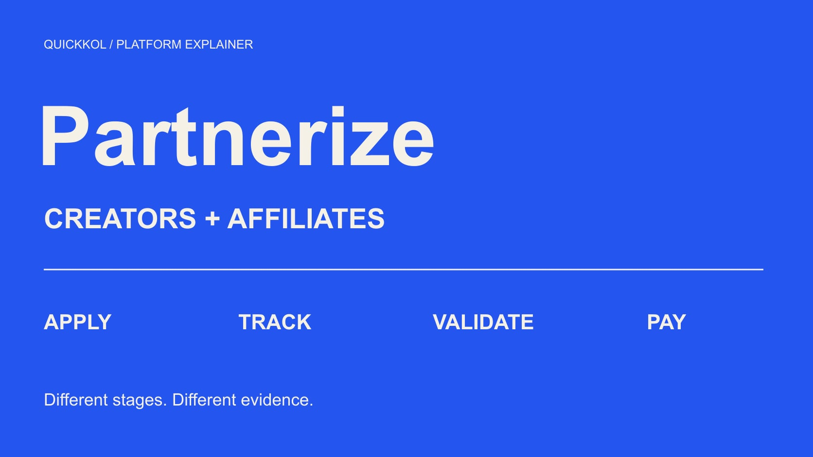
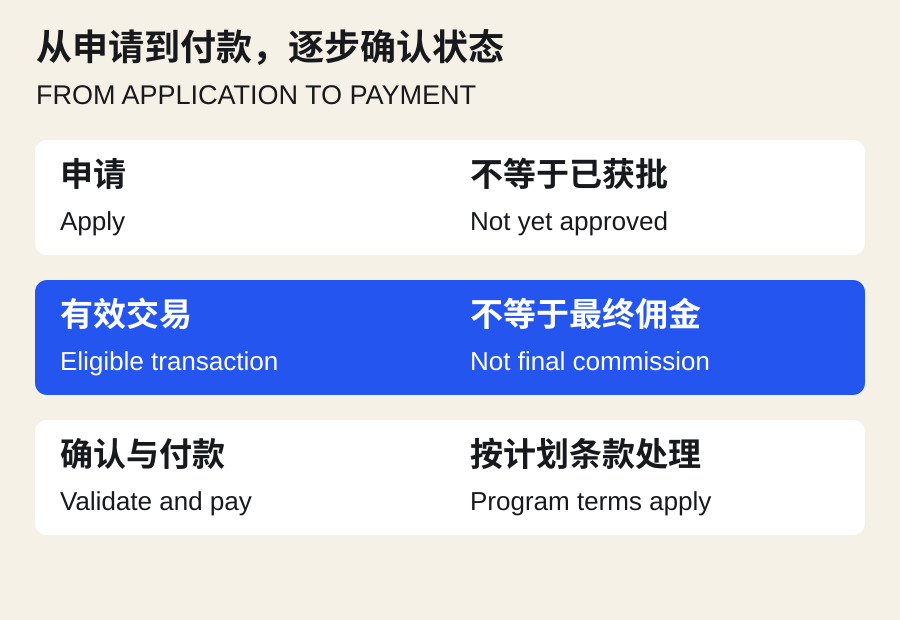

# Partnerize for Creator and Affiliate Partnerships

Understand Partnerize’s role in creator affiliate partnerships, separating discovery, application, tracking, commission validation and payment.

> Draft date: November 23, 2026; independent local preview only.

Partnerize is a partnership-marketing platform supporting work such as discovery, recruitment, tracking, management, measurement and payments. Creators can participate as one type of partner, but account registration, programme approval, content production, transaction attribution and commission payment are separate events. A brand should define the content contribution, qualifying transaction and programme owner before evaluating the offering. This guide uses public first-party material; it is not an independent product test, universal price list or earnings guarantee.

## Understand the partnership workflow

[Partnerize’s platform overview](https://partnerize.com/platform) organizes capabilities as Discover, Track, Manage, Measure, Pay and Protect. That is the provider’s description of its scope, not evidence that every quotation includes every feature, service team or market’s data.

For creator marketing, clarify how content connects with performance-based compensation. One creator may publish on their own account, supply assets the brand can use and share a commission-bearing recommendation link. These contributions can coexist, but they are not one deliverable or necessarily covered by the same fee.

Choose a real task first. For example, a travel-organizer brand may need creators who can explain a use case and are interested in discussing a programme with explicit conditions. Evaluate whether that task can be completed rather than compare the number of feature names on product pages.

This article created no account, configured no tracking and initiated no payment. Public material supports initial evaluation. Before implementation, ask the provider to demonstrate the intended market, account permissions and project workflow. Keep a record of what was shown and what still requires confirmation, rather than turn an overview into an assumed operating arrangement.

## Separate brand and creator responsibilities

The brand operates programme conditions, invitations, product information, tracking and payment arrangements. The creator decides whether the recommendation fits their work and audience, which programme to apply to and whether the content and compensation terms are acceptable. A platform does not automatically settle every agreement between them.

If the travel-organizer brand wants a demonstration on the creator’s account and permission to advertise with the asset, specify publication and advertising use separately. Affiliate commission should not silently purchase advertising rights, and a sample shipment should not become an undisclosed publication obligation.

Prepare an invitation both parties can understand: product, content task, proposed platform, how fees or commission will be discussed, and one question the recipient can answer. The [affiliate-outreach invitation guide](/blog/whats-affiliate-outreach-partner-invitation/#answer) helps distinguish a commission opportunity from an already confirmed paid-production assignment.

If budget or programme terms are unapproved, make an exploratory enquiry instead of presenting a definite offer. An interested reply is not acceptance of every term. State the question to resolve next so differing scopes do not later appear as unexplained quotation changes. The operating record should make the proposal clear enough for a new colleague to continue the conversation.

## Registration is not programme approval

[Partnerize’s partner welcome guide](https://go.partnerize.com/hubfs/1.%20PARTNERIZE/1.%20Global/12.%20eBooks/partnerize-welcome_kit.pdf) describes using Campaigns and Join Campaigns to find programmes, read conditions and submit an application for the brand team to review. It is an earlier public operating document; inspect the actual account for the current interface.

A creator should check the brand, permitted markets, products and promotional arrangement before applying. A displayed brand name does not establish an approved partnership or endorsement. Submission, review and acceptance need separate states.

The brand should assign someone to applications too. If a creator’s work is relevant but the current programme lacks their market or product arrangement, provide an understandable status instead of leaving the application unresolved indefinitely. Rejection from one programme does not establish unsuitability for every other creative task.

For acceptance testing, ask the provider to demonstrate how a test application is found, how conditions are inspected and how its state is handed over. Looking at a registration screen does not complete that workflow. This article registered or applied for nobody and does not treat the guide’s sample names or figures as current opportunities. The useful outcome is a traceable programme decision and an appropriate next action.

## Make commission conditions inspectable

Before discussing a percentage, define the commissionable object: products, markets, transaction state, treatment of returns and applicable period. Programmes can differ. A webpage example should not become an assumed Partnerize default for every partner.

In a teaching example, a programme agrees 8% of confirmed qualifying product value. A hypothetical eligible base of £600 produces £48 commission. The percentage, base and result illustrate arithmetic; they are not a platform quotation, typical creator earnings or money already received.

If some of the £600 remains unconfirmed, do not automatically treat it as the final base without reading the rules. Explain sales value, recorded commission, payable commission and actual payout separately. Use the account’s actual state names rather than rewriting them to improve a report.

A fixed production fee can coexist with commission. State the production or publication purchased by the fixed amount, the result rewarded by commission and the payment conditions for both. This allows the creator and brand to see which contribution each payment concerns. It also prevents a performance percentage from hiding a larger creative assignment or turning provisional transaction data into a promise of guaranteed income.

Teaching workflow: recording a transaction does not complete every content, commission or payment condition.

## Match tracking to the implementation

[Partnerize’s tracking explanation](https://partnerize.com/platform/track) lists first-party, server-to-server, batch and mobile-app routes. These are implementation options, not evidence that issuing a creator link automatically configures all of them.

Involve the website or app owner in choosing the route. Establish where transactions are recorded, which fields enter the system and how tests or corrections are handled. The creator uses approved links and accurate wording; they should not be expected to explain a backend they cannot inspect.

A pilot can use one authorized test: the link reaches the correct item and market, the destination works, and the implementation owner can find the corresponding test record and explain whether it is excluded from real performance. Success establishes that path under the test conditions, not permanent freedom from missing records.

If figures differ, inspect the link, window, transaction definition and configuration changes before blaming creator misconduct or ineffective content. A recorded association also does not establish that the purchase would not have happened without the partnership.

The [creator-reporting decision-and-evidence guide](/blog/influencer-reporting-decision-memo-and-evidence/#answer) helps keep source, definition and recommendation together. Retain a route another person can inspect instead of requiring them to accept a polished total without knowing how it was assembled.

## Include payment and exceptions in the operating plan

Before publication, identify who handles commission questions, transaction corrections and payment enquiries. Passing an issue among an agency, brand and platform still leaves the creator without an answer. A contact route responsible for this programme is more useful than a broad assertion that the system pays automatically.

In the teaching example, a returned transaction should trigger a review under the actual programme conditions. Do not manually overwrite a total without retaining the explanation. If payment awaits missing information, state what is needed and who supplies it without exposing unrelated personal or banking details.

During a demonstration, choose an exception that involves no real payment. Ask how an operator finds the record, explains its state and routes it to the responsible team. Preserve that outcome in the operating note so ownership is not discovered only after purchase.

Use this programme’s terms for payment timing, thresholds, currency and charges. This guide has not verified a single number applicable worldwide. Those questions can become explicit pre-release conditions rather than an improvised search for answers after the creator asks. A complete partnership workflow includes the exception route as well as the successful transaction.

## Compare quotations for the same work

[Partnerize’s pricing-model explanation](https://partnerize.com/pricing) describes licensing and performance-based structures, with service level, programme count, region and currency among the considerations. Do not invent a universal monthly fee or conflate partner registration with the brand’s platform purchase.

Give providers comparable conditions: current programme count, markets, intended partner types, operating responsibility and tracking environment. Ask the proposal to identify the platform and service scope, then compare that with the team’s own capabilities.

A team with experienced programme operators and a team needing full management are purchasing different work even on the same platform. The lowest displayed price does not independently establish the better fit.

Do not convert a website-wide return figure into a forecast for this project. Start with a small task that has an owner and an acceptance condition before expanding. Preserve unanswered demonstration questions as unconfirmed rather than substitute a sales statement for completed implementation. The result should be a decision about a defined operating need, not a claim that the team has independently verified every advertised capability.

## Connect creator research with programme operations

If the team has not yet identified whom to invite, first research work that explains the product situation clearly. [QuickKOL’s product explanation](https://www.quickkol.com/) describes brief-led creator discovery and research for preparing candidates and relevant conversations. Programme tracking, commission and payment remain with the corresponding system and responsible owners.

For the travel-organizer example, find someone who can explain capacity and practical limits, then specify creator publication, brand assets and affiliate links separately. A candidate record is not an accepted partnership.

Hand over a one-page plan containing the content task, selection reason, application state, commission conditions, test owner and payment contact. Each item needs evidence or a next action so the team can distinguish work that can proceed from decisions still outstanding.

Evaluate Partnerize by whether it supports that complete assignment. Creator selection and programme operation need their own evidence to move a partnership from an invitation to an understandable settlement.

## Next step

Define the explanation task and candidate rationale before discussing programme conditions.

[Explore QuickKOL](https://www.quickkol.com/)

## Sources and scope

Sources reviewed November 23, 2026 using accessible public material. No user account was signed into or changed. Editorial examples are not client outcomes; confirm features in the intended account.

- [Partnerize’s platform overview](https://partnerize.com/platform)
- [Partnerize’s partner welcome guide](https://go.partnerize.com/hubfs/1.%20PARTNERIZE/1.%20Global/12.%20eBooks/partnerize-welcome_kit.pdf)
- [Partnerize’s tracking explanation](https://partnerize.com/platform/track)
- [Partnerize’s pricing-model explanation](https://partnerize.com/pricing)
- [QuickKOL’s product explanation](https://www.quickkol.com/)
