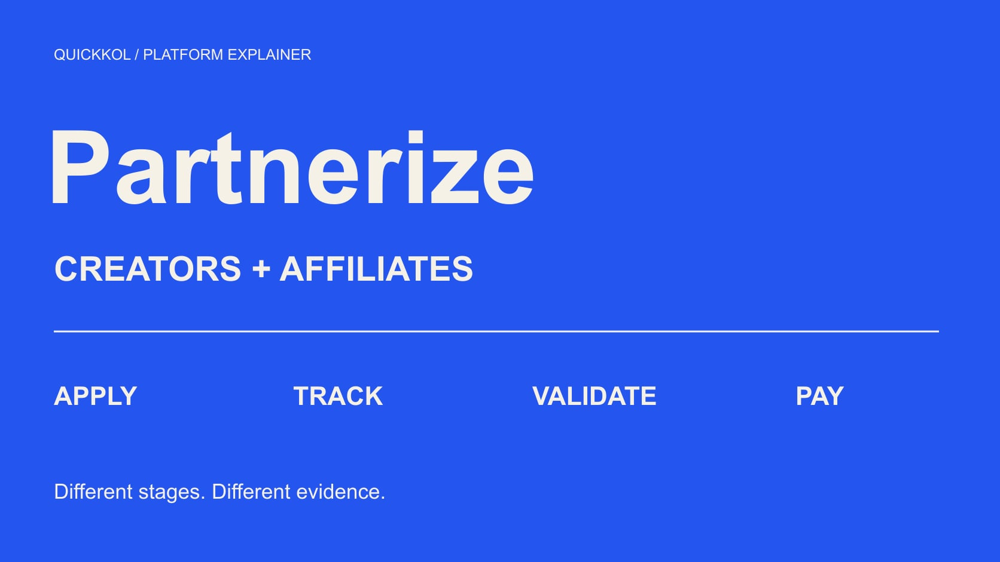
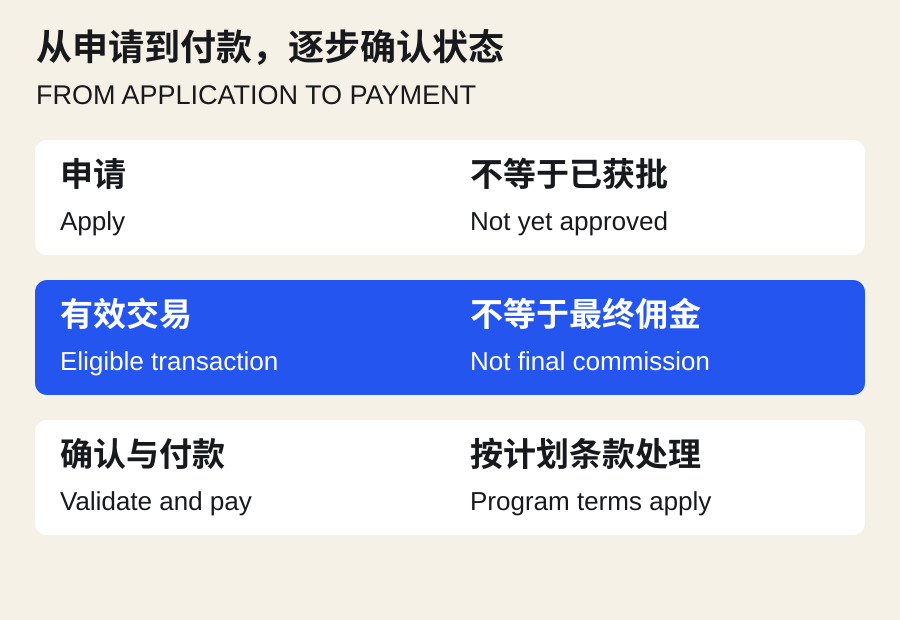

# Partnerize 怎样支持达人与联盟合作

了解 Partnerize 在达人联盟合作中的角色，区分发现、申请、跟踪、佣金确认和付款，并用一项小规模任务评估是否适合团队。

> 草稿日期：2026年11月23日；仅独立本地预览。

Partnerize 是合作伙伴营销平台，面向品牌和合作方组织发现、招募、跟踪、管理、衡量与付款等工作。达人可作为其中一种合作方参与联盟计划，但账号注册、计划获准、内容制作、订单归因和佣金到账并不是同一事件。品牌应先确定希望采购什么内容、怎样定义合格交易，以及谁负责运行计划，再评估平台方案。以下依据公开官方资料，不构成独立实测、统一价格或收益保证。

## 平台解决的是一段合作流程

[Partnerize 平台说明](https://partnerize.com/platform)将能力组织为 Discover、Track、Manage、Measure、Pay 和 Protect。这是供应方对产品范围的介绍，不代表任一报价自动包含所有功能、服务人员或适用于所有市场的数据。

对达人营销，最需要澄清的是内容与效果分成怎样衔接。一位创作者可能提供自有账号发布、品牌可使用的素材，以及带佣金的推荐链接。三项工作可以同时存在，但它们不是同一个交付，也未必由同一份费用覆盖。

先选一个实际任务，例如为一款旅行收纳产品找到能解释使用场景的创作者，再邀请合适的人讨论一个具有明确条件的联盟计划。平台是否适合，应看这项工作能否顺利完成，而不是比较首页功能名称的数量。

本篇没有创建账户、配置跟踪或发起付款。公开资料支持初步评估；真正使用前，仍应让供应方演示目标市场、账号权限和本次项目需要的流程。

## 先分清品牌方与达人方的任务

品牌方需要管理计划条件、邀请对象、商品信息、跟踪方案与付款安排。达人方需要判断推荐是否适合自己的作品和观众、申请什么计划，以及是否接受具体内容与报酬条件。平台不是替双方自动达成每一项约定的人。

例如，品牌希望一段收纳演示既在创作者账号发布，又可用于广告，就应分别说明发布与广告用途。联盟佣金不能默认为购买了广告许可，也不能把寄送样品写成强制发布。

先形成一份双方都看得懂的邀请，写明商品、内容任务、拟发布平台、费用或佣金讨论方式，以及需要对方回答的一个问题。[联盟外联邀请指南](/zh/blog/whats-affiliate-outreach-partner-invitation/#answer)可帮助区分按佣金合作和已经确认的付费制作。

如果团队尚未批准预算或计划条件，先进行意向沟通，不把待定方案包装成确定机会。创作者回复感兴趣，也不表示已经接受所有条款。把下一步要解决的问题写清，能减少后续因范围不同产生的报价误解。

## 注册与加入品牌计划是两个步骤

[Partnerize 合作方入门指南](https://go.partnerize.com/hubfs/1.%20PARTNERIZE/1.%20Global/12.%20eBooks/partnerize-welcome_kit.pdf)说明，已有合作方账号可通过 Campaigns、Join Campaigns 查找并申请品牌计划，阅读相应条件后提交，由品牌团队审核。该指南是较早的公开操作资料；当前界面应以实际账号为准。

对创作者，先核对计划中的品牌、允许推广的地区、商品范围和发布方式，再决定是否申请。不要因为某个品牌名称出现在界面，就声称已获该品牌合作或背书。提交申请、等待审核、获准参与，应该分别记录。

品牌团队也应指定谁处理申请。若一位创作者的内容很相关，但当前计划没有其市场或商品安排，给出明确状态，比让申请长期悬而未决更有帮助。一次被拒不表示这个人不适合所有其他内容任务。

演示验收可以要求供应方展示一个测试申请怎样被找到、查看条件和交接状态。仅查看注册页面不能证明完整加入流程已完成。本文没有替任何读者注册或申请，也不把指南中的示例品牌和数字当作当前可用机会。

## 把佣金条件写成能核对的算例

在讨论比例之前，先明确计佣对象：哪些商品、什么地区、什么交易状态、是否含退款，以及适用时间。不同计划可以有不同约定，不应把某个网页示例当作 Partnerize 对所有合作方的默认规则。

教学假设：某计划约定对已确认的合格商品金额支付8%，当前可计佣基础为600英镑，示例佣金为48英镑。8%、600和48都是说明计算的假设，不是平台报价、达人典型收益或已经到账的收入。

若600英镑中有一部分尚未完成确认，就不能在未核对规则时全部作为最终基础。销售额、已记录佣金、应付佣金与实际到账应分别解释。平台状态的具体名称也应按实际界面记录，而不是为了报告好看自行改写。

固定制作费与佣金可以并存。品牌应说明固定费购买的制作或发布任务，佣金奖励什么结果，以及两者的付款条件。这样创作者不必用一个不确定的结果承担所有确定的制作成本，品牌也能看清各项支出对应什么贡献。

教学流程：记录了一笔交易，不等于内容、佣金与付款的全部条件都已完成。

## 跟踪能力需要对应实际技术和数据

[Partnerize 跟踪功能说明](https://partnerize.com/platform/track)列出第一方、服务器到服务器、批量及移动应用等方式。它们属于不同实施路径，不是给每位创作者一条链接就自动完成全部配置。

品牌应让负责网站或应用的人参与选择，确认交易从哪里记录、哪些字段进入系统、怎样处理测试或更正。创作者负责使用获准链接与真实说明，不应被要求解释自己无法访问的后端配置。

试运行可以围绕一项获准的测试任务：链接到正确商品与市场，目标页面能正常访问，负责实施的人能找到对应测试记录，并说明它是否被排除在真实业绩之外。测试成功仅说明这条路径在测试条件下可用，不代表未来永不漏记。

若数据不一致，先核对链接、时间窗口、交易定义和配置变动。不要立即把问题归为创作者作弊或内容无效。技术记录的关联也不是“没有该合作就不会发生购买”的因果证明。

[达人报告的决策与证据指南](/zh/blog/influencer-reporting-decision-memo-and-evidence/#answer)可帮助把来源、口径和推荐结论放在一起，保留别人能够复核的路径。

## 付款与异常处理也属于计划设计

品牌要在发布前说明谁处理计佣问题、交易更正和付款查询。一个问题若在代理、品牌和平台之间反复转交，创作者仍然不知道由谁答复。给出能够处理本计划事项的联系路径，比笼统说“系统会自动付款”更有用。

沿用前述教学示例，如果某笔金额发生退款，应按实际计划条件核对相应佣金，而不是手工把报表覆盖成一个新总数却不保留说明。若付款尚待资料完善，应说明缺什么、由谁提供，而不公开无关个人或银行信息。

演示平台时，可以选择一个不涉及真实付款的异常场景，询问如何查找记录、说明状态和交接给负责团队。将这个结果写进内部操作说明，避免采购完成后才发现无人负责例外。

对于实际付款周期、门槛、币种和到账费用，使用本次计划及账户提供的条款。本文没有核验一个对全球所有人都适用的固定数字。品牌可以把这些问题列为上线前需要确认的条件，而不是等达人追问时才临时寻找答案。

## 报价比较要使用同一任务范围

[Partnerize 报价方式说明](https://partnerize.com/pricing)介绍许可费和基于效果的结构，并指出服务层级、计划数量、地区和币种等会影响方案。因此不应引用一个未经核验的统一月费，或把合作方注册与品牌购买平台的成本混为一谈。

向供应方提供可比较的条件：当前计划数量、目标市场、预期合作方类型、需要谁负责日常运行，以及实际跟踪环境。让报价说明平台与服务范围，再与自己的运行能力比较。

一个团队已经有成熟的计划运营人员，另一个团队需要完整代运营，两者即使使用同一平台，采购的工作也不同。最低显示价格不能独立说明哪种方案更合适。

不要把网站上的整体回报数字改写成本项目的预计回报。先用一个有负责人、可验收的小任务检查适用性，再决定是否扩大。演示过程中没回答的问题，保留为未确认，不用销售承诺替代已经完成的实施。

## 把达人发现与联盟运行衔接起来

如果团队还不知道应该邀请谁，先研究作品是否能清楚解释商品场景。[QuickKOL 官网能力说明](https://www.quickkol.com/)提供基于简报的达人发现与研究，可用于准备相关候选与联系讨论；联盟计划的跟踪、佣金与付款仍应由相应系统和负责人处理。

对旅行收纳示例，先找能解释容量与实际使用限制的人，再说明自有账号发布、品牌素材和联盟链接各有什么约定。不要把平台中的一条候选记录当作已经同意合作。

下一步可交接一页计划：内容任务、候选理由、申请状态、计佣条件、测试负责人和付款问题联系人。每项都有来源或待办，团队才知道哪些可以推进、哪些仍需决定。

Partnerize 是否合适，应由这条完整任务能否得到支持来判断。达人作品选择与联盟运营各自有依据，才能让合作从一条邀请走到清楚的结算。

## 下一步

明确产品解释任务与候选理由，再邀请对方讨论实际计划条件。

[了解 QuickKOL](https://www.quickkol.com/)

## 来源与范围

资料核验于2026年11月23日，基于可读取的公开来源。未登录或修改用户账号；编辑示例不代表真实客户结果，平台功能以实际账号为准。

- [Partnerize 平台说明](https://partnerize.com/platform)
- [Partnerize 合作方入门指南](https://go.partnerize.com/hubfs/1.%20PARTNERIZE/1.%20Global/12.%20eBooks/partnerize-welcome_kit.pdf)
- [Partnerize 跟踪功能说明](https://partnerize.com/platform/track)
- [Partnerize 报价方式说明](https://partnerize.com/pricing)
- [QuickKOL 官网能力说明](https://www.quickkol.com/)
