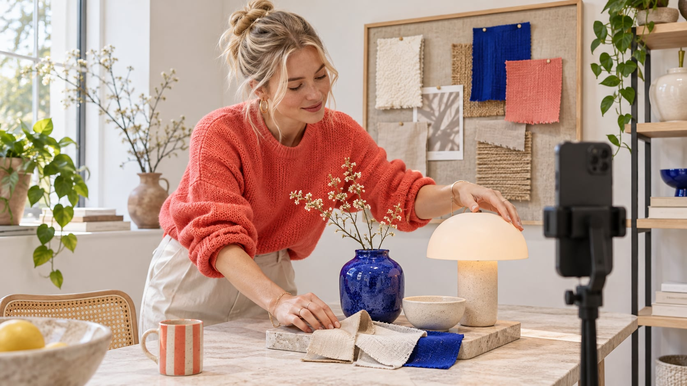
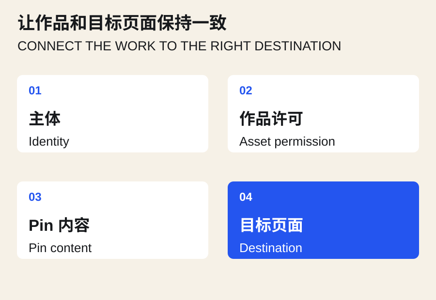

# Pinterest Business Account Setup for Creator Work

Set up a business account and prepare the first partnership Pin, using a home-creator example to check identity, content and destination.

> Draft date: November 23, 2026; independent local preview only.

Pinterest’s business presence is a business account; it does not require a separate object called a business page. Follow the official route to create a new business account or, where appropriate, convert an existing personal account. For a creator partnership, first decide whether the account belongs to the brand or creator, then prepare the profile, asset permissions, Pin and destination link. Review appropriate metrics afterwards, distinguishing saves, on-platform clicks and visits to the brand’s website.

## Decide whose business account is needed

A brand publishing commissioned material on its own Pinterest does not need the creator to surrender a personal account. A creator who wants to manage work, content and partnerships through their own presence can decide whether business functions fit that task. The two entities have different information, permissions and purposes.

Imagine a home brand commissioning lamp-styling photographs for agreed brand-channel use. The brand’s responsible operator should set up its account and publication. The creator appearing in the images does not make their account a brand asset. The [account-identity and collaboration guide](/blog/instagram-accounts-collaboration-identity-map/#answer) helps establish that distinction before setup.

Prepare an accurate name, suitable business email, correct website and clear introduction. Do not combine creator and brand into an ambiguous identity or copy a personal contact into a public profile without agreement. A business account is an operating presence, not permission to acquire or expose somebody else’s information. Decide who owns the login and who handles later requests before the account becomes part of a campaign.

## Create or convert through the documented route

[Pinterest’s business-account instructions](https://help.pinterest.com/en/business/article/get-a-business-account) provide the relevant new-account and conversion routes. The desktop creation flow begins by selecting a business account from signup, entering the requested information and completing business setup. Existing personal users can look for conversion under account management in settings. Follow the labels and confirmation actually shown in the current interface.

The official material explains preservation of relevant existing information and content during conversion and the public nature of a business account. Read the displayed confirmation before proceeding and decide whether personal material is suitable to remain public. A campaign deadline should not pressure a creator into a change they do not understand.

This article did not create or convert an account, and a single collaboration does not make conversion mandatory. A brand using authorized assets can complete its own route. If the expected option is missing, verify the account, suitable device and operating permissions, then consult the current help page. Do not repeat a conversion attempt on a different personal account simply because its menu looks more familiar.

## Write a profile with an understandable subject

The profile should explain the entity, subject and available destination. A hypothetical home brand might describe lighting and small-space arrangement; a creator should describe their actual work and business contact. Listing every possible partnership category produces a less useful introduction.

Confirm permission and the accurate relationship before using a creator’s portrait, name or work in the profile. A brand account should not imply that the creator personally operates it. One commission should not be described as a continuing ambassadorship unless that is the actual agreement.

Read the profile as a public visitor. Can someone understand who this is, what the work covers and where a link will lead? Check the website spelling and mobile readability. An unprepared shop should not sit behind a buy-now label. If the destination is an instructional article, say that it opens the tutorial. Clear expectations at this stage reduce confusion before a viewer reaches the first Pin or sends a business inquiry.

## Prepare a Pin that explains its subject

Suppose the collaboration explains arranging light in a reading corner. Choose work that shows the lamp position and reading area clearly. The image should help the viewer rather than consist mainly of an oversized logo. A useful title states the question, while the description adds what is demonstrated, relevant conditions and required commercial identification.

An editorial title might describe lamp placement in a small reading corner, with a description identifying the arrangement as an example and linking to the full explanation or product information. Do not substitute medical or absolute outcome claims for an actual demonstration. Showing one arrangement does not prove suitability for every room or person.

The [brand-partnership content-governance guide](/blog/brand-partnerships-joint-content-governance/#answer) helps assign factual checks to the brand and expressive choices to the creator. Confirm that the asset permission covers this account, channel and current period before publishing. A photograph appearing on another social platform does not make it freely reusable on Pinterest. Preserve the creator’s agreed credit and context as part of the publication review.

## Create, inspect and publish

[Pinterest’s Pin-creation steps](https://help.pinterest.com/en/article/create-a-pin-from-an-image-or-video) describe uploading an image or video from the creation entry, then adding a title, description, destination link and relevant board before publication. Use the options offered to the current account. Confirm media support and additional functions in the actual interface; this article’s process illustration is not a product screenshot.

For the hypothetical lighting piece, title and image concern the reading corner and the link opens the corresponding explanation, rather than an unrelated homepage. Inspect orientation, clarity, text placement and any ordering. Complete relevant accessibility or commercial-content settings truthfully where the interface provides them.

Review before publishing, then open the actual Pin URL to confirm the result. Draft, scheduled and published are different states. If an error appears, record the message and step instead of creating repeated copies with the same title. After editing a published item, return to the real publication to verify its new state. A separate campaign checklist is coordination, not proof that the platform accepted the post.

A functional route for a hypothetical home collaboration, not a screenshot of the current Pinterest interface.

## Make the destination complete the next task

Open the destination from the Pin on a phone and check for incorrect redirects, expired promotions, unavailable products or pricing inconsistent with the image. If the link leads to a creator’s article, confirm what changes the brand is entitled to request. One commission should not become unlimited website-maintenance work.

If viewers click to learn an arrangement, let the page explain the process promptly. If they intend to inspect an item, show the correct model and current conditions. A purchase route can be present without concealing limitations relevant to the example.

Record the Pin URL, destination, publication time and responsible person so a broken path can be addressed later. Agree who maintains or replaces a link that will change after the partnership. A relevant destination that remains usable supports creator content better than an attractive publication linked to an expired page a few days later. This is especially important when a useful instructional Pin can be encountered after the immediate campaign period.

## Interpret the relevant metrics

[Pinterest’s analytics definitions](https://help.pinterest.com/en/business/article/pinterest-analytics) distinguish impressions, saves, Pin clicks and outbound clicks. Display, saving for later use and opening something within Pinterest are not equivalent to a visit to the brand’s website. Name the measure rather than using clicks for every action.

Suppose a hypothetical Pin records 80 saves and 40 outbound clicks. These are different actions, not 120 identified people with purchase intent. Without order information, neither establishes a sale. The values are teaching examples, not platform benchmarks or client results.

Retain the observation window and source, and confirm whether the figures concern a publication or the account. Overlapping viewers and repeated actions can exist, so an added total is not necessarily unique people. If saves are high relative to outbound clicks, examine whether the content and destination support the intended next task. That is a question to investigate, not an established causal explanation. Use consistent windows in later reviews instead of comparing one newly published item with another that has accumulated activity for months.

## Prepare a board with a clear subject

A hypothetical brand may have creator work about reading corners, bedside lighting and dining areas. Organize boards around actual audience tasks instead of repeatedly placing the same image into many unrelated subjects. Give the reading-corner board a clear name and description, then check that this Pin belongs there.

A board title does not need repeated brand names. Visitors should understand its scope from the name and encounter matching work inside. If a board mixes unrelated discount graphics, portraits and technical specifications, organize it before adding another commission. This is an editorial information-structure suggestion, not a claim that a particular board name guarantees distribution. The aim is a coherent collection a reader can use after opening the Pin.

Also agree how business access will be handed over if the operator leaves the project. An account should not depend indefinitely on a private identity no longer responsible for it.

## Research creators around a continuing subject

For continuing Pinterest collaboration content, research creators around a clear audience subject: small-space homes, seasonal storage or step-by-step craft work, for example. Examine whether actual publications carry useful information before discussing channel use and publication terms.

[QuickKOL’s product explanation](https://www.quickkol.com/) provides discovery and research from a stated need. It does not execute this Pinterest setup process or imply that any Pinterest account is searchable in the product. Confirm current supported platforms and functions. A team can research related work on supported channels, then directly discuss the Pinterest arrangement.

The output of this tutorial should be a business account with a clear identity, a permitted Pin that answers a question, a working destination and a defined review basis. Those are practical foundations for a creator partnership. Simply adding business page to a profile field would not complete any of them.

## Next step

Research people who demonstrate clearly, then discuss the asset and channel arrangement.

[Research creators with QuickKOL](https://www.quickkol.com/)

## Sources and scope

Sources reviewed November 23, 2026 using accessible public material. No user account was signed into or changed. Editorial examples are not client outcomes; confirm features in the intended account.

- [Pinterest’s business-account instructions](https://help.pinterest.com/en/business/article/get-a-business-account)
- [Pinterest’s Pin-creation steps](https://help.pinterest.com/en/article/create-a-pin-from-an-image-or-video)
- [Pinterest’s analytics definitions](https://help.pinterest.com/en/business/article/pinterest-analytics)
- [QuickKOL’s product explanation](https://www.quickkol.com/)
