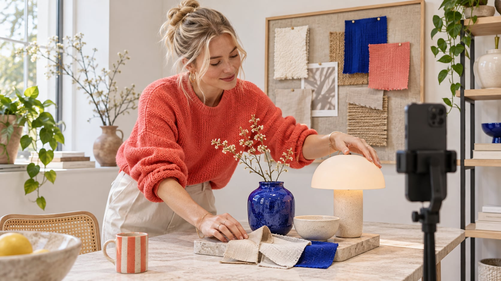
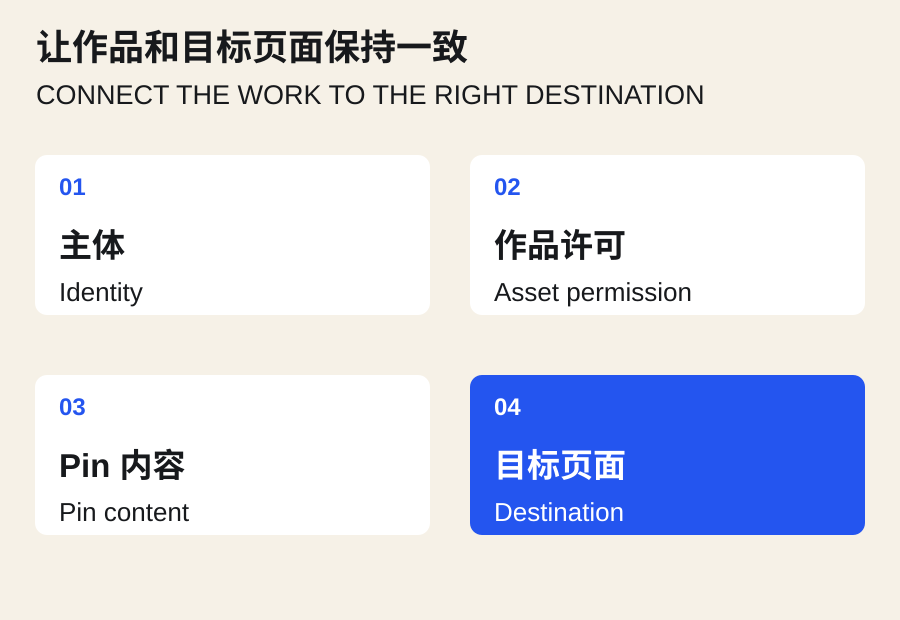

# 达人合作怎样设置 Pinterest 商业账号

从商业账号设置到发布第一条合作 Pin，用家居达人示例确认身份、作品与访问路径。

> 草稿日期：2026年11月23日；仅独立本地预览。

Pinterest 的商业入口是 business account，不是必须另建一个叫“business page”的页面。可以按官方路线新建商业账号，或在适用时转换已有个人账号。用于达人合作时，先确认账号属于品牌还是创作者，再完成资料、作品许可、Pin 内容与目标链接。最后查看适用指标，不把收藏、站内点击与品牌网站访问混为一谈。

## 先决定创建谁的商业账号

品牌如果只是想把合作素材发布到自己的 Pinterest，不需要要求创作者交出个人账号。创作者若希望用自己的账号经营作品、内容与商业合作，可以自行判断是否需要商业功能。两种主体的资料、权限和使用目标不同。

假设家居品牌采购了一位创作者的灯具布置照片，约定只在品牌渠道使用。这次应由品牌负责人设置自己的账号与发布，不应因为照片里有创作者就把其账号写成品牌资产。[账号身份与协作关系指南](/zh/blog/instagram-accounts-collaboration-identity-map/#answer)可以帮助团队先划清这个范围。

准备一个真实名称、适当业务邮箱、准确网站与清楚的介绍。不要把创作者与品牌混成一个模糊名称，也不要在未确认同意时把个人联系信息复制进公开资料。商业账号是工作入口，不是获得他人资料的许可。

## 按官方路线新建或转换账号

[Pinterest 商业账号步骤](https://help.pinterest.com/en/business/article/get-a-business-account)提供两种相关路线。新建商业账号的桌面流程从注册入口选择商业账号开始，填写所需资料并完成业务设置；已有个人账号则可以在设置的账号管理中查找转换商业账号。具体显示内容以当前界面为准。

官方说明提到转换会保留相关已有资料与内容，同时商业账号涉及公开状态。转换前先阅读实际确认提示，判断原来的个人内容是否适合继续公开。不要因为品牌合作临近，就让创作者在不理解变化时完成转换。

这篇文章没有代为创建或转换任何账号，也不要求为某次合作一定转换。若只需要品牌发布已授权素材，完成品牌自己的路线即可。若界面没有目标选项，确认是否进入正确账号、使用适当设备与具备操作权限，再参考当前帮助页面。

## 把资料写成读者能理解的主题

商业资料应说明主体、内容主题与可用目标链接。对于假设的家居品牌，可以写照明与小空间布置；对于创作者，则说明自己分享的实际内容与业务联系。不要把所有合作品类堆成一个没有重点的介绍。

如果使用创作者头像、姓名或作品作为资料的一部分，先确认相应许可与准确关系。品牌账号不能让读者误以为由某位创作者本人运营，也不应把一次合作写成长期代言，除非双方确有这样的安排。

用公开视角读一遍资料：访客能否知道这是谁，作品讲什么，点链接会到哪里。检查网站拼写和移动端可读性。没有准备好的商店不要用“立即购买”作入口；如果链接只是教学文章，就清楚写成查看教程。

## 准备一条能独立解释内容的 Pin

假设合作展示“阅读角怎样布置灯光”，选择能看清灯具位置与阅读区域的作品。图片应对读者有用，不只是一个放得很大的品牌标识。标题解释问题，说明文字补充演示内容、使用条件与必要商业标识。

例如标题可以是“小空间阅读角：灯具怎样摆放”，说明则交代这是一个布置示例，并指向完整文章或产品资料。不要用医疗或绝对效果表达替代实际演示；创作者展示一种布置，不代表已经证明适合所有房间或所有人。

[品牌合作内容治理指南](/zh/blog/brand-partnerships-joint-content-governance/#answer)可帮助确认哪些事实由品牌核对，哪些表达由创作者决定。发布前检查作品许可是否涵盖这个账号、这个渠道和当前期限，不能因为照片在另一社交平台出现，就视为 Pinterest 可自由转用。

## 创建、预览与发布

[Pinterest 创建 Pin 步骤](https://help.pinterest.com/en/article/create-a-pin-from-an-image-or-video)说明，可从创建入口上传图片或视频，再填写标题、说明、目标链接与适用的板块等信息，完成后发布。按当前账号提供的选项操作，媒体格式与附加功能需在界面确认，不要把本篇流程图当作产品截图。

在假设的灯光作品中，标题与图片都围绕阅读角，目标链接到同一主题的完整说明，而不是不相关的首页。检查素材方向、清晰度、文字位置和显示顺序。若界面提供所需的可访问性或商业内容设置，按真实情况填写。

预览之后再完成发布，最后打开实际 Pin 链接确认。草稿、排期与已发布是不同状态。若报错，记录提示和步骤，不要连续创建多个同名副本。已经发布后需要修改，也应回到该条真实作品确认新状态。

假设家居合作的功能路线，不是 Pinterest 当前界面截图。

## 确认链接完成了读者的下一步

在手机上从 Pin 打开目标页面，确认没有误跳、过期活动、空白产品或与图片不一致的价格。若链接是创作者自己的文章，也确认品牌是否有权要求更改其中内容，不能把一次合作变成无限网站维护责任。

假设读者点开是为了学习布置，就让页面尽快解释过程；若目的是查看商品，就展示正确型号与当前条件。页面可以包含购买入口，但不应隐藏与示例有关的重要限制。

合作团队可以记录 Pin 链接、目标 URL、发布时间与负责人，便于后续发现失效时处理。若合作结束后目标地址将变化，提前约定谁维护或怎样替换。一个能持续打开的相关页面，比一条发布当天好看、几天后失效的链接更能承接达人内容。

## 用适合的指标解释结果

[Pinterest 指标定义](https://help.pinterest.com/en/business/article/pinterest-analytics)区分展示、收藏、Pin 点击与站外点击。展示表示内容被显示，收藏与稍后使用有关，站内打开并不自动等于访问品牌网站。报告应写具体指标，而不是用“点击”概括所有动作。

例如，假设某条作品有80次收藏和40次站外点击，这些只是两种不同动作，不能相加成120个购买意向者。没有订单资料，就不能把它写成成交。数字是本篇假设示例，不是平台基准或客户结果。

保留观察窗口与资料来源，确认采用作品层还是账号层的数据。重叠受众与重复动作可能存在，不能把相加值当成去重人数。发现高收藏而较少站外点击时，可以研究内容与目标页面是否适合读者下一步；这仍是需要核对的解释，不是已证明原因。

## 先整理一个清楚的内容板块

假设品牌有阅读角、床头与餐区三类合作作品，可以按真实读者任务组织板块，而不是把同一图片重复发布到大量无关主题。先让阅读角板块有清楚名称和说明，再检查本次 Pin 是否确实属于这里。

板块标题不必充满品牌名。访客应该从名称理解内容范围，点开后也能看到相符作品。若一个板块同时包含不相关的折扣图、人物头像与产品规格，先重新整理，再增加新合作素材。

另外确认负责人离开项目时怎样交接业务权限，不能把账号长期依附于不再参与的私人身份。

## 用持续主题寻找合适创作者

如果品牌希望持续制作 Pinterest 合作内容，可以从清楚的读者主题找人，比如小空间家居、季节性收纳或能展示步骤的手工内容。先看真实作品是否有信息，再讨论渠道使用与发布条件。

[QuickKOL 官网能力说明](https://www.quickkol.com/)提供按需求发现与研究达人的入口。它不是本篇 Pinterest 创建流程的执行工具，也不意味着任意 Pinterest 账号都能在其中检索；平台覆盖与具体能力以当次产品入口为准。可以先研究对方在已支持渠道的相关作品，再直接确认 Pinterest 合作安排。

完成这条教程后，你应得到一个身份清楚的商业账号、一条有许可且能解释问题的 Pin、一个可用目标链接和明确的复盘口径。它们比单纯把“business page”填进某个资料字段更能支持真实达人合作。

## 下一步

研究擅长清楚演示的人，再讨论作品与渠道安排。

[在 QuickKOL 研究达人](https://www.quickkol.com/)

## 来源与范围

资料核验于2026年11月23日，基于可读取的公开来源。未登录或修改用户账号；编辑示例不代表真实客户结果，平台功能以实际账号为准。

- [Pinterest 商业账号步骤](https://help.pinterest.com/en/business/article/get-a-business-account)
- [Pinterest 创建 Pin 步骤](https://help.pinterest.com/en/article/create-a-pin-from-an-image-or-video)
- [Pinterest 指标定义](https://help.pinterest.com/en/business/article/pinterest-analytics)
- [QuickKOL 官网能力说明](https://www.quickkol.com/)
