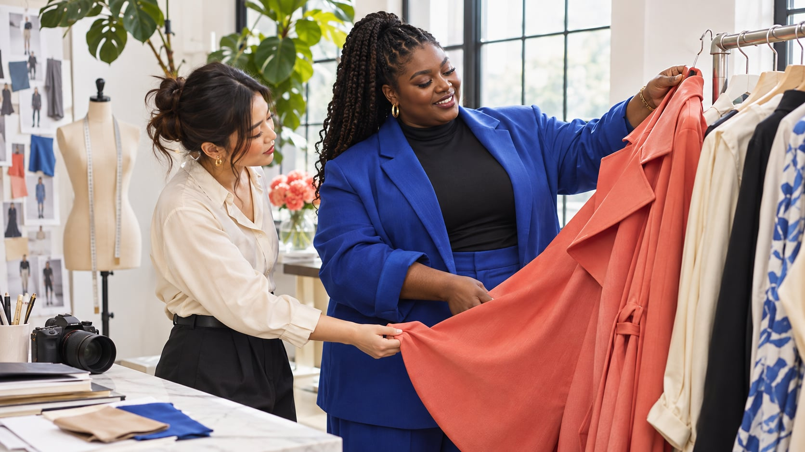
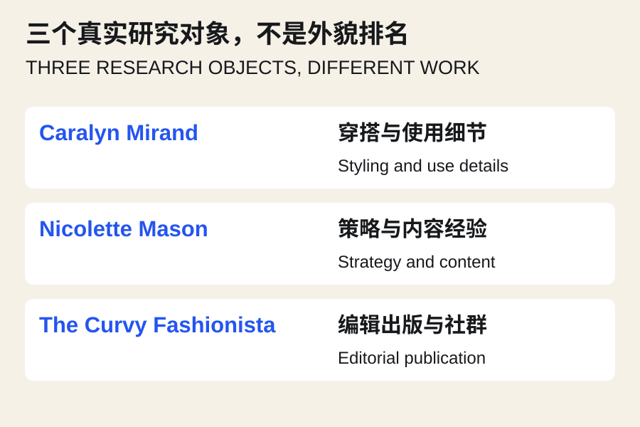

# Plus Size Fashionistas: Creator Examples for Brands

Study three public examples for plus-size fashion partnerships: styling explanation, inclusive brand strategy and community-focused editorial work.

> Draft date: November 23, 2026; independent local preview only.

For a brand researching a “plus size fashionista,” start with how public work helps people understand clothing, rather than ranking appearances or bodies. Useful starting points include Caralyn Mirand Koch’s styling content, Nicolette Mason’s inclusive brand work and The Curvy Fashionista, the editorial platform founded by Marie Denee. These are different partnership roles, not interchangeable influencer inventory. The examples use accessible creator-owned pages reviewed November 23, 2026; they do not establish current availability, verified audience composition or a performance ranking.

## Match the partnership role before choosing a name

Selection here is based on public work addressing plus-size fashion, size inclusion or the relevant community. It is not a top-three follower ranking, and nobody’s body category was inferred from a photograph. The scope includes an individual content creator, a brand strategist and an editorial publication. Retaining those differences makes a partnership request more accurate.

A brand may need to explain movement in a coat, show several ways to wear one piece or discuss a collection’s design choices. Each task requires different work evidence. A useful try-on demonstration does not automatically establish suitability for a strategy assignment, and a publication is not a personal account to book by the post.

Start with a one-page brief specifying the audience question, actual product conditions, action to show and intended publication. The [fashion creator repeat-wear brief](/blog/fashion-influencers-repeat-wear-brief/#answer) helps turn “show the garment” into a more concrete assignment.

Retain the creator’s own language and professional positioning. One person is not a representative of every plus-size consumer. Audience suitability, willingness to collaborate, production arrangements and usage conditions require their own confirmation. The purpose of the examples is to make that next research step more specific, rather than suggest that a category label completes selection.

## Caralyn Mirand Koch: Study practical styling explanation

[Caralyn Mirand’s own work page](https://www.caralynmirand.com/) describes her as a content creator and former curve model, with fashion and undergarment categories. The reviewed page also presents specific coat and wedding-guest styling topics. Those public materials provide a research starting point, not a conclusion about every audience member or partnership result.

An apparel brand can examine how her work breaks “what to wear” into situations and choices before deciding whether it fits the assignment. A proposed coat collaboration might need to explain layering space, seated length and everyday combinations rather than show only a standing pose. That is an editorial task a brand could discuss, not a claim that she accepted or produced it.

Save the relevant work address and record the explanation actually observed, plus conditions still to confirm. Reading an article does not establish that every video was watched. If an action is absent from the reviewed material, turn it into a question rather than certified capability.

Before commissioning, state the real sample sizes, delivery arrangement, revisions and publication requirements. A creator should not have to call a garment well fitting to satisfy a brief or extend one personal wearing experience into a guarantee for everybody. Clear product information supports a more useful conversation about what can genuinely be demonstrated.

## Nicolette Mason: Study inclusion and brand strategy

[Nicolette Mason’s own introduction](https://www.nicolettemason.com/about) positions her work in marketing, communications and brand strategy, including co-founding the size-inclusive label Premme. The relevant evidence is her public professional work. It is not an appearance-based identity judgment or proof that an earlier project remains an active relationship today.

A brand can study this kind of work when translating inclusion into actual product communication. Imagine a team introducing an expanded size range. Establish which garments, markets and sizes are genuinely available before developing the story, casting or messaging. A campaign phrase cannot supply sizes the product does not offer.

If the need is strategy, specify the discussion, proposal or production contribution being commissioned. A budget for one social post should not quietly contain an entire consultancy. Professional experience is a reason to start a scoped conversation, not a substitute for a quotation and deliverable agreement.

A useful research question is: “We want to explain how this range addresses a particular wearing need. Which public work is closest to that task?” Let the professional identify relevant material, then discuss applicability rather than assume an endorsement from a name.

There is also no need to transfer unrelated personal details from a biography into the candidate sheet. Keep what serves the creative task and legitimate business contact. The contribution under consideration is professional judgment, with its own scope and conditions.

## The Curvy Fashionista: Distinguish a publication from a profile

[The Curvy Fashionista’s introduction](https://thecurvyfashionista.com/start-here/) says Marie Denee founded the platform in 2008 and describes its plus-size style, beauty and lifestyle focus. It has an editorial identity and should not be reduced to a personal profile whose wording a brand can freely dictate.

Study how its work organizes shopping questions, industry discussion and community information before proposing a relevant subject. A collection launch may supply material for consideration, but it does not automatically deserve coverage. A paid arrangement should not be disguised as an independent editorial conclusion.

Clarify whether the approach concerns information for editors, commercial content, an event partnership or another defined contribution. Editorial decisions and commercial arrangements need clear boundaries. The existence of a section does not give a brand a right to appear in it.

If the request specifically involves the founder as a host or strategist, confirm that person and arrangement separately. Do not assign the publication team’s work to an individual by default. Equally, a founder’s public statement does not establish the publication’s approval of a partnership.

The research output is an appropriate collaboration type and answerable questions, rather than a quotation cell identical to one for an individual creator. Preserving this distinction lets the brand approach the right recipient with a more accurate proposal.

Define the task before researching the partner; these contributions do not share one post specification.

## Write a garment brief the creator can fulfil honestly

Specify the actual sample size, fabric, fastening, measurement basis, sales markets and stock conditions. The brand owns those product facts; the creator should not have to infer them from a product image. If a sample differs from the retail version, explain the difference before deciding whether it belongs in public content.

A hypothetical brief might request a fastening and arm-movement demonstration, an explanation of layering in this garment, the creator’s styling reasons and a route to the current size chart. These are production suggestions, not a universal clothing test or a promise to determine fit for every viewer.

Allow genuine limits into the work. A creator may explain that an element does not suit their preference or that a different size is needed. That feedback can be more useful than mandatory positive wording. Brand review should correct facts and agreed scope without erasing actual experience to manufacture uniform praise.

Body measurements are personal information, and a commercial assignment does not justify demanding unrelated disclosure. If a sizing detail is genuinely useful, agree an appropriate expression with the person and keep it relevant to garment choice.

The repeat-wear brief also helps define use situations. Discuss production, creator publication and subsequent brand use as separate parts of the assignment rather than assume one fee includes every possible use.

## Compare the work using a shared question

Use a shared question when placing these examples in a research sheet: perhaps how to help viewers choose a coat for a particular occasion. Then record the different contributions—demonstration, strategy or editorial information. Different assignments should not be forced into one ranking based on like rates.

Retain the relevant public work and review date for each judgment. If a source is unavailable, state what was not observed rather than enter a performance value of zero. Even an accessible follower count does not replace relevant market evidence, actual work or commercial terms.

Invite a creator to share task-relevant audience or content evidence they are comfortable providing, without requesting private audience lists. Specific viewer questions, production capability and treatment of genuine product limitations are more useful than a broad label saying someone suits the plus-size market.

Keep public observation, creator confirmation and unresolved questions as distinct evidence states. They are not ratings of a person’s worth. The sheet should show what the next conversation needs to answer, not impersonate a completed commercial endorsement or certification.

Use the [brand-partnership content-governance guide](/blog/brand-partnerships-joint-content-governance/#answer) when the team needs to define the partner and publishing responsibilities. A list label should not replace a concrete agreement.

## Use the examples to start the next research task

These examples start research into three different contributions; they are not a ready-made shortlist for every brand. Decide whether the need is styling explanation, strategy or editorial work, then use the official pages to inspect relevant material and current business routes.

[QuickKOL’s product explanation](https://www.quickkol.com/) describes discovery and research driven by a brief or keywords. A team can place the specific wearing question in its brief, research relevant work on supported platforms and then confirm identity, interest and commercial terms. A returned candidate is not a guarantee of availability, a body classification or proof of every audience attribute.

The next action can be small: choose a real garment, write one viewer question, retain two relevant work references and approach the appropriate person with a defined, paid opportunity. Do not replace portfolio research with a demand for free speculative production or treat an interested reply as a completed license.

That keeps the collaboration grounded in clothing and audience needs while making the professional contribution visible. A name opens the research; the expression, judgment or production capability needed for this assignment is what the brand is considering purchasing.

## Three real research starting points

Based on owned pages reviewed November23,2026. Order is not a ranking; live audience data and availability were not verified.

| Example | Public work lead | Confirm next |
| --- | --- | --- |
| Caralyn Mirand Koch | Styling, coats and occasion choices | Relevant work and production conditions |
| Nicolette Mason | Inclusive branding and communications | Actual strategy or content scope |
| The Curvy Fashionista / Marie Denee | Plus-size fashion publication | Publication, individual and commercial route |

## Next step

Research creators around the action and explanation required, then discuss the actual scope.

[Explore QuickKOL](https://www.quickkol.com/)

## Sources and scope

Sources reviewed November 23, 2026 using accessible public material. No user account was signed into or changed. Editorial examples are not client outcomes; confirm features in the intended account.

- [Caralyn Mirand’s own work page](https://www.caralynmirand.com/)
- [Nicolette Mason’s own introduction](https://www.nicolettemason.com/about)
- [The Curvy Fashionista’s introduction](https://thecurvyfashionista.com/start-here/)
- [QuickKOL’s product explanation](https://www.quickkol.com/)
