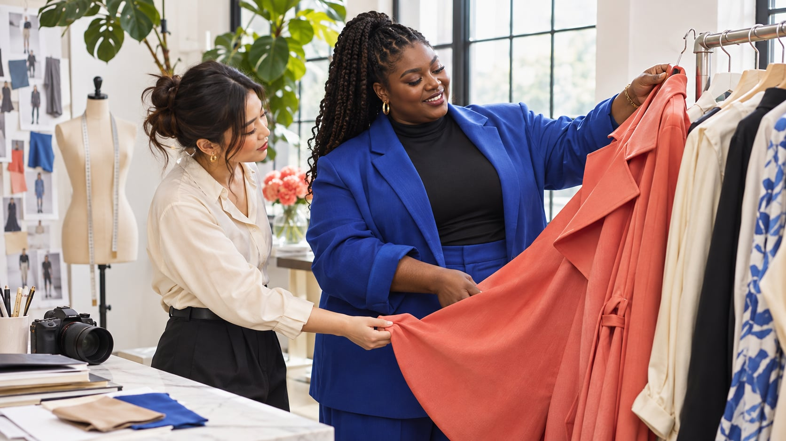
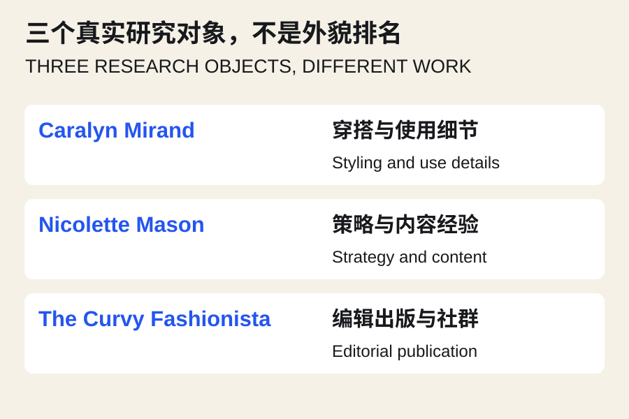

# 大码时尚创作者：品牌可研究的真实示例

从三类真实公开作品出发，研究大码时尚合作：穿搭解释、包容性品牌策略，以及面向相关社群的编辑内容。

> 草稿日期：2026年11月23日；仅独立本地预览。

为品牌研究“plus size fashionista”，应看公开作品如何帮助观众理解服装，而不是按外貌或身材排名。可从 Caralyn Mirand Koch 的穿搭内容、Nicolette Mason 的包容性品牌工作，以及 Marie Denee 创办的 The Curvy Fashionista 编辑平台开始。这三类对象承担不同任务，不是同一规格的达人名单。以下示例依据截至2026年11月23日可读取的自有页面，不代表当前可接单、受众已验证或合作效果排行。

## 先看合作角色，再看名字

本篇选择公开作品明确涉及大码、尺码包容或相关社群内容的对象。它不是按粉丝量取前三名，也没有根据照片推断任何人的体型。研究范围包括个人内容创作者、品牌策略工作者和编辑媒体，保留角色差别，才能提出合理的合作请求。

品牌的任务可能是说明一件外套的活动空间，展示同一单品的不同搭配，或解释某个系列的设计选择。任务不同，需要的作品证据也不同。一个有用的试穿示范，不自动证明适合主持品牌战略讨论；一个有深度的媒体平台，也不能当作个人账号直接下单。

先在一页简报中写清观众问题、真实商品条件、希望看到的动作和计划发布的位置。已有的[时尚达人重复穿着简报](/zh/blog/fashion-influencers-repeat-wear-brief/#answer)可帮助把泛泛的“展示这件衣服”改成具体内容。

本文保留创作者自己的用语和公开业务定位，不把一个人当作所有大码消费者的代表。受众是否适合、当前是否愿意合作，以及制作和使用条件，都需要下一步分别确认。

## Caralyn Mirand Koch：研究日常穿搭的解释能力

[Caralyn Mirand 官方作品页](https://www.caralynmirand.com/)将她介绍为内容创作者及前曲线模特，栏目包括时尚与内衣。所读页面也展示了外套和婚礼宾客穿搭等具体主题。这些公开材料提供研究起点，不是关于她所有观众或每项合作结果的结论。

对服装品牌，可先研究她怎样把“穿什么”拆成场景与选择，再判断是否符合自己的问题。例如，一次外套合作可以需要解释内搭空间、坐下后的长度和日常搭配，而不只是镜头前站立展示。这里是品牌可提出的编辑任务，不表示她已接受或实际制作了这项内容。

研究时保存对应作品页，记录自己看见的讲解方式和仍需确认的条件。若只读了文章，不要声称观看了所有视频；如果某种动作没有展示，就把它写成询问，而不是现成能力证明。

合作前应说明可供应的真实尺码、寄样方式、修改安排和是否需要发布。创作者不应该为了满足品牌简报而声称衣服合身，也不应被要求将个人穿着体验扩写成对所有人的保证。

## Nicolette Mason：研究包容性品牌与内容策略

[Nicolette Mason 官方介绍](https://www.nicolettemason.com/about)将其工作定位于营销、传播和品牌策略，并列出共同创办尺码包容品牌 Premme 等经历。这里依据的是她公开的专业工作，不用外貌替她定义身份，也不将过往项目自动写成今天仍在进行的合作。

这类对象适合品牌研究怎样把包容性落到实际内容和产品沟通。假设团队准备发布尺码扩展系列，首先要说明哪些单品、市场和尺码确实可购买，再讨论故事、选角与表达。一个宣传语不能补上实际没有供应的尺码。

品牌如果需要策略支持，应明确要求讨论、方案或制作中的哪一部分，而不是用“一条达人帖子”的预算暗含整套咨询。公开策略经历可以成为沟通理由，但不能替代具体报价和交付范围。

研究后的问题可以是：“我们希望解释这一系列怎样满足具体穿着需求，哪些已公开的工作最接近这个任务？”让对方指出相关材料，再讨论适用性，比根据一个人名直接推定愿意背书更加尊重专业贡献。

同样，不需要把公开简介中的私人生活信息带进候选表。保留与内容任务和业务联系有关的资料就足够。

## The Curvy Fashionista：区分编辑媒体与个人账号

[The Curvy Fashionista 介绍](https://thecurvyfashionista.com/start-here/)说明，Marie Denee 于2008年创办该平台，内容面向大码时尚、风格、美妆和生活方式。它是有编辑定位的媒体，不应被简化为一个可任意安排文案的个人账号。

品牌可研究其作品怎样组织购物问题、行业讨论和社群信息，再判断是否存在合理的合作题目。比如，某个系列的上市信息可以作为选题资料，但不能预设它一定值得报道，更不能要求付费安排伪装成独立编辑结论。

联系时先说明所提议的是资料提供、商业内容、活动合作，还是其他明确任务。编辑决定与商业约定需要保持清楚边界。网站存在某一栏目，也不代表品牌拥有进入该栏目的权利。

若需要创始人本人参与主持或策略讨论，应单独确认对象和业务安排，不把媒体团队的工作默认归给个人。反过来，一位创始人的公开观点也不等于整个媒体已经批准一项合作。

这类研究的输出是合适的合作类型与待询问题，而不是一个和个人达人完全相同的报价格子。保留这种差异，能让品牌向正确接收人提出准确请求。

先确认任务，再研究对象；三类贡献不能按同一帖子规格购买。

## 给创作者能诚实完成的试穿简报

把商品信息写具体：实际寄样尺码、面料、扣合方式、测量口径、可售市场和库存条件。品牌负责确认这些事实，不让创作者从一张商品图猜。若样衣与零售版本不同，应在制作前说明差异及能否用于公开展示。

一个假设简报可以要求：展示扣合与抬手动作；说明这一件的内搭情况；给出创作者自己的搭配理由；让观众知道到哪里核对当前尺码表。这是制作建议，不是适用于所有衣服的统一测试，也不承诺由动作判断所有人的合身程度。

允许真实限制进入内容。创作者可以说某一部分不适合自己的偏好，或需要换一种尺码；这类反馈可能比强制积极文案更能帮助品牌发现问题。品牌审核应纠正事实和约定范围，不要求删掉真实体验以制造一致好评。

身体尺寸属于个人信息，不应因商业合作就要求公开无关细节。确需说明某项尺码信息时，先由本人决定适当表达，并保留与商品选择直接有关的范围。

服装品牌合作范围也可以参考重复穿着简报中的使用场景安排，分别讨论内容制作、本人发布与品牌后续使用。

## 比较作品时，用同一问题而不是同一标签

把三类对象放在同一研究表时，先写共同问题，例如“怎样帮助观众选择适合某场合的外套”，再记录不同贡献：演示、策略、编辑信息。对不同任务，不应强行用同一个点赞率排出先后。

每条判断保留对应公开作品及核验时间。来源无法访问时，写清没有看到什么，而不是将缺失记成表现为零。粉丝数字即使可见，也不能代替相关市场、实际作品和商业条件。

与创作者沟通时，请其提供愿意分享、与任务有关的受众或内容证据，不索取私人观众名单。观众问了哪些具体问题、是否能完成拍摄、如何处理真实产品限制，通常比一个笼统的“适合大码市场”标签更有用。

在审阅表中保留“公开可见”“本人确认”“待核验”三种状态。它们对应不同证据，不是对人的价值评分。品牌可以据此决定下一次沟通需要解决什么，而不是把研究表当成已完成的商业背书。

需要进一步明确合作对象和发布责任时，可参考[品牌合作内容协作指南](/zh/blog/brand-partnerships-joint-content-governance/#answer)；不要让一个名单标签替代具体约定。

## 从真实作品开始下一次合作研究

以上对象可作为三种贡献的研究起点，不能直接复制为适合所有品牌的名单。先决定你需要试穿解释、策略讨论还是媒体内容，再沿官方页面查看相关作品与当前联系入口。

[QuickKOL 官网能力说明](https://www.quickkol.com/)提供简报与关键词驱动的达人发现和研究入口。团队可以把具体穿着问题放进简报，在其支持的平台中寻找相关作品，再人工核对身份、兴趣与合作条件。工具返回候选，不代表对方愿意接单，也不证明某个身体类型或所有受众特征。

实际下一步可以很小：选一个真实单品、写一个观众问题、保存两段相关作品证据，再向合适对象提出明确且有报酬安排的讨论。不要要求免费试拍来替代作品研究，也不把回复意向当作已经同意授权。

这样的合作从服装和观众需求出发，创作者的专业贡献也更清楚。名字是入口，真正值得采购的是能够完成这次任务的表达、判断或制作能力。

## 三个真实研究起点

依据2026年11月23日读取的各方自有页面；顺序不表示排名，未核验实时受众或当前档期。

| 对象 | 公开工作线索 | 下一步需确认 |
| --- | --- | --- |
| Caralyn Mirand Koch | 穿搭、外套与场合选择 | 相关作品与本次制作条件 |
| Nicolette Mason | 包容性品牌与传播策略 | 策略或内容的实际范围 |
| The Curvy Fashionista / Marie Denee | 大码时尚编辑媒体 | 媒体、个人与商业联系的区别 |

## 下一步

围绕需要展示的动作与解释研究达人，再讨论实际合作范围。

[了解 QuickKOL](https://www.quickkol.com/)

## 来源与范围

资料核验于2026年11月23日，基于可读取的公开来源。未登录或修改用户账号；编辑示例不代表真实客户结果，平台功能以实际账号为准。

- [Caralyn Mirand 官方作品页](https://www.caralynmirand.com/)
- [Nicolette Mason 官方介绍](https://www.nicolettemason.com/about)
- [The Curvy Fashionista 介绍](https://thecurvyfashionista.com/start-here/)
- [QuickKOL 官网能力说明](https://www.quickkol.com/)
