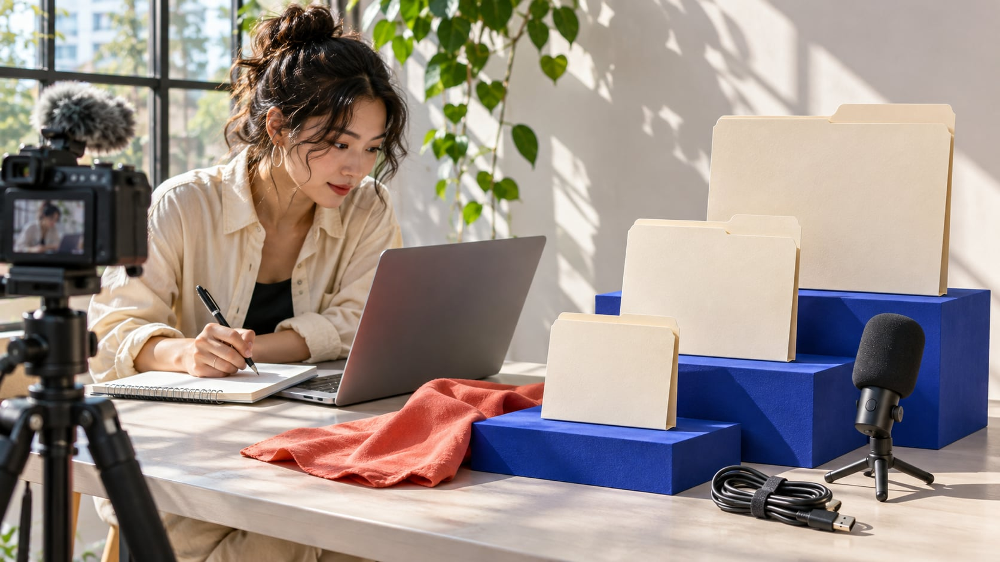
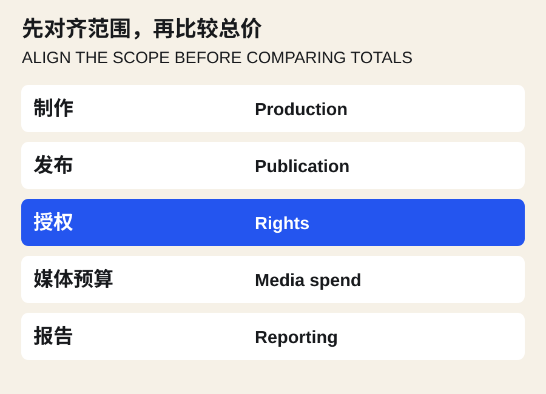

# Social Media Marketing Packages for Creator Work

Compare three hypothetical packages for production, creator publication and ongoing partnerships, with explicit fees, rights and delivery boundaries.

> Draft date: November 23, 2026; independent local preview only.

Social media marketing packages involving creators should identify whether the purchase is production, publication on a creator’s account, brand-account management or a combination. Define assets, quantities, participants, revisions, rights, timing, fees and reporting scope. The three packages below are hypothetical scope examples, not industry standards, actual service quotations or agency packages offered by QuickKOL.

## Separate the work hidden inside one package name

Monthly social media service might mean captions and scheduling for a brand account, or it might include filming, outreach, creator publication and advertising management. Identical package names do not establish identical work. Break the proposal into individual tasks and compare quantities and responsibilities line by line.

[UAL’s London creator-hiring guide](https://www.arts.ac.uk/students/student-careers/stories/how-to-hire-a-content-creator-in-london) distinguishes production roles and working arrangements. That distinction helps avoid treating every content task as publication to followers. It is used here to clarify scope, not to turn a local illustrative rate into a worldwide creator-services standard.

Start with an actual assignment: the brand needs three videos explaining new equipment, with one published by a creator and two used only on brand channels. That sentence already raises separate production, publication and licensing questions. It invites more comparable responses than choosing a silver, gold or premium name before anybody has explained the purchase. If a provider responds only with a post count, ask which of those tasks the count actually includes.

## Scope one: a defined production set

The first hypothetical package contains two vertical demonstration videos and four related photographs, made by one creator in one agreed shoot, with one defined revision round. It does not promise creator-account publication or automatically include advertising use. It suits a brand with an existing publishing route that needs clearer demonstration assets.

Define the question answered by each piece, file format, subtitles, final exports and any optional raw material. Two videos should not imply unlimited duration, every aspect ratio and all source files. The creator needs to understand acceptance, and the buyer needs to know exactly what will arrive.

One film might explain assembly and the other cleaning. They can share a shoot while each answers a separate question. A later request for an outdoor setting requires a scope discussion. Apparently spare time does not automatically add another creative assignment to the original package. State who supplies the product and factual instructions, and whether a delayed delivery changes the filming date. These practical details can matter more than the package label.

## Scope two: add a creator publication

The second hypothetical package adds one creator-account publication and agreed publication information over a defined observation window. The purchase now involves narrative, placement and the creator’s audience relationship as well as a file. Confirm willingness and fit with the person’s ordinary content rhythm before treating the slot as available.

Specify the account, format, publication time, retention or change arrangements, and responsibility for commercial identification. One publication is not a fixed-sales commitment, and the creator’s entire audience is not a set of new customers for this brand.

The [brand-partnership content-governance guide](/blog/brand-partnerships-joint-content-governance/#answer) helps allocate factual approval and creative judgment. Put two review rounds into the calendar if that is the agreement. Reconfirm timing when product information arrives late. A credible scope makes these dependencies visible instead of hiding them inside an all-inclusive claim. Also clarify who responds to product questions after publication: the creator can describe their experience, while the brand may need to answer warranty, stock or order questions.

## Scope three: define an ongoing partnership

The third hypothetical package runs for three months, with two assets, one content review and the next brief each month. It suits a project with established partnership fit and a genuine sequence of subjects. Three months is an illustrative scope, not a standard every creator should accept.

Define monthly delivery and approval dates, unfinished items, pauses, cancellation and pricing for new requests. Renaming a one-off project a monthly partnership should not imply that the creator is always on call. The brand also needs an owner who can provide timely information and decisions each month.

Be specific about exclusivity. Identify category, territory, duration and exceptions before discussing compensation. An undefined instruction not to work with competitors can cover a list the creator cannot understand or price. The value of a continuing partnership lies in accumulated knowledge and useful content, not simply buying more undefined access to somebody’s account or working time.

## Make the quotation explain the cost components

Ask the quotation to identify management or planning, creator production, creator publication, usage rights, extra production expenses, advertising media spend and reporting. A provider can bundle its commercial price while still explaining what is included and what is additional. Not quoted does not mean free.

Do not force every component into every project. State that advertising is excluded when it is not required, or that production is inapplicable when the brand supplies the assets. Clarify tax treatment, currency, payment stages, cancellation and rush work. Otherwise one apparently comparable amount may include taxes while another excludes them.

This guide does not invent an average package price. Actual pricing depends on work, creator, rights and market. Ask providers to respond to the same scope sheet and explain their differences. The lowest total may describe another purchase if it omits required rights or reporting. Comparison starts by establishing equivalent tasks, not by assuming that two similarly named bundles already contain them.

Align the work being purchased before comparing quotation totals.

## Rights and media spend are separate

Receiving an asset does not establish every reuse right. Specify organic publication, paid advertising, website and other channel permissions, including duration, territory, editing and sublicensing conditions. Activating an advertising-authorization feature does not replace an agreement about the underlying creative work.

Media budget pays for distribution. It is different from the creator’s production fee and from the provider’s other charges. Keep organic and paid scope separate in reporting so purchased impressions do not become evidence of entirely organic creator influence.

For example, a brand that purchased three months of organic reposting on its social accounts should confirm a new use before placing the film in an advertisement six months later. A file remaining in the company drive does not establish unlimited continuing permission. This is editorial scope guidance; the responsible party should review the actual agreement and applicable rights. A clear renewal process helps both sides answer a new request without assuming either automatic permission or automatic refusal.

## Include reporting and commercial identification

[Google Analytics campaign-parameter guidance](https://support.google.com/analytics/answer/10917952?hl=en) can support consistent campaign traffic naming, but link parameters do not prove that all purchases were caused by the partnership. A reporting commitment should state data sources, observation duration, delivery date and fields that may be unavailable.

[ASA’s 2026 influencer-advertising guide overview](https://www.asa.org.uk/resource/influencers-guide.html) covers commercial relationships and affiliate disclosure in a UK context. Check the requirements of other relevant markets separately. Provider, brand and creator should decide before publication who confirms commercial identification; third-party execution does not mean nobody is responsible.

The [creator social-metrics decision guide](/blog/social-media-metrics-creator-decision-tree/#answer) helps select measures connected to the objective. Product explanation, clicks and transactions are different outcomes and should not disappear into one unexplained score. A monthly report needs to correspond to understandable material, rather than a screenshot with no source. Ask for a sample structure using invented data if the provider cannot share client information. That can demonstrate the intended format without disclosing another customer’s records.

## Choose through a concrete scope conversation

Ask five questions about the proposal: who makes what, where it is published, how the brand may use it, what is excluded, and how completion is established. Ask the provider to answer for this product rather than repeat a general sales presentation.

If the answers remain unclear, narrow the first stage. One demonstration and review may establish a useful starting point before expanding to several creators. The reason is unresolved scope, not the assumption that a small package needs no approval. Product facts, rights and payment still need agreement.

Save the final scope version and document additions with their consequences when something changes. A good package gives the creator executable work and the brand an understandable purchase. It should not turn every subsequent question into a disagreement over what somebody thought was already included. Review the actual deliverables at completion, then decide whether another package would solve the next task.

## Match acceptance to the purchase

For production, inspect files, content, subtitles and agreed revisions. For publication, check the real URL and account. For reporting, verify the window and sources. Separate acceptance lets the team identify what is complete and what still needs work.

A delivered film that has not been published does not complete every part of the project. A published post with an unfinished observation window does not establish the final commercial result either. Status should help the next responsible person act, rather than simply making every cell in a progress sheet appear complete.

## Return discovery to the content need

Once the content is defined, research creators with the relevant capability. [QuickKOL’s product explanation](https://www.quickkol.com/) provides discovery and research from a need. It should not be described as the agency selling the three hypothetical packages in this article.

For a home-appliance cleaning demonstration, investigate creators familiar with domestic use who show action details clearly, then discuss publication, licensing and fees. Discovery results still require manual work review and direct confirmation of interest.

Give the responsible project owner both the scope sheet and suitable candidates. Procurement can then concern an actual creative assignment rather than comparing similar-sounding package names before the deliverable has been decided.

## Three hypothetical scope examples

These are editorial scope examples, with no market-price or outcome promise. Agree final quantities and conditions directly.

| Scope | Core deliverable | Confirm separately |
| --- | --- | --- |
| Production | Two videos, four photos, one revision round | Creator publication, ad rights, raw files |
| Production and publication | Defined production plus one creator publication | Window, reporting, usage duration |
| Ongoing partnership | Illustrative three months, two assets and a review monthly | Exclusivity, pauses, changes and cancellation |

## Next step

Decide what needs to be made before discussing candidates, publication and fees.

[Research creators with QuickKOL](https://www.quickkol.com/)

## Sources and scope

Sources reviewed November 23, 2026 using accessible public material. No user account was signed into or changed. Editorial examples are not client outcomes; confirm features in the intended account.

- [UAL’s London creator-hiring guide](https://www.arts.ac.uk/students/student-careers/stories/how-to-hire-a-content-creator-in-london)
- [Google Analytics campaign-parameter guidance](https://support.google.com/analytics/answer/10917952?hl=en)
- [ASA’s 2026 influencer-advertising guide overview](https://www.asa.org.uk/resource/influencers-guide.html)
- [QuickKOL’s product explanation](https://www.quickkol.com/)
