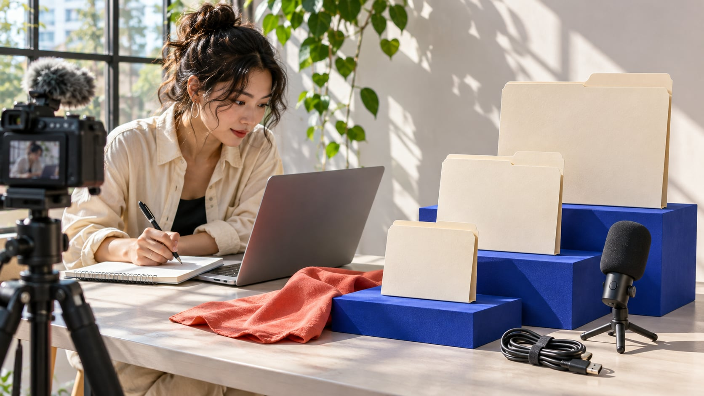
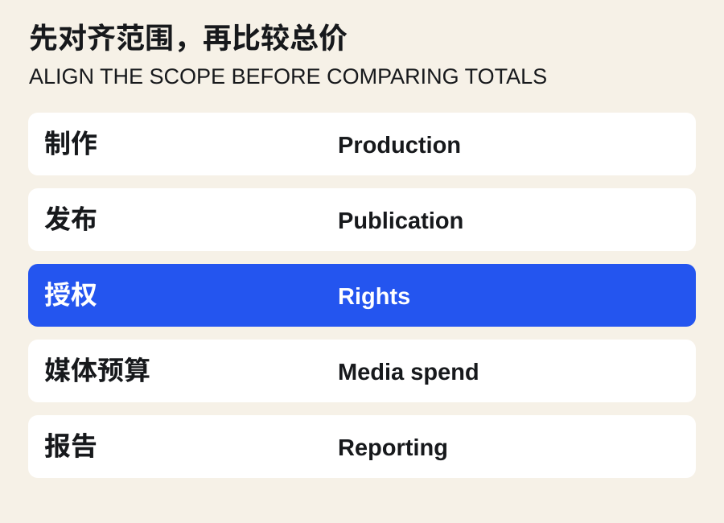

# 社交媒体营销套餐：怎样写清达人合作范围

用三个假设套餐比较制作、达人发布和长期合作，把费用、授权与交付边界写清。

> 草稿日期：2026年11月23日；仅独立本地预览。

包含达人合作的 social media marketing packages，应先明确采购的是制作、达人账号发布、品牌账号运营，还是几项组合。每个套餐至少写清作品、数量、参与人、修改、授权、时间、费用和报告范围。下文提供三种假设范围与比较问题，不把它们冒充市场统一标准、真实服务报价或 QuickKOL 提供的代理套餐。

## 先拆开常被放在一个名称里的工作

“每月社交媒体服务”可能只包含品牌账号文字与排期，也可能含拍摄、达人联络、创作者发布和广告管理。报价名称相同，不代表买到同一份工作。先把工作拆成独立行，再比较每一行的数量与责任。

[UAL 伦敦创作者雇用指南](https://www.arts.ac.uk/students/student-careers/stories/how-to-hire-a-content-creator-in-london)区分了制作岗位与不同合作方式，提醒采购方不能把所有内容工作都理解成面向粉丝发布。这里用其角色区分帮助定义范围，不把当地示例价格当作全球达人服务标准。

品牌应先写一个真实任务，例如“需要三条能解释新器具使用方法的视频，其中一条在达人账号发布，另外两条只供品牌渠道使用”。这一句已经能暴露制作、发布和使用权三个问题。比起先选银牌、金牌或高级套餐，更容易得到可比较的答复。

## 范围一：先完成一组可用的制作素材

第一个假设套餐是两条竖版演示视频和四张相关照片，由一位创作者完成一次拍摄，包含已约定的一轮修改。没有承诺达人账号发布，也没有自动包括广告使用。适合品牌已有发布渠道、当前缺少清楚演示作品的情况。

交付定义应包括每条作品要回答的问题、文件格式、是否含字幕、最终文件与可选原始素材。不要只写“两条视频”就期待无限长度、所有剪辑比例与全部原始文件。创作者应知道品牌会怎样验收，品牌也要知道自己拿到的是什么。

例如一条讲组装，另一条讲清洁，两条共享同一次拍摄但各自完成独立答案。若品牌之后要求新增室外场景，应讨论追加范围。不能因为剩余时间看似够用，就自动把更多创作工作算进原套餐。

## 范围二：增加一项真实的达人发布

第二个假设套餐在制作基础上增加一条达人账号发布和一份约定窗口的作品资料。品牌购买的不只是文件，还涉及创作者的叙事、发布位置与受众关系。需要确认对方是否愿意参与，以及发布是否与其正常内容节奏匹配。

明确作品在哪个账号、什么格式、何时发布、保留与修改安排，以及商业标识由谁确认。不要把“发布一次”写成达到固定销售额，也不要把达人所有观众都视为本次品牌的新客户。

[品牌合作内容治理指南](/zh/blog/brand-partnerships-joint-content-governance/#answer)可帮助双方确定事实审核与创作判断。若审核需两轮，把时间写进日历；若产品信息迟到，重新确认发布时间。一个可信的套餐应允许看见这些依赖，而不是把所有不确定性藏在一句“全包服务”里。

## 范围三：持续合作需要持续交付定义

第三个假设套餐是连续三个月合作，每月两项作品、一场内容复盘和下一月简报。它适合已经确认合作匹配、确有持续主题的项目。三个月只是本篇范围示例，不是所有达人都应接受的标准期限。

持续合作应说明每个月的交付与审核时间、未完成项目怎样处理、临时停拍与取消规则，以及新需求如何报价。一次性活动不能因为改名月度合作，就默认创作者随时待命。

独家安排也应具体。如果品牌需要限制同品类合作，明确品类、地域、时间与例外，再由双方讨论补偿。不要用“不能与竞争对手合作”覆盖创作者无法理解的无限名单。持续合作的价值来自连续的知识与内容，而不只是购买更多没有定义的账号占用时间。

## 费用表至少分出这几项

要求报价分别写明管理或策划、达人制作、达人发布、使用授权、额外制作费用、广告媒体预算和报告。提供方可以合并计价，但仍要解释哪些部分包含、哪些另计。未报价与免费不是同一状态。

没有必要在所有项目中强塞每一项。如果不做付费广告，就写不包含；若品牌自备素材，制作项可以不适用。税费、币种、付款节点、取消与加急也需要明确，避免比较时一个报价含税、另一个不含。

这里不提供虚构“套餐平均价”。实际价格取决于工作、创作者、权利和市场。可以让两家提供方使用同一范围表回复，再对比差异原因。最低总价若省略了必要授权或报告，未必对应同一个采购任务。

比较时先对齐工作范围，再看报价总额。

## 授权与广告预算不能互相替代

品牌得到一条作品，不代表已经获得所有再使用权。报价应说明自然发布、付费广告、网站与其他渠道的许可，相关期限、地区、剪辑与转授权条件也要清楚。平台上某个广告授权功能的开启，不能代替双方对作品权利的约定。

广告预算则是付给媒体分发的支出，不是创作者制作费，也不是服务商收入的唯一组成。报告时分开显示自然与付费范围，避免把广告买到的展示全部解释成达人自然影响力。

例如品牌只采购三个月自有社交转发，半年后想把作品用在新广告，应先确认新用途。不要因为旧文件仍保存在公司网盘，就认为授权仍无限有效。这是范围管理的编辑建议，具体合同与适用权利由负责人核对。

## 报告与商业标识写进范围

[Google Analytics 活动参数说明](https://support.google.com/analytics/answer/10917952?hl=en)可用于整理活动流量命名，但链接参数不能证明所有购买都由这次合作造成。套餐若承诺报告，应写清数据来自哪里、观察多久、何时交付与哪些字段可能不可得。

[ASA 2026 达人广告指南介绍](https://www.asa.org.uk/resource/influencers-guide.html)覆盖商业关系与联盟披露。英国市场只是一个明确适用范围，其他市场需查看相应要求。服务商、品牌与创作者应在发布前安排谁确认商业标识，不能因套餐由第三方执行就假设无人需要负责。

[达人社交媒体指标决策指南](/zh/blog/social-media-metrics-creator-decision-tree/#answer)可以帮助选用目标相关的指标。作品解释、点击和交易是不同结果，不宜用一个总分掩盖。报价中的“月报”至少要对应一份能看懂的内容，而不是只承诺一张没有来源的截图。

## 用一次实际问答选择套餐

拿到提案后问五个问题：谁制作什么，在哪里发布，品牌能怎样使用，未包含什么，怎样判断交付完成。让对方用本次产品回答，而不是只复述通用销售介绍。

若答案仍模糊，缩小第一阶段。例如先完成一条演示与一次复盘，再决定是否扩大到多位达人。这样做的依据应是任务尚未清楚，而不是把小套餐当成无需审核的试用。产品事实、权利和付款仍要明确。

双方确认后保存最终范围版本，变更时写出新增事项和影响。好的套餐让创作者有可执行的任务，也让品牌知道自己购买的结果。它不应让每一个后续问题都变成“我们以为已经包含”。

## 交付验收要对应采购范围

制作完成时检查文件、内容、字幕与已约定修改，发布完成时核对真实链接与账号，报告完成时核对窗口与来源。三类验收分开，才能说明哪项工作完成、哪项仍需处理。

例如交付视频但尚未发布，不应把全部项目写成已完成；作品已发布但报告窗口未结束，也不应提前宣布最终商业结果。项目状态应帮助下一位负责人行动，而不是只让进度表看起来全绿。

## 找人任务应回到内容需求

确定需要的作品之后，再研究有相应能力的达人。[QuickKOL 官网能力说明](https://www.quickkol.com/)提供按需求寻找与研究达人的入口，不应被描述成本文三种代理套餐的服务商。

例如需要清楚展示家电清洁步骤，就先找熟悉家庭使用场景、能拍出动作细节的人，再讨论发布、授权与费用。候选发现结果还需人工核对作品和询问合作意向。

最终把范围表和合适候选一起交给项目负责人。这样采购讨论围绕真实内容工作，而不是在没有确定交付的情况下比较几个听起来相似的套餐名字。

## 三个假设范围对比

均为本文假设结构，没有市场价格或效果承诺；最终数量与条件需要双方确认。

| 范围 | 主要交付 | 另行确认 |
| --- | --- | --- |
| 制作 | 两条视频、四张照片、一轮修改 | 达人发布、广告权、原始文件 |
| 制作与发布 | 约定制作加一条达人账号发布 | 窗口、报告、使用期限 |
| 持续合作 | 示例三个月，每月两项作品与复盘 | 排他、暂停、变更与取消 |

## 下一步

先确定要拍什么，再讨论合作对象、发布和费用。

[在 QuickKOL 研究达人](https://www.quickkol.com/)

## 来源与范围

资料核验于2026年11月23日，基于可读取的公开来源。未登录或修改用户账号；编辑示例不代表真实客户结果，平台功能以实际账号为准。

- [UAL 伦敦创作者雇用指南](https://www.arts.ac.uk/students/student-careers/stories/how-to-hire-a-content-creator-in-london)
- [Google Analytics 活动参数说明](https://support.google.com/analytics/answer/10917952?hl=en)
- [ASA 2026 达人广告指南介绍](https://www.asa.org.uk/resource/influencers-guide.html)
- [QuickKOL 官网能力说明](https://www.quickkol.com/)
