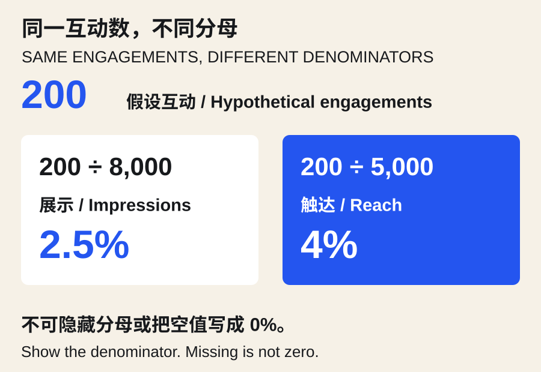

# Social Media Report Template for Creator Campaigns

Download bilingual CSV files with hypothetical examples and connect publication-level evidence to a defensible partnership decision.

> Draft date: November 23, 2026; independent local preview only.

A useful social media report template connects the partnership objective, individual publications, observation window, data source and next decision. This page provides editable English and Chinese CSV files: a publication sheet, metric dictionary and summary template, with explicitly hypothetical examples. They do not connect social accounts or import data automatically. Open the files in a spreadsheet application, copy a blank working row, and replace the examples before using the report for a real creator campaign.

## Choose the decision the report must support

Begin with an actual choice: renew the partnership, change the next piece of content, adjust a budget or wait for more information. A product-explanation objective needs relevant viewing and feedback evidence. An order objective also needs transaction and attribution information. Avoid starting with a total-engagement slide and inventing a commercial interpretation afterwards.

The summary file keeps six working fields: objective, observation, limitation, recommendation, owner and next review. In a hypothetical backpack collaboration, an entry could say that the film demonstrates three compartments but questions still concern laptop size, so the next commission should demonstrate that fit. This is more usable than a verdict that performance was good.

Assign responsibility before sharing the template. One person may supply platform figures, another order information and another the final interpretation. A creator can document what was published without having access to the brand’s completed orders. Do not ask a contributor to certify a measure they cannot inspect.

## Use one row for one publication observation

The publication sheet records campaign_id, creator, platform, post_url, format, published_at, window_start, window_end, timezone, distribution_scope and source_reference. Add another row when the same publication is observed over another window. Do not quietly replace the earlier snapshot. The report should reveal which observation supports the conclusion.

Separate columns hold impressions, reach, views, likes, comments, shares, saves, outbound_clicks, attributed_orders and attributed_revenue. Leave a value blank when the platform does not supply it or the creator has not authorized access, and explain the reason in missing_reason. Enter zero only for a verified zero. Missing permission, unavailable information and an observed zero are different states.

Platform measures also have their own boundaries. [YouTube’s channel-overview explanation](https://support.google.com/youtube/answer/9314414?hl=en) distinguishes views, watch time, subscribers and estimated revenue. A channel overview is not the complete commercial result of one sponsored publication. Creator advertising revenue is also different from brand sales revenue. Combining these in a general return column would make subsequent calculations meaningless.

## Let the dictionary control aggregation

The dictionary asks for a definition, unit, source, aggregation rule and limitation for every measure. [Pinterest’s analytics definitions](https://help.pinterest.com/en/business/article/pinterest-analytics) distinguish impressions, saves and outbound clicks. Opening a Pin does not automatically mean visiting the brand’s website. A website-traffic discussion needs the applicable outbound-click or website-side measure, rather than treating every click as a visit.

Do not add cumulative snapshots of the same publication. If a post has 100 cumulative clicks on day seven and 140 on day fourteen, the total is not 240. A difference of 40 represents later additions only when both readings belong to the same consistently defined cumulative series. Stop the calculation if the definition changes.

Unique reach should not be casually added across creators either, because one viewer may encounter several partners. Without deduplication, a report can label a sum of publication-level reach values, but it cannot call that a unique campaign audience. The dictionary places that qualification before calculation, rather than adding a defensive footnote after an overstated result.

## Work through the engagement example

The hypothetical IG-DEMO-01 publication has 8,000 impressions, 5,000 reach, 120 likes, 20 comments, 30 shares and 30 saves within one example window. These are teaching numbers, not platform averages or QuickKOL client results.

Define engagements as the sum of those four actions and the numerator is 200. The impression-based engagement rate is 200 divided by 8,000, multiplied by 100: 2.5%. Using reach produces 200 divided by 5,000, multiplied by 100: 4%. Both calculations use the same hypothetical actions. The denominator changes the meaning, so a report should not display an unexplained 4% engagement rate.

The sheet places engagement_definition, engagement_denominator and engagement_rate_pct together. Downloaded results are static examples, not automatic spreadsheet formulas. Recalculate them when replacing the inputs. If the denominator is blank or zero, leave the result blank and explain that it cannot be calculated. Do not disguise that state as a valid 0%. The [creator social-metrics decision guide](/blog/social-media-metrics-creator-decision-tree/#answer) helps select measures for the actual objective.

One hypothetical engagement total, two denominators and two meanings. CSV examples contain static values.

## Connect links and orders without overstating attribution

[Google Analytics campaign-parameter guidance](https://support.google.com/analytics/answer/10917952?hl=en) explains how source, medium, campaign and related parameters help identify campaign traffic. A consistent naming convention makes website information easier to connect to creator publications. It does not prove that a purchase was caused entirely by that creator.

If a hypothetical collaboration link receives 25 attributed orders, state the attribution system, window, refund status and currency, and whether records overlap other channels. A brand-level revenue total cannot establish orders for each individual post. Where transaction information is unavailable, stop at the content and traffic evidence the team actually has.

The template therefore retains attribution_model, attribution_window, currency and refund_status. It does not assume one model is always fairest or transform clicks directly into revenue. The [creator reporting and evidence memo guide](/blog/influencer-reporting-decision-memo-and-evidence/#answer) helps carry these conditions into the final conclusion. An approver should see which outcomes were observed, which were assigned under a model and which remain interpretations. This distinction matters especially when several partners, paid advertisements and returning customers contribute to the same purchasing journey.

## Fill the files, validate them and write the summary

Download the three files in the required language and create a working copy for the campaign. Remove or clearly isolate example rows, enter the campaign identifier and window, and then add publications individually. A source reference should name the material, export date and an authorized internal location. Do not put account passwords or complete personal audience records into a shared CSV.

Next, validate complete dates, consistent units, duplicate cumulative observations and reasons for missing values. Reproduce the example’s 200 engagements, 2.5% and 4% to confirm the denominator logic. Then trace one real publication from the report back to its authorized source and check that copying, filtering or formatting has not changed the value.

Finish with a paragraph that supports action: the objective, what the work achieved, which commercial outcomes remain unverified and what should change next. A report does not need an enthusiastic adjective for every metric. If renewal is not yet supported, identify the additional evidence and a review date. This is more useful than a large headline that conceals the gap.

## Handle CSV import and sharing problems

The files use UTF-8 encoding. Some spreadsheet applications may display Chinese incorrectly when a CSV is opened by double-clicking. Use the application’s data-import option, choose UTF-8 and a comma delimiter, inspect the headers and save a working copy. Do not paste a campaign’s real data in bulk before confirming that columns align.

Long URLs, dates and identifiers with leading zeroes can be changed automatically by spreadsheet software. Keep identifiers as text, inspect dates alongside the time zone and retain currency with amounts. If a number has been imported as a date, return to the source rather than guessing the original value from its appearance.

IG-DEMO-01 exists to check the logic, not supply a default conclusion for your campaign. Look for remaining DEMO labels and hypothetical amounts after creating the working file, especially in summaries and charts copied into presentations. Mark it as a real report only after replacing the examples and checking their sources.

Before sharing, create a version containing the necessary summary. Authorized source screenshots, internal order identifiers and personal contacts do not all belong in a creator-facing file. Where extra material is needed, identify an appropriate restricted location and owner rather than publishing every underlying record for convenience. Finally, confirm that the recipient can open the files and understands which version is final. A valid download alone does not establish that the report is ready for a decision.

After validation, share a decision summary while retaining the working file’s version and date. If somebody changes a denominator, window or order rule, revise the summary as well. Updated underlying numbers do not make an old conclusion current. Chart titles should retain units and the observation window so a screenshot remains interpretable outside the workbook. Ask the decision owner to confirm the proposed next action, rather than treating delivery of the CSV as approval to renew or expand the creator partnership.

## Use the findings in the next creator search

When a report reveals repeated audience questions about a use case, put the required explanatory skill into the next creator brief. If viewers still do not understand whether a backpack works for commuting, research creators with relevant commuting content who can demonstrate storage details. Simply raising a follower threshold would not address that finding.

[QuickKOL’s product explanation](https://www.quickkol.com/) provides a starting point for discovery and creator research from a stated need. Translating the report into language, setting and content-skill requirements can support that work. It does not mean the product automatically imports these CSV files or replaces the brand’s attribution system.

Save the final report version, source snapshots and decision owner. At the next review, verify windows and definitions before discussing changes. A consistent report can accumulate partnership knowledge. A fresh collection of attractive but incomparable charts each month cannot provide the same continuity.

## Download the report files

Three UTF-8 CSV files per language, for opening in a spreadsheet application. Replace hypothetical examples; no account connection or automatic calculation is included.

- Publication sheet: one row per publication observation.
- Metric dictionary: definitions, units, sources and aggregation limits.
- Summary template: turn the observations into a specific decision.

[Chinese publications CSV](../public/downloads/creator-report-publications-zh.csv)

[English publications CSV](../public/downloads/creator-report-publications-en.csv)

[Chinese dictionary CSV](../public/downloads/creator-report-dictionary-zh.csv)

[English dictionary CSV](../public/downloads/creator-report-dictionary-en.csv)

[Chinese summary CSV](../public/downloads/creator-report-summary-zh.csv)

[English summary CSV](../public/downloads/creator-report-summary-en.csv)

## Next step

Describe the content skills needed to answer the audience questions your report uncovered.

[Research the next creator partnership](https://www.quickkol.com/)

## Sources and scope

Sources reviewed November 23, 2026 using accessible public material. No user account was signed into or changed. Editorial examples are not client outcomes; confirm features in the intended account.

- [YouTube’s channel-overview explanation](https://support.google.com/youtube/answer/9314414?hl=en)
- [Pinterest’s analytics definitions](https://help.pinterest.com/en/business/article/pinterest-analytics)
- [Google Analytics campaign-parameter guidance](https://support.google.com/analytics/answer/10917952?hl=en)
- [QuickKOL’s product explanation](https://www.quickkol.com/)
