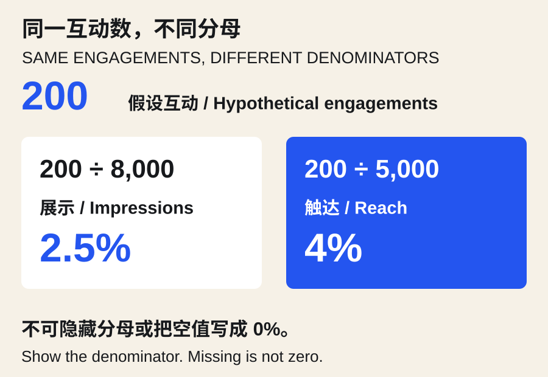

# 达人合作社交媒体报告模板与填写示例

下载带假设数据的双语 CSV，从作品、指标到合作决策，建立可以复核的达人报告。

> 草稿日期：2026年11月23日；仅独立本地预览。

一份能用于达人合作的 social media report template，至少要把合作目标、单条作品、观察窗口、数据来源和下一步决策连起来。本页提供中英文 CSV：作品数据表、指标字典与摘要模板，并填入明确标注的假设示例。它们是可编辑文件，不会连接社交账号或自动拉取数据；导入表格软件后，先复制空白行，再替换示例。

## 先选报告要支持的一个决定

报告首先回答一个实际问题：继续合作、修改下一条内容、调整预算，还是等待更多资料。目标若是解释产品用法，报告就要保留与理解有关的观看和反馈证据；目标若是带来订单，还需交易与归因资料。不要先放一页总互动数字，再临时给它寻找商业解释。

模板摘要页保留“目标、观察、限制、建议、负责人、下次复核”六个字段。例如，假设品牌希望读者理解一件背包怎样分隔收纳，可写“视频清楚展示三个隔层；相关问题仍集中在电脑尺寸；下一条补拍尺寸演示”。这比“表现很好”更容易用于下一轮简报。

多人共用模板时，先明确谁填写平台数据、谁提供交易资料、谁批准最终结论。达人可以证明作品中的信息，不一定能看到品牌后台的最终订单。不要让某个角色为自己无法读取的数字签字确认。

## 用一行保存一条作品的一次观察

作品表记录 campaign_id、creator、platform、post_url、format、published_at、window_start、window_end、timezone、distribution_scope 和 source_reference。相同作品在不同观察窗口的数据应新增一行，不能悄悄覆盖上一份快照。这样才能说明报告采用了哪一次读数。

模板包含 impressions、reach、views、likes、comments、shares、saves、outbound_clicks、attributed_orders 和 attributed_revenue 等独立字段。某平台没有该指标或达人没有授权提供时，留空并在 missing_reason 写明原因。已核验为零才填0，不能把无权限、未提供和真实零值混在一起。

平台指标本身也有边界。[YouTube 频道总览说明](https://support.google.com/youtube/answer/9314414?hl=en)把观看、观看时长、订阅与估算收入分开。频道总览不是一条赞助作品的完整商业结果，创作者的广告收入也不是品牌销售收入。把这些值塞进同一“回报”列，会让后续计算失去意义。

## 指标字典决定哪些数字能够相加

字典要求每个指标注明定义、单位、来源、可否相加和限制。[Pinterest 指标定义](https://help.pinterest.com/en/business/article/pinterest-analytics)把展示、收藏与站外点击区分开；点开 Pin 不自动等于访问品牌网站。报告若要讨论网站流量，应使用适用的站外点击或网站端资料，而不是把所有点击视为访问。

同一作品的累计数据不能跨快照相加。一条帖子在第七天累计100次点击、第十四天累计140次，不能报告为240次。只有确认是同一口径、同一累计序列时，差额40才可表达后一段新增点击。口径改变时先暂停计算。

独立触达人数也不能随意跨达人相加，因为同一观众可能看过多位达人。可以在没有去重能力时报告“各作品触达相加值”，但必须明确不是去重后的合作总受众。字典的作用，就是把这种限制放在计算前，而不是等结论出问题后再补说明。

## 按示例核对一次互动率

假设示例 IG-DEMO-01 的作品有8,000次展示、5,000触达、120赞、20评论、30分享和30收藏，均来自同一示例窗口。这些是教学数据，不是平台均值或 QuickKOL 客户结果。

若定义互动数为以上四项之和，则互动数为200；按展示计算的互动率为200÷8,000×100%=2.5%；按触达计算则为200÷5,000×100%=4%。两个结果都来自同一组假设数据，但分母不同，不能只写“互动率4%”而隐藏口径。

模板把 engagement_definition、engagement_denominator 和 engagement_rate_pct 放在同一行。下载文件中的结果是示例静态值，并非自动公式。替换数据时需要重新计算。分母为空或为0时，结果留空并标记不可计算，不用0%冒充一个有效结果。要进一步选择适合目标的指标，可阅读[达人社交媒体指标决策指南](/zh/blog/social-media-metrics-creator-decision-tree/#answer)。

同一假设互动数，分母不同，指标含义也不同。CSV 为可编辑模板，示例结果是静态值。

## 把链接与销售记录接上，但保留归因边界

[Google Analytics 活动参数说明](https://support.google.com/analytics/answer/10917952?hl=en)介绍 source、medium、campaign 等参数怎样帮助识别活动流量。为达人合作分配一致的参数命名，可以让网站端资料与作品表更容易对应；它不等于证明某次购买完全由该达人造成。

假设一条合作链接记录25个归因订单，报告仍需注明归因系统、窗口、退款状态、币种以及这些订单是否与其他渠道重叠。若品牌只提供汇总金额，不能据此推断每条作品的订单。没有可用的交易资料时，报告应停留在已经获得的内容和流量证据。

模板因此保留 attribution_model、attribution_window、currency 和 refund_status。这里不预设某种模型最公平，也不把链接点击数直接换算成销售额。[达人报告与证据备忘指南](/zh/blog/influencer-reporting-decision-memo-and-evidence/#answer)可以帮助把这些条件写进最终结论，让审批人知道哪些结果可观察、哪些只能作为解释。

## 填写、检查，再形成一页摘要

实际使用时先下载对应语言的三个文件，为自己的活动建立副本。删除或清楚隔离示例行，填写活动标识和窗口，再逐条录入作品。来源备注建议写资料名称、导出日期和允许访问的内部位置，不把私人账号密码或完整用户资料放进共享 CSV。

第二步检查日期是否完整、单位是否一致、累计数据是否重复、缺失值是否有原因。先用示例核算200、2.5%和4%，确认自己理解分母。再抽查一条真实作品，从报告回到授权资料，确认数字没有因复制、筛选或格式转换而变化。

最后写一段能促成行动的摘要：目标是什么、作品实现了什么、哪些商业结果尚未证实、下一次要改变什么。报告不需要替每个数字找一个积极形容词。若结果不足以支持续约，写清需要补充的资料和复核时间，比用大标题掩盖缺口更有用。

## CSV 打开异常时怎样处理

文件使用 UTF-8 编码，中文在部分表格软件直接双击打开时可能显示异常。可用软件的数据导入功能选择 UTF-8 与逗号分隔，先检查表头，再保存工作副本。不要在尚未确认列对应关系时批量粘贴真实数据。

长链接、日期与带前导零的编号容易被软件自动改写。活动编号宜保持文本，日期与时区分开核对，金额列保留币种。若一个数字被导入成日期，回到原始来源重新读取，不能凭显示外观猜回原值。

示例 IG-DEMO-01 的作用是校验逻辑，不是为你的活动提供默认结论。建立工作表后，检查是否仍有 DEMO 标记或假设金额遗留，尤其是汇总页与复制到演示稿的图表。只有替换完并核对来源，才可把文件标为真实报告。

共享前另存只包含必要汇总的版本。原始授权截图、内部订单标识与个人联系信息不需要全部放在面向创作者的文件里。若团队需要补充说明，提供合适的受限位置与负责人，而不是为了方便把所有底层资料公开。

复核后可以把摘要导出给决策人，但保留工作表的版本号与日期。有人修改分母、窗口或订单规则时，应同步修订摘要，不能只更新底层数字而保留旧结论。图表标题也应显示单位与窗口，让离开工作表的截图仍有足够上下文。

## 让下一次达人研究使用本次学习

报告若发现观众持续询问某种使用场景，下一轮找达人时就把这种解释能力写进需求。比如观众不清楚背包能否用于通勤，可以研究有实际通勤内容、能展示收纳细节的创作者，而不是机械地扩大粉丝数量条件。

[QuickKOL 官网能力说明](https://www.quickkol.com/)提供从需求出发发现和研究达人的入口。把报告结论整理成清楚的语言、场景和内容能力要求，有助于后续研究；这不代表平台会自动接入本页 CSV 或代替品牌的归因系统。

保存最终报告版本、数据快照和决定负责人。下次复核时先确认窗口与口径，再讨论变化。这样报告能够持续积累合作知识，而不是每月重新制作一套无法比较的漂亮图表。

## 下载报告文件

每种语言三个 UTF-8 CSV；可在表格软件打开。假设示例需要替换，不包含账号连接或自动计算。

- 作品表：一行对应一次作品观察。
- 指标字典：定义、单位、来源与相加限制。
- 摘要模板：从观察形成一个明确决定。

[中文 作品数据表](../public/downloads/creator-report-publications-zh.csv)

[英文 作品数据表](../public/downloads/creator-report-publications-en.csv)

[中文 指标字典](../public/downloads/creator-report-dictionary-zh.csv)

[英文 指标字典](../public/downloads/creator-report-dictionary-en.csv)

[中文 摘要模板](../public/downloads/creator-report-summary-zh.csv)

[英文 摘要模板](../public/downloads/creator-report-summary-en.csv)

## 下一步

用已经发现的读者问题描述下一轮所需的内容能力。

[研究下一轮合作达人](https://www.quickkol.com/)

## 来源与范围

资料核验于2026年11月23日，基于可读取的公开来源。未登录或修改用户账号；编辑示例不代表真实客户结果，平台功能以实际账号为准。

- [YouTube 频道总览说明](https://support.google.com/youtube/answer/9314414?hl=en)
- [Pinterest 指标定义](https://help.pinterest.com/en/business/article/pinterest-analytics)
- [Google Analytics 活动参数说明](https://support.google.com/analytics/answer/10917952?hl=en)
- [QuickKOL 官网能力说明](https://www.quickkol.com/)
