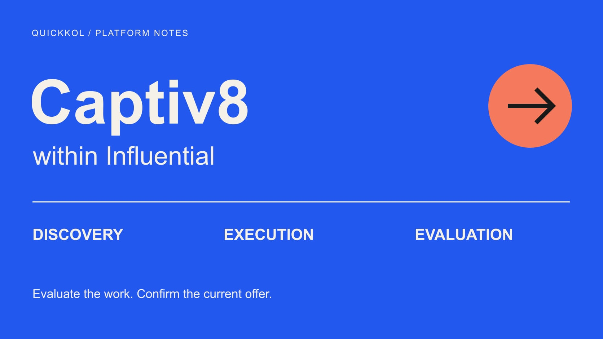
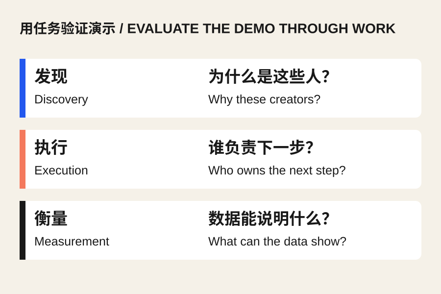

# Captiv8 and Influential: A Brand’s Platform Guide

Understand Captiv8’s current place within Influential, then evaluate published capabilities against the creator-marketing work a brand actually needs.

> Draft date: 2026-11-23; local preview only. Author shown by the website: Daniel Craig.

Captiv8 is an influencer-marketing technology platform whose homepage now states it has been integrated into Influential. Brands should evaluate the current offering rather than rely on an old standalone-product review. Define whether the need is creator discovery, partnership execution, paid amplification or business measurement, then ask the provider to demonstrate the work included in the proposed arrangement. Public product descriptions support initial research; they do not establish every entitlement in a buyer’s account or constitute an independent performance test.

## Start with Captiv8’s current position

[Captiv8’s current homepage](https://captiv8.io/) explicitly states that it has been integrated into Influential and directs Work With Us there. This affects whom to contact, how to interpret product descriptions and what an older review can still establish.

[Publicis’s acquisition announcement](https://www.publicisgroupe.com/en/news/press-releases/publicis-groupe-acquires-captiv8-to-build-the-world-s-most-powerful-connected-influencer-platform), dated May 21, 2025, described acquiring Captiv8 and integrating it with Influential. Its reported network of 15 million creators was a company-disclosed scale figure at that time, not a count of suitable, contactable candidates available for every market today.

This guide therefore does not invent subscription prices or turn every feature on an older product page into a current standard package. First establish the contracting party, the relationship between technology and services, and the team and markets the proposal covers.

The [brand-research platform task-fit guide](/blog/brand-research-platform-creator-question-fit/#answer) starts with the question a team needs answered. Researching Captiv8 should likewise establish whether the present offer supports the actual partnership work, rather than collect the longest possible feature list.

Keep a dated vendor note containing the public positioning, relevant product page and questions for the provider. That gives the buying team a shared starting point without pretending a public website has already confirmed the commercial scope, account access or operating arrangement for their particular project.

## Turn discovery needs into a demonstrable brief

[Captiv8’s suite description](https://captiv8.io/influencer/) presents discovery, profile research and curated lists. Those are vendor descriptions, not proof that a particular recommendation suits the brand or that a score establishes personal facts.

Prepare a specific demo brief. Imagine a home brand looking for creators who demonstrate small-space storage, with target language and content format already defined. Ask to see the route from input criteria through relevant original work to retaining or excluding a candidate, instead of only a prepared list.

For each example result, ask why it appeared, which work supports the judgment, when the information was observed and what remains unknown. If the demonstration depends on authorized data, clarify its source and account conditions rather than assume identical information for every public account.

A useful output is a small candidate table with reasons. Content relevance and willingness to collaborate remain separate; discussion must establish actual availability, experience and terms.

This exercise lets the team assess the reasoning it will use after purchase. If operators cannot explain a recommendation beyond a score, ask for the supporting view and the limitations. A discovery workflow should help people make a defensible choice, not merely accelerate a decision whose basis they cannot inspect.

Compare the same scope and distinguish public descriptions from demonstrated results.

## Distinguish platform capability from execution services

[Influential’s product-and-service overview](https://influential.co/) describes both its platform and team capabilities. Ask who actually researches, contacts creators and manages revisions rather than assume end-to-end means the provider performs every task.

Continue the same brief through the demo. Once a candidate becomes a partner, how does work reach the responsible person? Where does the brand see feedback? How does the creator receive a revision request? Those concrete questions are easier to assess than whether a workflow exists.

Record platform seats, service time and third-party work separately. A demonstration operator completing an action does not establish that the buyer’s staff receive the same permissions or that all services are included in a technology fee.

One team may want to retain creative relationships and key communication while buying technical support. Another may need more execution assistance. Both can be reasonable; the proposed arrangement should match who performs the work rather than force every brand into an identical configuration.

An implementation discussion should end with named responsibilities and an example handover. The client needs to understand what happens between discovering a relevant creator and delivering approved work. That understanding is more useful than assuming that a broad platform label has already assigned every operational responsibility.

For example, a team might review creative work internally while needing help with contracts and payments. Ask the provider to show what the brand submits, what the creator receives, who resolves an exception and which record can be exported. Return those demonstrated results to the commercial questions so the proposal connects platform access with human responsibilities. This is a procurement exercise, not a claim that any present package automatically includes that arrangement.

## Evaluate commerce tracking and outcome interpretation separately

Public product material discusses commerce, affiliate work and measurement. Translate those areas into the buyer’s own questions: which action needs recording, where the data originates and under what conditions it can be related to this creator content.

For example, work distributed organically and through advertising should not have its two reports blindly added into unique people. For sales, inspect actual fields, periods and attribution conditions rather than use views or a combined score as the business outcome.

The [creator KPI decision-agreement guide](/blog/social-kpi-creator-decision-contract/#answer) helps define the action a measure should support. A demo can include an example export showing how zero, unknown, estimated and delayed data are distinguished, rather than only the most attractive chart.

This article has not purchased, signed into or tested Captiv8. These are editorial procurement checks, not findings about actual measurement accuracy. Provider case studies retain their original subjects and conditions; they are not the buyer’s income forecast.

A practical acceptance question is whether another analyst can explain the sample report without the demonstrator narrating every number. Definitions, data origin and time scope should remain available in the handover. That makes reporting a usable decision resource instead of a presentation that loses its meaning as soon as the sales meeting ends.

## Compare quotations for the same work scope

The public pages reviewed here do not establish the actual price for every customer. Request a written scope for this task instead of treating an older online price or another client’s quotation as universal.

List required seats, services, markets, account connections, reports and exports, then identify what the proposal includes and what needs another discussion. Separate creator fees, advertising budget and technology or service charges.

Imagine two proposals both producing a shortlist. One is operated by the brand and another includes more execution support. Their totals should not be compared as identical products. Align workload and responsibility before judging whether the difference is worthwhile.

Also ask about onboarding, training, support, contract period and the handover of information when the arrangement ends. This article does not claim the provider has particular fixed terms; these questions turn unknowns into procurement items that can receive formal answers.

A useful comparison preserves the same brief throughout. If the salesperson changes the example to a different market or a simpler campaign, record that change. Otherwise, the team may believe it has compared two ways to perform one job when the proposed deliverables and operational assumptions have actually diverged.

## When to begin with a smaller research task

Not every team already needs a complete execution and commerce arrangement. If the immediate question is which work fits this brief, complete a smaller discovery task first, then assess the need for a wider platform or service.

[QuickKOL’s product explanation](https://www.quickkol.com/) offers discovery and research starting from keywords or a similar creator. It can be an entry for that narrower task; this article does not claim equivalence with every Captiv8 or Influential execution, commerce and measurement capability.

Write the actual assignment: find work explaining a storage operation, retain reasons for relevance and identify questions to confirm. If cross-team execution, complex commerce or reporting needs remain, evaluate wider arrangements against those needs.

This is not declaring a winner from brand names. Fit depends on the work, existing team and resources. A smaller research output can clarify procurement more effectively than buying broad capability before deciding how it will be used.

The choice can also evolve. A brand may initially need research assistance and later have a larger operational requirement. Preserve the evidence and responsibilities from the first task so expansion is based on observed needs rather than a vague belief that a larger feature list necessarily produces a better creator partnership.

## Close the evaluation with the original task

A useful evaluation answers four questions: what is the current provider relationship, which work does the buyer need, what did the demonstration establish and which conditions still require quotation or agreement?

Retain research date, actual pages, example brief and provider answers. Keep undemonstrated capabilities unknown rather than convert confident sales language into accepted implementation evidence.

If proceeding, involve the people who will operate the relevant workflow and verify the outputs they need. If not proceeding, record a specific reason, such as a narrower discovery requirement, rather than assign a quality verdict to an untested product.

For Captiv8, its current integration is the starting point for understanding the offer; the brand’s partnership task is the basis for judging the proposal. Connecting them turns product research into material that supports a real decision.

The final recommendation can remain conditional. It might identify a suitable next demo, an unresolved data question or a smaller task to complete first. That is a more defensible result than a universal best-platform claim unsupported by the buyer’s needs, an account-level test or an agreed commercial scope.

## Give the demo a concrete question set

Editorial procurement framework, not a completed product test or fixed feature promise.

| Task | Ask to see | Retain conditions |
| --- | --- | --- |
| Discovery | Inputs, original work and candidate reasons | Data sources and unknowns |
| Execution | Brief, feedback and ownership | Technology and service scope |
| Measurement | Fields, periods and export | Attribution and estimation limits |
| Procurement | Quotation for this scope | Charges, duration and handover |

## Next step

If creator research is the immediate need, give QuickKOL the subject, audience and content task to establish reviewable candidate reasons.

[Start research from a brief](https://www.quickkol.com/)

## Sources and research scope

Sources reviewed November 23, 2026. Instructions use public official material, without signing into or changing a user account. Editorial examples are not client results; confirm availability in the intended account.

- [Captiv8’s current homepage](https://captiv8.io/)
- [Publicis’s acquisition announcement](https://www.publicisgroupe.com/en/news/press-releases/publicis-groupe-acquires-captiv8-to-build-the-world-s-most-powerful-connected-influencer-platform)
- [Captiv8’s suite description](https://captiv8.io/influencer/)
- [Influential’s product-and-service overview](https://influential.co/)
- [QuickKOL’s product explanation](https://www.quickkol.com/)
