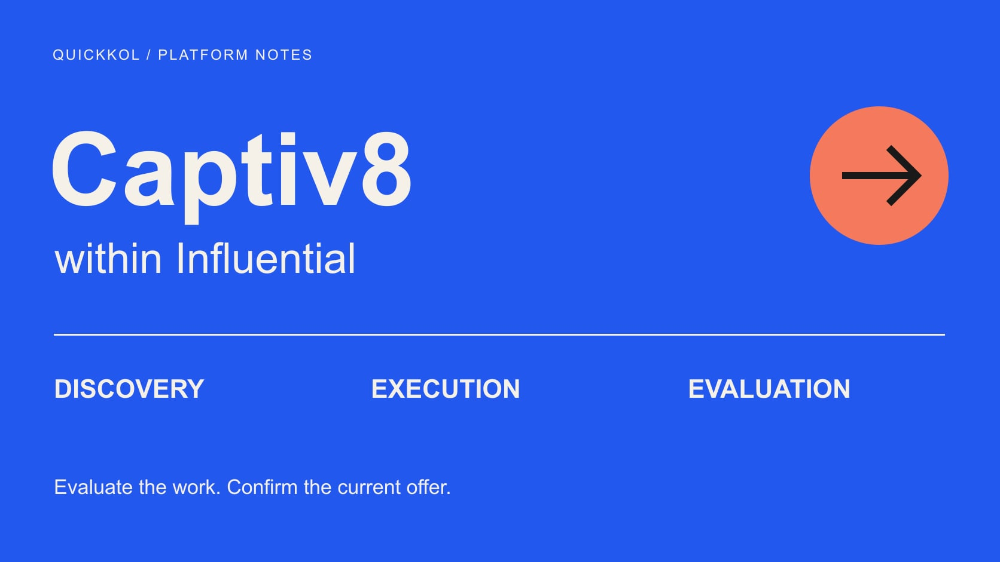
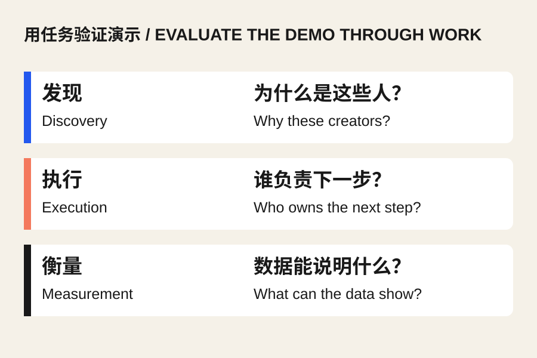

# Captiv8 现状与达人营销选型指南

从 Captiv8 整合进 Influential 的当前状态出发，区分官网能力、实际采购范围和品牌应要求演示的达人营销任务。

> Draft date: 2026-11-23; local preview only. Author shown by the website: Daniel Craig.

Captiv8 是达人营销技术平台，其官网目前明确说明已整合进 Influential。品牌不应继续把它当作与当前服务体系无关的独立旧产品介绍。先明确自己需要发现达人、管理合作、付费扩散还是衡量商务结果，再请供应方用同一个真实任务演示本次报价包含的能力。公开产品说明可以支持初步研究，不能证明你的账号会得到全部功能，也不是独立实测或效果保证。

## 先看 Captiv8 今天处于什么位置

[Captiv8 官网现状](https://captiv8.io/)直接写明已整合进 Influential，并把“Work With Us”引向后者。这个变化影响找谁沟通、如何理解产品介绍，以及旧资料还能说明什么。

[Publicis 收购公告](https://www.publicisgroupe.com/en/news/press-releases/publicis-groupe-acquires-captiv8-to-build-the-world-s-most-powerful-connected-influencer-platform)发表于 2025 年 5 月 21 日，说明当时收购 Captiv8，并计划将其与 Influential 整合。公告提到的 1,500 万创作者网络属于该公司当时披露的规模，不能自动视为今天每个市场都能联系到的有效候选数。

因此本篇不列未经核验的订阅价格，也不将旧产品页上的每项能力写成当前标准套餐。首先向供应方确认签约对象、技术与服务的关系，以及这份方案适用的团队和市场。

[品牌研究平台的任务匹配方法](/zh/blog/brand-research-platform-creator-question-fit/#answer)提醒团队，采购问题应从需要回答的问题开始。对 Captiv8 的有用研究，同样不是收集最多功能名称，而是辨认当前方案能否支持自己的达人合作工作。

## 把发现需求写成可演示的 Brief

[Captiv8 套件说明](https://captiv8.io/influencer/)描述创作者发现、资料研究、名单整理等能力。它是供应商对产品的描述，不能替品牌证明某个推荐结果合适，也不应把评分当成个人事实。

准备一个足够具体的演示 Brief。例如，假设家居品牌想找能演示小空间收纳的创作者，目标语言和内容形式已确定。要求展示从输入条件、查看相关原作到保留或排除候选的过程，而不是只展示一个预先准备的名单。

对每个示例结果询问：为什么出现、哪条作品支持判断、资料日期是什么、哪些信息未知。若演示依赖授权数据，问清授权来源与账号条件，不假定所有公开账号都提供同样信息。

有用输出可以是一小份带理由的候选表。把“内容相关”与“愿意合作”分开，进一步沟通才能确认实际可用时间、经验和商业条件。

比较同一工作范围，区分公开描述与实际演示结果。

## 区别平台能力与实际执行服务

[Influential 产品与服务说明](https://influential.co/)同时介绍其平台与团队能力。品牌应据此问清谁实际做研究、谁联系创作者、谁管理修改，不能仅因页面写着端到端就假定全部由供应方代办。

拿同一份 Brief 继续演示：候选成为合作对象后，任务怎样交给负责方？品牌在哪里看反馈？创作者如何收到修改？这些是具体执行问题，比“有没有工作流”更容易判断是否适合现有团队。

把平台席位、服务工时和第三方工作区分记录。演示者操作成功，不意味着品牌操作人已获得同样权限，也不证明所有服务已包含在某个技术费用里。

实际团队可能希望保留创意关系与关键沟通，只需要技术辅助；另一个团队则希望购买更多执行支持。两种需求都合理，关键是方案要与谁承担工作一致，而不是强迫每个品牌选择同样配置。

例如，团队可能自行审核作品，却需要供应方协助合同与付款。演示时让对方依次说明：品牌在哪一步提交信息，创作者收到什么，谁处理异常，最后能导出什么记录。将实际演示结果写回报价问题中，才能看清平台权限与人工服务是否共同覆盖任务。这个例子是采购演练，不代表任何当前套餐默认提供上述流程。

## 分别验收商务追踪和效果判断

供应商公开资料涉及商务、联盟营销与效果报告能力。采购时将它们拆成自己的问题：需要记录哪种动作、数据来自哪里、什么条件下能与本次达人内容关联。

例如一条作品既自然发布又用于广告，不应将两个报告直接叠加成独立人数。若讨论销售，要求看真实字段、期间与归因条件；不要用观看量或一个综合分数替代业务结果。

[达人 KPI 决策约定方法](/zh/blog/social-kpi-creator-decision-contract/#answer)帮助品牌先确定指标对应什么行动。演示中可以要求导出一份样例报告，说明零值、未知、估算与迟到数据怎样区分，而不是只看最漂亮的图。

本文没有购买、登录或实测 Captiv8。这些是用于采购核对的编辑方法，不是对实际准确率的结论。供应商给出的案例也应保留原始对象与条件，不能直接写成品牌自己的收益预测。

## 报价要围绕同一工作范围比较

本次读取的公开页面不能核定每个客户的实际价格。品牌应索取与自己任务对应的书面范围，而不是把网上旧价格或另一个客户报价当成通用标准。

列出需要的席位、服务、市场、账号连接、报告与数据导出，确认哪些属于报价、哪些需另行讨论。创作者费用、广告预算和工具或服务费用也要分别说明。

假设两份方案都能提供候选名单，一份由品牌自行运营，另一份包括更多执行支持，就不应仅用总价比较成同一产品。先统一工作量和责任，再判断差异是否值得。

同时询问启动方式、培训、支持、合同期间与结束后资料如何交接。本文不声称供应商具有某种固定条款；这些问题帮助品牌把未知事项转成可以获得正式回答的采购清单。

## 什么时候先从较小的研究任务开始

不是每个团队都已需要整套执行与商务安排。如果当前问题只是“有哪些作品与这份 Brief 相关”，可以先完成一个范围较小的达人发现任务，再判断是否需要更广平台或服务。

[QuickKOL 官网能力说明](https://www.quickkol.com/)提供从关键词或相似创作者开始的发现与研究路径。它可以作为这个较小任务的入口；本文不声称其拥有 Captiv8 或 Influential 的全部执行、商务与衡量能力。

把真实任务写下来，例如寻找能够解释某种收纳操作的作品、记录相关理由和后续要确认的问题。完成后若仍有跨团队执行、复杂商务或报告需求，再按这些需求评估其他方案。

这不是仅凭品牌名宣布一个工具更好。选择取决于需要完成的工作、已有团队和实际资源。让较小研究产出帮助定义采购问题，比先购买宽泛能力再猜怎样用更清楚。

## 用同一个任务结束产品评估

一次有用的评估应能回答四个问题：当前供应方关系是什么、自己需要完成哪项工作、演示证明了什么、哪些条件仍待报价或合同确认。

保存研究日期、实际读取页面、样例 Brief 和供应方答复。对尚未演示的能力保留未知，不因销售材料措辞肯定就自动写成已通过验收。

如果继续采购，让后续操作人员参与相关演示，并验证他们需要的输出。如果暂不采购，留下清楚原因，例如当前只需要较小的发现任务，而不是给未实测产品贴质量标签。

对于 Captiv8，当前整合状态是理解产品的起点；品牌自己的合作任务才是判断方案的依据。将这两项连接起来，才能把产品研究变成能支持实际决策的材料。

## 给产品演示一份可回答的问题表

编辑采购框架，不是已完成的产品测试或固定功能承诺。

| 任务 | 要求展示 | 保留条件 |
| --- | --- | --- |
| 发现 | 输入、原作与候选理由 | 数据来源与未知项 |
| 执行 | Brief、反馈与负责方 | 技术与服务范围 |
| 衡量 | 字段、期间与导出 | 归因与估算限制 |
| 采购 | 本次工作对应的报价 | 费用、期限与交接 |

## 下一步

如果当前需要研究相关创作者，向 QuickKOL 提供主题、受众与内容任务，先建立可复核的候选依据。

[从 Brief 开始研究](https://www.quickkol.com/)

## 来源与研究范围

资料核验于 2026 年 11 月 23 日。操作说明基于公开官方资料，没有登录或修改用户账号。编辑示例不是客户结果；功能以目标账号实际可用范围为准。

- [Captiv8 官网现状](https://captiv8.io/)
- [Publicis 收购公告](https://www.publicisgroupe.com/en/news/press-releases/publicis-groupe-acquires-captiv8-to-build-the-world-s-most-powerful-connected-influencer-platform)
- [Captiv8 套件说明](https://captiv8.io/influencer/)
- [Influential 产品与服务说明](https://influential.co/)
- [QuickKOL 官网能力说明](https://www.quickkol.com/)
