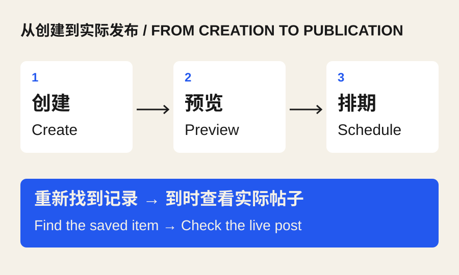

# How to Schedule Facebook Posts for Creator Campaigns

Turn approved creator content into a scheduled Facebook Page post you can locate, verify and review after publication.

> Draft date: 2026-11-23; local preview only. Author shown by the website: Daniel Craig.

To schedule Facebook Page posts for a creator campaign, use Meta Business Suite: select the correct Page, create the post, add approved copy and media, preview it, choose a later date and time, and confirm the schedule. Then find the saved item in Planner or Content. This walkthrough concerns Page posts, rather than treating personal profiles, groups and every format as interchangeable. Menu positions vary by version; the useful output is a retrievable scheduled item, not merely an entry in a team calendar.

## Before opening the composer

First identify the publisher. A creator delivering a video does not by itself give a brand permission to publish it on the brand’s Page. Equally, planning a post for the creator’s Page does not give the brand access to that account. Establish whether the assignment concerns a brand Page, a creator Page or two separately authorized versions.

Prepare final copy, the media file, the destination address, necessary partnership wording and an explicit publication time with a time zone. Replace “Friday evening” with something unambiguous. For a hypothetical London collaboration, write November 27, 2026, 18:00 Europe/London, then compare that target with the zone displayed during scheduling. This is an editorial example, not a completed client campaign.

[Meta’s Business Suite app listing](https://play.google.com/store/apps/details?id=com.facebook.pages.app&hl=en) describes creating, scheduling and managing Facebook Page content. Its public screenshots show Create Post, Planner and a Scheduled state; they do not establish that every account currently has the same layout.

The workflow below uses public product material and an illustrated operating guide, without a signed-in account test. Start with one approved, low-risk asset. Completing that small task makes missing permissions or confusing settings easier to identify than loading an entire unfinished campaign into a queue.

## Step 1: Select the Page and create a post

Open the Facebook Page you are authorized to manage and enter Meta Business Suite. Check the Page name and avatar before using Create Post. Content or Planner may also provide a route into creation.

[Landcare’s illustrated scheduling guide](https://www.environment.vic.gov.au/__data/assets/pdf_file/0044/689993/Landcare-Social-Media-Guide.pdf) documents a desktop flow through the content or calendar view and a publishing-destination selection. It shows an earlier interface, so this article describes the task rather than promising a permanent corner or button position.

Inside the composer, inspect the destination again. If the assignment includes only a Facebook version, keep that Page selected. A connected Instagram account is not a reason to publish there automatically. The crop, wording and link experience may require separate approval.

The expected output is a composer attached to the intended Page and platform. If you see only a personal account or cannot create content, ask the Page administrator to check authorization and account selection before continuing. Switching to an unrelated publisher would create a different deliverable. A brand does not need the creator’s password to resolve this question.

## Step 2: Add the approved content and inspect the preview

Upload the final asset and add its corresponding copy. An internal filename can retain a version number; the public caption should not accidentally contain production notes such as “final v3.” Compare the upload with the approved subtitles, product condition and visible use case.

Imagine a coffee brand has permission to publish a creator’s demonstration on its Page. An editorial caption could read: “Created with Lin. She demonstrates two pouring rhythms using the same home setup; see the complete method at the link.” It names the collaboration, describes a visible action and offers a next step without turning one demonstration into product-performance research.

Insert the real destination address. Use the mobile preview to inspect the opening frame, subtitles, caption and partnership wording. Open the link independently and confirm that it reaches the intended page. A placeholder belongs in a draft, not in a scheduled deliverable.

Complete applicable partnership labels or required settings available to the publishing account. Publication permission, music rights and advertising authorization still need their own confirmation; an enabled scheduling control does not grant them.

The output is a complete publishable preview. Ask the reviewer to approve this file and this caption together, rather than relying on an ambiguous instruction to use an earlier version.

## Step 3: Choose the later publication time

Find the publishing or scheduling controls in the composer, choose publication for later, enter a date and time, and confirm the schedule as prompted. A version may separate saving the selected time from submitting the post. Saving the picker alone does not replace the final Schedule action.

Compare the displayed year, month, day, clock format, time zone and Page with the brief. The example target is November 27 at 18:00 in London. An operator elsewhere should not copy the number 18:00 while ignoring the displayed zone. Convert using the rules for the target date rather than treating a time difference as permanently fixed.

A suggested active time can inform planning, but it does not guarantee reach or sales. Do not casually move an approved creator release simply because a suggested slot appears beside the calendar.

For dates that are too close, too far away or otherwise unavailable, follow the account’s displayed limits and messages. This guide does not turn a commonly repeated scheduling-window figure into a universal current rule.

Keep the page open after submission. The next task is to establish what the system saved; entering a date is not itself proof that an executable scheduled post exists.

The scheduling output is a retrievable task; publication needs a separate check at the intended time.

## Step 4: Find the saved item in the queue

Return to Planner or Content, locate the item on the intended date and open it. Verify the asset, Page, time and scheduled status. If useful, retain an internal screenshot limited to these work details. [Meta Blueprint’s scheduling course overview](https://www.facebookblueprint.com/student/path/253041-meta-business-suite-customer-connection) also identifies post and Story scheduling as Business Suite tasks; its login-gated lesson was not treated as a completed hands-on test here.

An example handoff record is: “Brand Page; coffee demonstration A; November 27, 18:00 Europe/London; found in Planner; awaiting publication.” That records scheduling acceptance, not exposure or sales.

If the item is missing, inspect platform filters, the date range, the selected Page and draft content. Before reopening creation, establish whether the original operation was saved. Repeated submissions can create a duplicate instead of solving the uncertainty.

For a change, open the original record and use the editing or rescheduling actions currently offered. Reopen it after saving. A material change to an offer, partnership wording or asset should return to the relevant reviewer.

When a change affects multiple posts, creator response coverage or markets, use the [Facebook schedule-change dependency guide](/blog/facebook-creator-schedule-change-dependencies/#answer). First finish the smaller task: ensure this one post was saved and can be found again.

Give the task an internal reference such as COFFEE-FB-A if similar filenames might confuse the team. Use that same reference in the approval note, scheduling record and final-link log. It need not appear publicly and is not presented as a platform-generated attribution code.

If the queued caption is wrong, resolve the original record instead of pasting the correct caption into another new post and leaving both waiting to publish. Ask another authorized colleague to locate the item using only the Page, asset description and intended time. Successful retrieval by that colleague is a practical check that the handoff contains enough information.

This small acceptance step is especially helpful when a creator supplies several nearly identical edits. It ties the approval to the saved item, while keeping responsibility for the actual account with its authorized operator.

## At publication time: Check the actual Page

At the intended time, open the published item on the actual Page. Inspect its public address, picture, subtitles, caption and destination. A screenshot of a scheduled item is not evidence of completed publication. If the system still reports processing, inspect its message and queue before manually posting another copy.

Record the observed publication time. In a hypothetical case where 18:00 was intended but the post became visible at 18:07, the seven-minute difference is an execution variance to explain. Do not quietly change the target to 18:07. A time-sensitive offer may require the team to adjust subsequent actions.

Then review results against the collaboration’s purpose. An instructional post may be evaluated through useful audience questions and relevant onward visits. A link click is not automatically a purchase, and view counts from different platforms should not be added as if they had identical definitions.

For an event release, the [Facebook creator-event release-clock guide](/blog/facebook-scheduling-creator-event-release-clock/#answer) helps arrange the surrounding content. Its task is coordination; this guide’s task is creating and verifying one scheduled Page post.

Close the assignment with the final address and necessary record. The next operator should be able to inspect actual content rather than infer publication from a message saying it probably went out.

## Make the next scheduled collaboration easier

Reuse the confirmed operating route for the next collaboration, while checking its account, authorization, asset and time afresh. A previous creator’s permission or a previous post’s settings do not become automatic defaults.

If the team still needs someone who can demonstrate the coffee technique, define that content task before researching candidates. [QuickKOL’s product explanation](https://www.quickkol.com/) describes brief- or keyword-led creator discovery and research on its supported platforms. It should not be presented as a Facebook scheduler or as access to every Facebook account.

The immediate next step is deliberately small: take one approved item through creation, scheduling, retrieval and publication review. Record account-specific interface differences in your internal operating note, then reuse steps your own authorized account has confirmed.

## Next step

Research creators against a specific content brief, then complete publishing in an authorized Page.

[Explore QuickKOL](https://www.quickkol.com/)

## Sources and research scope

Reviewed November 23, 2026 using Meta’s public app material, official screenshots and course overview, plus an earlier illustrated Landcare operating guide. Some Meta help pages were inaccessible or login-gated. No signed-in test was performed; exact current menu positions, a fixed scheduling window and universal account-type availability are not claimed.

- [Meta’s Business Suite app listing](https://play.google.com/store/apps/details?id=com.facebook.pages.app&hl=en)
- [Landcare’s illustrated scheduling guide](https://www.environment.vic.gov.au/__data/assets/pdf_file/0044/689993/Landcare-Social-Media-Guide.pdf)
- [Meta Blueprint’s scheduling course overview](https://www.facebookblueprint.com/student/path/253041-meta-business-suite-customer-connection)
- [QuickKOL’s product explanation](https://www.quickkol.com/)
