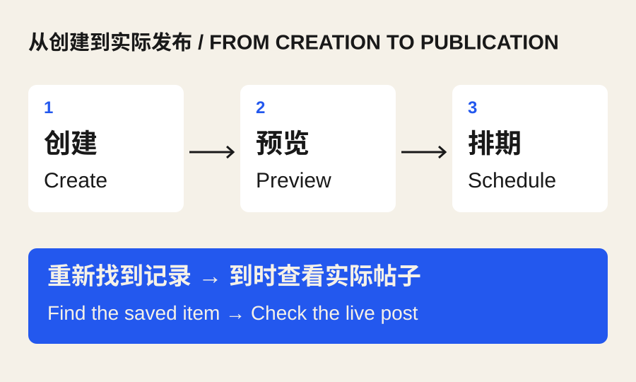

# 怎样排期发布 Facebook 合作帖子

把已批准的达人素材变成一条可找到、可复核的 Facebook Page 排期帖子，完成从创建到发布后的检查。

> Draft date: 2026-11-23; local preview only. Author shown by the website: Daniel Craig.

为 Facebook Page 排期发布合作帖子，可使用 Meta Business Suite：选择正确的 Page，创建帖子，加入已批准的文字与素材，预览后选择稍后发布的日期和时间，提交排期，再到 Planner 或 Content 找到对应记录。本文演示的是 Page 帖子，不把普通个人资料、群组和其他内容格式混为一谈。按钮位置会随版本变化；成功结果是能重新打开的排期记录，而不是只在团队日历里写下一行。

## 开始前：确定谁发、发什么、何时发

先写明发布主体。达人交付一段视频，不等于品牌已经获得在自己 Page 发布的权利；品牌计划在达人 Page 发帖，也不代表自己拥有该账号的操作权限。排期前确认这条内容属于品牌 Page、达人 Page，还是两个分别授权的版本。

准备最终文案、媒体文件、目标地址、必要的合作说明，以及带时区的发布时间。不要用聊天里的“周五晚上”代替明确时间。假设合作在伦敦发生，应把目标时间写为“2026 年 11 月 27 日 18:00，Europe/London”，操作时再核对界面显示的时区。这是编辑演示，不是已经执行的客户活动。

[Meta Business Suite 官方应用说明](https://play.google.com/store/apps/details?id=com.facebook.pages.app&hl=en)列出创建、排期与管理 Facebook Page 内容的能力。其公开截图可见 Create Post、Planner 和 Scheduled 状态，但不能据此推定每个账号今天都有完全相同的布局。

本文依据公开产品资料与图示教程整理操作流程，没有登录账号替读者测试。先用一条已获许可的低风险素材完成流程，比一次性把几十条未定稿内容放进队列更容易发现问题。

## 第一步：选择 Page，再创建帖子

进入你获准管理的 Facebook Page，打开 Meta Business Suite。先核对 Page 名称和头像，再寻找 Create Post／创建帖子入口；也可从 Content／内容或 Planner／规划工具进入创建流程。

[Landcare 图示排期教程](https://www.environment.vic.gov.au/__data/assets/pdf_file/0044/689993/Landcare-Social-Media-Guide.pdf)记录了从内容或日历视图创建、选择发布平台的桌面流程。它展示的是较早的界面，因此这里按任务描述步骤，不承诺某个按钮永远位于左上或右下。

进入编辑器后，再看一次发布目的地。假设本次只交付 Facebook 版本，就只保留该 Page；不要因为账号已连接，就默认同时发布 Instagram。两边画面裁切、文案和链接体验可能需要分别确认。

预期输出是一个属于正确 Page 的编辑器，并且目标平台与简报一致。如果只看得到个人账号，或无法创建帖子，应先请 Page 管理员检查授权及账号选择，而不是换一个无关账号强行继续。品牌也不需要让达人把登录密码发给运营人员。

## 第二步：上传素材，让文案在预览中成立

上传最终文件，再加入对应的文案。文件名可以保留内部版本号，公开文案不必带着“最终版 v3”等工作标记。特别注意素材是否与已批准的字幕、产品状态和使用场景一致。

假设一个咖啡品牌获得了达人演示片段的 Page 发布许可，可以用这样的编辑示例：“与创作者 Lin 合作。她用同一套家用器具演示两种注水节奏；完整做法见链接。”这段话说明合作、描述可见动作，并给出下一步，没有把一次拍摄写成产品效果研究。

把实际目的链接放进去，从移动预览看文案、首帧、字幕与合作说明是否可读。链接要能抵达预期页面；占位符只能留在草稿里，不能随排期发布。

如果平台提供合作标注或其他必填项目，按目标账号可用的设置完成。发布权、音乐使用和广告授权仍需分别确认，不会因为排期按钮能点击就自动获得。

此步输出应是一条可发布的完整预览。让审核者确认具体文件与这段文案，而不是只说“按之前那个版本发”。

## 第三步：设定日期、时间与发布状态

在编辑器中寻找发布选项或排期设置，选择稍后发布，填写日期和时间，再按界面要求确认排期。不同版本可能把日期选择与最后提交分成两步；保存时间后，仍要完成最终的 Schedule／排期动作。

将显示时间与简报逐项比对：年月日、上午下午或 24 小时制、时区、发布 Page。示例的目标是伦敦当地 11 月 27 日 18:00；如果操作者在其他地区，不要只照抄数字 18:00 而忽略时区转换。以目标日期的当地规则换算，不把固定时差永久套用。

不需要为了追逐某个“最佳时间”临时打乱达人合作的已批准窗口。界面提供的活跃时间建议可以作为参考，无法保证这条内容获得更多触达或销售。

对于太近、太远或不可用的日期，以账号显示的限制和提示为准。本文没有把常见教程中的固定排期天数写成所有账号当前都适用的规则。

完成后不要马上关闭页面。下一步要确认系统保存了什么；手动填写了日期还不等于已经建立可执行的排期任务。

排期教程的输出是一条可重新打开的任务；实际发布仍需到时核对。

## 第四步：到队列中找到它，而不是停在成功提示

回到 Planner 或 Content，找到对应日期的帖子并打开。核对内容、Page、时间和排期状态，必要时保存只包含这些业务信息的内部截图。[Meta Blueprint 排期课程目录](https://www.facebookblueprint.com/student/path/253041-meta-business-suite-customer-connection)也将帖子与 Story 排期列为 Business Suite 的操作任务；本篇没有把需要登录的课程说成已完成实操。

预期结果可以写成一条交接记录：“品牌 Page；咖啡演示 A；11 月 27 日 18:00 Europe/London；已在 Planner 找到；等待到时发布。”这只是排期验收，不是曝光或销售报告。

找不到时，先检查平台筛选、日期范围、Page 和草稿区域。重新打开创建窗口之前，确认原任务没有已经保存，避免连点提交制造重复内容。

需要改动时，从原记录进入当前可用的编辑或重排操作。修改后重新打开确认最终状态。涉及优惠、合作说明或素材的实质变更，应重新征求相应审核者确认。

如果改动牵涉多条内容、达人回复值班或跨市场发布时间，可以继续看 [Facebook 排期变更依赖指南](/zh/blog/facebook-creator-schedule-change-dependencies/#answer)。这里先把单条帖子确实保存、并且可以找回来这件事做完。

也可以给这条任务一个仅供内部使用的标识，例如 COFFEE-FB-A。审核表、排期记录和最终链接使用同一标识，避免相近文件名让两条内容混淆。这个标识不需要公开展示，也不是平台自动生成的追踪代码。

若队列中的文案不对，先停留在该记录处理，不要把正确文案重新贴到另一个新帖子并让两个版本都等待发布。操作完成后，请另一位获准查看的同事按 Page、素材和时间重新定位一次。能由他人找到，说明交接信息已经足够清楚。

## 发布时间到了：确认真实页面上的内容

到预定时间后，在实际 Page 打开已发布内容。检查公开链接、字幕、画面、文案和目标地址，确认没有把排期截图误当作最终发布凭证。若发布状态仍在处理中，先查看系统提示与队列，避免立即手动再发一遍。

记录真实发布时间。假设目标 18:00，页面实际在 18:07 可见，这七分钟是需要解释的执行偏差，不应偷偷把目标时间改成 18:07。若内容涉及限时活动，也应让团队知道是否需要调整后续动作。

再按合作目标检查结果。教程型帖子可以看读者提出的问题和有效后续访问；不要把一次链接点击直接写成购买，也不要将不同平台的观看数当作同一指标相加。

如果这是活动发布的一部分，[Facebook 达人活动发布时钟指南](/zh/blog/facebook-scheduling-creator-event-release-clock/#answer)可以帮助安排前后内容。它解决的是协作节奏，本篇解决的是怎样建立并核对一条 Page 排期帖。

保留最终链接与必要记录后，才把这项任务标为完成。这样下一位同事可以直接查看实际内容，不必靠聊天里一句“应该发了”判断。

## 从一次可复用的操作开始

下一条合作帖可以沿用已经确认的操作路径，但应重新核对账号、授权、内容与时间。不要把上一位达人的许可或上一条帖子的设置直接当成这次默认条件。

如果团队仍在找适合咖啡演示的创作者，应先把内容需求写清楚，再研究候选人的作品。[QuickKOL 官网能力说明](https://www.quickkol.com/)提供简报或关键词驱动的达人发现与研究入口，可用于其支持的平台；本篇不把它写成 Facebook 排期器，也不声称它能访问任意 Facebook 账号。

实际下一步很小：挑一条已批准的内容，完成创建、排期、重新找到、到时查看这四项。把遇到的账号界面差异记在内部操作说明里，下一次再复用经过自己账号确认的步骤。

## 下一步

用具体内容简报研究合适的达人，再在已获授权的 Page 完成发布操作。

[了解 QuickKOL](https://www.quickkol.com/)

## 来源与研究范围

核验日期为 2026 年 11 月 23 日。已读取 Meta 公开应用资料、官方截图和课程目录，并参考较早的 Landcare 图示操作教程；部分 Meta 帮助页要求登录或不可访问。未登录账号测试，不承诺当前每个按钮位置、固定排期窗口或所有账号类型适用。

- [Meta Business Suite 官方应用说明](https://play.google.com/store/apps/details?id=com.facebook.pages.app&hl=en)
- [Landcare 图示排期教程](https://www.environment.vic.gov.au/__data/assets/pdf_file/0044/689993/Landcare-Social-Media-Guide.pdf)
- [Meta Blueprint 排期课程目录](https://www.facebookblueprint.com/student/path/253041-meta-business-suite-customer-connection)
- [QuickKOL 官网能力说明](https://www.quickkol.com/)
