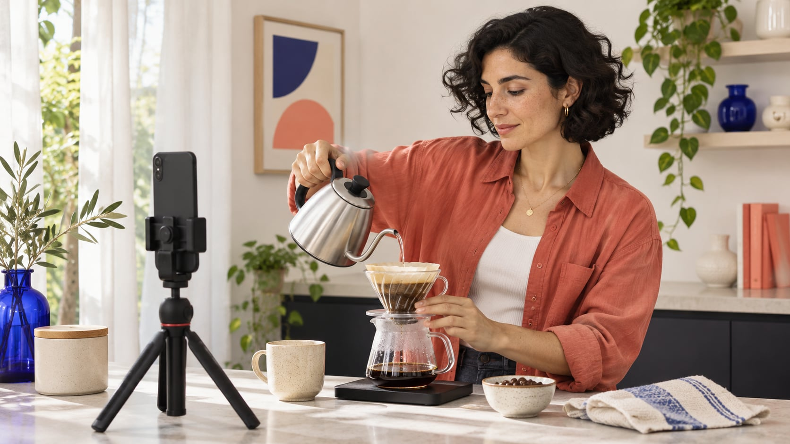
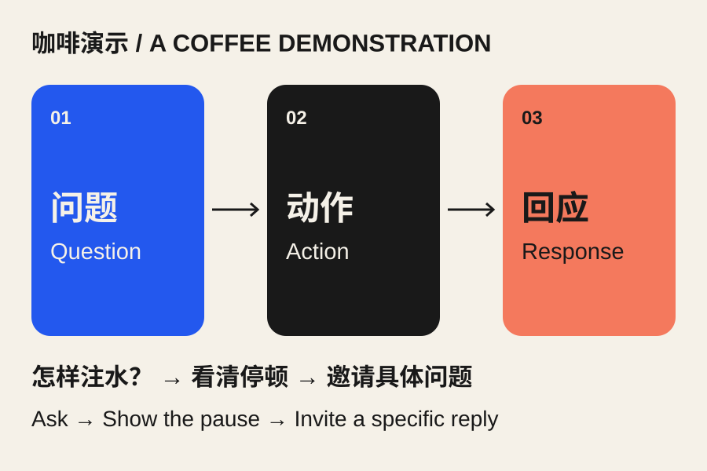
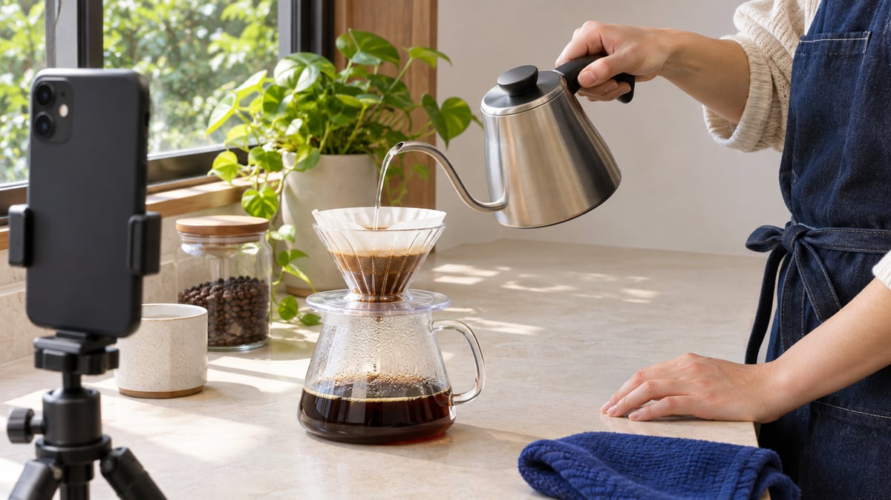

# Facebook Story: A Practical Guide to Creator Content

Build a short sequence with a visible action, a useful explanation and a next step so Facebook Stories support a creator collaboration.

> Draft date: 2026-11-23; local preview only. Author shown by the website: Daniel Craig.

A Facebook Story is a photo- or video-based sharing format that can help creators show an action, explain a choice and invite a clear next step. A collaboration can use a question–demonstration–response sequence, although that is an editorial method rather than a platform requirement. Before publishing, confirm the account, audience, partnership wording and actual availability period. The familiar 24-hour description is not a substitute for checking the intended account’s current settings. Evaluate what viewers understood and did, not simply how many frames were posted.

## Give the Story one useful job

A creator’s Story does not need to contain every brand message. Give it a small, immediate job: show how something is used, explain a practical choice or help the viewer find the next piece of information. If the audience needs to consult full conditions repeatedly, provide a stable detail page as the reference.

[Meta’s Stories format announcement](https://about.fb.com/news/2017/03/more-ways-to-share-with-the-facebook-camera/) introduced the photo-and-video format in 2017 with the familiar 24-hour availability. [Meta’s One-plan feature description](https://www.meta.com/meta-one-plans/) now lists extended Story expiration for Facebook. “Every Story always lasts exactly 24 hours” is therefore not a conclusion to apply without qualification.

For a brand, the intended availability period and the account’s actual options are separate questions. If a contract specifies a window, inspect the publishing account’s settings before agreeing to it. An older tutorial is not proof that the creator can select a particular duration today.

This guide uses a hypothetical coffee collaboration to show how a sequence can explain a pouring technique. It is an editorial example, not a client result or a claim that the technique necessarily improves taste or generates sales. The specific audience question is what changes in the creator’s visible action, rather than which product deserves an unsupported superlative.

## Turn the brief into three filmable frames

Frame one poses the question. Show the creator beside the prepared equipment and introduce the task: “Today’s demonstration: how do I organize a staged pour?” Include clear partnership wording. The brand should approve a description of the real assignment rather than dress an ordinary demonstration as a scientific experiment.

Frame two shows the action. Use a stable position where the spout, water and vessel remain visible. The creator can explain, “Here I pause before continuing the pour.” A product close-up alone does not demonstrate a technique. If the action needs more space, divide it while preserving the relationship between the clips.

Frame three invites a response or onward step. For example: “Which part of your routine makes you pause? Reply and tell me.” A checked destination for the complete method is another option. Choose one main action instead of simultaneously demanding likes, messages, purchases, shares and follows.

The outputs are a question, an observable action and a response route. This is not a mandatory marketing funnel, and viewers will not necessarily watch every frame in order. Give each enough context to make sense to someone entering halfway through.

Use the [brand-partnership content-governance guide](/blog/brand-partnerships-joint-content-governance/#answer) if the team first needs to specify the partner, deliverables and use. A brief built around observable content still leaves the creator room to film in their own voice.

Hypothetical coffee collaboration: each frame has a job; choose the actual sequence length to suit the content.

## Film for comprehension before decoration

Fix the phone in position and film a sample. Check whether the hand blocks the action, whether an edge cuts off the equipment and whether captions remain readable on an ordinary phone. Vertical production often suits this viewing situation; this guide does not present one pixel size as a universal current upload requirement for every organic Story.

A coffee sequence can establish the scene with a wider view and then move close enough to show the action. Avoid changing to an unrelated angle every few seconds. The audience needs to understand the pour, not merely notice editing rhythm. The background does not need to be filled with logos.

Keep essential wording within a comfortably readable central area, then inspect whether the actual publishing controls cover it. A design file cannot establish the final phone experience. Captions should preserve key information when the viewer watches without sound.

Confirm permission for music, stickers and other material used in the assignment. A creator’s everyday access to an asset should not be treated as automatic permission for a brand to reuse it in paid advertising. Establish the image and explanation first, then add useful decoration.

Number the review files in their intended order. Feedback such as “the action in frame two is obscured; please refilm that section” gives a creator something practical to change. A request to make the sequence feel more premium does not.

Position the camera to show the action clearly, keeping hands and equipment from hiding key details.

## Create the Story from the intended identity

Before publishing, confirm whether the intended identity is the creator or the brand’s Page. Open the Story-creation entry available to that identity, capture or select the prepared photo or video, and add the necessary text and available editing elements. [Meta’s Business Suite app listing](https://play.google.com/store/apps/details?id=com.facebook.pages.app&hl=en) and its official screenshots also show Page Story creation; they do not establish identical menus for profiles and Pages.

[Meta’s composer update](https://about.fb.com/news/2025/12/making-it-easier-to-create-discover-and-share-content-on-facebook/) describes more visible audience and cross-posting choices in the Stories and Feed creation experience. After editing, actively check who will see this item and whether it will also go elsewhere. Do not assume the previous selection suits this collaboration.

For the coffee sequence, inspect three things in preview: the order of the frames, the legibility of partnership wording and whether the proposed response route is genuinely available in that account. If an entry is unavailable, change the invitation. Plain text that cannot be tapped should not be designed to impersonate an active button.

Follow the target interface’s share or publish prompts. When scheduling instead, find the saved item in the queue afterwards; creating content does not mean it is publicly visible. Exact labels and positions change, and no user account was signed into to test every version for this guide.

For Page scheduling, continue with the [Facebook collaboration-post scheduling tutorial](/blog/facebook-page-post-scheduling-steps/#answer). Its creation, preview and saved-record checks provide a useful foundation.

## Review the published viewing experience

Open the published Story and inspect the order, sound, text, audience and availability period. Where authorized and practical, check the ordinary viewing experience rather than relying only on the creator’s editing screen. Retain the agreed delivery evidence without collecting unrelated personal information about viewers.

If the middle frame is missing, the question and response invitation no longer contain the promised demonstration. Check the upload or publication state and repair the omission. Views on the remaining two frames do not complete a three-frame assignment. Likewise, replace an unavailable response route with something the viewer can actually do.

Agree who will review replies while the content is available. A coffee viewer asking about quantities may reveal a missing explanation or suggest a useful follow-up. The responsible person should know which information they can answer directly and which requires product-team confirmation.

Expiration does not create unlimited brand reuse rights. Publishing the material later on a Page, in an advertisement or elsewhere should follow the agreed purposes. Record the observed availability, delivery status and reuse permission separately instead of compressing them into one word: published.

The useful output is a viewing check plus any questions awaiting a response. A chat screenshot that no longer opens the content cannot substitute for that review.

## Measure what this sequence helped viewers do

Return to the original task. If the purpose was to explain staged pouring, review relevant questions, the viewing data actually available to the publishing account and onward visits to the complete method. Use fields the account provides rather than importing definitions from a different platform.

Consider a clearly hypothetical calculation: if the first frame records 800 views and the third records 500, the ratio is 500 divided by 800, or 62.5%. This describes those two counts. Without knowing whether they involve the same people, how views are defined or whether repeats are included, it is not a 62.5% unique-user completion rate.

Likewise, 20 replies do not establish 20 purchasers. Separate genuine questions, duplicates and irrelevant messages before deciding whether the sequence helped viewers progress. The [social-media metrics decision guide](/blog/social-media-metrics-creator-decision-tree/#answer) can help establish consistent reporting terms.

If useful questions repeatedly concern one action in the middle frame, show that action more clearly next time instead of making every frame longer. If viewers understand the demonstration but cannot find the next information, repair the destination first.

End the review with one concrete change and its reason. “Add a close view at the pause because several relevant questions ask when to continue” is an actionable production decision. “Improve engagement” is not.

## Find creators who can make the action understandable

When researching creators, inspect how existing work explains steps, uses captions and responds to specific questions. Follower count does not establish demonstration skill, and an attractive image does not automatically qualify someone to teach this task. Establish whether the person can and wants to make the sequence understandable.

[QuickKOL’s product explanation](https://www.quickkol.com/) describes discovery and research using a brief or keywords. A team can find candidates with relevant demonstrations on supported platforms, then separately confirm the Facebook account and proposed partnership. Work on another platform is not proof of a Facebook audience.

The practical next step is a one-page filming brief containing one question, one action that must be visible and one usable response route. Once the creator and brand agree on those points, choose the presentation and release arrangement. The number of frames is a production choice; the content’s purpose is the reason to publish.

## Next step

Research suitable partners by how clearly their work explains the intended action.

[Explore QuickKOL](https://www.quickkol.com/)

## Sources and research scope

Sources reviewed November 23, 2026. Instructions use public official material, without signing into or changing a user account. Editorial examples are not client results; confirm availability in the intended account.

- [Meta’s Stories format announcement](https://about.fb.com/news/2017/03/more-ways-to-share-with-the-facebook-camera/)
- [Meta’s One-plan feature description](https://www.meta.com/meta-one-plans/)
- [Meta’s Business Suite app listing](https://play.google.com/store/apps/details?id=com.facebook.pages.app&hl=en)
- [Meta’s composer update](https://about.fb.com/news/2025/12/making-it-easier-to-create-discover-and-share-content-on-facebook/)
- [QuickKOL’s product explanation](https://www.quickkol.com/)
