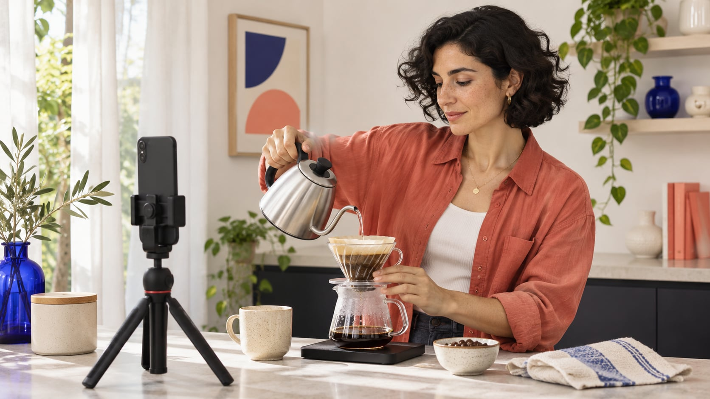
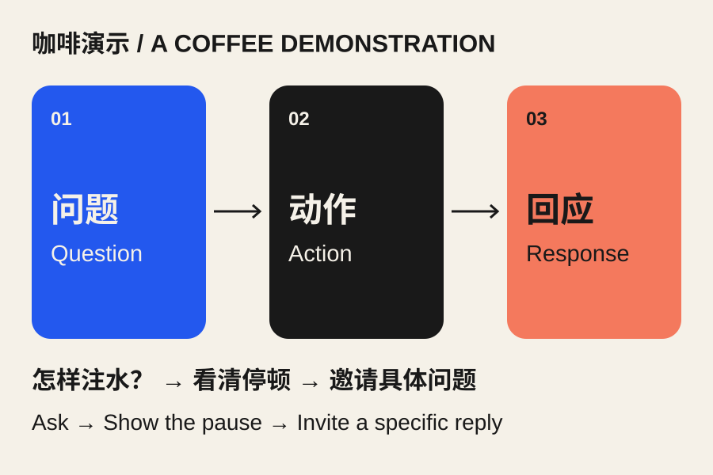
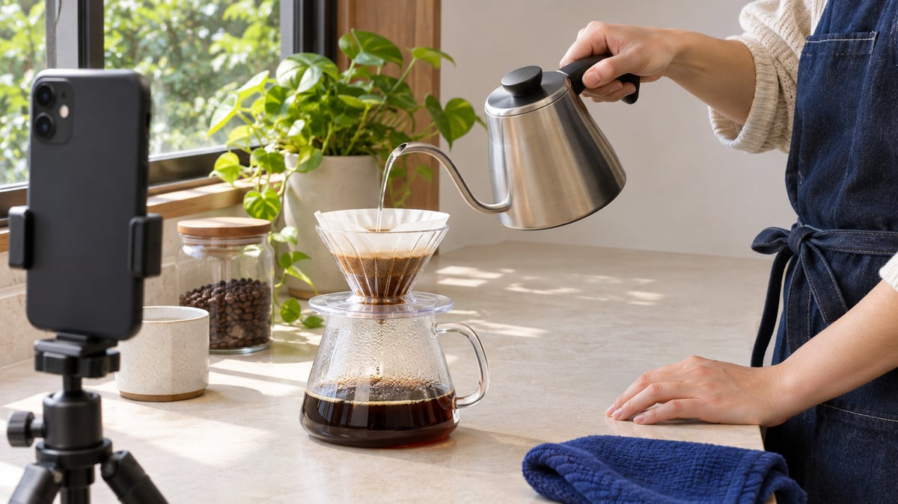

# Facebook Story 怎样讲清达人合作

用一组有动作、有解释、有下一步的短内容，让 Facebook Story 真正服务于达人合作，而不是缩小版广告海报。

> Draft date: 2026-11-23; local preview only. Author shown by the website: Daniel Craig.

Facebook Story 是以照片或短视频分享当下内容的格式，适合达人展示具体动作、解释选择，再邀请受众采取一个清楚的下一步。一次合作可以拆为“问题、演示、回应”三段，但这是一种编辑方法，不是平台规定。发布前核对账号、受众、合作说明和可见期限；常见的 24 小时说明不能替代目标账号当前设置。品牌应评估观众理解了什么、做了什么，而不只统计发了几张。

## Story 应承担一个能说清楚的小任务

达人合作中的 Story 不必装下品牌全部卖点。它更适合回答一个正在发生的问题：这件东西怎样用、为什么这样操作，或者看完后去哪里了解下一步。如果观众需要反复查阅完整条件，另给稳定的详情页面承接。

[Meta Stories 格式说明](https://about.fb.com/news/2017/03/more-ways-to-share-with-the-facebook-camera/)在 2017 年推出时将它介绍为照片与视频组成的临时内容，并说明常见的 24 小时展示。但 [Meta One 功能说明](https://www.meta.com/meta-one-plans/)目前已列出 Facebook 的延长 Story 有效期能力。因此，“Story 一定只展示 24 小时”已经不是可以不加条件套用的结论。

对品牌而言，应把“希望展示多久”和“该账号实际能展示多久”分开确认。若合作约定某一窗口，先检查目标账号设置，再写进交付要求；不要只因为旧教程这样写，就默认达人可以用某个期限。

本文使用一组虚构的咖啡合作作为演示：让观众看懂创作者怎样调整注水动作。示例不包含真实客户结果，也不承诺某个动作必然改善口味或带来销售。

## 把简报写成能拍出来的三段内容

第一段提出问题。画面是创作者和准备好的器具，文字可以写：“今天演示：分段注水怎样安排？”同时给出清楚的合作说明。品牌应确认这句话符合真实任务，不把普通冲泡包装成科学实验。

第二段展示动作。固定机位，让观众看得见壶嘴、水流和杯中变化。旁白解释：“这一段先停一下，再继续注水。”不要只给产品特写，再用文案宣称“演示完成”。如果动作比一段内容更长，可以合理拆分，并保留前后关系。

第三段回应或引导。可以说：“你平时最容易在哪一步犹豫？回复告诉我。”如果确实有已核对的完整方法入口，也可以引导到那里。一次只设一个主要动作，避免同时要求点赞、私信、购物、分享和关注。

三段示例的输出分别是一个问题、一个可见操作和一个受众回应入口。它不是固定的营销漏斗，也不保证所有观众会按顺序看完。每段都应有足够背景，让从中途进入的人知道正在看什么。

需要先写清合作对象、交付内容与使用方式时，可参考[品牌合作内容协作指南](/zh/blog/brand-partnerships-joint-content-governance/#answer)。把 brief 的重点放在可观察的内容上，达人仍可用自己的表达节奏完成拍摄。

咖啡合作的假设示例：每段承担一个任务，实际段数按内容需要调整。

## 拍摄时优先照顾观众看不看得清

把手机固定好，先拍一段样片，检查手是否挡住动作、画面边缘是否切掉关键器具，以及字幕能否在常见手机尺寸下读清。竖屏制作通常适合这类观看场景，但本文不把某个像素尺寸写成所有有机 Story 当前的强制上传规格。

咖啡演示可以用一个全景建立场景，再用足够近的机位拍动作。不要每两秒换一个与讲解无关的角度；观众需要看清注水怎样发生，而不是只看到剪辑节奏。拍摄背景也不必塞满品牌标识。

将重要文字留在画面中央较安全的可读区域，上传后再看实际控件是否遮挡。用真实手机预览确认，不从一张设计稿推定最终体验。字幕应补充声音信息，让静音观看也能理解关键步骤。

若使用音乐、贴纸或其他素材，确认具体用途所需权限。创作者日常可用的素材，不应自动推定能被品牌再次用于付费广告。先保证画面和讲解成立，再添加确实有帮助的装饰。

交付给审核者时，按实际顺序编号。把“第 2 段动作看不清，需要重拍”这样具体的问题反馈给达人，比一句“再高级一点”更容易执行。

拍摄时让相机看清动作，避免手和器具遮住关键细节。

## 从正确的发布身份进入 Story 编辑器

发布前先在目标账号里确认身份：是创作者本人，还是品牌 Page。打开该身份可用的 Story 创建入口，拍摄或选择已经准备好的照片、视频，再添加必要的文字和可用编辑元素。[Meta Business Suite 官方应用说明](https://play.google.com/store/apps/details?id=com.facebook.pages.app&hl=en)及其公开截图也展示了 Page 的 Story 创建能力，但不能据此推定个人资料和 Page 的菜单完全相同。

[Meta 创作界面更新](https://about.fb.com/news/2025/12/making-it-easier-to-create-discover-and-share-content-on-facebook/)说明强调了 Stories 与 Feed 编辑流程中更明显的受众和跨平台选项。因此编辑完成后，要主动检查这次内容给谁看、是否同时发往其他平台，而不是沿用上次选择。

这组咖啡内容应在预览里检查三件事：段落顺序是否正确、画面上的合作说明能否读到、引导动作是否在该账号真实可用。没有可用入口时，调整引导方式；不要把不能点击的文字伪装成按钮。

最后按照目标界面的分享或发布提示提交。若使用排期工具，则还要到队列里找到对应记录；完成创建不等于已经公开可见。按钮的具体名称和位置会变化，本篇没有登录任何用户账号验证全部版本。

对于 Page 的排期操作，可继续看 [Facebook 合作帖子排期教程](/zh/blog/facebook-page-post-scheduling-steps/#answer)，先熟悉创建、预览、找到保存记录这条基础路径。

## 发布后检查实际观看，而不是只看素材文件

发布后打开实际 Story，核对顺序、声音、文字、受众和可见期限。尽可能使用获准的普通观看方式检查，而不只看创作者自己的编辑界面。需要向品牌证明交付时，保存约定范围内的记录，不收集无关观众个人信息。

如果第二段缺失，第一段和第三段之间就没有完成演示。先确认上传或发布状态，再修复缺段；不要因为剩余两段有观看数，就把三段任务标为完成。如果第三段入口不能使用，也应修改为真实可执行的下一步。

限时内容应提前约定谁在展示期间查看回复。咖啡演示下出现“用量是多少”的问题，可能提示说明不完整，也可能成为下一条内容的好题目。负责人应能判断哪些属于可直接回答的信息，哪些需要产品团队确认。

展示到期不代表品牌可以随意复用素材。后续放到 Page、广告或其他渠道时，应按已约定用途处理。将实际可见期、交付状态和复用权限分开记录，会比把它们都写成“已发布”更清楚。

这一步的成果是一份实际观看检查结果，以及仍需回复的问题，而不是一张打不开内容的聊天截图。

## 用这一组内容回答一个复盘问题

先回到最初任务。假设目标是让观众理解分段注水，就整理与步骤有关的回复、实际可用的观看数据，以及进入完整教程的行为。用目标账号能提供的数据，不把另一平台的数据字段硬套进来。

一个明确标注的假设算例：若第一段记录 800 次观看、第三段 500 次观看，500 ÷ 800 = 62.5%。这只能描述这两个计数的比例；在不知道观看者是否相同、平台如何定义观看、有没有重复观看时，不能称为 62.5% 的独立用户完整看完率。

同样，20 条回复不代表 20 个购买者。应先区分真实问题、重复留言和不相关回复，再判断内容是否帮受众推进了任务。需要建立统一口径时，可参考[社交媒体指标决策方法](/zh/blog/social-media-metrics-creator-decision-tree/#answer)。

如果大多数问题都集中在第二段某个动作，下一次可以多给这一动作一些画面，而不是简单加长所有段落。若观众已理解演示，却找不到后续信息，就优先修正承接入口。

复盘的输出应是一项具体改动及理由，例如“下一版在停顿处增加近景，因为多条有效问题都在问何时继续”，而不是“继续提升互动”。

## 为下一组 Story 选择能解释动作的达人

选达人时，查看其已有作品怎样解释步骤、处理字幕和回应具体问题。粉丝量不能代替演示能力；画面漂亮也不自动说明适合讲解这次任务。先判断创作者是否愿意、也是否能够拍清这组内容。

[QuickKOL 官网能力说明](https://www.quickkol.com/)提供基于简报或关键词的达人发现与研究。团队可以在其支持的平台上先找有相关演示作品的候选人，再核对本次需要的 Facebook 账号与合作方式。不要把相关平台上的作品直接当作 Facebook 受众证明。

接下来的实际动作是写一页拍摄简报：一个问题、一个必须看见的动作、一个可用的回应入口。达人和品牌对这三点达成一致后，再决定表现形式与发布安排。这样的 Story 才有清楚的内容任务，素材数量本身不是目标。

## 下一步

从作品是否讲清楚动作出发，研究合适的合作对象。

[了解 QuickKOL](https://www.quickkol.com/)

## 来源与研究范围

资料核验于 2026 年 11 月 23 日。操作说明基于公开官方资料，没有登录或修改用户账号。编辑示例不是客户结果；功能以目标账号实际可用范围为准。

- [Meta Stories 格式说明](https://about.fb.com/news/2017/03/more-ways-to-share-with-the-facebook-camera/)
- [Meta One 功能说明](https://www.meta.com/meta-one-plans/)
- [Meta Business Suite 官方应用说明](https://play.google.com/store/apps/details?id=com.facebook.pages.app&hl=en)
- [Meta 创作界面更新](https://about.fb.com/news/2025/12/making-it-easier-to-create-discover-and-share-content-on-facebook/)
- [QuickKOL 官网能力说明](https://www.quickkol.com/)
