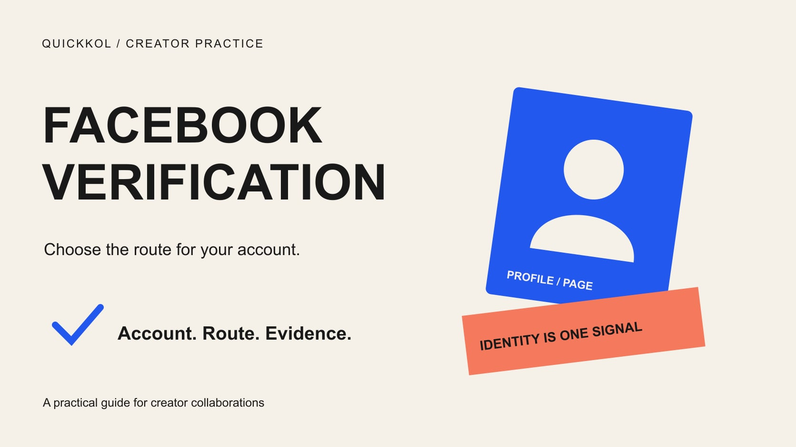
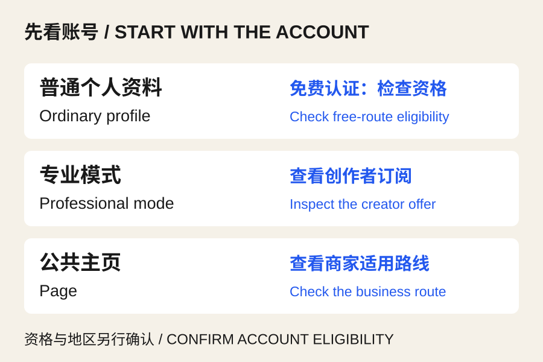

# How to Get Verified on Facebook as a Creator

Choose the appropriate Facebook verification route, use the official application entry and prepare a clear account record for creator partnerships.

> Draft date: 2026-11-23; local preview only. Author shown by the website: Daniel Craig.

To get verified on Facebook, identify the account first: an ordinary personal profile, professional-mode profile or Page. The free Facebook Verified announced in July 2026 excludes Pages and professional-mode accounts. Creators considering a subscription should use the Facebook subscription entry on Meta’s official product page, inspect the offer available to their actual profile and complete its information and identity checks. Existing badges are another situation. Verification can help account recognition, but a brand still needs to assess relevant work, audience evidence and authority for the proposed partnership.

## Choose the route for the account you actually use

Searches for Facebook verification can lead to similarly named products serving different accounts. [Meta’s Facebook Verified announcement](https://about.fb.com/news/2026/07/introducing-facebook-verified/) describes free person verification for eligible adults using a video selfie. It is being introduced in phases and excludes Pages and professional-mode accounts.

A creator already running commercial content through professional mode should therefore not assume the free option applies. Do not casually change an operating setup simply to make another product’s entry appear. Write down the actual account type and the purpose: reduce identity confusion, evaluate subscription benefits or understand an existing badge.

The [Instagram verification and partnership-authority guide](/blog/instagram-verification-partnership-authority/#answer) addresses a related but different platform task. This article first helps a Facebook creator select an application route. Interfaces, features and eligibility should not be transferred between the platforms.

The decision output can be straightforward. For an ordinary personal profile, check whether free verification is offered in that market. For a professional-mode profile, inspect the creator offer shown by Meta. For a brand Page, follow the applicable business-product information.

That routing decision is useful before preparing documents or discussing reimbursement with a brand. It prevents a campaign brief from requesting a badge through a route the creator’s actual account cannot use. It also preserves the creator’s operating choice rather than treating an account-type change as a routine verification shortcut.

Choose by account type rather than treating similar names as one product.

## Open the offer from the official entry

[Meta’s Verified product page](https://www.meta.com/meta-verified/) provides a Subscribe on Facebook entry and separates information for businesses. Sign in with the profile intended for the application and confirm the displayed account rather than purchase for someone else in the team.

The page also points to changes involving Meta One. For this application, read the product name, eligibility, included features, price, renewal and management information actually offered to the account. An old tutorial’s price should not become a worldwide promise. This article has not signed in or made a purchase.

Work through the concrete task: open the official page, choose its Facebook entry, confirm the intended profile, read the available offer and decide whether to continue. If the result is ineligible, unavailable or awaiting rollout, preserve that state and follow official help for that issue.

If the brand proposes paying the cost, agree its nature and period before work begins. A production fee does not automatically include a long-running subscription, and a brand-funded purchase does not establish acceptance of every future content use.

Keep the purchasing decision separate from creator selection. A relevant creator might already hold a badge, decide a subscription is useful or prefer not to buy one. The brand can evaluate those circumstances without pretending subscription purchase alone establishes the person’s suitability for a particular campaign.

## Prepare information that matches the profile

Before applying, compare the profile name, portrait and information you intend to provide. Meta’s product page says a government-issued ID may be requested and a selfie video may be required in selected regions. Follow the requirements displayed in the actual process.

The account holder should handle that preparation. The team can check public identity and explain the task without storing complete identity documents, login codes or payment information in an ordinary brief, shared sheet or outreach email. The brand needs the correct partner, not every capability of the person’s account.

If the creator uses a professional name, do not invent information to satisfy a guessed requirement. Read the applicable instructions and resolve how legal identity relates to professional presentation before proceeding. No particular document is guaranteed acceptance here.

Retain a proportionate application record: account, route, submission date and platform state. There is usually no reason for every content reviewer to receive the underlying sensitive materials. Identity confirmation and creative review have different information needs.

For example, an agency coordinator can record that the creator is handling a requested identity step while continuing to prepare a draft brief. That is different from marking verification approved. The distinction keeps ordinary preparation moving without assigning a final result to an application still under review.

## Check the outcome and implications of later changes

After submitting the requested information, inspect the platform’s outcome or next step. Payment, submission and approval are separate events. A payment receipt is not evidence that verification has been completed.

If more information is requested, handle the official request within the actual account. If there is no available entry or a decision is pending, record that honestly rather than promise a review date that has not been verified.

After approval, confirm which profile received the result. The product page explains that some profile changes may require going through subscription and verification again. Before changing relevant identity details, inspect current management instructions rather than assume a badge is permanently unaffected.

For a campaign, allow a practical period of stable account presentation. The brand can confirm the name and links needed for copy before production, instead of discovering a profile-name change at release. This is a production recommendation, not a platform rule requiring everyone to wait a fixed number of days.

If a change affects the planned post, update the creator reference in the brief and destination links. Keep the original account relationship visible while the current presentation is checked. The useful outcome is a reliable path to the intended work, not merely a familiar display name copied from an earlier screenshot.

## Turn the result into an accurate partnership record

Imagine a coffee creator publishing demonstrations through professional mode. A brand wants to reduce impersonated contact. A useful record contains the actual profile, public business route, applicable verification state and person handling this discussion, rather than demanding an inapplicable free badge.

This is an editorial scenario, not a client case. Even with verification, separately confirm who produced the work, whether a contact represents the creator and what this particular authorization includes. The badge does not endorse product opinions or commercial promises.

The brand should still inspect whether relevant work explains its subject clearly. The [creator media-kit versus press-kit guide](/blog/creator-media-kit-press-kit-recipient-scope/#answer) helps identify appropriate information for the recipient. Routine selection need not collect private material beyond that task.

While verification is pending, the team can research work and discuss scope, making decisions from the actual state. Absence of this badge should not become proven fake account, and presence should not become a shortcut that removes content review.

The operational gain comes from a clearer reference to the right person. A badge can contribute one identity signal, but a useful partnership record explains the intended task, the relevant work and the confirmed route for discussing it. Those details let another campaign manager continue accurately instead of interpreting a broad verified label without context.

## Handle common obstacles with a specific next step

When the free entry is missing, check account type and rollout region first. Professional-mode accounts and Pages should not be processed as ordinary profiles under the free announcement. When a subscription offer is missing, use the official product information rather than someone claiming an internal route.

For a name or photo issue, check genuine information and the current requirement rather than submit fabricated documents. An existing badge holder need not reapply simply to satisfy an outdated brief; first understand the present state.

If the business operates both a Page and a creator profile, record them separately. One entity’s verification should not be assigned to the other. Reusing a portrait does not create identical permissions or badge status.

When changing a plan, specify the affected task. Pending verification may affect an identity statement without necessarily preventing preparation of a review draft. Separate work that can proceed from questions still awaiting confirmation.

This produces a useful troubleshooting note: what the operator saw, which account it concerns and what can be done next. It is better than repeatedly retrying unrelated menus or asking the creator to promise success before the team has identified whether the requested product is available for the intended account.

## After verification, assess the work for the partnership

[QuickKOL’s product explanation](https://www.quickkol.com/) describes brief interpretation, creator discovery, research and outreach-related work. A brand can begin with keywords or a similar creator and inspect relevant original work before judging task fit.

For a Facebook collaboration, confirm the candidate’s actual Facebook work and business route separately. QuickKOL should not be described as a Facebook verification application tool, a subscription agent or a source of arbitrary Facebook account data.

A useful discovery brief might ask for creators who clearly explain pour-over coffee, focusing on demonstration conditions, expression and audience questions. The shortlist starts research; actual work, availability and commercial conditions still need confirmation.

Hand over the actual account, chosen route, application state and partnership contact. Verification then supports accurate identity reference, while work research supports content selection. Each has its own evidence and next action.

A creator does not need to turn the entire profile into an advertisement to make that record useful. Preserve their established subject and voice, then define a commission that fits. The brand can explain why it wants this person’s contribution instead of treating an application outcome as the whole reason to collaborate.

## Distinguish accounts before applying

Reviewed November 23, 2026; confirm availability with official information and the actual account.

| Situation | First check | Partnership record |
| --- | --- | --- |
| Ordinary personal profile | Free-feature eligibility and rollout | Actual account and current state |
| Professional-mode profile | Creator offer displayed by Meta | Profile, offer and outcome |
| Business Page | Applicable business-product guidance | Page entity and operational access |
| Existing badge | Existing state and change instructions | Do not assume reapplication is needed |

## Next step

Give QuickKOL the subject and explanation task, research relevant creators, then confirm their actual Facebook account and partnership terms.

[Explore creator discovery](https://www.quickkol.com/)

## Sources and research scope

Sources reviewed November 23, 2026. Instructions use public official material, without signing into or changing a user account. Editorial examples are not client results; confirm availability in the intended account.

- [Meta’s Facebook Verified announcement](https://about.fb.com/news/2026/07/introducing-facebook-verified/)
- [Meta’s Verified product page](https://www.meta.com/meta-verified/)
- [QuickKOL’s product explanation](https://www.quickkol.com/)
