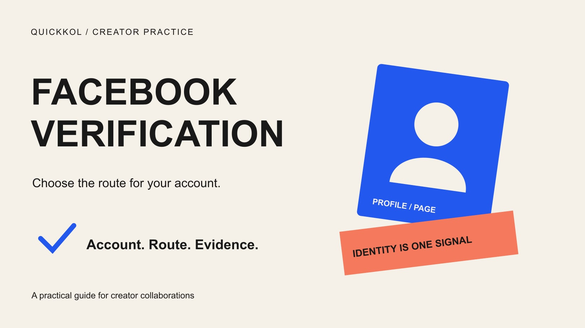
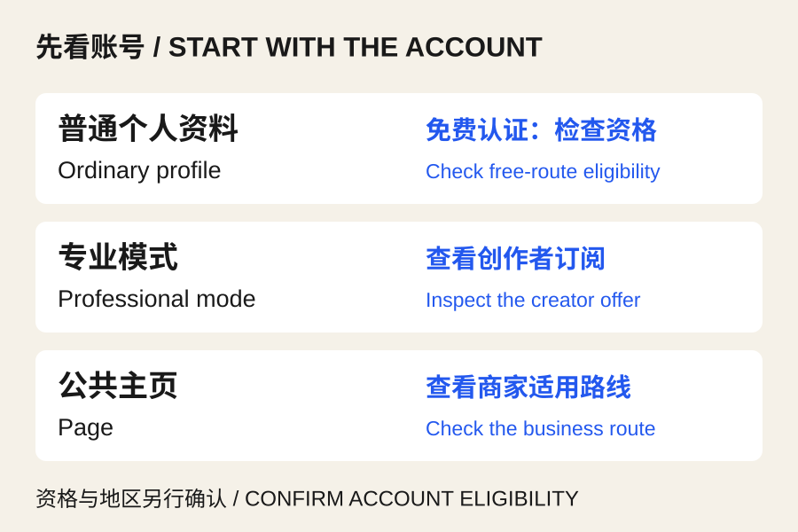

# Facebook 创作者怎样选择认证方式

为准备商业合作的 Facebook 创作者区分认证方式，找到正确申请入口，并整理品牌需要确认的账号资料。

> Draft date: 2026-11-23; local preview only. Author shown by the website: Daniel Craig.

先判断你使用的是普通个人资料、专业模式还是主页，再选择认证方式。Meta 于 2026 年 7 月推出的免费 Facebook Verified 面向符合资格的普通个人资料，公告明确排除主页和专业模式账号。经营内容合作的创作者可从 Meta 官方产品页的 Facebook 订阅入口查看自身可用方案，再按提示完成资料及身份确认。认证可以帮助识别账号，不能代替作品、受众和合作权限核对。

## 先分清你需要哪一种认证

搜索“Facebook 认证”可能得到名称相近、对象不同的结果。[Facebook Verified 官方公告](https://about.fb.com/news/2026/07/introducing-facebook-verified/)介绍的是免费真人核验：符合条件、年满 18 岁的用户录制自拍视频，由平台与现有资料照片比较；它分阶段推出，不适用于主页或专业模式账号。

因此，已经用专业模式经营商业内容的人，不应把免费入口当作自己的必然选项，也不宜只为找到该入口随意改变经营设置。先写下实际账号类型和目标：减少身份混淆、查看订阅功能，还是理解品牌看到的现有标识。

这与 [Instagram 认证及合作权限说明](/zh/blog/instagram-verification-partnership-authority/#answer)处理的问题不同。本篇先帮助 Facebook 创作者选择申请路径，之后才讨论品牌如何使用结果。平台之间的入口、功能和资格不能直接互换。

判断输出可以很简单：普通个人资料，检查免费功能是否在本市场开放；专业模式资料，查看官方展示的创作者方案；品牌主页，转到适用的企业产品说明。不要把申请路径写成一个人人都能完成的统一菜单。

按账号类型选路径，不将相似名称当作同一产品。

## 从官方入口打开实际方案

[Meta Verified 产品页](https://www.meta.com/meta-verified/)提供“Subscribe on Facebook”入口，并将企业方案单独列出。先用准备申请的本人资料登录，再从官方页面进入，核对显示的账号，而不是替团队中另一个人购买。

页面也提示 Meta One 的相关变化。对本次申请，优先阅读账号当下展示的产品名称、资格、包含功能、价格、续费和管理方式，不依赖旧教程中一组全球通用价格。本文没有登录账号执行购买，也不替你完成订阅。

具体操作可以按任务推进：打开官方页；选 Facebook 入口；确认目标资料；阅读可用方案；决定是否继续。若页面显示不符合资格、尚不可用或等待开放，保留该状态，改用官方帮助处理对应问题。

品牌若承担相关费用，应在合作前确认费用性质与期限。一次内容制作费不自动包含长期订阅，也不能由品牌购买行为推定创作者已接受所有合作用途。

## 准备能与实际资料对应的信息

申请前查看资料名称、头像和你准备提供的信息是否一致。官方产品页说明，平台可能要求政府签发的身份证件，部分地区还可能要求自拍视频；具体要求以你当前流程为准。

把准备工作留给账号本人完成。团队可以核对公开资料和说明任务，不需要在普通 Brief、共享表格或外联邮件中存放完整证件、登录验证码与支付资料。品牌需要的是正确合作对象，不是本人账户的所有访问能力。

如果你使用艺名或长期职业名称，不应临时编造资料来迁就猜测的要求。先查看适用规则，处理真实名称与职业展示的关系，再决定怎样继续。本文不承诺任何特定文件一定被接受。

保存适量申请记录，例如申请对象、所选路径、提交日期与平台状态。不要将完整敏感材料复制给每一个审稿人。身份确认和商业审稿有不同的信息需求，清楚的记录能让两边工作衔接而不互相越界。

## 完成申请后核对结果与后续变更

按实际流程提交所需信息后，查看平台给出的结果或下一步。付款、提交与获准是不同事件；不要用一张支付凭证向品牌证明认证已经完成。

如果平台要求补充材料，回到该账号中的官方请求处理。若没有可用入口或结果尚待审核，就如实记录，不能向合作方保证一个未经核验的审批日期。

获准后，确认结果属于哪个资料。官方产品页说明，部分资料变更可能需要重新经过订阅与认证流程；准备改用户名、名称展示或相关资料时，先核对当前管理说明，不把旧标识当作永远有效。

为活动留出账号稳定的准备期。品牌可以提前确认在文案和链接中使用的名称，避免临近发布时才发现对方正在更换身份展示。这是制作安排建议，不是平台规定所有创作者都必须等待相同天数。

## 把认证结果转成准确的合作记录

假设一位咖啡创作者用专业模式发布演示，品牌希望减少冒名联络。合适的记录是：实际资料链接、本人公开业务路径、适用认证状态及负责本次沟通的人，而不是要求其先获得不适用的免费标识。

这是编辑假设，不是实际客户案例。即使出现认证，也要单独确认作品是谁制作、联系人是否代表本人，以及这次授权包含什么。认证不是平台对产品观点或商业承诺的背书。

品牌还需要看相关作品是否清楚解释自己的主题。可以参考[达人媒体资料与新闻资料的使用区别](/zh/blog/creator-media-kit-press-kit-recipient-scope/#answer)，向合适接收人索取必要信息；没有必要为了常规筛选收集超出任务的私人资料。

若认证仍在处理中，团队可以继续研究作品和讨论范围，按真实状态作决定。不要把“没有这个标识”改成“已经证明是假账号”，也不要反过来把认证当成无需再看内容的筛选捷径。

## 常见障碍怎样处理

找不到免费入口时，先检查账号类型与地区开放情况；专业模式与主页不应按普通资料的免费公告处理。找不到订阅方案时，从官方产品页查看适用说明，不向声称有内部渠道的人交出账户。

出现名称或照片问题时，核对真实资料及当前要求，不提交虚假文件。已经有标识的人，也不必为了满足一份过时 Brief 重复申请；先理解其现有状态。

如果品牌同时经营主页和创作者资料，分别记录，避免把一个主体的认证写到另一个主体。多个页面使用同一张头像，并不能证明它们拥有相同权限或认证。

需要改动计划时，具体说明哪项任务受影响。认证待处理可能影响对外身份说明，却不一定阻止准备一份待审脚本。把已能完成的工作与仍待确认的事项分开，减少没有必要的停工。

## 认证之后，再按作品寻找合作匹配

[QuickKOL 官网能力说明](https://www.quickkol.com/)将产品定位在 Brief 理解、达人发现、研究和外联相关任务。品牌可以用关键词或相似创作者开始研究相关原作，再判断内容与目标是否匹配。

对 Facebook 合作，另行确认候选人的真实 Facebook 作品和可联系路径。不要把 QuickKOL 写成 Facebook 认证申请器，也不承诺其能直接提供任意 Facebook 账号数据或代办订阅。

可以先提出具体 Brief：寻找能讲清手冲咖啡步骤的创作者，重点看演示条件、表达方式与观众问题。名单是研究起点，下一步仍需要核对真实作品、可用时间与合作条件。

最后交接实际账号、所选路径、申请状态和合作联系人。这样认证服务于准确识别，作品研究服务于内容选择，两项工作各有依据，也让品牌能清楚安排接下来的沟通。

## 申请前先分清对象

核验于 2026 年 11 月 23 日；具体可用性以官方与实际账号为准。

| 情况 | 优先查看 | 合作记录 |
| --- | --- | --- |
| 普通个人资料 | 免费功能资格及开放情况 | 真实账号与当前状态 |
| 专业模式资料 | 官方展示的创作者方案 | 目标资料、方案与结果 |
| 企业主页 | 适用企业产品说明 | 主页主体与操作权限 |
| 已有标识 | 现有状态及变更规则 | 不默认需要重新申请 |

## 下一步

向 QuickKOL 提供内容主题与需要的解释任务，研究相关创作者作品，再核对实际 Facebook 账号与合作条件。

[查看达人发现能力](https://www.quickkol.com/)

## 来源与研究范围

资料核验于 2026 年 11 月 23 日。操作说明基于公开官方资料，没有登录或修改用户账号。编辑示例不是客户结果；功能以目标账号实际可用范围为准。

- [Facebook Verified 官方公告](https://about.fb.com/news/2026/07/introducing-facebook-verified/)
- [Meta Verified 产品页](https://www.meta.com/meta-verified/)
- [QuickKOL 官网能力说明](https://www.quickkol.com/)
