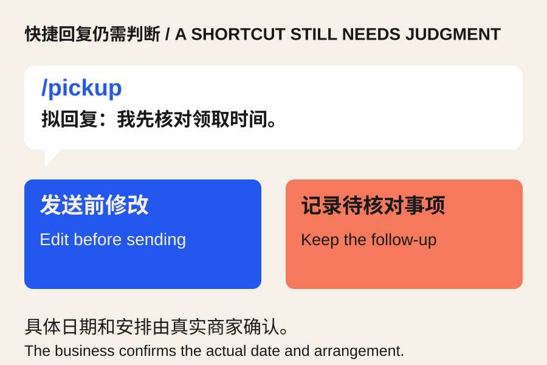

# WhatsApp Business Setup for Creator Campaign Enquiries

Set up a WhatsApp Business App destination for creator-led enquiries, from registration to short links, useful replies and chat organization.

> Draft date: 2026-11-23; local preview only. Author shown by the website: Daniel Craig.

Whats appbusiness usually means WhatsApp Business. For a small volume of enquiries generated by creator content, consider the Business App: download the official app, register a business number, complete the profile, obtain its generated short link and prepare quick replies and chat organization. The goal is an accurate destination for people choosing to contact the business, not unsolicited bulk messaging. Test one answerable enquiry from link to response before giving the destination to a creator, and assess larger integration needs separately.

## Start with the Business App, not an assumed integration

[WhatsApp Business’s feature guide](https://whatsappbusiness.com/products/business-app-features/) describes business profiles, greeting and away messages, quick replies and product presentation. This guide concerns a basic enquiry destination; it does not assume a Business Platform deployment, shared service system or API integration.

Choose one question a conversation can genuinely answer. After a creator demonstrates a bakery gift box, a viewer might ask whether collection is possible on a particular day. That has a specific product, timing and receiving business, making it a useful test. If the person only needs a public explanation, a direct information page may be simpler.

Identify the business owner, number and service scope. The actual business should manage the number rather than use the creator’s private phone as campaign support. Decide who handles setup and recovery before the destination is embedded in creative assets.

The [WhatsApp creator-enquiry handoff guide](/blog/whatsapp-business-creator-conversation-handoff/#answer) addresses receiving and routing questions. This article focuses on the App setup needed to produce an inspectable result for a smaller campaign.

The first deliverable is therefore a short destination brief: whose business will answer, what it can answer and why chat helps. That keeps the configuration proportionate to the task instead of choosing a complex system before the team has established a useful audience action.

## Download, register and establish the business profile

[WhatsApp’s official setup guide](https://whatsappbusiness.com/products/business-app-get-started/) covers download, terms, number registration and profile creation. Obtain the Business App through the official store route and check its name rather than assume a Messenger screenshot describes identical settings.

During registration, select country, verify country code and number, then complete the current number-confirmation prompts. The account owner handles verification codes; they do not belong in a creator brief. If migration or restoration is involved, first inspect what needs preserving instead of casually changing an operating business number for one campaign.

Next, enter business name, category and an appropriate image, adding genuine operating information and website. In the bakery example, name, collection address and hours should help viewers recognize the business in the video rather than a different shop with a similar name.

Choose contact and media access according to the task; a demonstration does not require importing an entire private address book. Inspect the public profile from a recipient’s perspective.

The output is a recognizable business identity with a practical way to continue. If information is missing, correct it before distributing the link. A functioning chat entry can still confuse people when its profile names another entity or offers no explanation of where an enquiry will go.

## Obtain the real short link and test the destination

[WhatsApp’s short-link instructions](https://faq.whatsapp.com/502291734918768/?cms_platform=android) explain that the Business App generates a link for the account. The Android route uses Tools, the additional-options menu and Short link, where the link can be copied or shared. Consult the corresponding instructions for another system.

Use the actual generated destination rather than inventing an apparently usable number in an article or asset. If adding a prefilled message, help the viewer ask a specific question: Hello, I saw the gift box in the video. Is Saturday collection possible? This is sample copy, not a real stock promise.

Open the link from another device or browser and confirm business identity, chat recipient and prefilled wording. A customer can change that wording, so it cannot independently establish that every conversation came from a particular creator.

Give the checked link to the creator and inspect the version in the final asset before release. Correcting an internal file alone can leave an older link circulating in a caption, profile or destination.

The test output should identify where the link opens and what the visitor is invited to do. That is more useful than marking link checked without recording whether it actually reached the intended business or merely loaded a generic web page.

## Prepare quick replies that can be edited before sending

[WhatsApp’s quick-reply instructions](https://faq.whatsapp.com/1791149784551042/?locale=en_US&cms_platform=android) give the Android route: Tools, Quick replies, add, then complete Message and Shortcut and save. In a chat, type a slash to select a reply, inspect the inserted text and edit or send it. A quick reply is not a robot that has already judged every enquiry.

Begin with three needs: what information is needed from the enquirer, which business facts are currently confirmed and how to explain that another check is required. Sample shortcuts could be /pickup, /details and /check; choose them for the real business rather than promise an unconfirmed time.

For /check, sample copy is: Thank you. I need to confirm that date with the shop. Please tell us your preferred collection date, and this business account will reply after checking. There is no need to request unrelated private details before understanding the question.

Give each answer an internal fact owner and review date, updating it when conditions change. Stored quantity is not a quality target. A few accurate responses usually suit a small pilot better than a large collection of promotional statements the business cannot fulfil.

The article’s downloadable reply sheet preserves those fields so the team can review wording before copying it into the App. It is an editable template, not a set of promises already approved by the featured business.

A quick reply supplies reusable wording; the specific question still needs judgment.

## Organize chats with the interface actually available

[WhatsApp’s chat-list explanation](https://faq.whatsapp.com/2861038884085362/?cms_platform=android) says the feature is rolling out, while the labels guide describes the transition. This article therefore does not require every operator to find an identical interface.

If Lists is available on the Android account, the official route is Tools, Lists, New list, followed by a name, relevant people or groups, and confirmation. If the account still shows Labels, use instructions for that version rather than recreate the account to force a new name.

Choose categories that support an action, such as awaiting date confirmation or collection arrangements answered. These are editorial suggestions, not platform defaults or proof of a purchase. A category helps locate a conversation; it should not be treated as consent to every future promotion.

Use a few permitted test conversations to check retrieval. The team needs to find pending questions and know when they can leave that category. Repeatedly registering one person as several new enquiries does not improve reporting.

For the bakery example, the useful state is whether the question about a date has been answered. It is not enough that a list exists. The person responsible for the answer should be able to locate the conversation and understand the next step without relying on the creator’s memory of a private exchange.

## Rehearse one hypothetical enquiry before the creator posts

Continue the gift-box example. Have a permitted tester open the final link and send Can I collect on Saturday? The business operator confirms the correct account received it, selects a relevant quick reply, edits necessary details and sends it. This is an editorial rehearsal plan, not a claim of testing the user’s business.

Then inspect whether the next action is clear. If the date needs confirmation, the receiver should know who checks and how a reply returns. If it can be answered, the text should match public operating information. Greeting and away messages should reflect actual service capacity; an automatic response is not a resolved enquiry.

Record link accuracy, profile accuracy, editable response, retrievable pending question and remaining issues. A basic destination does not first need a complex attribution system, but the team should know which part remains incomplete.

Finally, give the creator an invitation the business can fulfil: For collection questions, contact the shop team through the link in the brand profile. Do not imply the creator personally handles orders around the clock or turn chat counts directly into sales.

The rehearsal is small by design. It establishes whether the basic audience journey works before expanding creative distribution or adding more business functions that require their own setup and acceptance.

## Connect the destination to the creator’s actual content task

After setup, return to why the content deserves a viewer’s question. The creator can demonstrate box size, contents or a use situation, leaving individual arrangements for the business. The entire piece need not become a repeated contact us instruction.

The [social-media metrics decision guide](/blog/social-media-metrics-creator-decision-tree/#answer) helps separate content viewing, link activity, actual enquiries and confirmed business outcomes. Several messages in one conversation should not automatically become several customers.

QuickKOL can support research of creators whose work fits the subject and help prepare discovery and communication tasks. It does not replace Business App registration, number verification or chat setup. Facebook and WhatsApp operations remain with the appropriate owner.

The completion standard here is a real, answerable enquiry path and a few responses checked by the fact owner. Inspect the actual version before giving it to a creator, and reassess staffing and tools before expanding.

That connects the technical setup to a useful creator-marketing outcome: interested viewers can ask the right business a clear question. It preserves the creator’s contribution as an explanation or demonstration, while allowing the business to answer details only it can responsibly confirm.

## Three editable enquiry replies

Editorial examples, not approved wording for an actual business.

| Sample shortcut | Purpose | Check before sending |
| --- | --- | --- |
| /pickup | Explain confirmed collection arrangements | Date, address and operating information |
| /details | Identify the product in the video | Actual product and current conditions |
| /check | Explain an outstanding check | Owner and actual follow-up arrangement |

## Fill in the actual business information

The template includes purpose, shortcut, draft reply, fact owner and review date.

- Confirm business number and profile.
- Test the actual short link from another entry.
- Check that the inserted reply can be edited.
- Use Lists or Labels for the actual version.
- Run one permitted enquiry rehearsal before release.

[Chinese reply-preparation CSV](../public/downloads/creator-enquiry-replies-2026-11-23.zh.csv)

[English reply-preparation CSV](../public/downloads/creator-enquiry-replies-2026-11-23.en.csv)

## Next step

Start creator research in QuickKOL with a subject or similar work, then prepare an accurate enquiry destination for suitable partners.

[Explore creator research](https://www.quickkol.com/)

## Sources and research scope

Sources reviewed November 23, 2026. Instructions use public official material, without signing into or changing a user account. Editorial examples are not client results; confirm availability in the intended account.

- [WhatsApp Business’s feature guide](https://whatsappbusiness.com/products/business-app-features/)
- [WhatsApp’s official setup guide](https://whatsappbusiness.com/products/business-app-get-started/)
- [WhatsApp’s short-link instructions](https://faq.whatsapp.com/502291734918768/?cms_platform=android)
- [WhatsApp’s quick-reply instructions](https://faq.whatsapp.com/1791149784551042/?locale=en_US&cms_platform=android)
- [WhatsApp’s chat-list explanation](https://faq.whatsapp.com/2861038884085362/?cms_platform=android)
