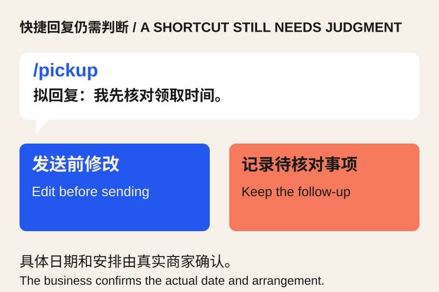

# WhatsApp Business 怎样设置合作咨询入口

为达人内容带来的主动咨询搭建一个清楚的 WhatsApp Business App 入口，从注册到短链接、快捷回复与聊天分类。

> Draft date: 2026-11-23; local preview only. Author shown by the website: Daniel Craig.

“whats appbusiness”通常是在找 WhatsApp Business。若品牌只需承接达人内容带来的少量咨询，可先评估 Business App：下载官方应用、注册业务号码、完善资料，再取得应用生成的短链接，准备快捷回复与聊天分类。这里的目标是让观众主动找到正确业务，不是批量给陌生人发消息。先用一个真实可答的问题测试从链接到回复的流程，确认后再把入口交给创作者。

## 先确认你要用的是 Business App

[WhatsApp Business 功能说明](https://whatsappbusiness.com/products/business-app-features/)介绍业务资料、欢迎消息、离开消息、快捷回复和商品展示等能力。本篇面向准备一个基础咨询入口的品牌，不假定已经部署 Business Platform、共享客服系统或 API。

先选一个需要对话才能回答的问题。例如，达人展示面包礼盒后，观众想知道某天是否可以到店领取。这个问题有具体产品、时间与接收业务，适合用来检查入口。若用户只需要读一份公开说明，直接给页面可能更省事。

写下业务负责人、使用号码和可服务范围。号码应由实际业务负责管理，不要把创作者私人号码当成活动客服。谁负责开通和恢复，最好在把入口印进素材之前确定。

已有 [WhatsApp 达人咨询交接指南](/zh/blog/whatsapp-business-creator-conversation-handoff/#answer)讨论团队如何接住问题。本篇进一步说明 App 里要准备什么，使小规模活动能先完成一个可查看的设置结果，而不是以“我们有 WhatsApp”代替流程。

## 下载、注册并建立业务资料

[WhatsApp 官方开通指南](https://whatsappbusiness.com/products/business-app-get-started/)给出下载、接受条款、注册号码与建立资料的过程。从官方指向的应用商店获取 Business App，确认应用名称，不把普通 Messenger 的设置截图当成完全相同的操作。

注册时选择国家、检查区号与号码，按当前提示完成号码确认。验证码由实际账号负责人处理，不写进给达人的 Brief。首次设置如果涉及迁移或恢复旧账号，先检查需要保留的信息，不为一次活动随意改动正在使用的业务号码。

接下来填写业务名称、类别与合适头像，补充营业信息和真实网站。对面包店例子，店名、领取地址和营业时间应能让观众确认这是视频里的业务，而不是另一个同名商家。

联系人与照片访问按实际任务选择，不必为了演示导入整份私人通讯录。完成后从普通接收人的角度查看公开资料，输出应是一张能识别业务、知道怎样继续提问的资料页。

## 取得真实短链接并测试入口

[WhatsApp 短链接步骤](https://faq.whatsapp.com/502291734918768/?cms_platform=android)说明，Business App 账号会生成一个短链接。Android 说明中的入口是 Tools，进入更多选项后选择 Short link，再复制或分享；不同系统应查看对应版本的官方步骤。

用应用提供的实际链接，不在文章或素材中编造一个看似可用的号码。若设置预填消息，让它帮观众提出具体问题，例如“你好，我想了解视频里的礼盒，是否可以周六到店领取？”这是编辑文案示例，不是真实库存承诺。

从另一台设备或浏览器打开链接，确认业务名称、聊天接收方和预填内容。预填文字仍可能被用户改写，不能仅靠这句话判断每一条对话都来自某位创作者。

把通过测试的链接交给创作者，在发布前再检查最终素材中的版本。不要只在内部文件里修正，留下旧链接在字幕、简介或落地页继续流转。

## 用快捷回复准备可直接修改的答案

[WhatsApp 快捷回复步骤](https://faq.whatsapp.com/1791149784551042/?locale=en_US&cms_platform=android)给出 Android 路径：Tools → Quick replies → 添加，填写 Message 和 Shortcut 后保存。聊天中输入“/”可以选择回复；先检查插入的文字，再修改或发送。快捷回复不是已经替所有问题作判断的机器人。

先准备三类内容：接到咨询后需要了解什么、当前可以确认的业务事实，以及需要进一步核对时怎样说明。示例短语可以是 /pickup、/details 和 /check，但以真实业务选用，不要承诺未确定的时间。

例如 /check 可以写：“谢谢，我需要向店内确认这个日期的安排。请先告诉我们希望领取的日期，确认后由本业务账号回复。”对方提供信息前，不必要求订单号或其他无关私人资料。

每条回复注明内部事实负责方及复核日期，事实变化时更新。保存数量不是质量目标；先把几条常用答案写准确，通常比复制一大批不能兑现的促销话术更适合小规模试点。

快捷回复提供可复用文字，具体答案仍要看本次问题。

## 按当前界面使用列表或标签

[WhatsApp 聊天列表说明](https://faq.whatsapp.com/2861038884085362/?cms_platform=android)指出功能正在逐步推出；旧标签说明也提示标签正在改成列表。因此本篇不要求每个操作者都找到相同界面。

如果 Android 账号已提供 Lists，官方步骤是 Tools → Lists → New list，命名后添加相应联系人或群组并确认。若仍显示 Labels，使用适用版本的说明，不要为找新名称反复重建账号。

分类名称可以服务下一步，例如“等待日期确认”“已答复领取安排”。这些是编辑建议，不是平台默认状态，也不是客户已经购买的证明。加入列表帮助找到聊天，不应被当成对所有未来推广的同意。

用两三条经允许的测试对话检查查找方式。团队需要知道怎样找到仍待处理的问题，以及何时可以移出该分类；不要为了报告数字而把同一个人反复登记成多个新咨询。

## 用一个假设咨询完成发布前演练

沿用礼盒例子，先让经允许的测试者打开最终链接，发送“周六可以领取吗”。业务人员确认收到的是正确账号，再选择相关快捷回复，修改必要信息并发送。这里的演练步骤是编辑方案，没有声称已在用户业务中执行。

接着检查下一步是否清楚。如果目前不能确认日期，接收人应明确谁核对、怎样回复；如果可以回答，文字应与公开营业信息一致。欢迎或离开消息也要反映真实服务能力，不把自动回复当成人工已经解决。

将测试结果记录为链接正确、资料正确、回复可编辑、待办可找到，以及剩余问题。无需为了一个基础入口先建设复杂归因系统，但至少要知道哪一环还没有完成。

最后请创作者使用能够兑现的邀请：“有领取安排问题，可通过品牌资料中的链接咨询店内团队。”不要暗示创作者本人会全天候处理订单，或从聊天次数直接推导销售结果。

## 把咨询入口接回达人内容任务

入口准备好后，回到作品为何值得观众主动提问。品牌可以让创作者展示礼盒大小、开盒内容或适用场景，再将仍需个别确认的问题交给业务，而不是让整段内容只剩“联系我们”。

参考[社交媒体指标决策方法](/zh/blog/social-media-metrics-creator-decision-tree/#answer)，把内容观看、链接活动、实际咨询和已确认业务结果分开记录。一次聊天可能有多个消息，不能简单当作多个客户。

QuickKOL 可用于研究与主题相关的创作者作品，帮助品牌准备发现与沟通任务；它不替代 Business App 的注册、号码核验或聊天设置。Facebook 或 WhatsApp 的实际操作仍由对应负责人完成。

本篇的完成标准是一条真实可用、业务能回答的咨询路径，以及几条经过事实负责人确认的答案。将它交给创作者前，检查实际版本；扩大活动前，再评估人员和工具是否足够。

## 三条可改写的咨询回复

编辑示例，不是任何实际商家的已批准话术。

| 短语示例 | 用途 | 发送前检查 |
| --- | --- | --- |
| /pickup | 说明已确认的领取安排 | 日期、地址与营业信息 |
| /details | 介绍视频对应商品 | 实际商品与当前条件 |
| /check | 说明还需要核对 | 负责方与真实跟进安排 |

## 下载后填写真实业务信息

模板包含用途、快捷短语、拟回复、事实负责人和复核日期。

- 确认业务号码与资料。
- 从另一入口测试真实短链接。
- 检查快捷回复可以修改。
- 按实际版本使用列表或标签。
- 发布前完成一次允许的咨询演练。

[中文回复准备表 CSV](../public/downloads/creator-enquiry-replies-2026-11-23.zh.csv)

[英文回复准备表 CSV](../public/downloads/creator-enquiry-replies-2026-11-23.en.csv)

## 下一步

在 QuickKOL 中用内容主题或相似作品开始研究候选，再为合适创作者准备准确的业务咨询入口。

[了解达人研究](https://www.quickkol.com/)

## 来源与研究范围

资料核验于 2026 年 11 月 23 日。操作说明基于公开官方资料，没有登录或修改用户账号。编辑示例不是客户结果；功能以目标账号实际可用范围为准。

- [WhatsApp Business 功能说明](https://whatsappbusiness.com/products/business-app-features/)
- [WhatsApp 官方开通指南](https://whatsappbusiness.com/products/business-app-get-started/)
- [WhatsApp 短链接步骤](https://faq.whatsapp.com/502291734918768/?cms_platform=android)
- [WhatsApp 快捷回复步骤](https://faq.whatsapp.com/1791149784551042/?locale=en_US&cms_platform=android)
- [WhatsApp 聊天列表说明](https://faq.whatsapp.com/2861038884085362/?cms_platform=android)
