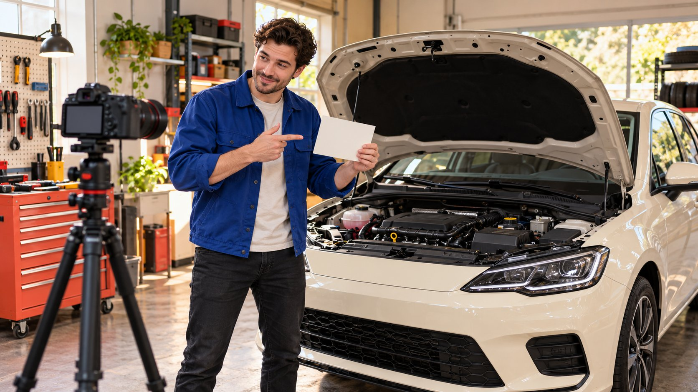

# Car YouTubers: Scope a Long-Term Vehicle Loan and Review

Status: local review draft; confirm the publication date before release.

Connect vehicle loans, actual experience, version records and returns in a clear automotive assignment with appropriate editorial boundaries.

AI-generated editorial illustration, not an actual creator, client, product or event.

For an extended vehicle loan with car YouTubers, define the use question before confirming the vehicle version, available time, driving and filming conditions, costs, faults and return. SavageGeese and Throttle House are public research entries, not current availability or partnership promises. Supplying a car does not automatically purchase coverage or a positive verdict, and a short experience cannot establish long-term reliability.

## Define what the extended loan should add

A static introduction, short drive and return after repeated use support different content. Define the new information: loading, operational habits, a particular feature or questions after actual use. Do not apply long-term review merely because it sounds thorough when the work cannot support that description.

The [automotive creator content-fit guide](/blog/car-youtubers-automotive-campaigns/#answer) helps match roles. This article addresses loan dependencies and evidence. Retain audience, model, market, use question and completion condition. Duration should follow the observation needed and feasible arrangements, not a universal number of days.

Genuine use does not require every life situation. Choose a few relevant observations, identifying the creator’s work and tasks for other appropriate people. If the business mainly needs an accurate feature demonstration, choose narrower scope rather than demanding an unsupported comprehensive verdict. A clear job gives the sample and production plan a basis. The invitation should explain why additional access time is necessary, not simply offer a vehicle and expect the recipient to infer the brand’s content goals or accept an undefined reporting obligation.

## SavageGeese: research explanation through the archive

The [SavageGeese official review archive](https://www.savagegeese.com/) provides historical entry points into technical reviews and automotive work, including visibly older dates. It supports discovery of relevant examples, not current publishing frequency, rates or availability. Continue into the actual work and retain versions and dates.

Inspect how questions, technical explanation, operation and impressions are organized. A brand seeking an explanation of a use condition should identify the material and access it can provide. Technical work on a channel does not require the creator to verify every brand claim. Method and judgment still depend on the assignment.

A similar role may need vehicle information, appropriate access and preparation. Identify confirmed and pending inputs while allowing a suitable angle. An archive is a research starting point, not a guarantee that any vehicle receives coverage. Do not record an unaccepted invitation as an active partnership. Keep historical work and current commercial arrangements separate. This gives the next reviewer a defensible reason for studying the role without presenting recognition or an old example as proof of present capability for every requested activity.

## Throttle House: separate content format from execution conditions

The [Throttle House official site](https://www.thethrottlehouse.com/) links its video channel and track-related content. It helps research comparison and presentation without establishing driving, location, vehicle-use or other conditions for the reader’s project. Nor does it establish current willingness to partner.

Inspect the question, conditions and distinction between entertainment and individual impressions. An expressive comparison is not automatically a standard for every market, configuration or environment. Specify the work being purchased rather than requesting a copied shot while assuming its prerequisites already exist.

For a similar production, execution owners confirm locations, participants and permitted activities. These are material dependencies, not matters to discover after vehicle handover. If conditions cannot be met, choose a static explanation, another accurate task or closure instead of treating an attractive public work as a ready-made plan. The content research should identify the role the brand needs; operational confirmation determines whether that role can be performed in the actual assignment. Keeping them separate avoids promising the creator access or activities the brand has no authority to supply.

## Record vehicle and software versions at handover

Confirm model, model year, configuration, market version, software, accessories and condition. Differences affecting the demonstration need appropriate content context. Keep vehicle-identification details in suitable internal records rather than publishing unnecessary information as decoration. A product name alone is insufficient to identify the actual object.

Retain receipt time, condition images, necessary instructions and ownership. For preproduction, loaned or specially prepared vehicles, identify conditions affecting observations. After a replacement, software update or accessory change, check existing footage and claims and notify the creator.

The [sample handoff guide](/blog/influencer-product-seeding-logistics/#answer) helps organize receipt and exceptions, while the vehicle arrangement still needs specific terms. Assign information supply, faults and changes of use before handover. Delivery does not automatically make production ready, and waiting caused by incomplete preparation should not silently become the creator’s own cost. A usable record lets another team member establish which vehicle supported which observation, especially if several examples arrive during the project and the final editor receives footage from more than one configuration.

## Confirm permitted use, support and fault handling

Have the appropriate owners confirm drivers, locations, route types, permitted activities, mileage and other limits. Authorized people review insurance and responsibility for the specific arrangement; this article does not claim every loan automatically covers every risk. These are brief fields, not a complete vehicle-loan agreement.

Assign contacts and procedures for maintenance, fuel or charging, cleaning, storage, faults, incidents and delayed returns, including spending requiring approval. Do not hide every potential change inside handle it yourself, or let an unauthorized outreach contact promise that the brand covers everything.

If the vehicle or conditions prevent the task, pause and re-decide scope and dates. Production should not perform an unagreed use merely to preserve timing. Retain facts, notifications and decisions so business, fleet and content teams understand the same state. An explicit fault route is more useful than searching for authority after work begins. It also allows the creator to report an issue without being expected to diagnose or repair it as an unpriced part of the content commission.

## Separate actual experience from broad performance conclusions

For each use question, retain situation, timing, version, actions and observation. Finding storage convenient differs from proving suitability for every family. Demonstrating one interface operation does not verify every software feature. Separate facts, impressions, measurements and unknowns so readers can understand verification.

For comparisons, state configurations, environment and method. Differences under unlike conditions are not automatically a verdict on the vehicle. Without appropriate testing, do not supply range, consumption, safety or reliability guarantees. Brand material can be attributed input without being renamed an independent creator measurement.

A longer loan does not make every observation long-term evidence. Describe the actual use scope and identify untested questions. Later updates require new observation rather than repeating a conclusion to meet a publication count. A bounded experience is more useful when accurately described than when labeled comprehensive certification. This also helps the brand choose a realistic deliverable: a thoughtful explanation of one operation may be supportable while a broad comparison would need substantially different conditions, time and expertise.

## Make each observation retrievable

Connect each observation with date, vehicle version, question, action, footage location and conclusion state. An entry may simply state that the relevant conditions did not occur and the question could not be observed. A new result is not required every day. Preserve only situation details needed to explain the method when personal travel should remain private.

The editor locates matching footage and checks its use. If none exists, another vehicle or day should not imply completion of the original action. Identify supplementary illustrative footage accurately. This log also helps a brand find passages needing another check after an update rather than reconstructing the filming context of an entire video from memory.

## Represent the loan, sponsorship and judgment accurately

The [FTC disclosure guidance](https://www.ftc.gov/business-guidance/resources/disclosures-101-social-media-influencers) discusses material relationships including noncash support in the US context. Review the loan, fees and other arrangements against the actual project. Supplying a vehicle does not automatically purchase coverage. Loan acceptance, acceptance of paid scope and editorial judgment need separate confirmation.

The brand can supply model and version facts and flag specific errors without making factual review a demand for positivity. A commissioned feature explanation should be identified accurately. An independent review invitation should not become accepted publication in the project sheet. Investigate facts behind disagreement instead of editing the creator to appear to accept a different conclusion.

[YouTube branded-content guidance](https://support.google.com/youtube/answer/154235?hl=en) describes paid-promotion notification and responsibilities. Check the actual market and channel, retaining appropriate commercial context in videos, descriptions and extracts. One platform setting does not confirm every later use. Hand relationships, versions and decisions to the actual publisher rather than merely ticking a loan form. This gives both parties a clear understanding of what the commercial arrangement requires and what it leaves to the creator’s assessment.

## Treat vehicle return and content closure as separate actions

The return record identifies time, place, recipient, condition, accessories and unresolved matters, with costs and exceptions handled under accepted terms. Do not close the project without confirming appropriate receipt of the vehicle. Keep identification and condition records within suitable access.

Content may remain in use after return. Confirm masters, source files, advertising, regional partners, term and permitted edits, with versions and actual placements indexed. Paying loan-related costs or receiving a file does not replace usage confirmation. Revisit older claims if the product changes.

Suppose a family-use assignment completes loading and interface observations but not another planned experience. Deliver the completed work, identify the gap and decide whether to continue. This is hypothetical, not a vehicle or named-channel case. The package should show which car supported which observation, remaining gaps, usable assets and action ownership. That turns extended access into useful content instead of leaving the brand with an unexplained set of driving shots. A later reviewer can then distinguish vehicle administration, accepted production and ongoing content permissions without assuming that one completed return closes every obligation or authorizes every future use.

## Vehicle loan and content handoff

| Stage | Record | Owner decision |

| --- | --- | --- |

| Before loan | Task, vehicle, timing and permitted use | Whether conditions are feasible |

| Handover | Version, condition, instructions and receipt | Whether work can begin |

| Use and production | Actions, observations, faults and changes | Continue, adapt or stop |

| Return and assets | Receipt, versions, permissions and placements | Close, supplement or follow up |

Editorial and operational fields, not a universal loan contract; named channels are research entries only.

## Extended-loan preparation

Align the observation question with actual arrangements.

- [ ] Define new information and experience limits.

- [ ] Research roles through relevant work.

- [ ] Retain vehicle, software and received condition.

- [ ] Confirm use, support and fault routes.

- [ ] Separate commercial relationships from editorial judgment.

- [ ] Return the vehicle and hand over permissions and next actions.

## Research date and limitations

Initial research was conducted October 29, 2026, with additional verification October 30. Methods, examples and tables are editorial recommendations; hypothetical numbers are not industry benchmarks. Named entries support research, not live rankings, endorsements, availability or acceptance. Interfaces and data depend on accounts, permissions and versions. Some Meta help pages could not be fully retrieved, so unverified button paths and fixed thresholds were excluded. These drafts are in independent local review; confirm publication dates before release.

## Sources

- [SavageGeese: Reviews archive](https://www.savagegeese.com/)

- [Throttle House: YouTube channel and track content](https://www.thethrottlehouse.com/)

- [FTC: Disclosures 101 (US, 2019)](https://www.ftc.gov/business-guidance/resources/disclosures-101-social-media-influencers)

- [YouTube: Branded-content disclosure labels](https://support.google.com/youtube/answer/154235?hl=en)
