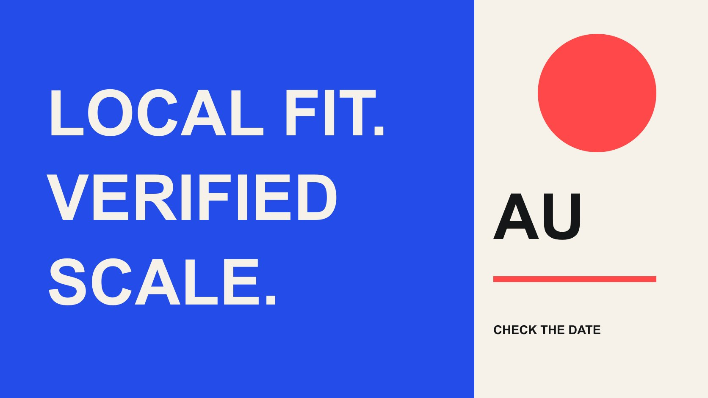

# Entrepreneurship Micro Influencers on Instagram AU: Verify the Fit

Status: local review draft; confirm the publication date before release.

Turn an Australian Instagram entrepreneurship micro-creator search into a reproducible shortlist, checking identity, local relevance, dated scale and commercial readiness separately.

QuickKOL editorial graphic; not actual account metrics or a platform interface.

For entrepreneurship micro influencers Instagram AU, define AU as Australia, the entrepreneurial content job and the project’s scale range. Separately verify individual, business or community accounts, Australian relevance and a dated follower observation. Do not label names qualified micro-creators without current evidence. Creator location, content location and audience geography are different conditions, while delivery needs relevant work and direct confirmation.

## Translate the query into an Australian business task

The query may come from software, business services, entrepreneurship education or a local event brand. Define the job: explain a founder’s actual process, address a small-business operation, host a local event or perform another specific task. An entrepreneurship label does not establish every business capability, and the assignment should not default to income promises or investment advice.

The [Australian entrepreneurship teaching-role guide](/blog/australian-entrepreneurship-micro-influencers-business-education/#answer) supports initial role selection. This article verifies the account subject, local evidence and scale state. Specify audience, market, task and delivery before searching. Find a few small Australian accounts is not a complete brief.

AU means Australia in this research. English-language accounts and people who once filmed locally do not automatically qualify. A live appearance needs actual attendance conditions; an Australian audience requirement needs matching evidence. Both can matter without substituting for each other. This distinction lets a brand search for a useful role rather than combining several loose signals into an apparently verified local candidate. Keep the requirement explicit so another colleague knows whether location, audience or delivery capability controls the next decision.

## Identify an individual, business or community account

An account may center on an individual founder or represent a company, institution, publication or community. Each can offer marketing value while involving different partners and deliverables. Retain the account link, stable identifier, subject and public work. Founder in a biography does not necessarily establish an individual creator.

An on-camera individual, business tutorial and community-event audience need different evidence. A company’s followers should not become its director’s personal influence, and community work does not establish that every member can host or produce. Ask who appears, makes, publishes and can accept commercial terms.

The [brand safety and identity research guide](/blog/verify-creator-brand-safety/#answer) helps attach evidence to the appropriate subject. Keep necessary public business contacts without guessing private locations or emails. Investigate shared names, renamed accounts and agent roles instead of turning an inconsistency into an accusation. The screening record should tell the next colleague how far verification has progressed. This is especially useful when a discovery tool returns a mixture of founders, agencies and publications under the same topic, since a shared keyword should not erase their different roles in an actual commission.

## Keep Australian relevance in distinct evidence fields

Record public creator location, content location, attendance feasibility and audience geography separately. Someone may operate in Australia while serving a global audience, or be elsewhere while well placed to explain a local task. Fit depends on the brief rather than one city tag.

Public sites, appropriate business information and relevant works provide leads, with direct confirmation of current conditions where needed. Do not infer nationality or geography from a photograph, accent, name or English use. Country information describing viewing or reach should not be renamed follower location.

Date every source so changed locations do not remain permanent facts in the sheet. For an event, confirm dates and actual travel feasibility. For an online explanation, confirm language, served market and accurate context. Local fit is a set of task-related conditions, not certification produced by Australia appearing in a search. Preserve unknowns with a specific next question and owner. The record then distinguishes someone who can attend, someone whose work concerns Australia and someone with appropriate audience evidence, allowing the brand to choose the condition it actually needs.

## Give micro a project definition and observation date

Define the scale category first. A project might use a hypothetical 10,000–100,000 follower screening range, but this is an editorial example, not a universal industry standard or platform eligibility condition. Decide whether the assignment needs that boundary rather than letting scale replace fit.

Retain platform, account, observation time, displayed value and precision. A public 10K display is not an exact 10,000. Near a boundary, request clearer shareable evidence if the distinction matters. Cross-platform followers should not become Instagram scale, and views or monthly audiences are not followers.

Mark current scale unverified when it cannot be observed. Prior appearance on a list does not preserve micro status indefinitely. Update changes while retaining older observations as history. A clear range and date are more transferable than an unsourced Australian micro-entrepreneur list. This article does not provide names asserted to meet a current threshold without evidence. That restraint lets the team maintain a reusable method instead of publishing a roster whose apparent precision depends on counts nobody recorded or definitions that change between candidates.

For example, a hypothetical six-month-old kit might list 50,000 followers without a checkable current record. It supports historical scale, not automatic passage through today’s screen. Request suitable new evidence or let the owner decide whether scale changes this task. Do not silently relabel history as live observation merely to complete the candidate count.

## Discover work through task and location combinations

Search by task, then combine location and role. Prepared starting queries might include Australia small business founder Instagram, Melbourne business systems creator or Sydney founder workshop host. These are editorial query ideas, not verified results or a promise of complete platform coverage.

Move from results into public work and record relevance: a comparable process explanation, genuine business situation or suitable hosting example. Biography keywords alone are insufficient. A small work sample can inform the next question without becoming representative research into a population or an opaque automatic ranking.

Retain discovery route, work, subject, local conditions, scale state and next inquiry. Deduplicate by account identifiers rather than counting one person’s several accounts as independent candidates. QuickKOL can help interpret a brief, discover related creators and research work and contact routes. Audience evidence, commercial conditions and outcomes still need verification. A useful shortlist should make that distinction visible: discovered means a promising research lead, not qualified, available or willing. This prevents downstream teams from turning search output into a promised roster before the necessary confirmation occurs.

## Check private-data provenance and sharing conditions

The [Meta official API collection overview](https://www.postman.com/meta/instagram/collection/6yqw8pt/instagram-api) provides context for professional-account integration, not a promise of private reports for any candidate. Check the actual product, account, authorized object and available fields when using tools or sharing. An analytics module does not make every value native, live and verified.

Request evidence around the present decision, such as an available shareable geography report with its field, window and capture date. Allow explanations of unavailable data. Do not collect complete follower identities or account passwords, or fill country shares from comment language. Distinguish screenshots, authorized observations and estimates.

When sources disagree, compare objects and time first. The task is fit research, not a fraud finding from one discrepancy. Pause or choose narrower work if an essential condition cannot be verified. Hand limits over with conclusions so the next owner knows which evidence exists and which assumptions await a response. This keeps a discovery workflow useful even when a candidate can provide only part of the desired information, without creating a false appearance of complete audience verification.

## Include Australian commercial claims and relationships

[ACCC social media guidance](https://www.accc.gov.au/business/advertising-and-promotions/social-media-promotions) explains that Australian Consumer Law applies to social advertising and statements should be truthful, accurate and supportable. Software effects, service capability and business experience in entrepreneurship content need accurate expression. A smaller creator’s reputation does not verify the brand’s claims.

The [ACCC 2023 influencer sweep](https://www.accc.gov.au/system/files/social-media-influencer-testimonials.pdf) reported concerns in content from 81% of 118 reviewed accounts. Selection used public tip-offs among other routes, rather than a random sample. Published in December 2023, it is not today’s violation rate for all Australian or micro accounts, or a legal finding against every reviewed account. It supports attention to commercial relationship presentation, not suspicion of an individual candidate.

The brief should identify fees, samples or support, permitted claims, disclosure, factual review and publication versions. A process explanation retains the conditions of personal experience rather than promising income or universal outcomes. Appropriate project review remains necessary; this article supplies research and handoff methods, not compliance certification. Keep the historical report’s scope with the statistic when citing it, so a useful disclosure lesson does not become an unsupported claim about the current entrepreneurship niche.

## Turn candidate states into executable next steps

Suppose three candidates are an individual, company and community account. The individual has relevant work but unverified scale. The company has local-service evidence without necessarily providing a personal endorsement. The community has event work while the host remains unconfirmed. These are hypothetical categories, not real names or a qualified roster. A recommendation field does not justify changing unknowns into passes.

Give each gap an action: confirm scale, ask who appears, request a matching report or discuss the task and dates. Conditions must be confirmed before becoming commitments. If someone outside the initial range better serves the job, an owner can revise the criterion with a reason rather than silently changing the definition for one person.

The output of entrepreneurship micro influencers Instagram AU should be a shortlist with sources, dates and states. Local fit, work, scale and acceptance jointly support the decision; none automatically replaces the others. This gives the brand a clear contact step and treats candidates according to actual evidence. A reproducible selection record is more useful than a supposedly definitive list that cannot explain its category, observation date or unresolved conditions.

## Australian entrepreneurship candidate record

| Condition | Evidence | State or next question |

| --- | --- | --- |

| Subject | Account and individual or organization role | Who appears, makes and publishes? |

| Australian relevance | Separate location, work, audience and attendance | Which condition serves this task? |

| Scale | Project range, platform, date and precision | Verified or pending |

| Readiness | Task, timing, claims, disclosure and acceptance | Next inquiry and owner |

No currently qualified roster without current observations; a project scale range is not a universal industry standard.

## AU entrepreneurship research checks

Turn search results into evidence-based candidates.

- [ ] Define AU and the business task.

- [ ] Distinguish individual, business and community subjects.

- [ ] Check local location, content and audience separately.

- [ ] Retain the micro range, date and precision.

- [ ] State private-data provenance and access scope.

- [ ] Hand over unknowns, next questions and owners.

## Research date and limitations

Initial research was conducted October 29, 2026, with additional verification October 30. Methods, examples and tables are editorial recommendations; hypothetical numbers are not industry benchmarks. Named entries support research, not live rankings, endorsements, availability or acceptance. Interfaces and data depend on accounts, permissions and versions. Some Meta help pages could not be fully retrieved, so unverified button paths and fixed thresholds were excluded. These drafts are in independent local review; confirm publication dates before release.

## Sources

- [Meta: Instagram API collection overview](https://www.postman.com/meta/instagram/collection/6yqw8pt/instagram-api)

- [ACCC: Social media promotions (Australia)](https://www.accc.gov.au/business/advertising-and-promotions/social-media-promotions)

- [ACCC 2023 influencer sweep](https://www.accc.gov.au/system/files/social-media-influencer-testimonials.pdf)
