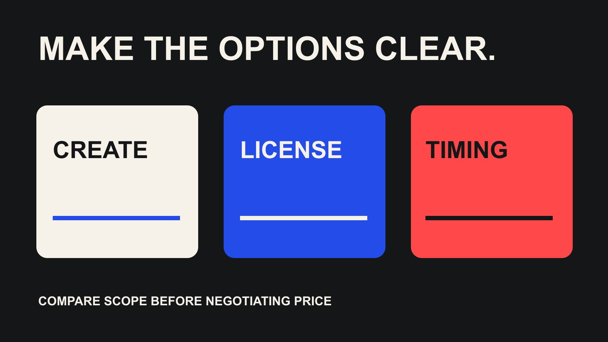

# 如何与达人谈合作：用不同范围方案替代单纯压价

状态：本地审阅稿；正式发布日期待确认。

把预算讨论转成可比较的制作、使用和时间方案，明确交换条件、批准权与最终接受记录。

QuickKOL 编辑图形；不呈现真实账号指标或平台界面。

How to negotiate with influencers 的有效起点，是确认双方讨论同一份工作，再提出能真实接受的范围、许可与时间组合。先问报价包含什么、哪项条件最影响工作，再比较方案；不能只拿不同报价的总价当作同一种商品。最终接受应明确到版本与条件，而不只是聊天里一句“价格可以”。

## 先判断差距来自价格还是工作内容

收到超预算报价后，先检查交付、制作复杂度、发布、修改、素材和使用范围。创作者可能把长期广告或额外版本包含在内，而品牌只想要一条自有账号内容。若双方讨论对象不同，直接压低百分比会掩盖问题，也可能让对方以为你希望原范围保持不变。

[达人反报价字段指南](/zh/blog/influencer-rate-card-counteroffer-data-model/#answer)可以帮助对齐币种、范围与缺失条件。本篇进一步准备可讨论方案。把已确认、待确认和可取消的项目分开，找出实际业务必须保留的部分。不要用另一位创作者更便宜的报价，证明当前报价不合理；两者任务和条件可能并不相同。

先向内部确认预算是制作上限、整个项目上限，还是尚未批准的目标。含税、寄样、代理和许可是否另占空间，也要清楚。谈判人需要知道自己能够承诺什么；如果每个方案最后都要推翻，外部沟通再流畅也无法形成可履行安排。

## 从多议题准备真正可接受的方案

[Harvard PON 多方案谈判说明](https://www.pon.harvard.edu/daily/dealmaking-daily/the-benefits-of-multiple-offers/)介绍 MESO：同时提出对提出方价值相当的不同组合，用来理解另一方偏好。关键是对己方等价值，不是三个价格一样，也不是随便列三个套餐。该说明不能保证任何创作者接受，本文的普通范围方案也不自动构成严格 MESO。

品牌可以先评估哪些条件有真实价值：广告期限、独家范围、发布数量、交付时间或素材版本。创作者也可能对这些条件有不同成本。把价值判断留在内部并形成可解释选择，不对外假称某种条件“对你没有成本”。

只提出团队愿意接受的方案，不拿一个不想成交的选项作装饰。若某项许可根本不能购买，删除它，而不是继续把它放在低价方案里试探。选项的作用是发现可行交换，不是用复杂包装让对方漏看重要条件。可以先讨论优先级，再发送清楚的完整组合。

## 把制作、发布与许可分开比较

制作一条视频、在创作者账号发布、品牌取得文件和广告使用，是不同购买对象。先确定每项是否需要，再决定怎样组合。不要把“需要成片”扩写成需要全部原片，也不要把品牌自有账号使用默认扩大到零售伙伴、多个地区和无限期限。

[美国版权局版权说明](https://www.copyright.gov/what-is-copyright/)提供原创表达与权利的基础背景。具体使用仍要核对适用法律和约定，不能因为支付制作费就假定全部权利转移。范围讨论需要明确渠道、地区、时间、编辑与其他条件，而不是只写一句“可商用”。

缩短某项期限或减少版本，可能形成不同方案，但费用变化由双方商议，不存在通用折扣公式。若品牌必须保留某种用途，坦率说明它是核心条件，并讨论能够支持的预算。若条件无法兼容，合理结束比先接受模糊范围、开工后再补谈更清楚。

## 用一组假设方案练习范围交换

假设原方案为 1,600 美元，包含一条成片和一段已写清的广告使用，品牌目前最多能承诺 1,200 美元。可以先问是否愿意讨论更短广告期限、减少交付或更灵活的制作时间，而不是宣布对方必须接受某个新价格。这些数字只是策划假设，不是市场费率或已接受报价。

例如，方案甲保留原任务与预算；方案乙提出减少广告期限并请求重新报价；方案丙提出自有账号用途与较晚交付，再询问是否可行。不要把“预算上限”写成对方已经接受的费用。只有创作者确认了具体组合与报价，才有可比较的真实方案。

这些组合对品牌未必等价值，因此不自动叫 MESO。内部要说明哪一项仍能完成业务任务、哪一项只是备用。若延迟本身不创造对方价值，不能宣称改期必然便宜。问清偏好与成本，再决定，而不把假设交换包装成行业规律。

## 让时间、修改与访问都有具体对象

“时间灵活”需要说明可以移动哪个阶段：寄样、拍摄、交稿还是发布。修改也要区分修正约定内错误与新增内容。一个额外开头、另一种语言或新市场，可能涉及新的工作。不要用笼统的“改到满意”为低价方案隐藏无限责任。

[YouTube 品牌伙伴访问说明](https://support.google.com/youtube/answer/15672082?hl=en)提醒合作方分别讨论数据共享与内容使用。报告访问、账号设置和广告许可应有不同记录，不能把一个平台操作当作全部商业条件已经达成。确认对象、负责人、期限与撤销影响，不索取无关账号密码。

把这些内容放回每个方案，保持相同字段。否则一个选项写得详细，另一个只有总价，读者会误以为缺失条件等同于没有限制。缺失就是待确认。让对方能够指出哪项最影响工作，也让品牌知道哪些交换真正可执行，而不是把未定义事项留到最终签署或开工时才发现。

## 记录让步与交换，不逐条拼最低条件

每次调整记录提出人、原因、原条件、新条件与相互依赖。对方接受较短期限下的价格，不表示原来较长期限也可用这个价格。不要从三个不同组合中抽取各自最有利部分，再认为全部已经被接受。

[达人谈判回复指南](/zh/blog/creator-negotiation-response-playbook/#answer)可以帮助把讨论写成清楚答复。表达可以简洁：说明目标、当前理解、可接受选择和需要确认的问题，不用虚构其他报价或假装最后期限。若期限来自实际活动或审批，说明事实；若只是希望尽快回复，不把愿望包装成对方必须立即决定的条件。

新的让步应由有权的人确认。内部团队改变使用需求时，更新所有受影响方案，并通知创作者。保留撤回或过期的选项，避免另一位同事引用旧邮件继续承诺。谈判记录的价值在于让已交换条件保持完整，不是统计谁每轮少付或多让了多少。

## 把下一封回复写成范围询问

在前述假设预算下，回复可以说明：我们目前可批准的上限为 1,200 美元，希望先确认报价中的广告范围。是否愿意讨论更短使用期，或仅用于品牌自有账号的版本？请分别说明可行范围与完整费用；如果不适合，我们可以结束本次讨论。这个示例是待讨论请求，不是创作者已接受的条件。

发送前确认内部真的能够批准所提组合。回复后，不只摘取数字，把对方对范围、排期和限制的说明一起保留；若只答复一项，不推定其他项目全部同意。

## 接受完整版本，再交接执行

最终确认应包含交付、发布、文件、费用与币种、税费处理、付款条件、时间、修改、使用和仍待解决事项。这里是交接字段建议，不是无需适当审阅的完整合同。若关键条件未接受，不能只凭“价格可以”安排不可撤回的工作。

把接受日期、双方确认与批准版本连接到制作和财务记录。让创作者收到一份一致信息，也让内部团队知道哪些内容不在范围内。若对方提出自己的条款，先按适当流程处理，不用品牌模板默认覆盖已经讨论过的事项。

开工后新增需要回到变更记录。谈判结束不等于范围永远可以随意扩展，合作关系良好也不等于可以省略确认。交接的下一步应说明谁发送 Brief、谁提供样品、谁汇总修改，以及谁在条件变化后重新决定，而不只是在表里把状态改为成交。

## 无法达成时保留清楚的结束与学习

如果预算、任务与条件无法兼容，可以说明本次不能继续，并保留是否适合以后讨论的真实状态。不要承诺没有依据的未来项目作为本次降价交换，也不要求对方先做完整创意提案来证明值得合作。

记录差距来自哪项条件，以及下次应该先准备什么。可能是品牌需要更准确的使用范围、更早安排样品，或者选择另一种内容任务。不能从一次未成交推导创作者不专业，也不根据其拒绝价格判断整体市场。

How to negotiate with influencers 最终要解决的是怎样形成双方能够履行的合作，而不是怎样保证所有人接受品牌预算。清楚的方案、真实的权限和完整接受记录，比一个孤立的最低价格更能支持后续交付。把这些信息留给下一位同事，谈判才真正进入可执行阶段。

## 可讨论的方案字段

| 方案 | 改变什么 | 必须确认 |

| --- | --- | --- |

| 保留原范围 | 原任务与原条件 | 预算是否可批准 |

| 缩小使用 | 更短或更少的已明确用途 | 新的完整报价与可行性 |

| 改变制作安排 | 交付、版本或实际时间 | 是否对双方有价值且可执行 |

不是固定价格或等价值保证；严格 MESO 要求提出方先评估各组合价值相当。

## 发送方案前检查

只发送有权且愿意接受的完整组合。

- [ ] 核对工作、币种和预算范围。

- [ ] 确认不可缺少与可交换的条件。

- [ ] 给各方案保留相同字段。

- [ ] 不把预算上限当作已接受报价。

- [ ] 记录交换条件、版本与批准权。

- [ ] 完整接受后再交接制作与财务。

## 研究日期与使用边界

资料初查于 2026 年 10 月 29 日，补充核验于 10 月 30 日。方法、示例与表格为编辑建议，标为假设的数字不是行业基准。具名入口用于研究，不代表实时排名、背书、档期或接受合作。当前平台界面与数据取决于账号、权限和版本；部分 Meta 帮助页面无法完整读取，因此未采用未核验的按钮路径或固定门槛。这批稿件处于独立本地审阅阶段，正式发布日期待确认。

## 来源

- [Harvard PON 多方案谈判说明](https://www.pon.harvard.edu/daily/dealmaking-daily/the-benefits-of-multiple-offers/)

- [美国版权局：What is Copyright?](https://www.copyright.gov/what-is-copyright/)

- [YouTube 品牌伙伴访问说明](https://support.google.com/youtube/answer/15672082?hl=en)
