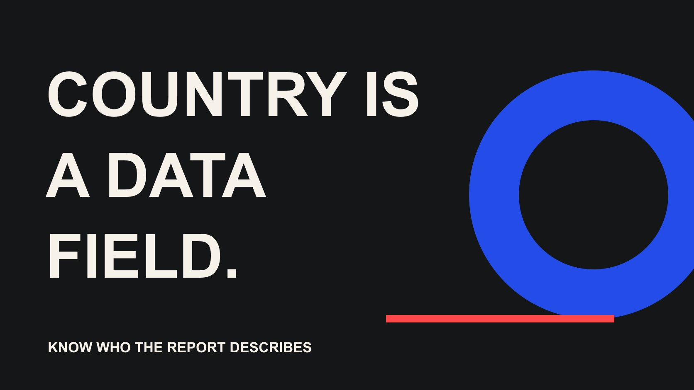

# 怎么看粉丝来自哪些国家？先确认指标、权限与缺失值

状态：本地审阅稿；正式发布日期待确认。

先确认账号权限和受众对象，再读取国家分布，区分粉丝、观看者与触达，并保留缺失和估计的限制。

QuickKOL 编辑图形；不呈现真实账号指标或平台界面。

要看粉丝来自哪些国家，先进入你拥有或获授权账号的原生分析，确认报告描述的是粉丝而不是观看、触达或互动受众，再读取实际可用的国家分布。评估别人的账号时，请对方提供带账号、字段和日期的合适报告。公开主页、创作者所在地和内容语言，都不能独自证明粉丝国家比例。

## 先判断你在看自己的账号还是候选账号

自有账号与研究别人的账号，能采取的操作不同。先确认你是否拥有适当访问，是否进入正确账号，以及报告权限是否仍有效。品牌在研究公开候选时，不应假定可以查看其私有受众；账号公开也不代表所有分析数据公开。

[Meta 官方 API 集合介绍](https://www.postman.com/meta/instagram/collection/6yqw8pt/instagram-api)面向 Instagram 专业账号的接入与管理。它提供合适接入路线的背景，不承诺任意账号、全部人口字段或任意历史都可获得。若使用工具，确认具体连接产品、授权对象与当前返回字段，不从工具名称推断数据已经原生核验。

仅为完成国家研究，不需要收集无关私人信息或把密码放入项目表。对于候选创作者，先说明业务问题与需要的有限证据，再由对方选择适当共享方式。[受众质量核验指南](/zh/blog/audit-creator-audience-quality/#answer)可帮助把访问状态、来源与未知字段分开；没有权限时，下一步是合适的请求，而不是猜测。

## 打开实际可用报告，先读字段再读数字

在 Instagram 等平台的自有分析中，先寻找当前提供的受众或粉丝报告，再确认其中是否有国家或地区字段。菜单名称、资格和可用范围可能随账号与版本不同；本篇不承诺统一按钮路径、固定粉丝门槛或所有账号都能显示同一列表。

如果找到分布，保存账号、报告名称、字段、所选时间、取得时间与必要截图。确认它描述的是粉丝、触达、互动还是其他对象。若没有相应字段，先核对账号、权限、时间范围和报告说明；不要把空白截图改成“全部来自本国”。

手机与桌面可能展示不同报告，因此也记录取得方式。若界面只列主要国家，不自行补齐其他国家；若字段是估计，保留其性质。检查的目标是得到与业务问题一致的可解释数据，而不是一定找到一张国家饼图。没有合适报告时，明确证据暂不可用，继续选择可执行的下一步。

## 粉丝、观看者和观看时长不是同一人群

粉丝存量描述账号关系，观看受众描述某段时间发生的观看，触达与互动也有各自定义。不能因为它们都在“受众”页面，就用同一个国家比例描述。先为每个数字写对象、单位与窗口，再决定它回答哪个问题。

[YouTube 受众说明](https://support.google.com/youtube/answer/9314416?hl=en)给出 Studio → Analytics → Audience 的查看路线，并说明 Top geographies 按频道观看时长列出主要地区。这不是订阅者国家比例。同一指南的 monthly audience 使用过去 28 天独立观看者估计，也不是永久粉丝总量。本文引用这些定义说明为什么跨平台名称不能直接互换。

如果问题是当地客户能否接触到某条合作内容，整体粉丝分布可能只提供背景。需要时补充与该内容和市场相配的可用观察，而不把全账号比例直接乘到视频观看上。数据更多不等于更准确，关键是每项对象是否服务同一个决定。

## 记录分母和覆盖，避免补出不存在的人数

百分比需要知道分母是什么。某国占已显示结果、全部可用粉丝数据、观看时长或其他对象的比例，意义不同。若来源没有清楚定义，就记录未知，不根据图形大小推算精确人数。国家、城市与语言也不能直接混成相同层级。

假设某份明确标为粉丝的报告中，某国占 40%，账号总粉丝为 10,000。只有定义、覆盖和时点匹配时，才可以说明算术估计为 4,000；它不是独立核实的个人名单，更不代表 4,000 名潜在买家。这是解释分母的假设，不是平台数据。

如果报告只显示前几项，不将它们重新归一化后冒充完整分布。保留原数值、未显示或未知状态，以及是否有其他类别。[指标口径记录指南](/zh/blog/creator-metric-definitions/#answer)可以帮助把这些条件写成可复核字段。一个完整而有限的定义，比多报几个小数位更适合被其他团队引用。

## 把缺失、受限与真实零分开

[YouTube 数据限制说明](https://support.google.com/youtube/answer/9101241?hl=en)指出，部分人口和地区数据可能受流量、筛选或隐私等条件限制，实际阈值未公开且可能变化。明细与总数可能不一致，不能通过差额猜出被隐藏的小人群。该平台的规则也不能直接被套成 Instagram 或其他平台的统一门槛。

同一份报告里，未显示、不可用、未核验与已确认零应保留不同状态。更改时间或筛选有时能改变可见范围，但新的窗口回答新的问题，需要保留变更；不能为了出现想要国家，反复移动窗口后只留下最有利结果。

若关键市场数据受限，说明当前决定受到什么影响。可以暂停短名单判断、请求适当补充，或选择不依赖该字段的有限任务。不要把缺失直接判成账号可疑，也不因为一张报告不完整就宣称创作者没有当地受众。证据状态描述数据，不应成为没有依据的个人评价。

## 研究候选时发送一个有限证据请求

请求可以写清账号、平台、需要的对象、当前可用窗口、国家分布与取得日期，并允许对方说明缺失条件。不要求无关的完整粉丝名单、私人位置或密码。品牌通常需要判断任务适配，不需要知道每一位粉丝是谁。

收到截图或导出后，核对账号标识、字段标签、窗口与显示精度。创作者提供的记录可以支持有限判断，但不能改名为品牌已经独立审计。若重要条件看不清，提出一个具体补充问题，而不是怀疑性地要求更多私人资料。

把公开研究、创作者提供、原生授权和估计分类保存。不同来源可以并列，不一定要强行合并。一个第三方工具给出的比例与原生报告不同，先比较对象、时间与方法；不先挑更有利数值，也不凭一次差异认定欺诈。清楚的来源层级让后续负责人知道结论有多大把握。

## 不要从语言和创作者所在地推算国家

创作者住在澳大利亚、作品在日本拍摄、评论使用英语，是三个不同事实，都不能独自证明粉丝国家。公开位置和语言可以帮助发现候选，但需要国家分布时，应回到合适报告，而不是把这些线索相加成一个没有方法的比例。

同理，国家字段也不能证明个人国籍、签证、消费能力或采购资格。受众研究应保留完成营销任务需要的范围，避免把一个聚合信号扩成对每个人的身份判断。没有适合证据时，写未知，比给每位评论者贴一个猜测地区更准确。

检查报告是否真正改变合作决定。如果品牌只在一个城市提供现场服务，国家比例可能过粗，还需核对实际地点与履约条件；如果内容面向全球教育，国家也未必是主要筛选项。用业务问题决定证据需要，不让容易取得的字段替代真正需要回答的问题。

## 遇到两份不同报告时怎么做

假设一份资料称澳大利亚为主要粉丝国家，另一份显示美国带来最多观看时长。两者可能同时成立，不能直接选一个称为“正确国家”。先核对账号、对象与窗口，再判断本次任务需要哪一种。这里没有真实账号数值，仅演练不同对象的解释。

如果任务是当地受众研究，先保留粉丝证据的覆盖与日期，再说明观看背景；如果评估具体内容，则寻找与该内容相配的可用报告。若仍缺关键字段，交付待确认问题，而不是把两个百分比平均。

## 交付国家证据与它能支持的决定

最终记录包括账号、平台、对象、字段、来源、窗口、覆盖、取得日期、状态与下一动作。将“可见报告以某国为主要观看时长来源”与“粉丝多数在某国”分别表述，不能为了简洁删掉关键对象。来源变化或授权撤销后更新记录。

结论可以是继续研究、请求更合适字段、调整市场任务或暂停判断。没有证据就不填最低当地占比，也不保证任何分布会转成销售。若团队采用内部筛选线，应清楚标为该项目标准，而不是平台或行业统一要求。

How to see your followers countries 最终需要的不是一张看起来完整的地图，而是一份知道在描述谁、何时、怎样取得的证据。把这些条件留在正文、报告和交接里，品牌才更容易选对下一步，也让创作者得到与真实资料相符的评价。

## 国家字段的对象核对

| 字段对象 | 能说明 | 不能直接改名为 |

| --- | --- | --- |

| 粉丝 | 来源允许范围内的粉丝分布 | 所有实际观看者 |

| 观看时长 | 观看时间的地区分布 | 订阅者国家比例 |

| 触达或互动 | 所选窗口与定义下的对象 | 全部粉丝或购买者 |

| 创作者所在地 | 个人公开位置线索 | 受众国家证据 |

实际可用字段依赖账号、权限和报告；缺失与真实零分开。

## 国家分布交接检查

先知道报告在描述谁。

- [ ] 确认账号与适当访问。

- [ ] 保留字段对象、单位与时间。

- [ ] 核对分母、覆盖和显示精度。

- [ ] 区分提供记录、授权观察与估计。

- [ ] 不从语言或创作者位置推算比例。

- [ ] 交付有限结论与下一证据请求。

## 研究日期与使用边界

资料初查于 2026 年 10 月 29 日，补充核验于 10 月 30 日。方法、示例与表格为编辑建议，标为假设的数字不是行业基准。具名入口用于研究，不代表实时排名、背书、档期或接受合作。当前平台界面与数据取决于账号、权限和版本；部分 Meta 帮助页面无法完整读取，因此未采用未核验的按钮路径或固定门槛。这批稿件处于独立本地审阅阶段，正式发布日期待确认。

## 来源

- [Meta：Instagram API 集合介绍](https://www.postman.com/meta/instagram/collection/6yqw8pt/instagram-api)

- [YouTube：Understand your audience](https://support.google.com/youtube/answer/9314416?hl=en)

- [YouTube：Understand limited data](https://support.google.com/youtube/answer/9101241?hl=en)
