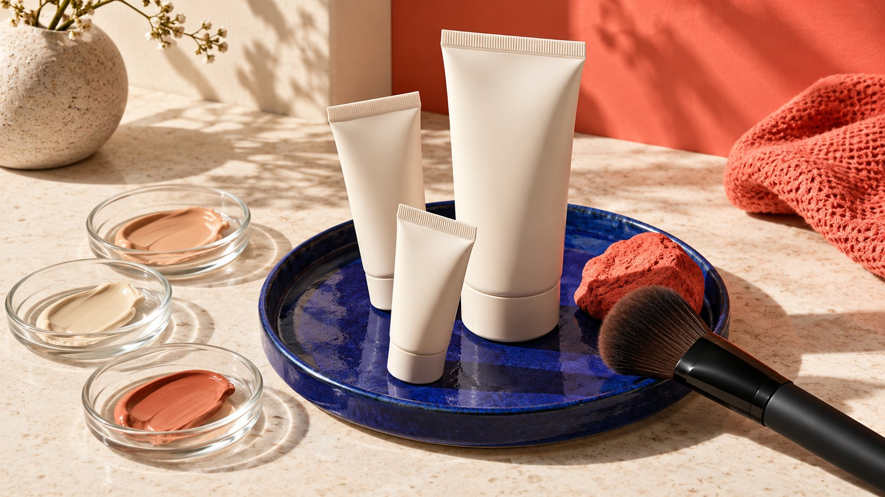

# Top Beauty Influencers: Separate Experience From Product Claims

Status: local review draft; confirm the publication date before release.

Research distinct roles in beauty science and makeup education, then match experience, technique and product claims with appropriate evidence and review.

AI-generated editorial illustration, not an actual creator, client, product or event.

When researching top beauty influencers, distinguish personal use, makeup technique, scientific explanation and product claims. Lab Muffin and Lisa Eldridge provide different public research routes, not a live ranking or partnership promise. Experience does not replace performance evidence, and expertise does not automatically verify a finished product. Connect each claim with its source, scope and actual published version.

## Separate beauty tasks by their evidence needs

A swatch can show color under particular light and capture conditions. A tutorial can explain technique. Science content can discuss concepts and evidence. These jobs are not interchangeable. Define the audience question and required capability rather than using beauty influencer as a label for every need.

List preference, observable operation, product fact and outcome claim separately. Personally finding a texture lightweight differs from saying everyone will improve a particular concern. The brand supplies the correct version and suitable supporting material; the creator should identify what they have not experienced or cannot assess. Smooth promotional expression is not a reason to erase those distinctions.

The [beauty content role guide](/blog/top-beauty-influencers-by-content-job/#answer) helps with initial work matching. This article focuses on claim review: who supplies evidence, who checks facts, which sentences need narrowing and how short versions retain conditions. Choose from the specific task and public work rather than recognition rankings without a date, definition or method. Audience and commercial conditions still need separate verification. A candidate who presents technique clearly may serve a different need from someone explaining scientific evidence, even when both publish about the same product category.

## Lab Muffin: study science explanation and boundaries

The [Lab Muffin official profile](https://labmuffin.com/about-michelle/) describes Michelle Wong as a chemistry PhD and science communicator and explicitly states that she is not a medical professional. It is a first-party route into beauty-science explanation, not a clinical qualification or proof that she has verified the reader’s product. This article does not infer current availability or acceptance of any brand request.

Inspect how public work defines a concept, distinguishes research subjects from finished products and communicates uncertainty. Ingredient-level information does not automatically establish a formulation’s results under every use condition. An invitation should identify the material the brand actually has rather than expecting the creator’s professional reputation to close an evidence gap.

A similar explanatory assignment can begin with what a term means or how far a document supports a claim. Route subjects outside the relevant expertise or needing another kind of review to suitable people. One creator should not be expected to answer everything. Accurately explaining what remains unknown may have more educational value than an absolute verdict. Evaluate that ability in the work itself while keeping biography, current data and agreed commercial scope as separate verification tasks.

## Lisa Eldridge: study technique and commercial context

The [Lisa Eldridge official biography](https://www.lisaeldridge.com/pages/my-world) provides context about makeup artistry, educational work and an owned brand. It is useful for studying how operational choices are explained, not evidence of openness to every competing product. Promotional biography language is not an independent trust ranking, and historical total views do not predict this assignment’s results.

Choose a relevant tutorial and inspect how tools, amount, sequence and reasons are presented. For a brand explaining application, these questions may be more useful than a generic recommendation. A technique demonstration does not establish a skincare or treatment outcome, and attractive footage does not replace finished-product fact checking.

For a similar role, discuss product range, shades, filming conditions, trial and necessary limitations. An owned brand, advisory role or other commercial relationship can affect fit and requires appropriate confirmation. Public instruction provides research leads; the invitation still needs room for the person to assess suitability. Recognition is not a pre-acquired partnership resource. Describe the content task clearly enough that both sides can distinguish a technique lesson from a testimonial or a broader product-performance claim before either begins production.

## Connect product claims to appropriate support

Create a concise claim record with wording, intended use, market, evidence, conditions, owner and state. Replace unsupported absolutes with an accurate scope rather than attaching subject to actual results to the entire sheet. Images, captions, audio and before-and-after presentations also communicate meaning; review should not stop at the spoken script.

[FDA cosmetic claims guidance](https://www.fda.gov/cosmetics/cosmetics-labeling/cosmetics-labeling-claims) states that US cosmetic labeling must be truthful and not misleading. Claims involving disease treatment or prevention, or effects on body structure or function, can bring drug requirements into consideration. FDA also says it does not preapprove cosmetic claims and identifies FTC as responsible for advertising claims. This US context should not be applied automatically to every market.

An expert explanation or existing label is not sufficient reason for unlimited reuse. Have appropriate people review product classification, supporting material and expression. This article does not provide individual care advice. The creator needs understandable facts and limitations, not a list of claims they are expected to validate through personal reputation. Keep the evidence location available to reviewers and identify which statement must wait, narrow or be removed when adequate support cannot be produced.

## Preserve experience through accurate capture conditions

For swatches and texture demonstrations, retain the product, shade, lighting, camera treatment and relevant steps. Capture conditions affect appearance. Postproduction should not create an effect the product did not produce. A brand can improve clarity without using filters, retouching or cuts that alter the audience’s understanding of performance.

Genuine experience requires suitable time and actual use, with alternatives or a stop route when use is not appropriate or possible. Do not ask a creator to continue an unsuitable attempt merely to deliver, or request unrelated private health information. Packaging, usage information or another accurately achievable job may be a better scope, subject to agreement.

For before-and-after material, document consistent conditions, interval and other relevant changes. A visible difference does not establish that the product caused all of it. Preserve the limit or choose another expression when the context cannot be explained. A clear experience statement identifies who observed what under which conditions. It should not transform one person’s appearance into a guaranteed result for everybody. Recheck this distinction in still images, where the surrounding explanation may disappear while the implied comparison remains prominent.

## Clarify the relationship behind the explanation

The [FTC endorsement FAQ](https://www.ftc.gov/business-guidance/resources/ftcs-endorsement-guides-what-people-are-asking) addresses material relationships, genuine experience and supportable claims in US advertising. Review fees, samples, commissions and other arrangements according to the facts. Educational content is not proof that no commercial relationship exists. Explanation and sponsorship can coexist when claims and relationships are represented accurately.

Put disclosure into the actual version rather than only the brief. Long videos, extracts, translations and advertisements may circulate separately, requiring another check of whether people can understand the relationship. Confirm settings for the actual channel instead of assuming one checkbox covers every later use.

Agree on factual review and opinion boundaries. The brand may correct a model, shade or citation error without requiring a disliked texture to become a positive experience. Narrow or remove an unsupported claim, and reconfirm changed scope. Accurate commercial presentation depends on consistency between work, evidence and relationship, not a universal disclaimer. Keep the approved file and conditions available so a later sales team does not strengthen the statement when reusing it in a shorter format. The most flattering isolated sentence may not preserve the meaning of the original explanation.

## Preserve limitations in reused versions

The [content usage schedule guide](/blog/influencer-content-licensing-paid-media-schedule/#answer) helps separate owned-account, advertising, sales-material and regional-partner use. A watchable original does not automatically permit downloading, redubbing or unlimited editing. Confirm files, territory, channels, term and permitted changes, especially treatments that alter the creator’s expression.

Create an index connecting original time codes, product version, claim record and approval. Removing for me or during this trial can turn an observation into a general outcome. A stronger translation can do the same. Have reviewers inspect the complete derivative rather than only the newly added caption.

If formulation, name or market availability changes, check whether older material remains applicable. A license still being in term does not make the facts permanently accurate. Assign expiry, removal, replacement and renewal actions. That supports continued use of understandable material instead of repeated copying of outdated wording between teams. Keep the original context retrievable so another colleague can distinguish a valid current adaptation from a version that needs a factual update, a new permission or both before its next publication.

## Hand over a shortlist as an evidence task record

Suppose a brand wants to explain foundation application. It may choose technique instruction, with accurate shades and capture conditions, rather than asking the creator to verify broad skincare effects. If performance claims are added later, supply appropriate material and review. Inviting a knowledgeable person does not remove that need. This hypothetical brief is not a partnership plan involving either named reference.

Hand over the content job, relevant work, unknown conditions, product facts, claim evidence, actual versions and next inquiry. Without current observations, do not populate guessed followers, prices or audience shares. Both research routes in this article require further task-specific verification before a purchasing decision.

Professional beauty collaboration matches statements with evidence and keeps unconfirmed matters within visible boundaries. Top should serve that judgment rather than function as an unexplained adjective. Preserve the same standard through selection, production and reuse. The resulting material is more useful for readers to understand, cite and apply to actual decisions. A concise evidence record can support that standard better than a long promotional shortlist that treats recognition, expertise and verified product outcomes as though they were the same thing.

## Beauty expression and evidence

| Type | Retain | Does not replace |

| --- | --- | --- |

| Experience | Actual use, period and personal context | Evidence of everyone’s outcome |

| Technique | Steps, tools, product and capture conditions | Finished-product performance verification |

| Science explanation | Definitions, original material and scope | Comprehensive certification of every formula |

| Advertising claim | Market, evidence, scope and review | Missing evidence supplied by reputation |

First-party research routes are not rankings or partnership promises; distinguish US guidance from the actual market.

## Beauty brief review

Review statements and the meaning communicated by images.

- [ ] Define experience, technique or explanation.

- [ ] Retain relevant work and fit reasons.

- [ ] Connect claims to versions, evidence and conditions.

- [ ] Capture and editing do not create unobserved effects.

- [ ] Disclosure appears appropriately in each publication.

- [ ] Reuse preserves conditions and checks factual currency.

## Research date and limitations

Initial research was conducted October 29, 2026, with additional verification October 30. Methods, examples and tables are editorial recommendations; hypothetical numbers are not industry benchmarks. Named entries support research, not live rankings, endorsements, availability or acceptance. Interfaces and data depend on accounts, permissions and versions. Some Meta help pages could not be fully retrieved, so unverified button paths and fixed thresholds were excluded. These drafts are in independent local review; confirm publication dates before release.

## Sources

- [Lab Muffin: About Michelle](https://labmuffin.com/about-michelle/)

- [Lisa Eldridge: My World](https://www.lisaeldridge.com/pages/my-world)

- [FDA: Cosmetics Labeling Claims](https://www.fda.gov/cosmetics/cosmetics-labeling/cosmetics-labeling-claims)

- [FTC: Endorsement Guides—What People Are Asking](https://www.ftc.gov/business-guidance/resources/ftcs-endorsement-guides-what-people-are-asking)
