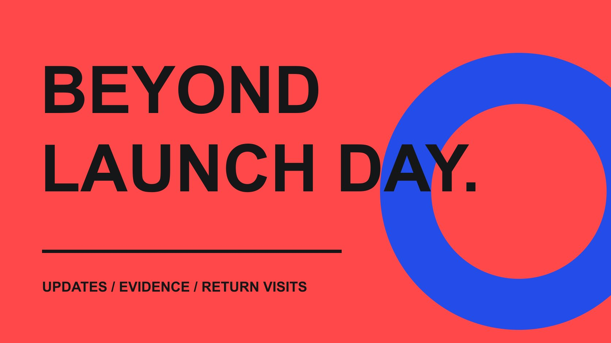

# Gaming YouTubers: Plan Coverage Beyond Launch Day

Status: local review draft; confirm the publication date before release.

Prepare version evidence and scope for post-update tutorials, design explanations and return visits while preserving accuracy and editorial judgment.

QuickKOL editorial graphic; not actual account metrics or a platform interface.

For post-update work with gaming YouTubers, choose a clear job such as instruction, design explanation or a return visit, then provide the build, change evidence, access and usage conditions. Sponsorship can purchase agreed production or publication scope, not guaranteed independent coverage or a positive verdict. Explain what changed, what remains unverified and how viewers can check their own version.

## Give post-update coverage a new question

Launch coverage may answer what the game is; follow-up work should explain what is worth understanding again. A patch, system, balance change or recurring problem can create a task. Developer importance alone does not establish an audience need for another video. Identify how the change affects a player’s actual choice or the intended audience’s work.

Separate instruction, design explanation and a return visit. Instruction needs accurate steps and prerequisites. Design analysis needs reasoning and citable material. A revisit needs genuine experience time. Different creators or lengths may suit these jobs. Do not compress them into promote it again and expect the creator to infer the assignment.

The [gaming YouTuber partnership guide](/blog/gaming-youtubers-brand-partnerships/#answer) helps with initial content fit. This article concentrates on evidence and handoffs after an update. Give every invitation a new question and explain why existing work does not already answer it. If the change lacks standalone value, update a description or wait for a more useful moment rather than forcing a commission. A precise audience problem makes outreach more credible and gives both parties a practical basis for deciding whether the proposed work belongs on the creator’s channel.

## Research format capability as well as game category

A channel that often plays the genre is not necessarily suited to system design analysis or beginner instruction. Inspect how relevant works present versions, demonstrate evidence, discuss limits and distinguish personal experience. Retain actual examples rather than treating follower size or a related game appearance as verified capability.

The [Game Maker’s Toolkit official profile](https://gamemakerstoolkit.com/) describes Mark Brown’s focus on game design and development. It is a public entry point for studying analytical storytelling, not a promise of coverage for the reader’s game. Observe how a question is broken down, then ask whether the brand has enough material to support similar depth. Do not copy the creative expression into a prescribed script.

[GMTK official inquiry routes](https://gamemakerstoolkit.com/contact/) distinguish advertising, game-review requests and consulting. That separation reminds brands to identify the request type. A contact route is not acceptance. A review invitation is not a purchased publication, and consultation is not automatically public endorsement. Use an appropriate public route to propose a concrete task while preserving space to decline or suggest another angle. The example illustrates why relationship type and content role both matter; it is not a recommendation that this particular channel is available for the assignment.

## Build a reproducible patch evidence package

Provide the version, platform, branch, region, language, patch date and public notes. Distinguish released, testing and planned changes. A roadmap intention is not an existing feature. If platforms update at different times, explain which build supports each verification rather than assuming every viewer can reproduce it immediately.

For material changes, retain previous behavior, new behavior, reproduction conditions and evidence locations. Developer explanation can help when clearly attributed as developer input. Whether a change improves the experience remains open to the creator’s judgment; patch notes are not a compulsory positive conclusion. If something cannot be reproduced, have an appropriate contact investigate instead of asking for publication first and evidence later.

List requirements for accounts, saves, servers and testing resources. Do not place passwords or private access tokens in a public working sheet; use suitable authorization routes. If a build changes during production, notify the creator which footage or statements may be affected. An accurate version package reduces the risk of discovering after filming that the demonstration differs from the audience’s actual product. It also lets the final video state a useful verification context without exposing confidential access details that do not help viewers.

## Make access and experience time fit the job

A tutorial may require verification from a fresh account; a revisit needs enough actual use; design analysis may need public documents and developer explanation. Do not impose one generic playtime on every job or invent an industry-standard number of days. Ask what conditions the creator needs for an accurate piece.

Confirm whether the environment differs from the public build, including special resources, unreleased features or prepared saves. Prepared material can support a demonstration, but avoid implying that it represents everyone’s ordinary starting experience. If servers, multiplayer availability or hardware limits affect the experience, preserve that context instead of editing away essential conditions.

Provide a new decision for faults, access failures and delayed builds. Adapt, reschedule or stop rather than demanding conclusions before experience is possible. Assign ownership for distributing and recovering codes, loan equipment and access. Confirm these dependencies alongside content scope so a simple-looking invitation does not create unpredictable troubleshooting work. The creator’s time and the brand’s support capacity both belong in the plan. A workable schedule should include the conditions needed to gather evidence, not merely a desired upload date after an assumed frictionless trial.

## Separate sponsorship scope from independent review

Identify what the brand is purchasing: a sponsored segment, commissioned tutorial, developer interview, production assets or another accepted scope. Providing a product or access does not establish a review commitment. For independent editorial work, factual checking should not become brand control of the final opinion.

[YouTube branded-content guidance](https://support.google.com/youtube/answer/154235?hl=en) describes paid-promotion notification and responsibilities. Treat the actual commercial relationship accurately for the channel and market; adding independent to an invitation does not erase it. If a review invitation becomes paid commissioned work, reconfirm scope, disclosure, fees and publication conditions.

The brand can correct a version, name or fact and provide verifiable supporting material. When a conclusion is unfavorable or different, investigate factual issues rather than requesting that opinion become advertising copy. Resolve different understandings of the content job before production. Clear request types reduce a late dispute about whether favorable coverage was supposedly purchased. Keep the accepted arrangement accessible to the publisher and editor so the final treatment matches the real relationship, including when a sponsored explanation and unrelated editorial work coexist on the same channel. Neither should silently be represented as the other.

## Check footage, music and downstream reuse

Publishers, developers, creators and third-party assets can involve different rights. The [U.S. Copyright Office overview](https://www.copyright.gov/what-is-copyright/) provides background on expression and rights; the project still needs permission checks for game footage, music, character assets, voice work and other ingredients. Association with a game does not establish authority to license every component for any purpose.

Explain what may be captured, which material has confidentiality or timing restrictions and how build changes will be communicated. Downloading a creator video, adapting it for an advertisement or supplying it to platform partners requires separately confirmed scope, territories and term. Publicly watchable work is not automatically the brand’s asset library.

For reuse, retain the original video, time code, changes, approval and placement. An update can make an old demonstration inaccurate, while an edit can remove the necessary version context. Preserving these conditions helps later replacement or clarification. The permissions record supports actual usage decisions rather than becoming a supposedly universal contract that needs no review. Let the final asset retain the context needed for viewers to understand what was observed, especially when footage from an earlier build is placed beside current product messaging.

## Observe outcomes under documented conditions

Follow-up content can serve returning players, newcomers or industry readers with different questions. Assess the content job first, then retain actual reports, windows and paid context. The [YouTube retention guide](/blog/creator-retention-watch-time/#answer) supports deeper review of individual works. One view count cannot establish returning players, increased game revenue or universal acceptance of a design change.

If comparing with launch coverage, state differences in build, season, attention context and publication age. Launch news and a repair tutorial months later are not natural comparators. For website actions, inspect links and destination records while preserving attribution limits. Without suitable data, report content questions and observed responses rather than inventing returning-player numbers.

Make the next action specific: explain an operational condition, correct a version note, answer recurring questions or invite another trial after a stable build. Do not require a creator to guarantee an outcome dependent on the platform or product. The review should give development, media and content teams their own repairable issues instead of ending with insufficient coverage. Keep unknowns visible when the actual purpose concerns adoption, since consumption of an explanation alone does not establish that a person installed, returned to or paid for the game.

## Close the update assignment with a handoff package

Suppose an update changes beginner resource management and the brand wants to reduce confusion from old tutorials. The task may be explaining the new process and build, not commissioning another complete review. This is a hypothetical situation, not a real game result. The creator should decide whether the question fits the channel and what experience and material it needs.

Hand over the new question, build package, access conditions, accepted scope, disclosure, permissions, work and bounded findings. If old material remains in use, identify locations to review. An authorized owner decides changes; do not expect creators to maintain every historical work indefinitely without an agreed assignment. Keep the new commission distinct from past commitments.

In future outreach, use relevant work and prepared information to explain why the subject deserves discussion, rather than requesting repetition of a popular video. Post-update content can clarify change when accurate evidence, workable timing and actual editorial judgment are present. Whether coverage occurs, how it is framed and which conclusion appears should be understood within the correct relationship type. That clarity makes the proposal more useful to both the brand and the creator.

## Post-update jobs and evidence

| Job | Input | Boundary |

| --- | --- | --- |

| Instruction | Build, prerequisites and reproducible steps | Do not generalize test conditions to every player |

| Design explanation | Rationale, citable material and judgment | Developer input is not independent judgment |

| Return visit | Actual experience and build context | Do not pre-purchase a positive verdict |

| Sponsored production | Accepted scope, disclosure and permissions | Do not confuse it with an independent review invitation |

Game Maker’s Toolkit is a public format-research example, not a commitment to cover or partner on any game.

## Before an update invitation

Prepare evidence and the request type first.

- [ ] Identify the new question launch coverage did not answer.

- [ ] Research actual format capability.

- [ ] Provide build, changes, platform and access conditions.

- [ ] Confirm experience time, faults and delay routes.

- [ ] Separate sponsorship, review invitations and consulting.

- [ ] Hand over permissions, version index and bounded findings.

## Research date and limitations

Sources reviewed October 29, 2026. Methods and tables are editorial recommendations; hypothetical numbers are not industry benchmarks. Platform conditions can change. Named references are research entry points, not live rankings, endorsements or confirmed partnerships. This draft is in local preview; confirm its publication date before release.

## Sources

- [Game Maker’s Toolkit: About the channel](https://gamemakerstoolkit.com/)

- [Game Maker’s Toolkit: Contact](https://gamemakerstoolkit.com/contact/)

- [YouTube: Branded-content disclosure labels](https://support.google.com/youtube/answer/154235?hl=en)

- [U.S. Copyright Office: What is Copyright?](https://www.copyright.gov/what-is-copyright/)
