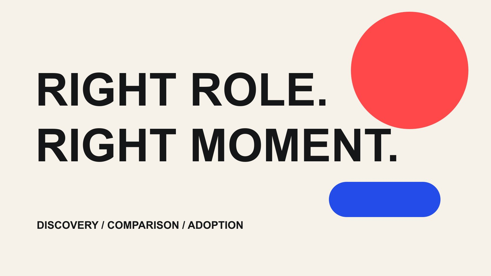

# 如何按客户决策阶段安排 Influencers 的内容角色

状态：本地审阅稿；正式发布日期待确认。

按发现问题、比较选择与开始使用三个客户任务安排达人内容，说明每种角色的证据、交接和衡量方式。

QuickKOL 编辑图形；不呈现真实账号指标或平台界面。

品牌安排 influencers 的角色，应先确定客户此刻需要完成的任务：理解一个问题、比较可行选择，还是开始使用已经购买的产品。按任务核对创作者的作品和相关受众，再定义内容、下一步与证据。三个任务可以在一次决策中往返发生，并不是每位顾客都会按固定漏斗移动；同一位达人也不必同时完成所有角色。

## 从客户要解决的任务开始

[IAB 2025 支出报告](https://www.iab.com/news/creator-economy-ad-spend-to-reach-37-billion-in-2025-growing-4x-faster-than-total-media-industry-according-to-iab/)的美国创作者广告研究中，品牌知名度和在线销售都出现在活动目标里，公告分别列出 43% 与 32%。这是 2025 年 11 月发布的特定研究结果，不是所有市场的目标分布，更不能据此给任何品牌分配预算。它提醒团队不要把创作者合作只理解为一种结果；实际分工仍需根据自己的客户任务制定。

发现阶段的观众可能还没给问题命名，比较阶段的人想理解不同方案的取舍，实施阶段的人需要完成使用步骤。但真实决策未必沿三个格子单向前进：已经购买的人会重新比较，看到教程的人也可能只是研究。本文把这些当作内容任务，而不是识别单个用户心理状态的模型。

先收集销售、客服、产品团队重复遇到的问题，再说明哪类问题适合由创作者解释。不要把内部部门名称直接当客户阶段，也不要为了填满框架而安排三位达人。一个明确的缺口足以开始；能解释为什么暂时不做其他内容，也是一种有价值的规划结果。

## 发现角色：让人理解问题与使用情境

发现型内容需要帮助观众理解“这和我有什么关系”，而不只是把品牌名放到画面里。家居品牌可能展示小空间里反复发生的收纳困难，软件品牌可能解释团队交接为什么容易丢失责任，公共服务供应商可能说明一项工作流程带来的具体负担。示例应该让目标人群识别任务，不夸大问题，也不暗示所有人都需要购买。

选人时看作品是否能把陌生概念讲清楚、是否尊重受众已有知识，以及是否能使用相关场景。幽默、视觉演示、采访和长文都可能完成这个工作，粉丝规模本身不能决定。[超越粉丝数的达人选择指南](/zh/blog/creator-selection-beyond-followers/#answer)可以帮助把作品能力、相关受众和合作条件分开核对。

给一个低摩擦、真实可完成的下一步，例如阅读说明、了解尺寸或查看完整演示。不要在定义不清时要求“提升认知并保证销售”。衡量可以记录内容是否被准确交付、目标解释是否成立，以及可获得的相关观看和后续行为；这些证据各有范围，不能把曝光直接改名为理解人数。需要理解证据时，可以设计适当的反馈或研究，而不是从观看次数推导。

## 比较角色：把选择条件放到台面上

比较内容应让读者知道在什么条件下某个选择成立，而不是把预设答案包装成评测。需要核对的字段可能是安装条件、兼容设备、维护方式、总费用和适用限制。对 B2B 服务，可以解释流程、接入要求和支持边界；没有必要假装所有产品都能用一个打分表排名。

让创作者提出观众真正会问的比较问题，并由品牌提供可核验的产品事实。明确样机版本、使用条件和哪些对比没有实际测试。不要将“品牌提供的规格”剪成“创作者亲测的结论”。若涉及竞争品牌，也应准确、适度，不能凭不完整体验作泛化贬损。

交付可以是一份场景对照、一段操作说明或有依据的评测内容。它的下一步应延续同一个问题，例如查看完整规格或预约适配讨论。衡量时先检查比较是否公平、关键限制是否保留，再看相关页面访问或咨询质量。低流量但能帮助采购者排除错误适配的内容，也可能有明确用途；它的价值不应只按娱乐内容的播放规模判断。

## 实施角色：让用户真正完成一个步骤

实施内容通常比产品发布更具体：第一次设置、清洁维护、交接账户、排除常见误解或使用一个附件。它可能服务现有用户，也可能帮助仍在比较的人理解实际要求。先写清适用版本和前提，再确定创作者是否能以足够慢、足够清楚的方式示范。

这里的风险常来自省略。省略设备条件、权限或关键安装步骤，会让视频看似流畅，却无法照做。用演示账户或合适的道具保护私人资料；对于需要专业资质或现场许可的工作，按实际项目条件安排，不把熟练的呈现当作资格证明。产品更新后，指定谁负责判断旧内容是否还准确。

下一步可以是下载配置表、进入帮助文档或联系支持。证据可以包括步骤完成检查、用户问题分类或适当的支持记录；不要未经设计就宣称视频减少了多少工单。将实施内容单独列为可维护资产，保留版本、链接、负责人和复核时间。它未必需要和发布广告使用相同的格式、时长或发布节奏，预算也应反映持续维护责任。

## 设计内容之间的交接

不同角色的内容应在问题上衔接，而不要求每个人按品牌设定的顺序观看。发现内容提出一个工作难题，比较内容解释选择条件，实施内容展示第一步；链接和标题要让观众清楚下一页能解决什么。不要把一个轻松的视频直接送到没有说明的销售表单，再把离开页面归为达人受众质量差。

品牌内部也需要交接。为每段内容准备事实来源、目标问题、版本、下一步、负责团队和需要保留的限制。销售与客服应知道创作者说了什么，也应能找到被引用的具体页面。发生页面失效、型号变化或服务政策调整时，有人能把问题反馈到内容负责人。

若用同一位创作者承担多个任务，分别约定每种交付和可用范围。若用多位创作者，不要求他们统一成完全相同的声音；统一的是产品事实、交接字段和必要边界。可把合作设计成相互补充的解释，而不是把每个人都变成同一个广告脚本的分发渠道。对品牌而言，一套清楚的内容索引比孤立保存几十个视频链接更容易长期使用。

## 把指标放在正确的决策层

每种角色都需要一个主要评价问题。发现内容可以先检查解释与相关接触，比较内容检查条件表达及后续询问，实施内容检查步骤可执行性与仍未解决的问题。不要把保存、观看、询价、订单混成同一个“互动结果”，也不要把三位创作者各自的触达简单相加成独立人数。

[Google Analytics 活动链接说明](https://support.google.com/analytics/answer/10917952?hl=en)支持用 UTM 参数识别带来流量的活动与创意。这类记录可以帮助保持来源一致，但不会单独证明内容造成了购买。即使一个表单来自带参数的链接，也仍需确认事件定义、去重、观察窗口和其他接触。[达人营销衡量指南](/zh/blog/creator-campaign-measurement/#answer)进一步说明了交付、受众反应和商业结果的不同层次。

把比较前提写在报告旁：内容格式、发布后时间、自然或付费分发，以及是否有可用的受众数据。同一个阶段并不保证所有作品都可公平横比。报告可以决定保留哪个解释、修复哪个页面或进一步调查哪项问题；缺少结论时写清下一步需要的证据，不临时更换指标使项目看起来成功。

## 把角色选择落实为可比较的范围方案

假设一家软件品牌已经有清楚的产品介绍，但试用者反复卡在管理员设置。一个方案是购买三条新的认知短视频，另一个方案是委托一段设置演示和一份配套清单。若真正的缺口是实施，两种方案不能只按视频数量比较；应看哪种能够解决已经确认的问题。这是工作选择的假设，不是某个真实品牌的测试结果。

还要检查不同交付的依赖：演示账户、产品负责人、字幕、页面和后续维护。创作者不应因为品牌没有准备账号而承担全部延期责任。若制作和账号发布分开购买，可优先解决解释资产，再决定是否需要另行分发；若受众发现是主要问题，则可能需要另一个范围，而不是对同一项目不断追加要求。

在报价比较中保留交付、发布、使用期限、修改和维护等字段。把未选方案及原因记下来，防止后续团队只看到“品牌砍掉了两条视频”，却不知道省下的范围被用于解决哪个问题。角色框架的作用是解释取舍，不是证明某个内容阶段天然比其他阶段更便宜或回报更高。

## 让真实性和复核责任贯穿所有角色

发现、比较和实施内容都可能包含商业关系。[FTC 背书问答](https://www.ftc.gov/business-guidance/resources/ftcs-endorsement-guides-what-people-are-asking)提醒美国广告中的背书与品牌关系需要适当处理；“教程”“专家访谈”或“真实体验”并不自动决定是否需要披露。为具体合作核对平台和适用地区要求，并在剪辑、翻译和再次使用时保留原来的事实与必要说明。

不要通过分工掩盖同一问题：比较视频不应被购买成肯定结论，实施视频不能省略关键条件来制造容易使用的印象，发现内容也不能借一个具名专家暗示不存在的认证。品牌负责提供产品证据，创作者负责诚实表达其实际贡献，审阅人负责记录修改理由；这比要求一个人承担所有结果更可执行。

复盘时将“角色选错”和“执行条件失败”分开。内容可能完成了任务，却被错误的页面或未准备好的支持流程阻断；也可能制作精良，但从一开始就回答了客户不关心的问题。保留问题、作品、接收路径和证据四者的联系。下一轮再根据具体缺口调整角色，而不是因为某一类达人暂时流行，就替换整个内容组合。

## 按客户任务选择内容角色

| 客户任务 | 内容交付 | 需要的证据 |

| --- | --- | --- |

| 理解问题 | 场景与概念解释 | 事实准确、场景相关、接触口径 |

| 比较选择 | 条件、取舍与限制 | 样机版本、测试范围、后续问题 |

| 开始使用 | 有前提的可执行步骤 | 步骤完成检查、版本和支持问题 |

三个任务可以往返发生，不是对个人购买意图的识别或转化保证。

## 确定角色前的五个问题

用答案决定范围，而不是用规模标签决定内容。

- [ ] 客户此刻缺少哪项理解或行动条件？

- [ ] 创作者有哪些与任务相符的完整作品？

- [ ] 下一步页面能否延续同一个问题？

- [ ] 现有证据能支持哪种结论？

- [ ] 谁负责产品改版后的内容复核？

## 研究日期与使用边界

资料核验于 2026 年 10 月 29 日。本文方法与表格为编辑建议，标明为假设的数字不是行业基准。平台条件可能变化，具名对象仅为公开研究入口，不代表实时排名、背书或已接受合作。稿件处于本地预览阶段，发布日期待正式发布前确认。

## 来源

- [IAB 2025 支出报告](https://www.iab.com/news/creator-economy-ad-spend-to-reach-37-billion-in-2025-growing-4x-faster-than-total-media-industry-according-to-iab/)

- [Google Analytics 活动链接说明](https://support.google.com/analytics/answer/10917952?hl=en)

- [FTC：背书指南问答](https://www.ftc.gov/business-guidance/resources/ftcs-endorsement-guides-what-people-are-asking)
