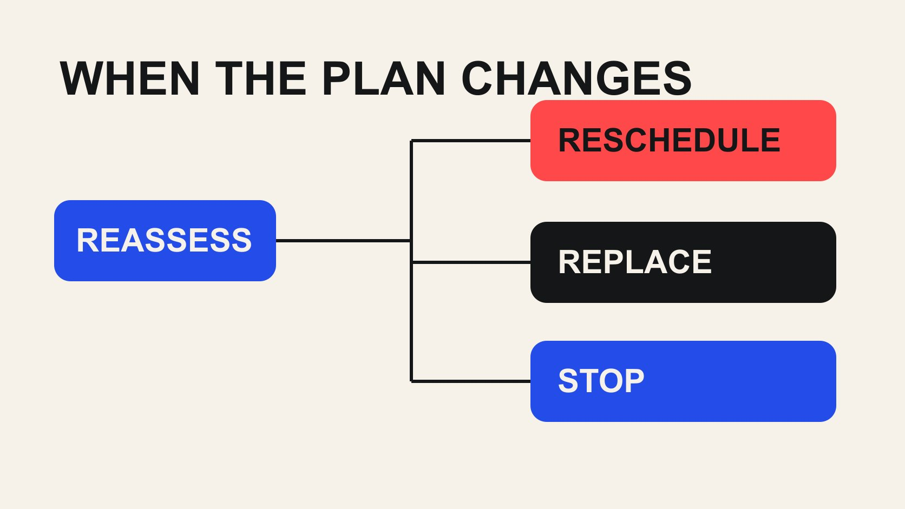

# 达人合作的连续性计划：延期、退出与替补怎么处理

状态：本地审阅稿；正式发布日期待确认。

在合作开始前准备延期、退出和替补路径，明确业务选择、创作者同意、文件交接与费用记录。

QuickKOL 编辑图形；不呈现真实账号指标或平台界面。

Influencers 合作的连续性计划，应在出现变动前说明谁接收消息、哪些条件需要重新决定，以及延期、缩小范围、替补或停止分别由谁确认。替补并不是把同一合同和原创意转发给另一个人；需要重新核对任务适配、同意、时间、费用和许可。保留事实与决定，减少临时压力下的误解。

## 先定义不能中断的业务任务

连续性不等于无论发生什么都必须按原日发布。先说明真正不能中断的任务：活动前解释报名方法、在产品开放后展示准确功能，或者在一段时期内提供客户问题的回答。不同任务有不同替代方式；把所有计划都写成“必须上线”，会让团队在变化发生时失去判断空间。

区分固定时点和可移动时点。展会现场无法简单移到下个月，普通教程却可能可以延后。还要区分创作者本人不可替代的专业经验，与可以通过其他已授权材料完成的解释工作。若主要价值来自个人观点，换人后就需要重新设计内容，而不是只把名字替换掉。

[达人项目风险记录指南](/zh/blog/creator-campaign-risk-register/#answer)可以帮助列出业务影响与负责人。只保留会改变决定的依赖，避免把各种极少发生的事件堆成没人维护的清单。一个可用计划应让接收变化的同事知道：什么仍可进行，什么必须暂缓，以及当前缺少哪一个决定。

## 约定怎样报告变化，不追问无关隐私

给创作者一个明确联系人，并说明哪些变化需要尽早通知：关键样品无法取得、档期变化、无法完成真实试用、拍摄条件改变或不愿继续参与。报告需要的是对任务的影响与可讨论选项，不是无关的个人证明。对健康或家庭变化，只收集安排合作真正需要的信息。

品牌也承担报告义务。产品延期、Brief 改动、审批人缺席或使用范围扩大，都可能改变创作者原先接受的条件。不要只有一方向另一方承诺“不准延期”，却把内部变化当成无需重新讨论的正常情况。记录通知时间，便于知道团队什么时候获得了哪些事实。

为不同紧急程度选择适当渠道，并保留可追溯确认。一个约定的项目邮箱或联系人通常比临时到多个私人账号追问更清楚。若消息尚未确认收到，不要把它写成“对方已同意”。重要决定回到双方可核对的记录里，减少口头讨论与排期表之间的不一致。

## 用有限选项重新决定范围和日期

出现变化后，先列已经完成、尚未完成和受影响的内容，再比较延期、缩小范围、改变形式、替补或停止。不要从“原日期不能变”直接跳到“找一个人顶上”。某些情况下，先发布已有的准确信息，再安排后续解释，比匆忙制作一条缺少真实体验的视频更合适。

每个选项写明业务影响、可行时间、额外输入、费用与批准人。数字尚未确认时标为待确认，不把内部预估当作创作者已接受的报价。若品牌希望保留原日期，就明确需要放弃哪些内容，不能让范围、质量、时间和费用四项都默认为不变。

让创作者确认自己能够履行的新安排，并给出需要答复的实际时点。不要把没有回复解释为接受更紧排期。将最后决定回传给媒体、销售、活动或其他接收团队，停止依据旧日期作出的承诺。一个被所有人理解的新计划，比仍写着原日期却已经失去依据的漂亮日历更有价值。

## 替补候选人需要重新获得适配证据

替补池可以预先研究公开作品，但不能把“候选人已找到”写成“随时可合作”。记录对方是否只是研究线索、已联系、愿意讨论，还是已经接受具体条件。除非另有明确安排，不要求未签约创作者无限保留档期，也不要向业务团队承诺名单里任何人都能立即开拍。

重新核对任务能力、产品体验、地区履约和时间。原创作者擅长深度教学，替补擅长快速展示，两者可能服务不同问题。[达人名单工作流](/zh/blog/creator-shortlist-workflow/#answer)可以帮助把替补理由写成作品证据，而不是只按相似粉丝量排序。受众规模不能替代对实际交付能力的判断。

给替补一份准确的新 Brief，说明哪些条件仍固定、哪些可以讨论。对方应有机会提出不适合或无法完成的部分。不要把原合作方的私人资料、未公开报价或未许可创意一起转发。替补是新的合作决定，提前研究可以减少寻找时间，却不能取消必要的同意与核对。

## 检查哪些素材和权限能够交接

原合作方已经完成的素材，不会因为项目换人就自动可交给替补继续加工。[美国版权局版权说明](https://www.copyright.gov/what-is-copyright/)提供原创表达与权利的基础背景；具体项目需要核对约定中的使用、编辑、转交和终止条件。付款、持有原片和某一版内容批准，不能被混成对所有后续处理的许可。

列出 Brief、品牌事实、产品文件、创作者原创脚本、试拍、成片和第三方素材，分别判断可以分享给谁。品牌自己拥有且允许使用的资料可以按需要交接；无法确认的部分先保留限制。若新创作者需要从头设计表达，应在工作范围与时间里承认这一点，而不是把它当成简单替换镜头。

[YouTube 品牌伙伴访问说明](https://support.google.com/youtube/answer/15672082?hl=en)也体现了数据共享与内容使用需要分别处理。账号或视频访问变化后，核对报告与推广安排，不共享账号密码，也不假定原创作者的授权会转给新合作。把需要撤销、保留、重新申请的事项交给明确负责人，避免替补完成了内容却仍无法正确发布。

## 把费用与已完成工作对应起来

费用处理应回到实际条款、完成范围和双方确认，而不是临时使用一个通用扣款比例。可能涉及已完成制作、不可退支出、取消安排、新增寄样、补拍与替补费用。这里提供的是记录方法，不是对任何项目付款责任的法律判断；需要时由适当负责人审阅。

把原预算、已承诺金额、已付金额、变化费用与待确认项目分开。若停止原合作，又增加替补，不能只在表里把名字替换，掩盖已经发生的成本。也不要未经核对就把原合作方全部费用视为可回收，或把剩余预算当作替补一定会接受的价格。

保留决定人、依据和通知状态，让财务知道哪笔费用对应哪个工作包。对创作者说明范围和支付安排的变化，避免内容团队与财务发出不同信息。清楚的费用记录既支持业务选择，也让后续复盘能够比较不同连续性方案的真实代价，而不是只看最后一张发票。

## 重新检查发布与关系说明

人员或形式变化后，重新检查实际文案、标签、产品版本和发布人。不要让旧合作方的推荐语与新创作者画面组合，形成对方从未表达的背书。若原计划是亲身试用，新合作方尚未试用，就需要改变安排，不能简单沿用原先的体验脚本。

[FTC 背书问答](https://www.ftc.gov/business-guidance/resources/ftcs-endorsement-guides-what-people-are-asking)在美国背景下解释背书与重要关系。它不能证明某个替补项目已经合规，但提醒团队：真实表达与关系说明都需要对应实际合作。其他市场另行核对。把商业披露、平台设置和素材版本一起交给发布负责人，而不是只通知“现在换了一个人”。

取消旧排程，核对媒体资产、报名页、销售材料和活动议程里是否仍有旧姓名或照片。只修改主项目表不保证下游同步完成。对外确需说明变化时，由获授权的人准备准确内容，不自行联系媒体、客户或其他人。项目内部需要的是明确分工，避免多个团队分别给出不同解释。

## 用桌面演练检验替代路径

假设一家 B2B 品牌计划在产品开放当天发布专家教程，受访者提前告知无法按期拍摄。团队先确认业务需要的是准确的入门说明，而非必须由该人士出镜；可比较延期访谈、由已准备好的品牌演示临时承接，或重新邀请其他专业创作者。这是虚构情景，不是客户案例。

逐个追问：谁决定？事实已经准备好吗？现有材料允许怎样使用？新创作者是否有时间真实了解产品？业务是否接受另一种形式？如果其中一项未知，记录询问对象与截止条件，不在演练里默认所有选项都可行。一次可解释的停止决定，也比表面维持原日期更有管理价值。

结束后检查哪些信息找不到、哪些权限不清楚，以及下一次应该提前准备什么。不要为了演练给所有创作者增加不必要义务。连续性计划的作用，是让变化发生时仍有合理选择，同时尊重真实工作、许可与双方承诺；它不应把任何人当作随时可互换的素材供应标签。

## 发生变化后的决定表

| 选项 | 先确认 | 必要交接 |

| --- | --- | --- |

| 延期 | 新日期仍服务业务且双方可行 | 新排期、依赖与通知 |

| 缩小或改形式 | 核心问题仍能准确回答 | 新范围、批准与费用 |

| 替补 | 重新核对适配、同意和时间 | 新 Brief、许可和执行状态 |

| 停止 | 按约定审阅完成工作与责任 | 文件、费用、访问与排程处理 |

每个选项都需要具体事实；不使用统一取消费用或默认替补承诺。

## 连续性准备清单

让下一位同事可以执行，而不是猜测。

- [ ] 说明不能中断的业务任务与可移动条件。

- [ ] 双方都有明确的变更报告联系人。

- [ ] 区分研究候选与已接受的替补。

- [ ] 核对素材、访问和许可的交接范围。

- [ ] 费用对应已完成工作与新承诺。

- [ ] 更新实际发布位置并保存决定。

## 研究日期与使用边界

资料核验于 2026 年 10 月 29 日。本文方法与表格为编辑建议，标明为假设的数字不是行业基准。平台条件可能变化，具名对象仅为公开研究入口，不代表实时排名、背书或已接受合作。稿件处于本地预览阶段，发布日期待正式发布前确认。

## 来源

- [美国版权局：What is Copyright?](https://www.copyright.gov/what-is-copyright/)

- [YouTube 品牌伙伴访问说明](https://support.google.com/youtube/answer/15672082?hl=en)

- [FTC：背书指南问答](https://www.ftc.gov/business-guidance/resources/ftcs-endorsement-guides-what-people-are-asking)
