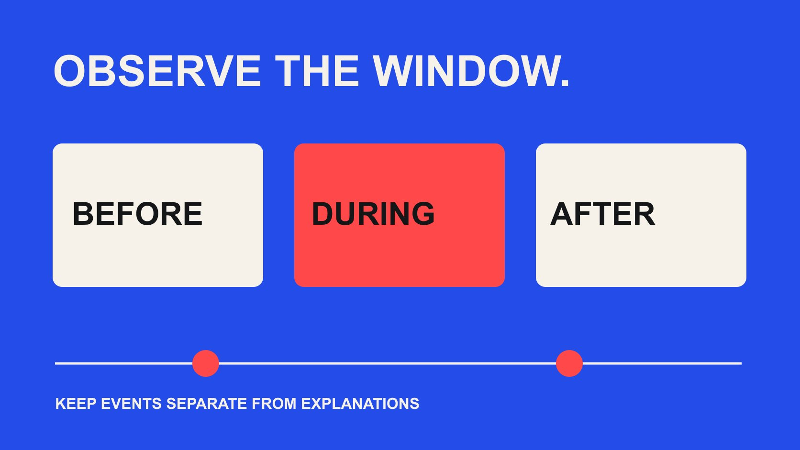

# Instagram 粉丝追踪如何服务 Campaign 观察与解释

状态：本地审阅稿；正式发布日期待确认。

把 Instagram 粉丝追踪放进活动前、中、后的观察记录，区分净变化、同期事件和能够支持的结论。

QuickKOL 编辑图形；不呈现真实账号指标或平台界面。

Instagram follower tracker 可以记录一个账号在指定窗口中的粉丝总量变化，但单靠两个总量无法判断新增了哪些人，更不能证明增长由某次达人合作造成。先确定观察问题、可用来源和统一窗口，再记录同期广告、内容、优惠与清理事件。报告应把可观察的净变化、尚未验证的解释和下一步调查分开。

## 先写清追踪要回答的问题

品牌常在活动结束后问“这位达人带来了多少粉丝”，但手头只有品牌账号的起止总量。两者并不对应：总量变化同时包含关注、取消关注和账号管理影响，也可能伴随多个传播渠道。先把问题改成能够被现有证据回答的形式，例如“这次合作发布前后，我们观察到的净变化是否不同，需要进一步检查什么？”

定义观察对象。是品牌主账号、地区账号，还是创作者账号？如果业务目标是让当地客户咨询，全球粉丝总量可能只是背景信号。观察到增长也不能直接说明新增人群的地区、兴趣或购买可能性；这些是需要其他合适证据回答的问题。不要为了报表好看，把任何上升都称为合作成果。

[Instagram 粉丝变化记录指南](/zh/blog/instagram-followers-check-change-log/#answer)可以帮助整理快照，而本篇重点在于如何将记录放进 Campaign 时间背景。开始前写一句决定用途：保留某种内容、检查投放影响，或者补充受众证据。若无论结果如何团队都不会采取行动，可以降低采集频率，避免把例行截图当成效果评估本身。

## 在看到结果之前划定观察窗口

先选固定时区、起止时间和采集节奏，再开始看曲线。可用相同长度的活动前、活动期和活动后窗口作为编辑观察方法，但不规定所有项目都必须观察七天。新品发布、单条视频和连续多周的系列，具有不同节奏；窗口应服务于实际问题，并写明为何这样选择。

保留发布时间，而不只记日期。如果前窗口在周一早晨结束，活动期却到周日深夜结束，两段长度和日内位置可能不一致。跨市场项目还要区分账号报告时区、创作者发帖时区与团队工作时区。不要在看到增长峰值后，把活动起点向前移动到最低点，再把终点放到最高点。

延后出现的变化可以继续观察，但应补充新窗口并保留原计划，而不是覆盖旧定义。若错过原始快照，明确缺口与可用的替代记录。活动前的两个窗口也可帮助发现波动，但少量历史点并不建立稳定基线。时间可比只能减少一些解释困难，不能自动消除季节性、广告或其他内容的影响。

## 给每个快照保留来源与精度

最少记录账号标识、实际观测时间、显示数值、来源、采集人和备注。公开页面可能显示取整数，创作者提供的截图可能对应另一时刻，原生报告也可能使用不同字段。把它们混在一条高精度曲线里，会制造实际不存在的可比性。显示“10K”不能被当作精确的 10,000，再推算个位数变化。

[Meta 官方 API 文档](https://www.postman.com/meta/instagram/documentation/6yqw8pt/instagram-api)提供专业账号相关的访问路线与权限说明。使用某个集成前，核对具体产品、账号类型、获授权对象和当前可用字段；不能从一个 API 路线的要求推断所有路线都一样，也不能承诺任何公开账号都可获得历史私有数据。第三方工具的页面名称不等于官方核验已经完成。

缺失快照标记为缺失，不能补成零。若来源在活动中途变化，写明断点，尽可能在重叠时刻比较口径，再决定是否能够合并。原始证据与整理表分开保存，保留适当的访问范围。追踪任务需要的是可解释的记录，不需要创作者交出账号密码，也不应采集与项目判断无关的个人信息。

## 在曲线旁边建立同期事件日志

记录可能影响关注行为的已知事件：品牌自己的内容、其他达人发布、付费投放、赠品活动、产品缺货、媒体报道、服务事故以及账号管理。给每条事件标注开始时间、结束时间、地区和信息来源。只记录知道发生的事；不确定的解释进入待调查栏，不画成已证实的增长驱动。

[Meta 垃圾粉丝管理公告](https://about.fb.com/news/2024/06/protecting-athletes-and-fans-on-our-apps-during-major-sporting-events-this-summer/)在 2024 年介绍过批量移除垃圾粉丝的功能。这说明账号管理可能与总量变化有关，却不能证明某个账号这次下跌就源于清理。相同原则适用于广告：知道投放同时存在，不代表能够从总量里拆出广告与达人的独立贡献。事件日志提供背景，而不是自动分配功劳。

让相关团队在项目期间补充日志，比月底凭记忆回填更可靠。一次小范围优惠可能没有进入主项目表，但确实改变了进入账号的动机；一个落地页故障也可能影响站外结果。保留这些背景不会让报告失去价值，而是帮助团队避免把可修复的其他问题，全归因于一位创作者的表达。

## 把净变化算对，再限制解释

下面是假设算例：起点显示精确总量 10,000，终点为 10,120，则窗口净变化为 120，相对起点变化为 1.2%。这不表示期间只有 120 人关注，也不说明所有新增关注仍然留下。若同一窗口存在关注与取消关注，两个总量只保留相互抵消后的结果。

再假设前一个相同长度窗口净增 90。活动窗口比它多出 30，但这 30 只是两个观测差值，不是已经识别的达人增量。没有合理的因果识别设计，就不能把差额乘以任意粉丝价值来计算回报。这些数字仅用于解释算术，不是账号案例、增长目标或行业基准。

百分比要写清分母。相同的净增，对不同起点规模意味着不同相对变化；较小账号的比例也可能更易波动。若记录经过取整，不报告超出来源精度的小数位。把缺失、时刻不一致或来源变化放在数字旁边，而不是埋在附录里。让读者一眼看到“观察到了什么”以及“这个观察不足以说明什么”。

## 遇到口径断点时如何交接

假设活动开始时只保存了公开页面上的“10K”，三天后才取得精确的原生总量。不要把早期取整数与后来的精确值相减，制造一个看似完整的活动增长数字。报告可以分别说明：初始观察只有取整显示；可复核的精确序列从第三天开始。这个限制来自记录条件，不应让创作者承担补造历史数据的任务。

给业务负责人两个选择：保留缺口并缩小本次结论，或者在下一次合作前先准备一致来源与固定时刻。若存在当时保存的其他授权证据，可以核对是否对应同一账号、同一时间和同一字段，再决定能否使用。新找到的文件不因为“数字更细”就自动更可靠。

交接时列出哪些比较仍然成立、哪些不能计算，以及改进采集的负责人。团队仍可查看作品质量、合适的原生报告和站外行动，不需要因为一条粉丝序列不完整，就把整个项目宣布为失败或成功。

## 不要用总量替代受众与行动证据

粉丝总量追踪不能给出新增关注者名单，也不能可靠推导这批人的国家或购买行为。即使另有账号整体受众分布，也不应把整体比例直接乘到本次净增上，宣称某地区新粉丝已经确定。整体存量与期间新进入人群，是两个不同对象。

如果项目需要网站行动，提前测试活动链接、接收页面与事件。[Google Analytics 活动链接说明](https://support.google.com/analytics/answer/10917952?hl=en)可以帮助区分活动来源与创意标识；这些标识支持来源分析，仍不单独证明增量。[达人转化追踪指南](/zh/blog/track-influencer-conversions-ga4/#answer)介绍了把站外记录接入项目的方法。粉丝净变化、带参数访问和有效咨询可以并列报告，但不要当作可以逐级一一对应的人群漏斗。

缺少私有数据时，说明现有证据能支持的下一步。例如先确认链接是否被使用、受众问题是否集中在配送地区，或者请合作方提供允许共享的原生报告。不要用没有依据的受众估计填满表格。一个明确标为未知的字段，比根据语言、头像或零散评论猜测个人国家，更适合进入正式决策记录。

## 用一页观察结论支持下一次决定

结案时保留问题、窗口、来源、净变化、同期事件、限制和下一动作。把“活动期净增 120”写作观察，把“可能与合作有关”写作尚未验证的解释。如果业务确实需要估计因果贡献，应另行规划适合条件的评估设计，不在已有快照上补一个看似科学的归因比例。

不要因为某位达人发布之后品牌总量下降，就直接要求对方承担增长责任。先检查双方实际约定的是内容、发布、访问证据还是明确的结果义务，再讨论下一次调整。总量可能与创作者内容产生相反方向的变化；公平复盘需要看到作品、受众回应与其他活动背景，而不是只用一条账号曲线评判个人。

下一动作应足够具体，例如保留同一采集口径再观察一个窗口、修正网站接收问题，或者在下一次合作前增加许可范围内的报告要求。交接原始证据的位置与负责人，让另一位同事能够复核。追踪器的真正用途，是帮助团队减少不可靠的解释，并知道下一次需要准备哪种证据。

## 观察记录的最少字段

| 字段 | 记录方式 | 避免的误读 |

| --- | --- | --- |

| 账号与时刻 | 标识、时区与实际采集时间 | 把不同时间当作同一快照 |

| 来源与精度 | 原生、截图或公开取整值 | 从 10K 推算个位数变化 |

| 窗口与净变化 | 固定边界、起止值、差额 | 把差额称为新增人数或因果增量 |

| 同期事件 | 已知事实、时间与证据 | 把时间相邻当作原因已证实 |

| 下一决定 | 负责人、行动与补充证据 | 为了报表完整而补造解释 |

这是观察框架；不能替代因果评估，也不保证任何来源都提供所有字段。

## 发布前准备观察，结案时限制解释

每项勾选都应能对应记录或实际测试。

- [ ] 确定账号、问题、窗口和时区。

- [ ] 核对采集来源、可用权限与显示精度。

- [ ] 将缺失、换源和取整保留在记录中。

- [ ] 请相关团队维护同期事件日志。

- [ ] 把净变化、受众证据和站外行动分别说明。

- [ ] 交付有限结论、原始证据和下一动作。

## 研究日期与使用边界

资料核验于 2026 年 10 月 29 日。本文方法与表格为编辑建议，标明为假设的数字不是行业基准。平台条件可能变化，具名对象仅为公开研究入口，不代表实时排名、背书或已接受合作。稿件处于本地预览阶段，发布日期待正式发布前确认。

## 来源

- [Meta：官方 Instagram API 集合](https://www.postman.com/meta/instagram/documentation/6yqw8pt/instagram-api)

- [Meta 垃圾粉丝管理公告](https://about.fb.com/news/2024/06/protecting-athletes-and-fans-on-our-apps-during-major-sporting-events-this-summer/)

- [Google Analytics 活动链接说明](https://support.google.com/analytics/answer/10917952?hl=en)
