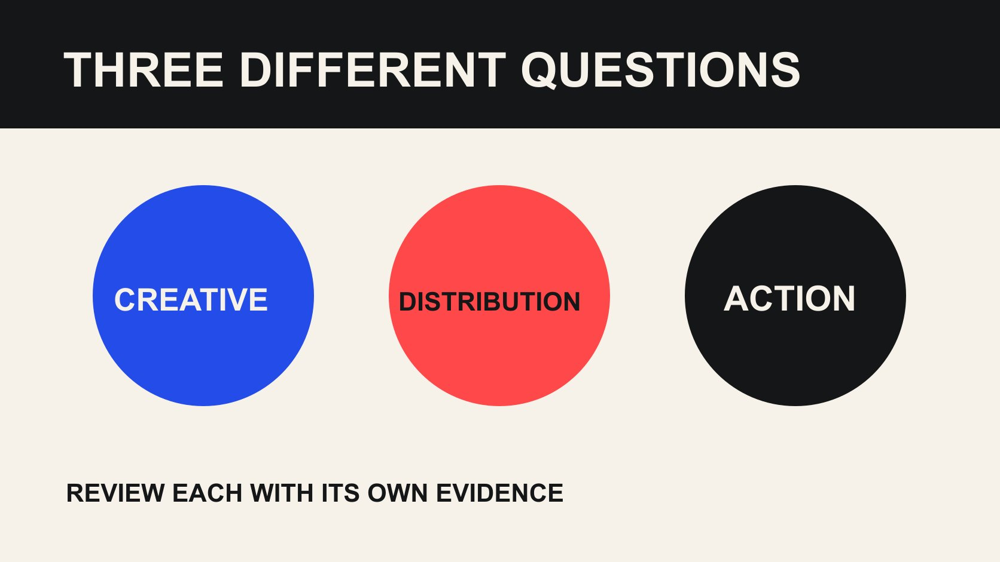

# TikTok Analytics 复盘：给创意、分发和行动不同窗口

状态：本地审阅稿；正式发布日期待确认。

把 TikTok 内容复盘拆成表达是否清楚、分发发生了什么和业务行动能否验证，避免用一个数字回答所有问题。

QuickKOL 编辑图形；不呈现真实账号指标或平台界面。

TikTok analytics 应分别回答三个问题：作品有没有准确完成内容任务，平台与付费活动带来了怎样的可观察分发，以及哪些站外行动能够被当前记录支持。先固定版本、窗口、来源和付费状态，再作比较。观看、评论和访问不是可直接相加的同一种结果，也不能单独证明销售增量。

## 把复盘问题拆开，避免一个分数包办

项目结案常把内容、分发和商业结果压成一个“表现好不好”。但开头不清楚、初期分发有限、链接失效和产品缺货，是不同问题，需要不同负责人。先写每个内容任务：解释一个操作、回答一个疑虑、展示使用情景，或者邀请合适人群了解更多，再选择对应观察。

创意复盘可以检查实际作品有没有兑现 Brief，观众是否提出相同的未解问题，以及重要事实是否被误读。分发复盘记录可用的播放、时间、来源与付费背景。站外复盘检查接收页面和事件。三者相关，却不应在证据不足时被自动串成已经证明的漏斗。

[达人合作衡量指南](/zh/blog/creator-campaign-measurement/#answer)可以帮助把问题与负责人对应。不要先导出所有指标，再逐一寻找听起来合理的解释。一个有用的报告应让团队知道下一次改什么，以及需要谁参与；如果结果只有一个综合分数，往往仍无法区分应该改脚本、投放、网站还是产品安排。

## 建立版本、发布时刻与观察窗口

记录具体视频、创作者账号、内容版本、实际发布时间、时区和观察截止。删除后重发、修改说明、增加付费支持或更换落地页，都可能改变解释。不要把不同版本的截图放在一起，像它们描述同一条连续记录。原始证据的位置也应保留，便于核对。

可以设计早期创意观察和较晚业务观察，但天数由项目实际情况决定，不给所有 TikTok 内容规定统一“最佳复盘时间”。跨视频比较时说明采用同样发布年龄，还是同一日历期间。两种窗口回答不同问题，不能用已经积累很久的视频总量去评判刚发布作品的同阶段表现。

若某项数据需要时间处理，标记临时值和下一次检查日期，不随意补齐。快照缺失就写缺失，不能根据今天总量推算当时数值。窗口提前约定有助于减少选择性汇报，但仍不能消除主题、分发和受众条件差异；这些限制应随结果一同交接。

## 先看表达完成度，再读结果

用 Brief 检查实际视频：主要问题是否清楚、产品是否准确出现、演示步骤能否理解、限制与关系说明是否保留。这个检查可以在没有全部分析数据时进行，但不能代替观众行为证据。编辑判断应清楚标为判断，不包装成平台给出的质量评分。

把观察写到具体时刻或句子。例如，“观众在评论中反复问安装前提”比“内容不够吸引”更容易执行。然后回看前提是否说清楚，是否因为裁切、字幕或过快演示而丢失。若内容本身准确，但问题仍反复出现，可以考虑补充说明，而不一定推翻整条作品。

[TikTok 互动口径指南](/zh/blog/tiktok-engagement-rate-calculator-by-views/#answer)适合进一步检查动作与分母。单一互动率不能自动解释开头、节奏或可信度，尤其当动作定义不一致时。不要把一个较低比例直接变成创作者能力不足的判断。先确定可观察的问题，再设计下一版的具体改动与需要收集的证据。

## 把评论作为有边界的问题样本

[TikTok 评论洞察说明](https://support.tiktok.com/en/using-tiktok/growing-your-audience/comment-insights-on-tiktok)介绍了评论分析与 AI 辅助分类。它可以帮助整理可见讨论，但分类结果不等于所有观看者的意见调查。没有评论的人、未显示的内容和不同筛选条件，都可能影响样本。不能把“十条里有六条提到价格”写成“60% 受众认为贵”。

给评论研究记录采样时间、排序或筛选方式、数量、语言与排除规则。去除明显无关内容时保留理由，不只留下支持结论的评论。若借助 AI 归类，抽查原文与分类，尤其注意反讽、方言和上下文。不要从一句评论推断个人年龄、国家或购买资格。

将问题分成可修复类型：事实缺失、操作不清、服务限制、主观偏好或超出本次范围。把对应负责人写出来。样本可以发现值得回答的问题，却不适合凭空估计市场占比。若问题需要代表性研究，另行安排合适方法，不把评论标签数当作完整需求预测。

## 区分自然分发、付费支持与观察限制

[TikTok 推荐机制说明](https://support.tiktok.com/en/using-tiktok/exploring-videos/how-tiktok-recommends-content)介绍了多种推荐信号和个性化条件。它不能为某条视频提供事后确定的分发原因。观看较低可能有多种背景，不能仅凭结果就宣布账号被限流，或认定某个创作者被平台惩罚。把无法证实的解释保留为未知。

记录是否有付费支持、开始时间、目标与可用报告来源。[TikTok 品牌伙伴标签说明](https://ads.tiktok.com/help/article/about-the-brand-partner-tag-in-content-disclosure-settings?lang=en)涉及合作标签、报告与广告授权相关安排；实际共享与设置仍需核对。拿到某条视频的数据访问，不等于所有历史内容和全部指标都可获得，也不替代双方对内容用途的约定。

不要把自然和付费报告里可能重叠的观看直接相加成独立人数。先检查对象、字段和去重定义；无法确认就分栏显示。媒体增加支持后，后续观察应注明状态变化，不能继续称作纯自然表现。内容是否值得保留与投放是否达到目标，可以有不同结论，不必用一个标签同时概括。

## 站外行动先检查接收与标识

若目标包括网站访问、预约或演示申请，发布前测试链接、移动端页面和事件记录。[Google Analytics 活动链接说明](https://support.google.com/analytics/answer/10917952?hl=en)提供活动来源与创意标识的参数方法。这些标识帮助解释访问来自哪个已标记入口，但不单独证明创作者导致了新增购买。

记录实际链接放在哪里、是否可用，以及跳转或分享是否改变参数。公开观看与站外会话不是同一单位，部分观看者可能通过其他路径访问，也可能根本没有点击。不能把缺失标识的访问自动归到创作者，更不能把两份报告里的总数强行对成一条逐人漏斗。

当行动很少时，检查页面是否服务正确市场、表单是否可完成、优惠是否仍有效，以及咨询标准是否清楚。这些是需要验证的可能问题，不是默认原因。把网站、媒体和内容负责人的检查分开，避免最后只要求创作者“提高转化”。报告应指出当前记录能支持哪种行动结论，以及仍缺什么证据。

## 用假设情景练习有限解释

假设两条产品解释视频的观察窗口相同，甲有 20,000 次观看，乙有 8,000 次。甲获得付费支持，乙没有；乙的可见评论中反复出现一个已经被视频解释过的问题。不能仅按观看排序认定甲创意更好，也不能仅凭乙的评论宣布受众普遍不理解。这些是假设数字，不是平台数据或行业目标。

先核对两份报告的对象和付费状态，再回看乙的问题是否因字幕、画面或措辞而不易找到。若能定位表达缺口，下一版可以只改这项，并保留其他条件的记录。若找不到证据，继续调查，不为了完成复盘而选择一个确定原因。

甲也需要单独检查媒体目标、内容准确度和站外接收。可能出现“表达完成任务、投放结果仍待判断”的结论。把每项结论对应证据与负责人，不强行选一个总冠军。这样的练习可以帮助团队在真实项目里，把数字变化转成可执行检查，而不是把复杂条件压成个人好坏。

## 让报告以一个明确实验或修复结束

下一步写成动作：补充安装前提、改正字幕、测试接收页面、确认共享条件，或在下一合作前统一报告窗口。每项动作保留负责人、完成条件和后续观察。不要把“继续优化”当作完整交接，也不要给没有证据的变化承诺固定提升比例。

保留原始报告、采样规则、作品版本和关键限制，方便下一位同事复查。若某项数据以后不再可获得，更新状态；若产品变化使旧说明失效，检查仍在使用的内容。复盘的范围应包括这些实际运营条件，而不只是发布后一张指标截图。

最后说明哪些建议来自编辑判断，哪些来自平台文档或观察。没有获得可靠的 TikTok 通用成功基准时，不填一个看似权威的标准值。好的分析让团队清楚下一次要怎样学习，并知道什么仍未被证实；它不要求所有项目都被包装成成功案例。

## 三类问题，三种记录

| 复盘层 | 记录 | 下一动作示例 |

| --- | --- | --- |

| 创意 | Brief、版本、具体表达与问题 | 补充缺失前提 |

| 分发 | 窗口、来源、自然与付费状态 | 核对媒体设置与可比条件 |

| 评论 | 样本、排序、时间和分类核验 | 回答反复出现的问题 |

| 站外行动 | 链接、接收页、事件与限定 | 修复表单或明确咨询条件 |

各层可以并列描述，不能在没有适当证据时连接成因果漏斗。

## TikTok 复盘交接

每个结论都应回答一个具体问题。

- [ ] 明确作品任务与版本。

- [ ] 保留观察窗口、时区与付费变化。

- [ ] 抽查评论分类并说明样本限制。

- [ ] 核对数据访问与素材使用的不同条件。

- [ ] 测试站外入口与事件。

- [ ] 交付一个有负责人和证据计划的下一动作。

## 研究日期与使用边界

资料核验于 2026 年 10 月 29 日。本文方法与表格为编辑建议，标明为假设的数字不是行业基准。平台条件可能变化，具名对象仅为公开研究入口，不代表实时排名、背书或已接受合作。稿件处于本地预览阶段，发布日期待正式发布前确认。

## 来源

- [TikTok：Comment insights](https://support.tiktok.com/en/using-tiktok/growing-your-audience/comment-insights-on-tiktok)

- [TikTok：How TikTok recommends content](https://support.tiktok.com/en/using-tiktok/exploring-videos/how-tiktok-recommends-content)

- [TikTok：Brand Partner tag（2026年4月）](https://ads.tiktok.com/help/article/about-the-brand-partner-tag-in-content-disclosure-settings?lang=en)

- [Google Analytics 活动链接说明](https://support.google.com/analytics/answer/10917952?hl=en)
