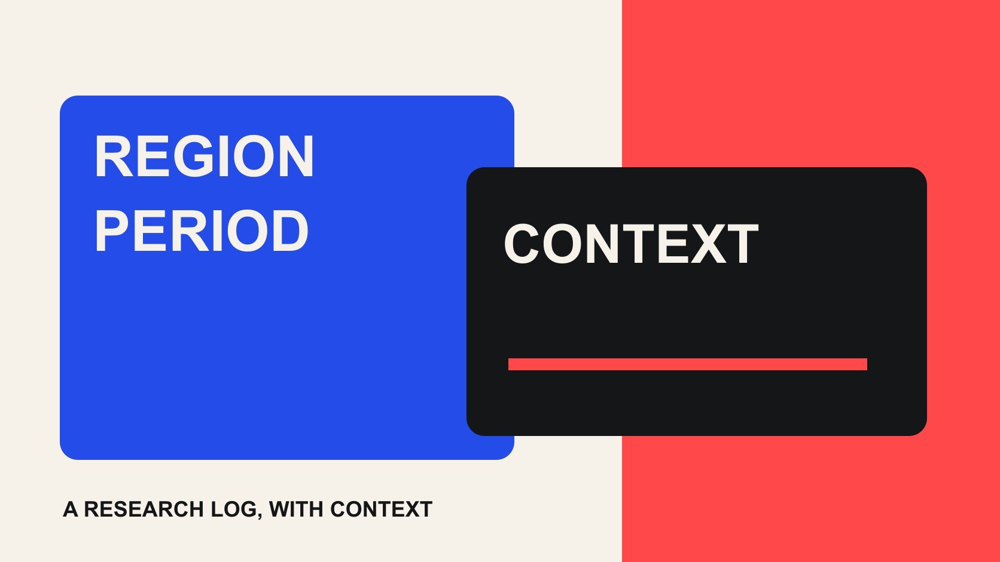

# TikTok Trends: Build a Regional Research Log for Brands

Status: local review draft; confirm the publication date before release.

Treat TikTok trends as dated, regional research signals. Preserve the sample and context before deciding whether a pattern belongs in a brand brief.

QuickKOL editorial graphic; not actual account metrics or a platform interface.

Research TikTok trends by fixing the market, observation window and relevant product question first. Use official discovery resources and public video examples to understand the context. A popular topic is a lead for investigation, not evidence that an audience wants your brand or that a sound is cleared for commercial use. Record the observation time, filters, examples and unknowns so another person can review the decision.

## Define the market before reading the trend

A claim that everyone on TikTok is doing something can combine countries, languages and dates that have little to do with the brand’s audience. Start with the selling or service market, content language, audience question and decision the research should change. A local venue, global software company and tourism organization may need entirely different observations even when they encounter the same hashtag.

The [TikTok Trends instructions](https://ads.tiktok.com/resources/help/article/how-to-use-trends?lang=en-GB) describe industry and time filters alongside hashtag analysis. Available fields can change, so retain the filters the interface actually provides. Do not fill a missing country or dimension from an old tutorial and label it verified. A topic shown on a US page does not establish the same use or meaning among Australian viewers.

Separate the retrieval date from the reporting window. A rolling thirty-day view opened today is not the same period as a rolling thirty-day view opened a week ago. Keep any displayed time zone and visible window with the record; if the interface does not identify a time zone, leave it unknown. A bounded question gives the later sample a useful comparison frame and makes it easier to explain why an apparently popular pattern was rejected.

## Use an official discovery route as the starting point

The [TikTok Creative Center overview](https://ads.tiktok.com/help/article/creative-center?lang=en) positions the resource around creative inspiration, advertising examples and trends. It is a starting point for studying a pattern, not a promise that any brand can reproduce an outcome. Record the feature used, search terms, retained filters, retrieval date and displayed category. When a value is available, preserve its label and unit rather than converting it into an invented popularity score.

Keep modules distinct. An advertising example, a hashtag content count and a video encountered in a personal feed answer different questions. An ad library also does not reveal all the advertiser’s budget, targeting and commercial conditions. If selection methodology is not explained, describe an item as a platform-presented example rather than the market’s most effective advertisement.

Give each observation a stable identifier linked to the original page and a short explanation. A screenshot without its context is difficult to reuse. The next reader should understand what was visible, which conditions matched, which fields were unavailable and why the item deserved further attention. The [TikTok topic discovery guide](/blog/tiktok-finder-topic-to-creator/#answer) develops the next step of finding individual creators. Discovering a pattern and qualifying a person for a partnership remain separate jobs.

## Inspect examples for the mechanism, not just the label

A hashtag may contain tutorials, jokes, criticism, product recommendations and unrelated tagging. Classify what each example is doing before asking whether the brand can contribute without changing its meaning. A sound may carry a joke or controversy that the hashtag alone does not reveal. Reading only the label can place the brand in the wrong conversation.

The [TikTok recommendation explanation](https://support.tiktok.com/en/using-tiktok/exploring-videos/how-tiktok-recommends-content) describes personalized signals in content selection. Your own For You feed therefore is not a representative sample of everybody in a country. Use it to discover leads, then inspect explicit searches, different creators and official resources. The result remains a limited convenience sample, not a precise estimate of regional interest.

Retain the creator, public video link, visible publishing-date status, content task, key expression and possible commercial restrictions. Do not select only high-view examples that support the original idea; include examples that fail to explain the product or are plainly irrelevant. When humor, identity context or local language is uncertain, ask someone familiar with that market to review the interpretation. Machine translation alone should not decide whether participation is appropriate. Study the mechanism and its boundaries rather than copying the original creator’s complete script.

## Check commercial use separately from popularity

A widely used sound is not necessarily available to a brand in every market, account type or advertisement. The [TikTok Commercial Music Library guide](https://ads.tiktok.com/resources/help/article/how-to-use-the-commercial-music-library?lang=en-GB) describes checking music for the campaign region and relevant placements. Preserve the selected track, territory and intended use. Being selectable somewhere on TikTok does not summarize permission for cross-platform edits or an extended advertising term.

Separate the content structure from the particular material. A comparison opening, object transition or question format may be expressed with original footage and appropriately cleared sound. Following a pattern does not require copying another person’s images, performance or complete recording. If the original creator is relevant, discuss a specific production, publication and usage scope through an appropriate public business route.

Check whether the subject fits the brand, industry and intended age group. Treat context, permissions and platform commercial conditions as necessary gates rather than factors that a high popularity score can cancel out. The [brand safety review guide](/blog/verify-creator-brand-safety/#answer) can help organize questions that need escalation. An unknown right or sensitive interpretation should not be labeled low risk merely because the team expects to publish quickly.

## Select patterns that can answer a real brand question

Write one sentence explaining the brand’s contribution: which action becomes clearer, which question gets answered, or which use condition becomes easier to understand? If removing the popular sound and hashtag leaves no useful information, the idea may offer participation without a content task. Light entertainment can still be appropriate, but the team should know why it deserves resources.

Test production feasibility next. Can the available creator deliver the expression naturally? Is the product ready? Can the factual statement be checked and the review completed while the context remains useful? A complex industrial installation may not suit a joke that expires the same afternoon. A professional service might borrow a question structure without copying a mass-entertainment performance.

Allow three explicit decisions: continue research, run a small verification, or do not participate. Time already spent collecting examples is not a reason to publish. Retaining rejection reasons reduces repeated searches and helps explain why a highly visible pattern did not enter the brief. The selection record should preserve evidence and unknowns instead of assigning every trend an undefined overall score. A clear rejection can be a useful research result when it prevents a poorly matched commission.

## Keep sample arithmetic within its actual scope

Suppose a team manually inspects twelve public videos under one regional and time-filter setting: five tutorials, four entertainment examples and three other expressions. Those counts describe the selected videos. They do not show that 42% of people in the market prefer tutorials. Discovery route, ranking, researcher judgment and unseen material can all affect the result.

If six examples appear relevant to a product category, that still does not qualify six creators for a partnership. Work suitability, public identity, audience evidence, timing and permissions require separate checks. Give content relevance and procurement readiness different states so a forwarded research sheet does not become an apparently approved roster.

A second reviewer can recode a small subset to discuss whether tutorial or product relevance means the same thing to both people. That can expose ambiguous rules; it does not establish a universal reliability rate. A defensible market estimate would require a separate sampling design. Ordinary trend research should not borrow statistical language to inflate its conclusions. For this decision, a few well-explained examples and counterexamples may be more useful than a polished percentage. Keep the original sample size visible wherever the observation is reused.

## Hand over a usable creative question

The creator handoff should include the audience question, market, useful expressive mechanism, original examples, brand facts, elements that must not be copied and questions that need the creator’s judgment. References are not shot-for-shot instructions. Leave room for the creator to explain what would feel natural and what would undermine the existing voice. Do not request a fixed view outcome because a recognizable trend is involved.

Add a review time and expiry conditions to the research record: changed context, unsuitable music permissions, a revised product or an approval process that misses the useful window. After expiry, the team can stop or turn the remaining audience question into evergreen material. That preserves learning without publishing a pattern whose purpose has disappeared.

This article is a research method, not a live October 2026 popularity ranking. The dynamic official resource did not provide a complete regional ranking that could be reliably preserved during this review, so no current rank or popularity value is asserted. In actual research, save what is visible on the observation date and distinguish platform facts, manual examples and editorial judgment. The next deliverable is one worthwhile question expressed as a brief, rather than an advertisement for every trend encountered.

## A hypothetical handoff with a stopping condition

Consider a hypothetical equipment brand serving small Australian offices. The team studies a fixed-camera before-and-after format to see whether it can explain a change in desk space. It is not trying to prove that the format ranks highly in Australia. The researcher preserves regional and time conditions, then separates a visible connection-and-storage demonstration from an unsupported promise about improved productivity.

The creator receives practical questions: which actions need close-ups, which storage dimensions must be checked, and which background documents should be removed to protect personal information? Ask for an original structure, not a reenactment of a reference video. The proposed next action is reading the product dimensions. No view or order outcome is promised, and this is an illustrative scenario rather than a QuickKOL client case.

Set stopping conditions before filming. Pause the trend-specific version if the sample arrives late, dimensions fail, music permissions do not fit, or review cannot finish within the agreed window. The underlying space-explanation task may still work with original sound as evergreen content. Record who changed the plan and why. This makes trend research an inspectable input instead of an obligation for every team to accommodate a moving popularity assumption.

## Five fields for the research record

| Field | Retain | Misreading prevented |

| --- | --- | --- |

| Market and window | Region, language, filters and date | One region represents the world |

| Original observation | Page, units and visible definitions | Metrics from different modules are equivalent |

| Examples | Links, tasks, context and counterexamples | A personal feed represents all users |

| Commercial conditions | Music, rights and category constraints | Popularity means permission |

| Next decision | Continue, verify, stop and expiry | Research creates a duty to publish |

Editorial research framework; sample counts describe only the inspected work.

## Before a trend enters the brief

Leave unsupported fields unknown; popularity does not cancel a missing condition.

- [ ] Specify the market, window and decision.

- [ ] Keep official discovery and public-example links.

- [ ] Review local meaning and commercial music conditions.

- [ ] Separate content relevance from creator readiness.

- [ ] Set expiry conditions and a review time.

## Research date and limitations

Sources reviewed October 29, 2026. Methods and tables are editorial recommendations; hypothetical numbers are not industry benchmarks. Platform conditions can change. Named references are research entry points, not live rankings, endorsements or confirmed partnerships. This draft is in local preview; confirm its publication date before release.

## Sources

- [TikTok: How to Use Trends (updated July 2026)](https://ads.tiktok.com/resources/help/article/how-to-use-trends?lang=en-GB)

- [TikTok: About Creative Center](https://ads.tiktok.com/help/article/creative-center?lang=en)

- [TikTok: How TikTok recommends content](https://support.tiktok.com/en/using-tiktok/exploring-videos/how-tiktok-recommends-content)

- [TikTok: Commercial Music Library (July 2026)](https://ads.tiktok.com/resources/help/article/how-to-use-the-commercial-music-library?lang=en-GB)
